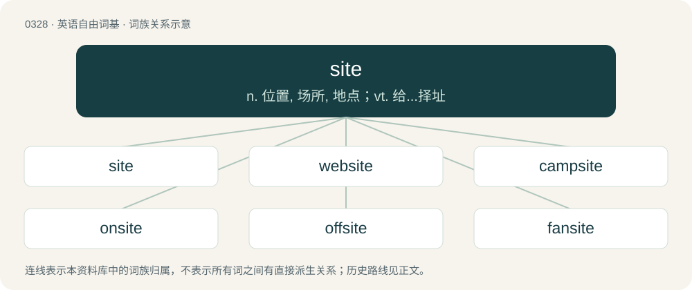

# 0375 · site — n. 位置, 场所, 地点；vt. 给...择址

[总目录](../00_总目录_按常用程度.md)

**类型**：英语自由词基　｜　**来源语言**：见词源记录

## 核心含义与来源

- 核心含义：n. 位置, 场所, 地点；vt. 给...择址
- 英文含义：The place where anything is fixed; situation; local position
- 词形：site

**来源记录 1**（名词；The place where anything is fixed; situation; local position）

From Middle English site, from Anglo-Norman site, from Latin situs (“position, place, site”), from sinere (“to put, lay, set down, usually let, suffer, permit”). Doublet of sitio and situs.

## 词族图

## 单词速览（常用到不常用）

| 单词 | 音标 | 释义 |
|---|---|---|
| [site](#w-1) | /saɪt/ | n. 位置, 场所, 地点；vt. 给...择址 |
| [website](#w-2) | /ˈwɛb(ˌ)saɪt/ | n. 网站（全球资讯网的主机站） |
| [campsite](#w-3) | 美 /ˈkæmpˌsaɪt/ | n. 营地 |
| [onsite](#w-4) | /ˈɔnsait/ | a. 在场的, 就地的 |
| [offsite](#w-5) |  | n. 装置外, 厂区外 |
| [fansite](#w-6) |  | 【英文】A website aimed at fans of something, such as a singer or football team. |
| [gravesite](#w-7) | 美 /ˈɡɹeɪvˌsaɪt/ | n. 墓地；死网 |
| [worksite](#w-8) | /ˈw\\\\ːksait/ | n. 工地 |
| [jobsite](#w-9) | /ˈd͡ʒab.səɪt/ | .现场, 工作地点 |
| [sitewide](#w-10) |  | 【英文】Throughout a site (either a physical place or a website). |
| [townsite](#w-11) | /taʊnˈsaɪt/ | 城镇所在地; 城址 |

## 逐词详解

### 1. site

**词性**：名词　｜　**音标**：/saɪt/

**中文释义**：n. 位置, 场所, 地点；vt. 给...择址

**英文义项**：The place where anything is fixed; situation; local position / A place fitted or chosen for any certain permanent use or occupation

**词源与演化**：

From Middle English site, from Anglo-Norman site, from Latin situs (“position, place, site”), from sinere (“to put, lay, set down, usually let, suffer, permit”). Doublet of sitio and situs.

**用法示例／搭配（非完整句）**：

> the site of a city or of a house

该用例对应义项：The place where anything is fixed; situation; local position

### 2. website

**词性**：名词　｜　**音标**：/ˈwɛb(ˌ)saɪt/

**中文释义**：n. 网站（全球资讯网的主机站）

**英文义项**：A collection of interlinked web pages on the World Wide Web that are typically accessible from the same base URL and reside on the same server.

**构词拆分**：web + site

**词源与演化**：

From web + site.

**例句**：

> You can find complete information about the products on the company's website.

该用例对应义项：A collection of interlinked web pages on the World Wide Web that are typically accessible from the same base URL and reside on the same server.

### 3. campsite

**词性**：名词　｜　**音标**：美 /ˈkæmpˌsaɪt/

**中文释义**：n. 营地

**英文义项**：A place where one or more tents may be pitched for an overnight stay in an outdoor area.

**构词拆分**：camp + site

**词源与演化**：

From camp + site.

**例句**：

> Campers scampered to higher ground when their campsite was engulfed in water.

### 4. onsite

**词性**：形容词　｜　**音标**：/ˈɔnsait/

**中文释义**：a. 在场的, 就地的

**英文义项**：On or at a site.

**构词拆分**：on + site

**词源与演化**：

From on + site.

### 5. offsite

**词性**：名词

**中文释义**：n. 装置外, 厂区外

**英文义项**：A group outing or meeting that takes place outside of the office.

**构词拆分**：off- + site

**词源与演化**：

From off- + site.

**例句**：

> They went bowling for their team offsite.

该用例对应义项：A group outing or meeting that takes place outside of the office.

### 6. fansite

**词性**：名词

**英文义项**：A website aimed at fans of something, such as a singer or football team.

**构词拆分**：fan + site

**词源与演化**：

From fan + site.

### 7. gravesite

**词性**：名词　｜　**音标**：美 /ˈɡɹeɪvˌsaɪt/

**中文释义**：n. 墓地；死网

**英文义项**：The location of a grave. / A grave.

**构词拆分**：grave + site

**词源与演化**：

From grave + site.

### 8. worksite

**词性**：名词　｜　**音标**：/ˈw\\\\ːksait/

**中文释义**：n. 工地

**英文义项**：A site where work occurs; usually used in reference to construction work.

**构词拆分**：work + site

**词源与演化**：

From work + site.

**例句**：

> The concrete mixing plant is just a mile from the worksite.

### 9. jobsite

**词性**：名词　｜　**音标**：/ˈd͡ʒab.səɪt/

**中文释义**：.现场, 工作地点

**英文义项**：A physical location where work is done, especially construction work.

**构词拆分**：job + site

**词源与演化**：

From job + site.

### 10. sitewide

**词性**：形容词

**英文义项**：Throughout a site (either a physical place or a website).

**构词拆分**：site + -wide

**词源与演化**：

From site + -wide.

### 11. townsite

**词性**：名词　｜　**音标**：/taʊnˈsaɪt/

**中文释义**：城镇所在地; 城址

**英文义项**：In former British colonies, a tract of land authorized to be developed as a town and then surveyed and marked out with streets.

**构词拆分**：town + site

**词源与演化**：

From town + site.
