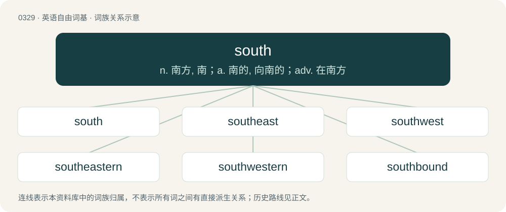

# 0376 · south — n. 南方, 南；a. 南的, 向南的；adv. 在南方

[总目录](../00_总目录_按常用程度.md)

**类型**：英语自由词基　｜　**来源语言**：见词源记录

## 核心含义与来源

- 核心含义：n. 南方, 南；a. 南的, 向南的；adv. 在南方
- 英文含义：The direction towards the pole to the right-hand side of someone facing east, specifically 180°, or (on another celestial object) the direction towards the pole lying on the southern side of the invariable plane.
- 词形：south

**来源记录 1**（名词；The direction towards the pole to the right-hand side of someone facing east, specifically 180°, or (on another celestial object) the direction towards the pole lying on the southern side of the invariable plane.）

From Middle English south, from Old English sūþ, from Proto-West Germanic \*sunþr (“southern”), from Proto-Germanic \*sunþrą (“south”), from Proto-Indo-European \*sóh₂wl̥ (“sun”). Cognates Cognate with Scots sooth (“south”), Yola zouth (“south”), North Frisian sööd, Süđ, süüd (“south”), Saterland Frisian Sude, Suud (“south”), West Frisian súd (“south”), Dutch zuid (“south”), German Süd (“south”), Danish syd (“south”), Faroese and Icelandic suður (“south”), Norwegian Bokmål syd, sør (“south”), Norwegian Nynorsk sør (“south”), Swedish syd, söder (“south”); also with Irish súil (“eye”), Cornish howl (“sun”), Manx sooill (“eye”), Scottish Gaelic sùil (“eye”), Welsh haul (“sun”), Latin sōl (“sun”), Ancient Greek ἥλιος (hḗlios, “sun; east; day”), Czech slunce (“sun”), Polish słońce (“sun”), Russian солнце (solnce, “sun”), Serbo-Croatian сунце, sunce (“sun”), Slovene sonce (“sun”), Latgalian saule (“sun”), Latvian saũle (“sun”), Lithuanian sáulė (“sun”), Albanian diell (“sun”), Avestan 𐬵𐬎𐬎𐬀𐬭𐬆 (huuar^ə, “sun”), Persian خور (xwar, “sun”), Ossetian хор (xor), хур (xur, “sun”), Sanskrit सूर्य (sūrya, “sun”), Tocharian A swāñce (“beam, ray”), Tocharian B swāñco (“beam, ray”).

## 词族图

## 单词速览（常用到不常用）

| 单词 | 音标 | 释义 |
|---|---|---|
| [south](#w-1) | 英 /ˈsaʊ̯θ/；/ˈsɐʊ̯θ/ | n. 南方, 南；a. 南的, 向南的；adv. 在南方 |
| [southeast](#w-2) | British/Southern/Standard /sawˈθɪjst/ | n. 东南, 东南地区；a. 东南的, 向东南的, 来自东南的；adv. 往东南, 来自东南 |
| [southwest](#w-3) | /saʊθˈwɛst/ | n. 西南, 西南方, 西南地区；a. 西南的, 来自西南方的；adv. 往西南, 来自西南 |
| [southeastern](#w-4) | /sauθˈiːstən/ | a. 东南方的 |
| [southwestern](#w-5) | /sauθˈwestən/ | a. 西南的, 向西南的, 来自西南的, 西南部的 |
| [southbound](#w-6) | /ˈsaʊθbaʊnd/ | a. 向南行的, 向南行驶的 |
| [southward](#w-7) | 英 /ˈsaʊθwəd/ | n. 朝南的方向(或地点、地区)；a. 在南方的, 往南方的；adv. 往南 |
| [southside](#w-8) | /ˈsaʊθˌsaɪd/ | \[电影\]荒诞拳击手 |
| [southland](#w-9) | /ˈsajθlənd, -lænd/ | n. 南国, 南部地方 |
| [southwards](#w-10) | /ˈsajθwədz/ | adv. 在南方 |
| [southpaw](#w-11) | /ˈsaʊθˌpɔː/ | a. 用左手的；n. 用左手的运动员, 用左手投球的投手 |
| [southeasterly](#w-12) | /sauθˈiːstəli/ | a. 往东南的, 来自东南的；adv. 往东南, 来自东南 |
| [souther](#w-13) | /ˈsaʊðə/ | n. 南风, 正南强风 |
| [southbridge](#w-14) |  | \[地名\] \[美国、新西兰\] 绍斯布里奇 |

## 逐词详解

### 1. south

**词性**：名词　｜　**音标**：英 /ˈsaʊ̯θ/；/ˈsɐʊ̯θ/

**中文释义**：n. 南方, 南；a. 南的, 向南的；adv. 在南方

**英文义项**：The direction towards the pole to the right-hand side of someone facing east, specifically 180°, or (on another celestial object) the direction towards the pole lying on the southern side of the invariable plane. / The southern region or area; the inhabitants thereof.

**词源与演化**：

From Middle English south, from Old English sūþ, from Proto-West Germanic \*sunþr (“southern”), from Proto-Germanic \*sunþrą (“south”), from Proto-Indo-European \*sóh₂wl̥ (“sun”). Cognates Cognate with Scots sooth (“south”), Yola zouth (“south”), North Frisian sööd, Süđ, süüd (“south”), Saterland Frisian Sude, Suud (“south”), West Frisian súd (“south”), Dutch zuid (“south”), German Süd (“south”), Danish syd (“south”), Faroese and Icelandic suður (“south”), Norwegian Bokmål syd, sør (“south”), Norwegian Nynorsk sør (“south”), Swedish syd, söder (“south”); also with Irish súil (“eye”), Cornish howl (“sun”), Manx sooill (“eye”), Scottish Gaelic sùil (“eye”), Welsh haul (“sun”), Latin sōl (“sun”), Ancient Greek ἥλιος (hḗlios, “sun; east; day”), Czech slunce (“sun”), Polish słońce (“sun”), Russian солнце (solnce, “sun”), Serbo-Croatian сунце, sunce (“sun”), Slovene sonce (“sun”), Latgalian saule (“sun”), Latvian saũle (“sun”), Lithuanian sáulė (“sun”), Albanian diell (“sun”), Avestan 𐬵𐬎𐬎𐬀𐬭𐬆 (huuar^ə, “sun”), Persian خور (xwar, “sun”), Ossetian хор (xor), хур (xur, “sun”), Sanskrit सूर्य (sūrya, “sun”), Tocharian A swāñce (“beam, ray”), Tocharian B swāñco (“beam, ray”).

**例句**：

> Germany is south of Denmark.

该用例对应义项：The direction towards the pole to the right-hand side of someone facing east, specifically 180°, or (on another celestial object) the direction towards the pole lying on the southern side of the invariable plane.

### 2. southeast

**词性**：形容词　｜　**音标**：British/Southern/Standard /sawˈθɪjst/

**中文释义**：n. 东南, 东南地区；a. 东南的, 向东南的, 来自东南的；adv. 往东南, 来自东南

**英文义项**：Of, in or pertaining to the southeast; southeastern. / Situated toward or in the direction of the southeast; southeastward; southeasterly.

**构词拆分**：south + east

**词源与演化**：

From Middle English southest, from Old English sūþēast, equivalent to south + east.

**用法示例／搭配（非完整句）**：

> A southeast course.

该用例对应义项：Situated toward or in the direction of the southeast; southeastward; southeasterly.

### 3. southwest

**词性**：形容词　｜　**音标**：/saʊθˈwɛst/

**中文释义**：n. 西南, 西南方, 西南地区；a. 西南的, 来自西南方的；adv. 往西南, 来自西南

**英文义项**：Of, in or pertaining to the southwest; southwestern. / Situated toward or in the direction of the southwest; southwestward; southwesterly.

**构词拆分**：south + west

**词源与演化**：

From Middle English southwest, southewest, from Old English sūþwest and sūþanwestan, equivalent to south + west. Cognate with West Frisian súdwest, Dutch zuidwest, German Südwesten, Danish sydvest, Swedish sydväst.

**用法示例／搭配（非完整句）**：

> A southwest course.

该用例对应义项：Situated toward or in the direction of the southwest; southwestward; southwesterly.

### 4. southeastern

**词性**：形容词　｜　**音标**：/sauθˈiːstən/

**中文释义**：a. 东南方的

**英文义项**：Of or pertaining to the southeast.

**构词拆分**：south + eastern

**词源与演化**：

From Middle English \*southesterne, from Old English sūþēasterne, equivalent to south + eastern.

**例句**：

> The southeastern part of the country is the most affluent.

该用例对应义项：Of or pertaining to the southeast.

### 5. southwestern

**词性**：形容词　｜　**音标**：/sauθˈwestən/

**中文释义**：a. 西南的, 向西南的, 来自西南的, 西南部的

**英文义项**：Of or pertaining to the southwest.

**构词拆分**：south + western

**词源与演化**：

From Middle English southwesterne, from Old English sūþwesterne, equivalent to south + western.

**例句**：

> Locals think southwestern sunsets are the most beautiful.

该用例对应义项：Of or pertaining to the southwest.

### 6. southbound

**词性**：形容词　｜　**音标**：/ˈsaʊθbaʊnd/

**中文释义**：a. 向南行的, 向南行驶的

**英文义项**：Which is (or will be) travelling south.

**构词拆分**：south + -bound

**词源与演化**：

From south + -bound.

**例句**：

> We took the southbound train to Barcelona.

该用例对应义项：Which is (or will be) travelling south.

### 7. southward

**词性**：名词　｜　**音标**：英 /ˈsaʊθwəd/

**中文释义**：n. 朝南的方向(或地点、地区)；a. 在南方的, 往南方的；adv. 往南

**英文义项**：The direction or area lying to the south of a place.

**构词拆分**：south + -ward

**词源与演化**：

From south + -ward.

**例句**：

> Europe is not really a continent; it juts westward out of Eurasia, the continent, as India juts southward out thereof.

### 8. southside

**词性**：名词　｜　**音标**：/ˈsaʊθˌsaɪd/

**中文释义**：\[电影\]荒诞拳击手

**英文义项**：The southern side of a building, street, city, area, etc.

**构词拆分**：south + side

**词源与演化**：

From south + side.

### 9. southland

**词性**：名词　｜　**音标**：/ˈsajθlənd, -lænd/

**中文释义**：n. 南国, 南部地方

**英文义项**：A land that lies to the south.

**构词拆分**：south + land

**词源与演化**：

From south + land.

### 10. southwards

**词性**：副词　｜　**音标**：/ˈsajθwədz/

**中文释义**：adv. 在南方

**英文义项**：In a southerly direction; towards the south.

**构词拆分**：south + -wards

**词源与演化**：

From south + -wards.

**例句**：

> I told Yaroslav that I took the train southwards from Cairo to Aswan, Egypt.

### 11. southpaw

**词性**：名词　｜　**音标**：/ˈsaʊθˌpɔː/

**中文释义**：a. 用左手的；n. 用左手的运动员, 用左手投球的投手

**英文义项**：One who is left-handed, especially in sports. / A left-handed pitcher.

**构词拆分**：south + paw

**词源与演化**：

From south + paw. The original derivation is unclear: although now best known from the sport of baseball, the term is first attested in 1813, before baseball was founded. Suggested theories include: For Boxing: \* Evidence suggests the term existed before baseball, being used in the 1840s to describe a left-handed punch or "paw" in boxing. A 1848 political cartoon described a "south paw" blow in this context. For Baseball: \* Early 19th-century ballparks were often built with home plate on the west side and the pitcher's mound on the east to prevent the sun from being in the batter's eyes. Consequently, a left-handed pitcher's arm would be facing the southern side of the diamond. However, the term was originally used to refer to position players rather than pitchers.

**例句**：

> Since home plate is generally in the southwest corner to avoid glare in the batter's eyes, a southpaw's pitching hand is to the south.

该用例对应义项：A left-handed pitcher.

### 12. southeasterly

**词性**：形容词　｜　**音标**：/sauθˈiːstəli/

**中文释义**：a. 往东南的, 来自东南的；adv. 往东南, 来自东南

**英文义项**：situated in, or pointing to, the southeast / coming from the southeast

**构词拆分**：south + easterly

**词源与演化**：

From south + easterly.

**例句**：

> The southeasterly wind blew over the water.

### 13. souther

**词性**：名词　｜　**音标**：/ˈsaʊðə/

**中文释义**：n. 南风, 正南强风

**英文义项**：A strong wind blowing from the south.

**构词拆分**：south + -er

**词源与演化**：

From south + -er.

### 14. southbridge

**词性**：名词

**中文释义**：\[地名\] \[美国、新西兰\] 绍斯布里奇

**英文义项**：A secondary microchip connected to the CPU only through the northbridge.

**构词拆分**：south + bridge

**词源与演化**：

From south + bridge.
