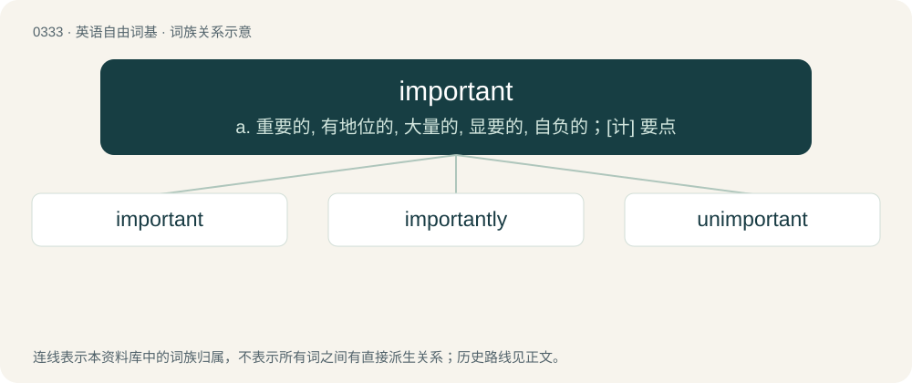

# 0380 · important — a. 重要的, 有地位的, 大量的, 显要的, 自负的；\[计\] 要点

[总目录](../00_总目录_按常用程度.md)

**类型**：英语自由词基　｜　**来源语言**：见词源记录

## 核心含义与来源

- 核心含义：a. 重要的, 有地位的, 大量的, 显要的, 自负的；\[计\] 要点
- 英文含义：Having relevant and crucial value; having import.
- 词形：important

**来源记录 1**（形容词；Having relevant and crucial value; having import.）

From Middle English important, from Medieval Latin important-, importāns. By surface analysis, import (“to be important”) + -ant. Displaced native Old English hēah and hefiġ.

## 词族图

## 单词速览（常用到不常用）

| 单词 | 音标 | 释义 |
|---|---|---|
| [important](#w-1) | 英 /ɪmˈpɔː.tənt/；美 /ɪmˈpɔɹ.tənt/ | a. 重要的, 有地位的, 大量的, 显要的, 自负的；\[计\] 要点 |
| [importantly](#w-2) | 英 /ɪmˈpɔː.tənt.li/；美 /ɪmˈpɔɹ.tənt.li/ | adv. 重要地；大量地；有名望地；自命不凡地 |
| [unimportant](#w-3) | 英 /ˌʌnɪmˈpɔːtənt/；美 /ˌʌnɪmˈpɔɹtənt/ | a. 不重要的 |

## 逐词详解

### 1. important

**词性**：形容词　｜　**音标**：英 /ɪmˈpɔː.tənt/；美 /ɪmˈpɔɹ.tənt/

**中文释义**：a. 重要的, 有地位的, 大量的, 显要的, 自负的；\[计\] 要点

**英文义项**：Having relevant and crucial value; having import.

**词源与演化**：

From Middle English important, from Medieval Latin important-, importāns. By surface analysis, import (“to be important”) + -ant. Displaced native Old English hēah and hefiġ.

**例句**：

> We thought it important for there to be a fire escape at the back of every building.

该用例对应义项：Having relevant and crucial value; having import.

### 2. importantly

**词性**：副词　｜　**音标**：英 /ɪmˈpɔː.tənt.li/；美 /ɪmˈpɔɹ.tənt.li/

**中文释义**：adv. 重要地；大量地；有名望地；自命不凡地

**英文义项**：Used to mark a statement as having importance. / In an important manner.

**构词拆分**：important + -ly

**词源与演化**：

From important + -ly.

**例句**：

> For centuries jellies have figured importantly among English desserts, particularly upon festive occasion.

该用例对应义项：in an important way

### 3. unimportant

**词性**：形容词　｜　**音标**：英 /ˌʌnɪmˈpɔːtənt/；美 /ˌʌnɪmˈpɔɹtənt/

**中文释义**：a. 不重要的

**英文义项**：petty; not important or noteworthy

**构词拆分**：un- + important

**词源与演化**：

From un- + important.

**例句**：

> A relatively unimportant feature of the system.

该用例对应义项：not important
