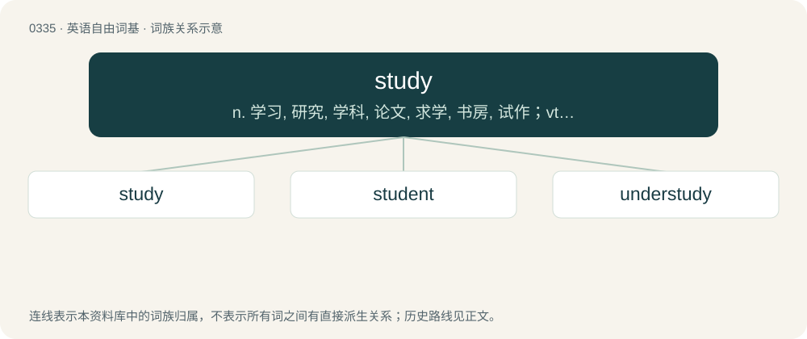

# 0382 · study — n. 学习, 研究, 学科, 论文, 求学, 书房, 试作；vt. 学习, 读书, 研究, 考虑, 计划；vi. 学习, 思索

[总目录](../00_总目录_按常用程度.md)

**类型**：英语自由词基　｜　**来源语言**：见词源记录

## 核心含义与来源

- 核心含义：n. 学习, 研究, 学科, 论文, 求学, 书房, 试作；vt. 学习, 读书, 研究, 考虑, 计划；vi. 学习, 思索
- 英文含义：To review materials already learned in order to make sure one does not forget them, usually in preparation for an examination.
- 词形：study

**多个词源／构词路径**：同一拼写可能有不同来源；以下按词性和含义分别列出。

**来源记录 1**（动词；To review materials already learned in order to make sure one does not forget them, usually in preparation for an examination.）

Inherited from Middle English studien, from Old French estudier (Modern French étudier), from estudie (noun), borrowed from Latin studium. Displaced Old English cneordlæcan.

**来源记录 2**（名词；Mental effort to acquire knowledge or learning.）

Inherited from Middle English studie, from Old French estudie (Modern French étude), borrowed from Latin studium (“zeal, dedication, study”), from Proto-Indo-European \*(s)tewd- (“to push, to hit”). Doublet of etude and studio.

## 词族图

## 单词速览（常用到不常用）

| 单词 | 音标 | 释义 |
|---|---|---|
| [study](#w-1) | 英 /ˈstʌd.i/；美 /ˈstʌd.i/ | n. 学习, 研究, 学科, 论文, 求学, 书房, 试作；vt. 学习, 读书, 研究, 考虑, 计划；vi. 学习, 思索 |
| [student](#w-2) | /ˈstjuː.dn̩t/ | n. 学生, 研究者, 学者 |
| [understudy](#w-3) | 英 /ˈʌndəstʌdi/；美 /ˈʌndɚstʌdi/ | n. 预备演员, 替角；vt. 通过观察掌握某工作, 通过实习掌握某工作；vt.vi. 练习当替角 |

## 逐词详解

### 1. study

**词性**：动词　｜　**音标**：英 /ˈstʌd.i/；美 /ˈstʌd.i/

**中文释义**：n. 学习, 研究, 学科, 论文, 求学, 书房, 试作；vt. 学习, 读书, 研究, 考虑, 计划；vi. 学习, 思索

**英文义项**：To review materials already learned in order to make sure one does not forget them, usually in preparation for an examination. / To take a course or courses on a subject.

**词源与演化**：

Inherited from Middle English studien, from Old French estudier (Modern French étudier), from estudie (noun), borrowed from Latin studium. Displaced Old English cneordlæcan.

**例句**：

> Students are expected to start studying for final exams in March.

该用例对应义项：To review materials already learned in order to make sure one does not forget them, usually in preparation for an examination.

### 2. student

**词性**：名词　｜　**音标**：/ˈstjuː.dn̩t/

**中文释义**：n. 学生, 研究者, 学者

**英文义项**：A person who studies or learns about a particular subject. / A person who is formally enrolled at a school, a college or university, or another educational institution.

**构词拆分**：stud(y) + -ent

**词源与演化**：

From Middle English student, studient, from Old French estudiant, estudiente, from Latin studēns, present participle of studeō (“dedicate oneself to, study”). Equivalent to stud(y) + -ent.

**例句**：

> The students were out raising funds for rag week.

该用例对应义项：A person who is formally enrolled at a school, a college or university, or another educational institution.

### 3. understudy

**词性**：动词　｜　**音标**：英 /ˈʌndəstʌdi/；美 /ˈʌndɚstʌdi/

**中文释义**：n. 预备演员, 替角；vt. 通过观察掌握某工作, 通过实习掌握某工作；vt.vi. 练习当替角

**英文义项**：To study or know a role to such an extent as to be able to replace the normal performer when required. / To act as an understudy (to someone).

**构词拆分**：under- + study

**词源与演化**：

From under- + study.

**例句**：

> She was such a big star that she wouldn't allow an understudy.
