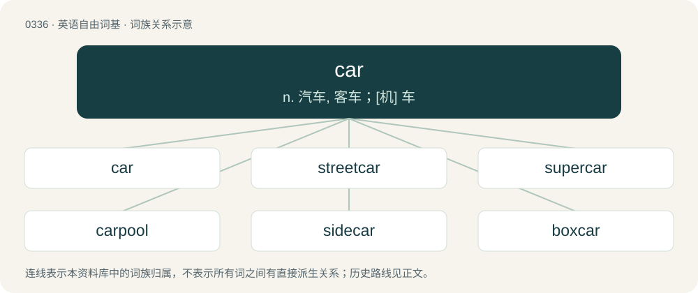

# 0383 · car — n. 汽车, 客车；\[机\] 车

[总目录](../00_总目录_按常用程度.md)

**类型**：英语自由词基　｜　**来源语言**：见词源记录

## 核心含义与来源

- 核心含义：n. 汽车, 客车；\[机\] 车
- 英文含义：A wheeled vehicle that moves independently, with at least three wheels, powered mechanically, steered by a driver and mostly for personal transportation but relatively smaller than a truck/lorry and a bus.
- 词形：car

**多个词源／构词路径**：同一拼写可能有不同来源；以下按词性和含义分别列出。

**来源记录 1**（名词；A wheeled vehicle that moves independently, with at least three wheels, powered mechanically, steered by a driver and mostly for personal transportation but relatively smaller than a truck/lorry and a bus.）

Inherited from Middle English carre, borrowed from Anglo-Norman carre, from Old Northern French (compare Old French char), from Latin carrus (“two-wheeled baggage wagon”), from Gaulish \*karros, from Proto-Celtic \*karros (“wagon”), from Proto-Indo-European \*ḱr̥sós (“vehicle”). Doublet of carrus and horse.

**来源记录 2**（名词；The first part of a cons in Lisp. The first element of a list.）

Acronym of contents of the address part of register number. Note that it was based on original hardware and has no meaning today.

## 词族图

## 单词速览（常用到不常用）

| 单词 | 音标 | 释义 |
|---|---|---|
| [car](#w-1) | 英 /kɑː/；美 /kɑɹ/ | n. 汽车, 客车；\[机\] 车 |
| [streetcar](#w-2) | 美 /ˈstɹitˌkɑɹ/ | n. 有轨电车 |
| [supercar](#w-3) | /ˈsjuːpəkɑː/ | n. 超级跑车 |
| [carpool](#w-4) | /ˈkɑːpuːl/ | v. 合伙使用汽车 |
| [sidecar](#w-5) | /ˈsaɪdkɑɹ/ | n. (摩托车的)边车 |
| [boxcar](#w-6) | /ˈbɒkskɑː/ | n. 有盖货车；\[电\] 转换盒 |
| [carport](#w-7) | 英 /ˈkɑː(ɹ).pɔːt/ | n. 汽车棚 |
| [carmaker](#w-8) | /ˈkɑː,meikə(r)/ | n. 汽车制造商 |
| [motorcar](#w-9) | /ˈməutəkɑː/ | n. 汽车；\[机\] 汽车 |
| [railcar](#w-10) | 美 /ˈɹeɪlˌkɑɹ/ | n. 有轨机动车 |

## 逐词详解

### 1. car

**词性**：名词　｜　**音标**：英 /kɑː/；美 /kɑɹ/

**中文释义**：n. 汽车, 客车；\[机\] 车

**英文义项**：A wheeled vehicle that moves independently, with at least three wheels, powered mechanically, steered by a driver and mostly for personal transportation but relatively smaller than a truck/lorry and a bus. / An unpowered unit in a railroad train, used to hold either passengers or cargo.

**词源与演化**：

Inherited from Middle English carre, borrowed from Anglo-Norman carre, from Old Northern French (compare Old French char), from Latin carrus (“two-wheeled baggage wagon”), from Gaulish \*karros, from Proto-Celtic \*karros (“wagon”), from Proto-Indo-European \*ḱr̥sós (“vehicle”). Doublet of carrus and horse.

**例句**：

> The most exciting part of riding a Ferris wheel is when your car goes over the top.

该用例对应义项：The passenger-carrying portion of certain amusement park rides, such as Ferris wheels.

### 2. streetcar

**词性**：名词　｜　**音标**：美 /ˈstɹitˌkɑɹ/

**中文释义**：n. 有轨电车

**英文义项**：A tram or light rail vehicle, usually a single car but sometimes multiple cars attached together, operating on city streets; a trolley car.

**构词拆分**：street + car

**词源与演化**：

From street + car. Coined before the era of motorcars, the term emphasized a type of car on rails that were in the street (along with foot traffic, wagons, and carriages) rather than on a separate, dedicated railroad, as a railcar is.

**例句**：

> While I was waiting for the streetcar, I witnessed a traffic accident.

### 3. supercar

**词性**：名词　｜　**音标**：/ˈsjuːpəkɑː/

**中文释义**：n. 超级跑车

**英文义项**：Any high-performance sports car; especially, any superexpensive one of a socially exclusive marque designed to be among the fastest on Earth with no expense spared.

**构词拆分**：super- + car

**词源与演化**：

From super- + car.

**例句**：

> These billionaires' world is one of yachts, McLarens, and Lamborghinis — supercars out of reach of the 99%.

该用例对应义项：Any high-performance sports car; especially, any superexpensive one of a socially exclusive marque designed to be among the fastest on Earth with no expense spared.

### 4. carpool

**词性**：名词　｜　**音标**：/ˈkɑːpuːl/

**中文释义**：v. 合伙使用汽车

**英文义项**：An arrangement whereby several people travel together in the same car in order to save costs, reduce pollution etc. / The group of people who participate in such a pool.

**构词拆分**：car + pool

**词源与演化**：

From car + pool.

**例句**：

> The neighbors decided on a carpool to get their kids to school, so that they wouldn't each have to drive every day.

该用例对应义项：An arrangement whereby several people travel together in the same car in order to save costs, reduce pollution etc.

### 5. sidecar

**词性**：名词　｜　**音标**：/ˈsaɪdkɑɹ/

**中文释义**：n. (摩托车的)边车

**英文义项**：A one-wheeled attachment to the side of a motorcycle to allow for a separate seat for a passenger or cargo space. / A cocktail made with cognac (or brandy), triple sec liqueur, and lemon juice.

**构词拆分**：side + car

**词源与演化**：

From side + car.

### 6. boxcar

**词性**：名词　｜　**音标**：/ˈbɒkskɑː/

**中文释义**：n. 有盖货车；\[电\] 转换盒

**英文义项**：An enclosed railway goods wagon, typically with a sliding door.

**构词拆分**：box + car

**词源与演化**：

From box + car.

**例句**：

> Tom lives in an abandoned boxcar.

### 7. carport

**词性**：名词　｜　**音标**：英 /ˈkɑː(ɹ).pɔːt/

**中文释义**：n. 汽车棚

**英文义项**：A roofed structure for automobile storage, usually attached to a house and not fully enclosed like a garage but with at least one side open to the outdoors.

**构词拆分**：car + port

**词源与演化**：

From car + port, coined by American architect Frank Lloyd Wright in 1936 and modeled on the French porte cochère (literally “coach entrance”).

**例句**：

> Franklin decided to improve his carport by walling in the sides and turning it into a garage.

该用例对应义项：A roofed structure for automobile storage, usually attached to a house and not fully enclosed like a garage but with at least one side open to the outdoors.

### 8. carmaker

**词性**：名词　｜　**音标**：/ˈkɑː,meikə(r)/

**中文释义**：n. 汽车制造商

**英文义项**：A manufacturer of automobiles.

**构词拆分**：car + maker

**词源与演化**：

From car + maker.

### 9. motorcar

**词性**：名词　｜　**音标**：/ˈməutəkɑː/

**中文释义**：n. 汽车；\[机\] 汽车

**英文义项**：An enclosed passenger motor vehicle: a car (automobile). / A self-propelled railway vehicle.

**构词拆分**：motor + car

**词源与演化**：

From motor + car.

### 10. railcar

**词性**：名词　｜　**音标**：美 /ˈɹeɪlˌkɑɹ/

**中文释义**：n. 有轨机动车

**英文义项**：A self-propelled railway vehicle for passengers, similar to a bus. / A powered single railway vehicle designed for passenger transport, with a driver's cab in both ends; Not to be confused with motor coach/motorcar, which is a powered railway vehicle capable to haul a train.

**构词拆分**：rail + car

**词源与演化**：

From rail + car.
