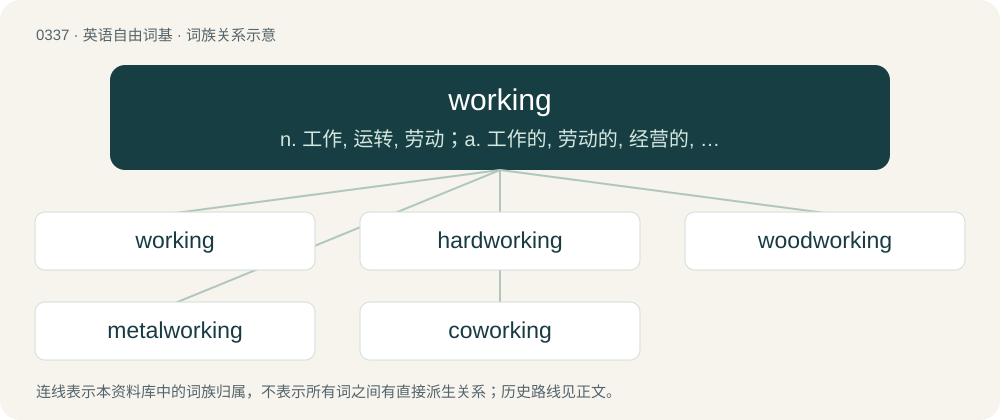

# 0384 · working — n. 工作, 运转, 劳动；a. 工作的, 劳动的, 经营的, 抽搐的, 运转的

[总目录](../00_总目录_按常用程度.md)

**类型**：英语自由词基　｜　**来源语言**：见词源记录

## 核心含义与来源

- 核心含义：n. 工作, 运转, 劳动；a. 工作的, 劳动的, 经营的, 抽搐的, 运转的
- 英文含义：Operation; action.
- 词形：working

**多个词源／构词路径**：同一拼写可能有不同来源；以下按词性和含义分别列出。

**来源记录 1**（名词；Operation; action.）

From Middle English werking, werkynge, warkynge, worchinge, from Old English wyrċing (“working”), verbal noun of wyrċan (“to work”), equivalent to work + -ing. Cognate with Scots wirking, warking, Dutch werking, German Wirkung.

**来源记录 2**（形容词；That is or are functioning.）

From Middle English workyng, wirkynge, worchinge, werchinge, workinde, wirkand, worchende, wurchende, from Old English wyrċende, from Proto-Germanic \*wurkijandz, present participle of Proto-Germanic \*wurkijaną (“to work”), equivalent to work + -ing. Compare Scots wirkand, werkand, warkand (“working”), Dutch werkend (“working, acting”), German wirkend (“acting, working”).

## 词族图

## 单词速览（常用到不常用）

| 单词 | 音标 | 释义 |
|---|---|---|
| [working](#w-1) | 英 /ˈwɜːkɪŋ/；美 /ˈwɝkɪŋ/ | n. 工作, 运转, 劳动；a. 工作的, 劳动的, 经营的, 抽搐的, 运转的 |
| [hardworking](#w-2) | /ˈhɑːɹdˌwɜːɹ.kɪŋ/ | a. 苦干的, 不辞辛劳的 |
| [woodworking](#w-3) | /ˈwud.wəːkiŋ/ | n. 木工活, 木工行业 |
| [metalworking](#w-4) | /ˈmetəl,w\\\\ːkiŋ/ | n. 金属加工术, 金属工 |
| [coworking](#w-5) |  | 【英文】The use of a shared working environment for independent activities by different organisations. |

## 逐词详解

### 1. working

**词性**：名词　｜　**音标**：英 /ˈwɜːkɪŋ/；美 /ˈwɝkɪŋ/

**中文释义**：n. 工作, 运转, 劳动；a. 工作的, 劳动的, 经营的, 抽搐的, 运转的

**英文义项**：Operation; action. / Method of operation.

**构词拆分**：work + -ing

**词源与演化**：

From Middle English werking, werkynge, warkynge, worchinge, from Old English wyrċing (“working”), verbal noun of wyrċan (“to work”), equivalent to work + -ing. Cognate with Scots wirking, warking, Dutch werking, German Wirkung.

**例句**：

> Be sure to check your working.

该用例对应义项：The incidental or subsidiary calculations performed in solving an overall problem.

### 2. hardworking

**词性**：形容词　｜　**音标**：/ˈhɑːɹdˌwɜːɹ.kɪŋ/

**中文释义**：a. 苦干的, 不辞辛劳的

**英文义项**：Of a person, taking their work seriously and doing it well and rapidly.

**构词拆分**：From hard + working.

**词源与演化**：

From hard + working.

**例句**：

> He used to be very hardworking, but now he's a bit lazy.

### 3. woodworking

**词性**：名词　｜　**音标**：/ˈwud.wəːkiŋ/

**中文释义**：n. 木工活, 木工行业

**英文义项**：The crafts of carpentry, cabinet making and related skills of making things from wood.

**构词拆分**：From wood + working.

**词源与演化**：

From wood + working.

**例句**：

> In woodworking, we classify wood as hardwood, softwood or exotic wood.

### 4. metalworking

**词性**：名词　｜　**音标**：/ˈmetəl,w\\\\ːkiŋ/

**中文释义**：n. 金属加工术, 金属工

**英文义项**：The art and craft of shaping metal.

**构词拆分**：metal + working

**词源与演化**：

From metal + working.

**用法示例／搭配（非完整句）**：

> metalworking industry

该用例对应义项：The art and craft of shaping metal.

### 5. coworking

**词性**：名词

**英文义项**：The use of a shared working environment for independent activities by different organisations.

**构词拆分**：co- + working

**词源与演化**：

From co- + working.

**用法示例／搭配（非完整句）**：

> coworking space

该用例对应义项：The use of a shared working environment for independent activities by different organisations.
