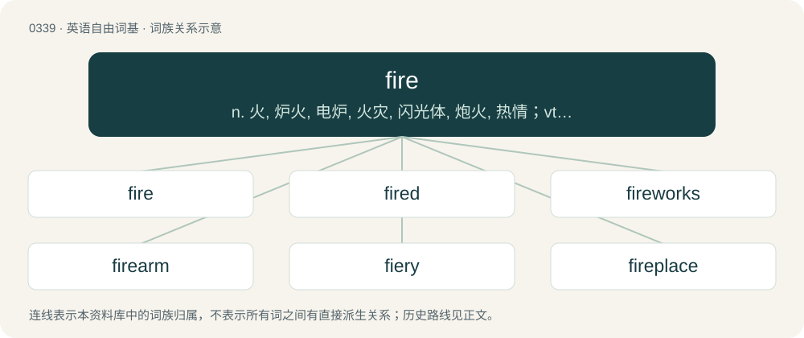

# 0385 · fire — n. 火, 炉火, 电炉, 火灾, 闪光体, 炮火, 热情；vt. 点燃, 烧制, 使发光, 激动, 放枪, 解雇；vi. 着火, 烧火, 开枪, 射击, 激动

[总目录](../00_总目录_按常用程度.md)

**类型**：英语自由词基　｜　**来源语言**：见词源记录

## 核心含义与来源

- 核心含义：n. 火, 炉火, 电炉, 火灾, 闪光体, 炮火, 热情；vt. 点燃, 烧制, 使发光, 激动, 放枪, 解雇；vi. 着火, 烧火, 开枪, 射击, 激动
- 英文含义：A (usually self-sustaining) chemical reaction involving the bonding of oxygen with carbon or other fuel, with the production of heat and the presence of flame or smouldering.
- 词形：fire

**多个词源／构词路径**：同一拼写可能有不同来源；以下按词性和含义分别列出。

**来源记录 1**（名词；A (usually self-sustaining) chemical reaction involving the bonding of oxygen with carbon or other fuel, with the production of heat and the presence of flame or smouldering.）

From Middle English fyr, from Old English fȳr (“fire”), from Proto-West Germanic \*fuir, from \*fuïr, a regularised form of Proto-Germanic \*fōr (“fire”), ultimately from Proto-Indo-European \*péh₂wr̥. Cognates See also Scots feier, fyre (“fire”), Yola vier, vire (“fire”), Saterland Frisian Fjuur, Fjúur (“fire”), West Frisian fjoer (“fire”), Alemannic German Füür (“fire”), Bavarian Feia (“fire”), Central Franconian Fauer, Feier, Füür (“fire”), Cimbrian bôar, vaür, vôar (“fire”), Dutch vier, vuur (“fire”), German Feuer (“fire”), German Low German Füer, Füür (“fire”), Luxembourgish Feier (“fire”), Mòcheno vaier (“fire”), Vilamovian faojer (“fire”), West Flemish vier (“fire”), Yiddish פֿײַער (fayer, “fire”), Danish, Norwegian Bokmål, Norwegian Nynorsk, and Swedish fyr (“fire”), Icelandic funi (“fire”), Gothic 𐍆𐍉𐌽 (fōn, “fire”). Also, compare Armenian հուր (hur, “fire”), Greek πυρ (pyr, “fire”), Latin pūrgō (“to clean, cleanse, clear, purge, purify”), Umbrian 𐌐𐌉𐌓 (pir, “fire”), Bulgarian фир (fir, “ooze, pickle, soak”), Polish perz (“smoke”), Hittite 𒉺𒄴𒄯 (paḫḫur, “fire”), Luwian 𒉺𒀀𒄷𒌋𒌨 (pāhūr, “fire”), Tocharian A/B por/puwar (“fire”). This was an inanimate noun whose animate counterpart was Proto-Indo-European \*h₁n̥gʷnis (see ignite). Cognate to pyre.

**来源记录 2**（动词；To set (something, often a building) on fire.）

From Middle English firen, fyren, furen, from Old English fȳrian (“to make a fire”), from the noun (see above). Cognate with Old Frisian fioria (“to light a fire”), Saterland Frisian fjuurje (“to fire”), Middle Dutch vûren, vueren, vieren (“to set fire”), Dutch vuren (“to fire, shoot”), Old High German fiuren (“to ignite, set on fire”), German feuern (“to fire”).

## 词族图

## 单词速览（常用到不常用）

| 单词 | 音标 | 释义 |
|---|---|---|
| [fire](#w-1) | 英 /ˈfaɪ.ə/；美 /ˈfaɪ.ɚ/ | n. 火, 炉火, 电炉, 火灾, 闪光体, 炮火, 热情；vt. 点燃, 烧制, 使发光, 激动, 放枪, 解雇；vi. 着火, 烧火, 开枪, 射击, 激动 |
| [fired](#w-2) | 英 /ˈfaɪ̯əd/；美 /ˈfaɪ̯ɚd/ | n. 因祸得福（电影名） |
| [fireworks](#w-3) | 英 /ˈfaɪ̯.ə.wɜːks/；美 /ˈfaɪ̯.ɚ.wɝks/ | n. 烟火, 激烈争论；\[化\] 焰火 |
| [firearm](#w-4) | /ˈfaɪəɹˌɑː(ɹ)m/ | n. 火器, 枪炮 |
| [fiery](#w-5) | /ˈfaɪəɹi/ | a. 炽热的, 热烈的, 暴躁的 |
| [fireplace](#w-6) | 英 /ˈfaɪəpleɪs/；美 /ˈfaɪɹpleɪs/ | n. 壁炉 |
| [gunfire](#w-7) | 英 /ˈɡʌnfʌɪə/ | n. 炮火, 号炮报时, 炮击 |
| [firefighter](#w-8) | 英 /ˈfaɪə(ɹ)ˌfaɪ.tə(ɹ)/；美 /ˈfaɪ.ɚˌfaɪ.tɚ/ | n. &lt;美&gt;消防队员 |
| [wildfire](#w-9) | /ˈwaɪldˌfaɪər/ | n. (古时战争时所用的)燃料剂, 磷火, 鬼火, 野火 |
| [ceasefire](#w-10) | /ˈsiːsfaɪə(r)/ | n. （通常指永久性的）停火, 停战; 停火命令 |
| [firepower](#w-11) | /ˈfaiəpauə/ | n. 火力 |
| [firewall](#w-12) | 英 /ˈfaɪə.wɔəl/；美 /ˈfaɪ(ə)ɹˌwɔl/ | \[计\] 放火墙, 隔离 |
| [fireman](#w-13) | 英 /ˈfaɪəmən/；美 /ˈfaɪɹmən/ | n. 救火队员, 消防队员；\[机\] 司炉 |
| [fireball](#w-14) | 英 /ˈfaɪəbɔːl/；美 /ˈfaɪəɹˌbɔl/ | n. 火球, 大流星 |
| [firewood](#w-15) | 英 /ˈfaɪ.ə(ɹ).wʊd/；美 /ˈfaɪ.ɚ.wʊd/ | n. 木柴 |
| [firefly](#w-16) | 英 /ˈfaɪ.əˌflaɪ/；美 /ˈfaɪ.ɚˌflaɪ/ | n. 萤火虫 |
| [backfire](#w-17) | /bækˈfaɪə(ɹ)/ | n. 逆火, 回火, 放火；vi. 放逆火, 预先放火, 发生意外 |
| [campfire](#w-18) | /ˈkæmpˌfaɪ̯ɚ/ | n. 营火, 营火会 |
| [crossfire](#w-19) | 英 /ˈkɹɒsfaɪə/；美 /ˈkɹɔːsfaɪɹ/ | n. 交叉火力, 串报, 串扰电流；\[电\] 交火 |
| [firework](#w-20) | 美 /ˈfaɪɚˌwɚk/ | n. 烟火具, 烟火, 烟火信号弹, 焰火, 激情的表现 |
| [firefighting](#w-21) | /ˈfaɪ.əɹˌfaɪ.tɪŋ/ | 消防 |
| [firestorm](#w-22) | /ˈfaiəstɔːm/ | n. 风暴性大火 |
| [hellfire](#w-23) | 英 /ˈhɛlˌfaɪə/；美 /ˈhɛlˌfaɪəɹ/ | n. 地狱之火, 严酷的苦难 |
| [firefight](#w-24) | /ˈfaiəfait/ | n. \[军\]交火,火战,炮战 |
| [firestone](#w-25) | /ˈfaiəstəun/ | n. 燧石, 耐火石 |
| [firehouse](#w-26) | /ˈfaiəhaus/ | n. 消防站 |
| [fireproof](#w-27) | /ˈfaiəpruːf/ | a. 耐火的, 防火的；vi. 变成有耐火性 |
| [fireside](#w-28) | /ˈfaiəsaid/ | n. 炉边, 家庭, 家庭生活；a. 在火炉边的, 非正式的 |
| [firecracker](#w-29) | 英 /ˈfaɪəˌkɹækə/；美 /ˈfaɪəɹˌkɹækəɹ/ | n. 爆竹, 鞭炮；\[化\] 爆竹; 鞭炮 |
| [firebird](#w-30) | /ˈfaiəbəːd/ | n. 北美黄鹂鸟 |
| [firebrand](#w-31) | 英 /ˈfaɪə.bɹænd/；美 /ˈfaɪɚ.bɹænd/ | n. 火把, 在燃烧的木柴, 煽动叛乱者 |
| [bushfire](#w-32) | /ˈbʊʃfaɪər/ | n. 林区大火 |
| [misfire](#w-33) | 美 /ˈmɪs.faɪ.ɚ/；/mɪsˈfaɪ(ɹ)/ | vi. 不发火, 失败；n. 不发火, 失败 |
| [afire](#w-34) | /əˈfaɪɚ/ | a. 燃烧的, 炽烈的；adv. 燃烧着 |
| [firebox](#w-35) | /ˈfaiəbɒks/ | n. 火室, 燃烧室；\[化\] 燃烧室 |
| [firebase](#w-36) | 英 /ˈfʌɪəbeɪs/；美 /ˈfaɪɚˌbeɪs/ | n. 重火力点(向敌人发射重型炮火的军事基地) |
| [firewire](#w-37) |  | 【英文】A high-speed digital link standard covered by the IEEE 1394-1995 standard. |
| [firelight](#w-38) | 英 /ˈfaɪə.laɪt/；美 /ˈfaɪɚ.laɪt/ | n. 火光 |
| [firebomb](#w-39) | /ˈfaiəbɔm/ | n. 火焰炸弹(燃烧弹和凝固汽油弹的总称) |
| [firebug](#w-40) | /ˈfaiəbʌg/ | n. 放火者, 放火狂, 萤火虫 |
| [rimfire](#w-41) | /ˈrim,faiə/ | a. (子弹)边缘发火的,(火器)发射边缘发火弹的 ；n. 边缘发火弹 |
| [firestarter](#w-42) |  | 打火石点火器具 |

## 逐词详解

### 1. fire

**词性**：名词　｜　**音标**：英 /ˈfaɪ.ə/；美 /ˈfaɪ.ɚ/

**中文释义**：n. 火, 炉火, 电炉, 火灾, 闪光体, 炮火, 热情；vt. 点燃, 烧制, 使发光, 激动, 放枪, 解雇；vi. 着火, 烧火, 开枪, 射击, 激动

**英文义项**：A (usually self-sustaining) chemical reaction involving the bonding of oxygen with carbon or other fuel, with the production of heat and the presence of flame or smouldering. / An instance of this chemical reaction, especially when intentionally created and maintained in a specific location to a useful end (such as a campfire or a hearth fire).

**词源与演化**：

From Middle English fyr, from Old English fȳr (“fire”), from Proto-West Germanic \*fuir, from \*fuïr, a regularised form of Proto-Germanic \*fōr (“fire”), ultimately from Proto-Indo-European \*péh₂wr̥. Cognates See also Scots feier, fyre (“fire”), Yola vier, vire (“fire”), Saterland Frisian Fjuur, Fjúur (“fire”), West Frisian fjoer (“fire”), Alemannic German Füür (“fire”), Bavarian Feia (“fire”), Central Franconian Fauer, Feier, Füür (“fire”), Cimbrian bôar, vaür, vôar (“fire”), Dutch vier, vuur (“fire”), German Feuer (“fire”), German Low German Füer, Füür (“fire”), Luxembourgish Feier (“fire”), Mòcheno vaier (“fire”), Vilamovian faojer (“fire”), West Flemish vier (“fire”), Yiddish פֿײַער (fayer, “fire”), Danish, Norwegian Bokmål, Norwegian Nynorsk, and Swedish fyr (“fire”), Icelandic funi (“fire”), Gothic 𐍆𐍉𐌽 (fōn, “fire”). Also, compare Armenian հուր (hur, “fire”), Greek πυρ (pyr, “fire”), Latin pūrgō (“to clean, cleanse, clear, purge, purify”), Umbrian 𐌐𐌉𐌓 (pir, “fire”), Bulgarian фир (fir, “ooze, pickle, soak”), Polish perz (“smoke”), Hittite 𒉺𒄴𒄯 (paḫḫur, “fire”), Luwian 𒉺𒀀𒄷𒌋𒌨 (pāhūr, “fire”), Tocharian A/B por/puwar (“fire”). This was an inanimate noun whose animate counterpart was Proto-Indo-European \*h₁n̥gʷnis (see ignite). Cognate to pyre.

**例句**：

> During hot and dry summers many fires in forests are caused by regardlessly discarded cigarette butts.

该用例对应义项：The occurrence, often accidental, of fire in a certain place, causing damage and danger.

### 2. fired

**词性**：形容词　｜　**音标**：英 /ˈfaɪ̯əd/；美 /ˈfaɪ̯ɚd/

**中文释义**：n. 因祸得福（电影名）

**英文义项**：dismissed, terminated from employment. / Heated in a furnace, kiln, etc., to become permanently hardened.

**构词拆分**：fire + -ed

**词源与演化**：

From fire + -ed.

**例句**：

> Had it not been for your help, I would have been fired.

### 3. fireworks

**词性**：名词　｜　**音标**：英 /ˈfaɪ̯.ə.wɜːks/；美 /ˈfaɪ̯.ɚ.wɝks/

**中文释义**：n. 烟火, 激烈争论；\[化\] 焰火

**英文义项**：An event or a display where fireworks are set off. / A boisterous or violent event or situation.

**构词拆分**：fire + work(s)

**词源与演化**：

From fire + work(s). The similarity with Dutch vuurwerk and German Feuerwerk, both “fireworks”, is hardly coincidental. Since the word was apparently first attested in English circa 1575, probably from the Dutch (1540), from the German (sense early 16th c.), from Middle High German viurwerc (14th c. as “fuel, firewood”). A spread from the south northwards is also in line with the fact that the first European fireworks were produced in Italy in the late 14th century.

**例句**：

> I left the room after John came home drunk but before the fireworks went off.

该用例对应义项：A boisterous or violent event or situation.

### 4. firearm

**词性**：名词　｜　**音标**：/ˈfaɪəɹˌɑː(ɹ)m/

**中文释义**：n. 火器, 枪炮

**英文义项**：A personal weapon that uses explosive powder to propel a projectile often made of lead.

**构词拆分**：fire + arm

**词源与演化**：

From fire (“projectile discharge”) + arm (“weapon”).

**例句**：

> David was arrested for illegal possession of firearms.

该用例对应义项：A personal weapon that uses explosive powder to propel a projectile often made of lead.

### 5. fiery

**词性**：形容词　｜　**音标**：/ˈfaɪəɹi/

**中文释义**：a. 炽热的, 热烈的, 暴躁的

**英文义项**：Of or relating to fire. / Burning or glowing.

**构词拆分**：fire + -y

**词源与演化**：

From Middle English fyry, from fyr (“fire”), equivalent to fire + -y.

**用法示例／搭配（非完整句）**：

> a fiery temper

该用例对应义项：Tempestuous or emotionally volatile; sulfurous.

### 6. fireplace

**词性**：名词　｜　**音标**：英 /ˈfaɪəpleɪs/；美 /ˈfaɪɹpleɪs/

**中文释义**：n. 壁炉

**英文义项**：An open hearth for holding a fire at the base of a chimney.

**构词拆分**：fire + place

**词源与演化**：

From fire + place.

**例句**：

> The fireplace was so large you could walk inside it.

该用例对应义项：an open recess in a wall at the base of a chimney where a fire can be built

### 7. gunfire

**词性**：名词　｜　**音标**：英 /ˈɡʌnfʌɪə/

**中文释义**：n. 炮火, 号炮报时, 炮击

**英文义项**：Shots from a gun or guns, typically creating loud report. / The use of gunpowder-type weapons, mainly cannon, as opposed to swords or bayonets.

**构词拆分**：gun + fire

**词源与演化**：

From gun + fire.

**例句**：

> Killing people became much easier and faster once armies started using gunfire.

该用例对应义项：The use of gunpowder-type weapons, mainly cannon, as opposed to swords or bayonets.

### 8. firefighter

**词性**：名词　｜　**音标**：英 /ˈfaɪə(ɹ)ˌfaɪ.tə(ɹ)/；美 /ˈfaɪ.ɚˌfaɪ.tɚ/

**中文释义**：n. &lt;美&gt;消防队员

**英文义项**：A person who has been trained to put out fires.

**构词拆分**：fire + fighter

**词源与演化**：

From fire + fighter. Created as a gender-neutral term for fireman and firewoman.

**例句**：

> The erected tower should help the firefighter to notice fires in time.

### 9. wildfire

**词性**：名词　｜　**音标**：/ˈwaɪldˌfaɪər/

**中文释义**：n. (古时战争时所用的)燃料剂, 磷火, 鬼火, 野火

**英文义项**：A rapidly spreading fire, especially one occurring in a wildland area. / A spreading disease of the skin, particularly erysipelas.

**构词拆分**：By surface analysis, wild + fire

**词源与演化**：

Inherited from Middle English wilde fyr, wilde fire, wylde fyre, from Old English wilde fȳr. By surface analysis, wild + fire.

**例句**：

> Earlier this month, 92 people died in Greece—the deadliest wildfire in recent history.

### 10. ceasefire

**词性**：名词　｜　**音标**：/ˈsiːsfaɪə(r)/

**中文释义**：n. （通常指永久性的）停火, 停战; 停火命令

**英文义项**：In warfare, an agreed end to hostilities for a specific purpose. (Typically only temporary).

**构词拆分**：cease + fire

**词源与演化**：

From cease + fire.

**例句**：

> The rebels agreed to a ceasefire while the peace talks were underway.

该用例对应义项：In warfare, an agreed end to hostilities for a specific purpose. (Typically only temporary).

### 11. firepower

**词性**：名词　｜　**音标**：/ˈfaiəpauə/

**中文释义**：n. 火力

**英文义项**：The capacity of a weapon to deliver fire onto a target. / The ability to deliver fire.

**构词拆分**：fire + power

**词源与演化**：

From fire + power.

**例句**：

> France couldn't overwhelm Algerian independence fighters with its firepower.

### 12. firewall

**词性**：名词　｜　**音标**：英 /ˈfaɪə.wɔəl/；美 /ˈfaɪ(ə)ɹˌwɔl/

**中文释义**：\[计\] 放火墙, 隔离

**英文义项**：A fireproof barrier used to prevent the spread of fire between or through buildings, structures, electrical substation transformers, or within an aircraft or vehicle. / The software that monitors traffic in and out of a private network or a personal computer and allows or blocks such traffic depending on its perceived threat.

**构词拆分**：fire + wall

**词源与演化**：

From fire + wall. Compare West Frisian brânmuorre, Dutch brandmuur, German Brandmauer, Feuermauer, Swedish brandvägg, brandmur, Icelandic eldvegg. The verb sense for using maximum power or acceleration comes from the engine's firewall being the limit of forward movement of the throttle controls on many simpler vehicles; thus, to get the maximum engine output, one would push the throttle levers or pedal all the way to the firewall. The politics sense is a calque of German Brandmauer.

**例句**：

> I need to configure this server with an appropriate firewall system.

### 13. fireman

**词性**：名词　｜　**音标**：英 /ˈfaɪəmən/；美 /ˈfaɪɹmən/

**中文释义**：n. 救火队员, 消防队员；\[机\] 司炉

**英文义项**：Someone (especially male) who is skilled in the work of fighting fire. / A person (originally a man) who keeps the fire going underneath a steam boiler (originally, shoveling coal by hand), particularly on a railroad locomotive or steamship.

**构词拆分**：fire + -man

**词源与演化**：

From fire + -man.

**例句**：

> The fireman's job was about to get very interesting; they had just run out of coal!

该用例对应义项：A person (originally a man) who keeps the fire going underneath a steam boiler (originally, shoveling coal by hand), particularly on a railroad locomotive or steamship.

### 14. fireball

**词性**：动词　｜　**音标**：英 /ˈfaɪəbɔːl/；美 /ˈfaɪəɹˌbɔl/

**中文释义**：n. 火球, 大流星

**英文义项**：To attack (someone or something) with balls of fire. / To explode in a ball of fire or flame.

**构词拆分**：fire (noun) + ball (noun)

**词源与演化**：

The noun is derived from fire (noun) + ball (noun). The adjective and verb are derived from the noun.

**例句**：

> The car swerved off a road, hit a wall, and fireballed as the petrol tank exploded.

该用例对应义项：To explode in a ball of fire or flame.

### 15. firewood

**词性**：名词　｜　**音标**：英 /ˈfaɪ.ə(ɹ).wʊd/；美 /ˈfaɪ.ɚ.wʊd/

**中文释义**：n. 木柴

**英文义项**：Wood intended to be burned, typically for heat.

**构词拆分**：fire + wood

**词源与演化**：

From Middle English ferwode, fyrewoode, equivalent to fire + wood.

**例句**：

> After many days of hard work, we finally had enough firewood for the winter.

该用例对应义项：Wood intended to be burned, typically for heat.

### 16. firefly

**词性**：名词　｜　**音标**：英 /ˈfaɪ.əˌflaɪ/；美 /ˈfaɪ.ɚˌflaɪ/

**中文释义**：n. 萤火虫

**英文义项**：Any beetle of the family Lampyridae, which exhibit bioluminescence during twilight.

**构词拆分**：Endocentric compound of fire + fly

**词源与演化**：

Endocentric compound of fire + fly, because the insects glow; whence also lightning bug. Compare glow fly, glowworm, and lanternfly. Compare typologically Ancient Greek λαμπυρίς (lampurís, “glowworm”) (&lt;+ πῦρ (pûr)).

**例句**：

> They found a species of firefly that was assumed to be extinct.

### 17. backfire

**词性**：动词　｜　**音标**：/bækˈfaɪə(ɹ)/

**中文释义**：n. 逆火, 回火, 放火；vi. 放逆火, 预先放火, 发生意外

**英文义项**：Of a gun, cannon, Bunsen burner, etc., to fire in the opposite direction, for example due to an obstruction in the barrel. / Of a reciprocating engine, to experience a premature ignition of fuel or an ignition of exhaust gases, making a popping sound.

**构词拆分**：back + fire

**词源与演化**：

From back + fire.

**例句**：

> Tom thought that he heard a car backfire.

### 18. campfire

**词性**：名词　｜　**音标**：/ˈkæmpˌfaɪ̯ɚ/

**中文释义**：n. 营火, 营火会

**英文义项**：A fire at a campground or on a camping trip, often used for cooking, to provide light and heat, to drive away bugs, and as a focal point for sitting around in the evening and talking, telling stories, and singing.

**构词拆分**：camp + fire

**词源与演化**：

From camp + fire.

**例句**：

> I asked you to start a campfire, Tom, not a forest fire!

### 19. crossfire

**词性**：名词　｜　**音标**：英 /ˈkɹɒsfaɪə/；美 /ˈkɹɔːsfaɪɹ/

**中文释义**：n. 交叉火力, 串报, 串扰电流；\[电\] 交火

**英文义项**：An arrangement of two or more weapons so each can fire diagonally at something in front of a line between them. / The danger to a third party passing between two belligerents firing at one another.

**构词拆分**：cross- + fire

**词源与演化**：

From cross- + fire.

**用法示例／搭配（非完整句）**：

> The two factions were either side of the road. A civilian lorry was caught in the crossfire and became collateral damage

该用例对应义项：The danger to a third party passing between two belligerents firing at one another.

### 20. firework

**词性**：名词　｜　**音标**：美 /ˈfaɪɚˌwɚk/

**中文释义**：n. 烟火具, 烟火, 烟火信号弹, 焰火, 激情的表现

**英文义项**：A device using gunpowder and other chemicals which, when lit, emits a combination of coloured flames, sparks, whistles or bangs, and sometimes made to rocket high into the sky before exploding, used for entertainment or celebration.

**构词拆分**：fire + work

**词源与演化**：

From fire + work. Compare Saterland Frisian Fjuurwierk (“firework”), West Frisian fjoerwurk (“firework”), Dutch vuurwerk (“firework”), Low German Füürwark, Füerwark (“firework”), German Feuerwerk (“firework”), Danish fyrværkeri (“firework”), Swedish fyrverkeri (“firework”), Faroese fýrverk (“firework”).

**例句**：

> Fireworks went off after Australia won the World Cup.

该用例对应义项：A device using gunpowder and other chemicals which, when lit, emits a combination of coloured flames, sparks, whistles or bangs, and sometimes made to rocket high into the sky before exploding, used for entertainment or celebration.

### 21. firefighting

**词性**：名词　｜　**音标**：/ˈfaɪ.əɹˌfaɪ.tɪŋ/

**中文释义**：消防

**英文义项**：The extinguishing of a fire. / The profession of being a firefighter.

**构词拆分**：fire + fighting

**词源与演化**：

From fire + fighting.

**例句**：

> Firefighting in Australia is becoming increasingly sophisticated.

### 22. firestorm

**词性**：名词　｜　**音标**：/ˈfaiəstɔːm/

**中文释义**：n. 风暴性大火

**英文义项**：A fire whose intensity is greatly increased by inrushing winds. / An intense or violent altercation; an intense or violent response; an outburst (as of controversy)

**构词拆分**：fire + storm

**词源与演化**：

From fire + storm.

**例句**：

> The incident triggered a political firestorm.

该用例对应义项：an outburst of controversy

### 23. hellfire

**词性**：名词　｜　**音标**：英 /ˈhɛlˌfaɪə/；美 /ˈhɛlˌfaɪəɹ/

**中文释义**：n. 地狱之火, 严酷的苦难

**英文义项**：The fire of Hell. / Fire produced by the Devil, or a similar supernatural creature connected to Hell.

**构词拆分**：hell + fire

**词源与演化**：

From Middle English helle fire, helever, from Old English hellefȳr, equivalent to hell + fire. Cognate with West Frisian helfjoer (“hellfire”), Dutch hellevuur (“hellfire”), German Höllenfeuer (“hellfire”).

**例句**：

> Mennad is going to burn in eternal hellfire.

### 24. firefight

**词性**：名词　｜　**音标**：/ˈfaiəfait/

**中文释义**：n. \[军\]交火,火战,炮战

**英文义项**：A skirmish involving an exchange of gunfire. / An intense argument.

**构词拆分**：fire + fight

**词源与演化**：

From fire + fight.

### 25. firestone

**词性**：名词　｜　**音标**：/ˈfaiəstəun/

**中文释义**：n. 燧石, 耐火石

**英文义项**：Iron pyrite, formerly used for striking fire. / A flint.

**构词拆分**：fire + stone

**词源与演化**：

From Middle English firestone, firstan, fyrestane, fyyr stone, from Old English fȳrstān, equivalent to fire + stone.

### 26. firehouse

**词性**：名词　｜　**音标**：/ˈfaiəhaus/

**中文释义**：n. 消防站

**英文义项**：A house containing a fire to heat it; a dwelling-house, as opposed to a barn, a stable, or other outhouse.

**构词拆分**：fire + house

**词源与演化**：

From Middle English firhous, fyrehous, from Old English fȳrhūs (“a fire-house, a room with a fire; furnace”), equivalent to fire + house. Compare Icelandic eldhús (“kitchen”).

### 27. fireproof

**词性**：形容词　｜　**音标**：/ˈfaiəpruːf/

**中文释义**：a. 耐火的, 防火的；vi. 变成有耐火性

**英文义项**：Resistant to damage from fire.

**构词拆分**：fire + -proof

**词源与演化**：

From fire + -proof.

**例句**：

> The fireproof safe will protect documents inside for up to four hours in a standard house fire.

该用例对应义项：Resistant to damage from fire.

### 28. fireside

**词性**：名词　｜　**音标**：/ˈfaiəsaid/

**中文释义**：n. 炉边, 家庭, 家庭生活；a. 在火炉边的, 非正式的

**英文义项**：The area near a domestic fire or hearth. / One's home.

**构词拆分**：fire + side

**词源与演化**：

From fire + side.

**例句**：

> The fireside evoked a pleasant warmth against the chill of mid-winter.

### 29. firecracker

**词性**：名词　｜　**音标**：英 /ˈfaɪəˌkɹækə/；美 /ˈfaɪəɹˌkɹækəɹ/

**中文释义**：n. 爆竹, 鞭炮；\[化\] 爆竹; 鞭炮

**英文义项**：A small explosive device, typically containing a small amount of gunpowder in a tightly-wound roll of paper, primarily designed to produce a large bang. / A peanut butter cracker baked with marijuana, similar in concept to an Alice B. Toklas brownie.

**构词拆分**：fire + cracker

**词源与演化**：

From fire + cracker.

**例句**：

> I thought that the sound was a firecracker at first.

### 30. firebird

**词性**：名词　｜　**音标**：/ˈfaiəbəːd/

**中文释义**：n. 北美黄鹂鸟

**英文义项**：A scarlet tanager (Piranga olivacea). (This species is now classified as belonging to the cardinal family: Cardinalidae) / A Baltimore oriole (Icterus galbula).

**构词拆分**：fire + bird

**词源与演化**：

From fire + bird, so called because of their bright red or orange plumage.

### 31. firebrand

**词性**：名词　｜　**音标**：英 /ˈfaɪə.bɹænd/；美 /ˈfaɪɚ.bɹænd/

**中文释义**：n. 火把, 在燃烧的木柴, 煽动叛乱者

**英文义项**：A torch or other burning stick with a flame at one end. / An argumentative troublemaker or revolutionary; one who agitates against the status quo.

**构词拆分**：fire + brand

**词源与演化**：

From Middle English fyr-brand, furbrond, equivalent to fire + brand. Cognate with German Feuerbrand (“firebrand”).

**例句**：

> The crowd cheered as a firebrand was tossed onto the huge pile of wood to start the traditional homecoming bonfire.

该用例对应义项：A torch or other burning stick with a flame at one end.

### 32. bushfire

**词性**：名词　｜　**音标**：/ˈbʊʃfaɪər/

**中文释义**：n. 林区大火

**英文义项**：An uncontrolled fire in a wooded or grassy area; a wildfire.

**构词拆分**：bush + fire

**词源与演化**：

From bush + fire.

**例句**：

> Can we repopulate an area after a bushfire?

### 33. misfire

**词性**：动词　｜　**音标**：美 /ˈmɪs.faɪ.ɚ/；/mɪsˈfaɪ(ɹ)/

**中文释义**：vi. 不发火, 失败；n. 不发火, 失败

**英文义项**：To fail to discharge properly. / To fail to ignite in the proper sequence.

**构词拆分**：mis- + fire

**词源与演化**：

Either a univerbation of earlier miss fire, or the compound mis- + fire (or possibly a confluence of both).

### 34. afire

**词性**：形容词　｜　**音标**：/əˈfaɪɚ/

**中文释义**：a. 燃烧的, 炽烈的；adv. 燃烧着

**英文义项**：On fire (often metaphorically).

**构词拆分**：a- (“on”) + fire

**词源与演化**：

13ᵗʰc., from Middle English afire, equivalent to a- (“on”) + fire. Figurative usage from late 14ᵗʰc.

**例句**：

> Forests set ablaze (or afire) by lightning.

该用例对应义项：lighted up by or as by fire or flame

### 35. firebox

**词性**：名词　｜　**音标**：/ˈfaiəbɒks/

**中文释义**：n. 火室, 燃烧室；\[化\] 燃烧室

**英文义项**：The chamber of a steam engine, or a steam locomotive, in which the fuel is burned. / The part of a fireplace where the fuel is burned.

**构词拆分**：fire + box

**词源与演化**：

From fire + box. In the sense of a redheaded woman, from box (“vagina”).

### 36. firebase

**词性**：名词　｜　**音标**：英 /ˈfʌɪəbeɪs/；美 /ˈfaɪɚˌbeɪs/

**中文释义**：n. 重火力点(向敌人发射重型炮火的军事基地)

**英文义项**：An encampment designed to provide indirect artillery support to infantry troops operating beyond the normal range of fire support from their own base camps; a fire support base.

**构词拆分**：fire + base

**词源与演化**：

From fire + base.

### 37. firewire

**词性**：名词

**英文义项**：A high-speed digital link standard covered by the IEEE 1394-1995 standard. / A system of wires or tubes designed to detect fire and trigger automatic fire-extinguishers in an aircraft engine compartment for example.

**构词拆分**：fire + wire

**词源与演化**：

From fire + wire. In the first sense ("high-speed digital link standard"), the term was originally a trade name—capitalized FireWire—used by Apple Inc. as it developed the standard in the late 1980s and early 1990s.

### 38. firelight

**词性**：名词　｜　**音标**：英 /ˈfaɪə.laɪt/；美 /ˈfaɪɚ.laɪt/

**中文释义**：n. 火光

**英文义项**：The light of a fire, such as from a campfire or fireplace.

**构词拆分**：fire + light

**词源与演化**：

From Middle English fire liȝt, fyre lyghte, from Old English fȳrlēoht, equivalent to fire + light.

**例句**：

> Mary's face looked ashen in the firelight.

### 39. firebomb

**词性**：名词　｜　**音标**：/ˈfaiəbɔm/

**中文释义**：n. 火焰炸弹(燃烧弹和凝固汽油弹的总称)

**英文义项**：A weapon that causes fire; an incendiary weapon.

**构词拆分**：fire + bomb

**词源与演化**：

From fire + bomb.

**例句**：

> A Molotov cocktail is a simple firebomb.

该用例对应义项：A weapon that causes fire; an incendiary weapon.

### 40. firebug

**词性**：名词　｜　**音标**：/ˈfaiəbʌg/

**中文释义**：n. 放火者, 放火狂, 萤火虫

**英文义项**：Pyrrhocoris apterus, a common red and black insect, that is the type species of the family Pyrrhocoridae. / A pyromaniac or arsonist.

**构词拆分**：fire + bug

**词源与演化**：

From fire + bug.

**例句**：

> Take those matches away from that kid; he's a firebug!

### 41. rimfire

**词性**：名词　｜　**音标**：/ˈrim,faiə/

**中文释义**：a. (子弹)边缘发火的,(火器)发射边缘发火弹的 ；n. 边缘发火弹

**英文义项**：A type of firearm cartridge where the primer is in the back rim, rather than a central primer cap. They are cheap to produce but cannot be reloaded with powder.

**构词拆分**：rim + fire

**词源与演化**：

From rim + fire.

**例句**：

> However, this prohibition does not apply if you use an air rifle, air pistol, or .22-caliber rimfire firearm for the control of listed birds.

### 42. firestarter

**词性**：名词

**中文释义**：打火石点火器具

**英文义项**：Someone who starts a fire or fires. / A tool used to start a fire; especially, a ferrocerium-and-steel set designed for camping, bushcraft, and so on.

**构词拆分**：fire + starter

**词源与演化**：

From fire + starter.

**例句**：

> Matthew used a firestarter to light the campfire quickly and easily.
