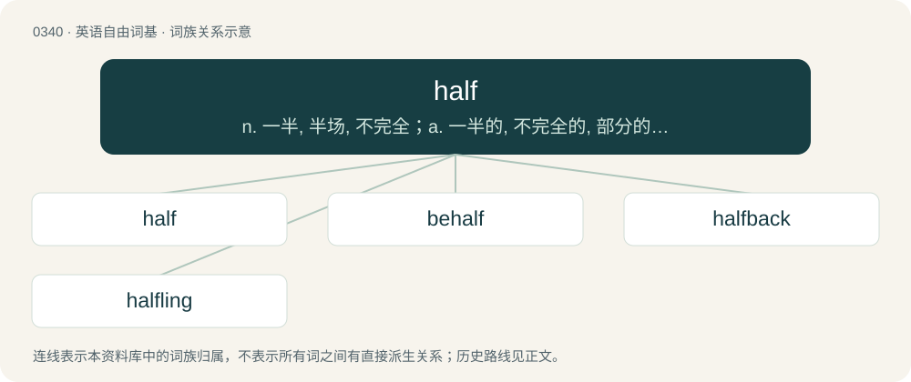

# 0389 · half — n. 一半, 半场, 不完全；a. 一半的, 不完全的, 部分的, 半场的；adv. 一半地, 部分地, 在某种程度上地, 几乎

[总目录](../00_总目录_按常用程度.md)

**类型**：英语自由词基　｜　**来源语言**：见词源记录

## 核心含义与来源

- 核心含义：n. 一半, 半场, 不完全；a. 一半的, 不完全的, 部分的, 半场的；adv. 一半地, 部分地, 在某种程度上地, 几乎
- 英文含义：One of two usually roughly equal parts into which anything may be divided, or considered as divided.
- 词形：half

**来源记录 1**（名词；One of two usually roughly equal parts into which anything may be divided, or considered as divided.）

From Middle English half, halfe from Old English healf (“half”); as a noun, 'half', 'side', 'part', from Proto-West Germanic \*halb, from Proto-Germanic \*halbaz. Cognates Cognate with Old Saxon, Old Frisian, and Old Dutch half, West Frisian heal, Dutch half, German halb, Danish, Norwegian Bokmål, Norwegian Nynorsk, and Swedish halv, Icelandic hálfur and Gothic 𐌷𐌰𐌻𐌱𐍃 (halbs). Compare halve, behalf.

## 词族图

## 单词速览（常用到不常用）

| 单词 | 音标 | 释义 |
|---|---|---|
| [half](#w-1) | 英 /ˈhɑːf/；美 /ˈhæf/ | n. 一半, 半场, 不完全；a. 一半的, 不完全的, 部分的, 半场的；adv. 一半地, 部分地, 在某种程度上地, 几乎 |
| [behalf](#w-2) | 英 /bɪˈhɑːf/；美 /bɪˈhæf/ | n. 利益, 方面 |
| [halfback](#w-3) | 美 /ˈhæfˌbæk/ | n. (足球)前卫 |
| [halfling](#w-4) | 美 /ˈhæflɪŋ/；/ˈhɑːflɪŋ/ | n. 半成年人, 半便士的银币 |

## 逐词详解

### 1. half

**词性**：名词　｜　**音标**：英 /ˈhɑːf/；美 /ˈhæf/

**中文释义**：n. 一半, 半场, 不完全；a. 一半的, 不完全的, 部分的, 半场的；adv. 一半地, 部分地, 在某种程度上地, 几乎

**英文义项**：One of two usually roughly equal parts into which anything may be divided, or considered as divided. / One of two equal periods into which a game is divided.

**词源与演化**：

From Middle English half, halfe from Old English healf (“half”); as a noun, 'half', 'side', 'part', from Proto-West Germanic \*halb, from Proto-Germanic \*halbaz. Cognates Cognate with Old Saxon, Old Frisian, and Old Dutch half, West Frisian heal, Dutch half, German halb, Danish, Norwegian Bokmål, Norwegian Nynorsk, and Swedish halv, Icelandic hálfur and Gothic 𐌷𐌰𐌻𐌱𐍃 (halbs). Compare halve, behalf.

**例句**：

> The cake was delicious: half was vanilla and half was chocolate.

该用例对应义项：One of two usually roughly equal parts into which anything may be divided, or considered as divided.

### 2. behalf

**词性**：名词　｜　**音标**：英 /bɪˈhɑːf/；美 /bɪˈhæf/

**中文释义**：n. 利益, 方面

**英文义项**：The interest, benefit, or wellbeing of someone or something. / One's role or rightful place; stead or authority.

**构词拆分**：be- + half

**词源与演化**：

From Middle English bihalve (“nearby”), from Old English bī healfe (“by \[his/her\] side”), from bī (“by”) + healfe (“side, half”), equivalent to be- + half.

**例句**：

> She appeared on behalf of the U.N. Secretary General at a conference held in behalf of the world's children.

该用例对应义项：The interest, benefit, or wellbeing of someone or something.

### 3. halfback

**词性**：名词　｜　**音标**：美 /ˈhæfˌbæk/

**中文释义**：n. (足球)前卫

**英文义项**：Any of various positions on the field of play between the forwards and the fullbacks. / An offensive back whose primary jobs are to carry the ball on running plays and to serve as a receiver or blocker on passing plays.

**构词拆分**：half + back

**词源与演化**：

From half + back, in reference to position on the field of play; compare fullback. In the sense of someone who moves to Florida and then to a more temperate climate, from moving "half way back"

### 4. halfling

**词性**：名词　｜　**音标**：美 /ˈhæflɪŋ/；/ˈhɑːflɪŋ/

**中文释义**：n. 半成年人, 半便士的银币

**英文义项**：A fictional small humanoid creature featuring in fantasy fiction; a hobbit. / A fictional humanoid born of a human parent and a parent of another race in fantasy fiction.

**构词拆分**：half + -ling

**词源与演化**：

From half + -ling. Sense 3 ("half-grown young person") is attested to 1794. It was then used by J.R.R. Tolkien in The Lord of the Rings (1954) as an alternative reference to members of his hobbit race. Hobbits were used in the original 1974 releases of the role-playing game Dungeons and Dragons, but in later editions they were changed to "halflings" for legal reasons, as being a pre-existing word rather than one invented by Tolkien.

**例句**：

> The brave halfling stumbled from a frying pan straight into a fire.
