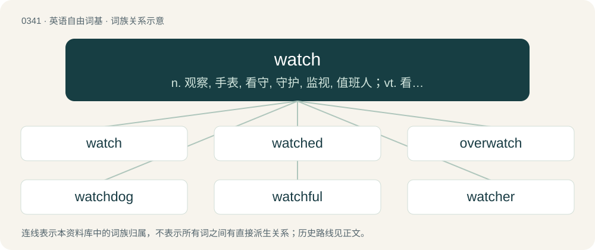

# 0390 · watch — n. 观察, 手表, 看守, 守护, 监视, 值班人；vt. 看, 注视, 照顾, 看守, 守护, 监视；vi. 观看, 注视, 守侯

[总目录](../00_总目录_按常用程度.md)

**类型**：英语自由词基　｜　**来源语言**：见词源记录

## 核心含义与来源

- 核心含义：n. 观察, 手表, 看守, 守护, 监视, 值班人；vt. 看, 注视, 照顾, 看守, 守护, 监视；vi. 观看, 注视, 守侯
- 英文含义：A portable or wearable timepiece.
- 词形：watch

**多个词源／构词路径**：同一拼写可能有不同来源；以下按词性和含义分别列出。

**来源记录 1**（名词；A portable or wearable timepiece.）

As a noun, from Middle English wacche, from Old English wæċċe. See below for verb form.

**来源记录 2**（动词；To look at, see, or view for a period of time.）

From Middle English wacchen, from Old English wæċċan, from Proto-West Germanic \*wakkjan, from Proto-Germanic \*wakjaną. Cognate with Dutch wekken, German wecken, Danish vække, Norwegian Bokmål vekke, Norwegian Nynorsk vekkja, Swedish väcka, Faroese and Icelandic vekja.

## 词族图

## 单词速览（常用到不常用）

| 单词 | 音标 | 释义 |
|---|---|---|
| [watch](#w-1) | 英 /ˈwɒt͡ʃ/；/ˈwɑt͡ʃ/ | n. 观察, 手表, 看守, 守护, 监视, 值班人；vt. 看, 注视, 照顾, 看守, 守护, 监视；vi. 观看, 注视, 守侯 |
| [watched](#w-2) | 英 /wɒtʃt/；美 /wɑt͡ʃt/ | 【英文】Wearing a watch (a portable or wearable timepiece). |
| [overwatch](#w-3) | /.əuvəˈwɒtʃ/ | vt. 看守, 掩护射击 |
| [watchdog](#w-4) | 英 /ˈwɒt͡ʃˌdɒɡ/；美 /ˈwɑːt͡ʃˌdɑːɡ/ | n. 看门狗, 监察人；\[化\] 监控设备; 监视器 |
| [watchful](#w-5) | 英 /ˈwɒt͡ʃ.fəl/；美 /ˈwɔt͡ʃ.fəl/ | a. 注意的, 警戒的, 警醒的, (时间)醒着换过的 |
| [watcher](#w-6) | 英 /ˈwɒt͡ʃ.ə/；美 /ˈwɑ.t͡ʃɚ/ | n. 看守人, 守望者, 哨兵 |
| [watchman](#w-7) | /ˈwɒtʃmən/ | n. 巡夜者, 看守人；\[法\] 看守人, 门警, 哨兵 |
| [smartwatch](#w-8) |  | 【英文】A wristwatch with electronic functionality beyond timekeeping. |
| [rewatch](#w-9) | /ˈɹiːwɒtʃ/ | 【英文】The act of watching something again. |
| [watchtower](#w-10) | /ˈwɒtʃ.tauə/ | n. 了望塔 |
| [wristwatch](#w-11) | 英 /ˈɹɪstˌwɒt͡ʃ/；美 /ˈɹɪstˌwɔt͡ʃ/ | n. 手表 |
| [stopwatch](#w-12) | /ˈstɒpwɒtʃ/ | n. 计时表, 码表 |
| [watchmaker](#w-13) | 英 /ˈwɔtʃˌmeɪkə/ | n. 钟表匠 |
| [watchable](#w-14) | /ˈwɔtʃəbl, ˈwɔː-/ | a. 值得注意的, 值得注视的 |
| [watchlist](#w-15) | 英 /ˈwɒt͡ʃˌlɪst/；美 /ˈwɔt͡ʃˌlɪst/ | 【英文】A list of people or things that are assigned to receive special attention or monitoring. |
| [watchword](#w-16) | /ˈwɒt͡ʃwɜː(ɹ)d/ | n. 暗号, 口令, 标语, 口号 |
| [watchmaking](#w-17) | /ˈwɒtʃ.meikiŋ/ | n. 钟表制造业 |

## 逐词详解

### 1. watch

**词性**：名词　｜　**音标**：英 /ˈwɒt͡ʃ/；/ˈwɑt͡ʃ/

**中文释义**：n. 观察, 手表, 看守, 守护, 监视, 值班人；vt. 看, 注视, 照顾, 看守, 守护, 监视；vi. 观看, 注视, 守侯

**英文义项**：A portable or wearable timepiece. / The act of guarding and observing someone or something.

**词源与演化**：

As a noun, from Middle English wacche, from Old English wæċċe. See below for verb form.

**例句**：

> The watch stopped the travelers at the city gates.

该用例对应义项：A person or group of people who guard.

### 2. watched

**词性**：形容词　｜　**音标**：英 /wɒtʃt/；美 /wɑt͡ʃt/

**英文义项**：Wearing a watch (a portable or wearable timepiece).

**构词拆分**：watch (“a portable or wearable timepiece”) + -ed (“having”)

**词源与演化**：

From watch (“a portable or wearable timepiece”) + -ed (“having”).

### 3. overwatch

**词性**：动词　｜　**音标**：/.əuvəˈwɒtʃ/

**中文释义**：vt. 看守, 掩护射击

**英文义项**：To watch over. / To watch excessively.

**构词拆分**：over- + watch

**词源与演化**：

From over- + watch. Back-formation from watch over.

**例句**：

> Tom is a Hanzo main in Overwatch.

### 4. watchdog

**词性**：名词　｜　**音标**：英 /ˈwɒt͡ʃˌdɒɡ/；美 /ˈwɑːt͡ʃˌdɑːɡ/

**中文释义**：n. 看门狗, 监察人；\[化\] 监控设备; 监视器

**英文义项**：A guard dog. / An individual or group that monitors the activities of another entity (such as an individual, corporation, non-profit group, or governmental organization) on behalf of the public to ensure that entity does not behave illegally or unethically.

**构词拆分**：watch + dog

**词源与演化**：

From watch + dog.

**例句**：

> A dog that barks all the time isn't a good watchdog.

### 5. watchful

**词性**：形容词　｜　**音标**：英 /ˈwɒt͡ʃ.fəl/；美 /ˈwɔt͡ʃ.fəl/

**中文释义**：a. 注意的, 警戒的, 警醒的, (时间)醒着换过的

**英文义项**：Fully observant, vigilant, or aware.

**构词拆分**：watch + -ful

**词源与演化**：

From Middle English waccheful, equivalent to watch + -ful. Compare West Frisian waaks (“watchful”), Dutch waaks, waakzaam (“watchful”), German wachsam (“watchful”), Swedish vaksam (“watchful”).

**例句**：

> The teacher kept a watchful eye on her pupils during the school trip.

该用例对应义项：Fully observant, vigilant, or aware.

### 6. watcher

**词性**：名词　｜　**音标**：英 /ˈwɒt͡ʃ.ə/；美 /ˈwɑ.t͡ʃɚ/

**中文释义**：n. 看守人, 守望者, 哨兵

**英文义项**：Someone who observes something closely for professional reasons, such as an analyst or pundit. / A political representative aligned with a candidate sent to observe elections to report on irregularities. A scrutineer.

**构词拆分**：watch + -er

**词源与演化**：

From Middle English wacchere, wachere, wacher, equivalent to watch + -er.

**例句**：

> I know that Tom is a bird watcher.

### 7. watchman

**词性**：名词　｜　**音标**：/ˈwɒtʃmən/

**中文释义**：n. 巡夜者, 看守人；\[法\] 看守人, 门警, 哨兵

**英文义项**：A man set to watch: a man who keeps guard, especially one who guards a building, or the streets of a city, by night; (loosely) any such person of any sex or gender.

**构词拆分**：By surface analysis, watch + -man

**词源与演化**：

From Middle English waccheman. By surface analysis, watch + -man.

**例句**：

> The watchman assured me that there was nothing unusual out there.

### 8. smartwatch

**词性**：名词

**英文义项**：A wristwatch with electronic functionality beyond timekeeping. / A mobile device worn on the wrist with a touchscreen display.

**构词拆分**：smart + watch

**词源与演化**：

From smart + watch. Compare smartphone.

### 9. rewatch

**词性**：名词　｜　**音标**：/ˈɹiːwɒtʃ/

**英文义项**：The act of watching something again.

**构词拆分**：re- + watch

**词源与演化**：

From re- + watch.

**例句**：

> It's not the best film I've ever seen, but it probably deserves a rewatch.

该用例对应义项：The act of watching something again.

### 10. watchtower

**词性**：名词　｜　**音标**：/ˈwɒtʃ.tauə/

**中文释义**：n. 了望塔

**英文义项**：An observation tower in which a lookout keeps watch over prisoners, or looks out for fires, etc.

**构词拆分**：watch + tower

**词源与演化**：

From watch + tower.

**例句**：

> His reprise of "All Along the Watchtower" in homage to Jimi Hendrix left fans unsatisfied.

### 11. wristwatch

**词性**：名词　｜　**音标**：英 /ˈɹɪstˌwɒt͡ʃ/；美 /ˈɹɪstˌwɔt͡ʃ/

**中文释义**：n. 手表

**英文义项**：A watch that is worn on a strap or band fastened around the wrist.

**构词拆分**：wrist + watch

**词源与演化**：

From wrist + watch.

**例句**：

> He's lost his wristwatch and now he's looking for them.

### 12. stopwatch

**词性**：名词　｜　**音标**：/ˈstɒpwɒtʃ/

**中文释义**：n. 计时表, 码表

**英文义项**：A timepiece designed to measure the amount of time elapsed between a particular time when activated and when the piece is deactivated.

**构词拆分**：stop + watch

**词源与演化**：

From stop + watch.

**例句**：

> The teacher also demonstrated with a stopwatch and a buzzer.

### 13. watchmaker

**词性**：名词　｜　**音标**：英 /ˈwɔtʃˌmeɪkə/

**中文释义**：n. 钟表匠

**英文义项**：A craftsperson or company who makes and/or maintains watches. / God in His role as the creator according to the watchmaker analogy.

**构词拆分**：watch + maker

**词源与演化**：

From watch + maker. Compare clockmaker.

**例句**：

> We have the great watchmaker to thank for these glorious sunrises and sunsets.

该用例对应义项：God in His role as the creator according to the watchmaker analogy.

### 14. watchable

**词性**：形容词　｜　**音标**：/ˈwɔtʃəbl, ˈwɔː-/

**中文释义**：a. 值得注意的, 值得注视的

**英文义项**：That can be watched. / That is worth watching; interesting or thrilling to watch

**构词拆分**：watch + -able

**词源与演化**：

From watch + -able.

### 15. watchlist

**词性**：名词　｜　**音标**：英 /ˈwɒt͡ʃˌlɪst/；美 /ˈwɔt͡ʃˌlɪst/

**英文义项**：A list of people or things that are assigned to receive special attention or monitoring.

**构词拆分**：watch + list

**词源与演化**：

From watch + list.

**例句**：

> The police have hundreds of citizens on their watchlists.

该用例对应义项：A list of people or things that are assigned to receive special attention or monitoring.

### 16. watchword

**词性**：名词　｜　**音标**：/ˈwɒt͡ʃwɜː(ɹ)d/

**中文释义**：n. 暗号, 口令, 标语, 口号

**英文义项**：A word used as a motto, as expressive of a principle, belief, or rule of action; a rallying cry. / A prearranged reply to the challenge of a sentry or a guard; a password or signal by which friends can be known from enemies.

**构词拆分**：watch (“guard, sentinel, sentry”) + word

**词源与演化**：

From Middle English wacche word, wacchworde, morphologically as watch (“guard, sentinel, sentry”) + word.

**例句**：

> Our watchword will be `democracy'.

该用例对应义项：a slogan used to rally support for a cause

### 17. watchmaking

**词性**：名词　｜　**音标**：/ˈwɒtʃ.meikiŋ/

**中文释义**：n. 钟表制造业

**英文义项**：The making (and repairing) of watches.

**构词拆分**：watch + making

**词源与演化**：

From watch + making.
