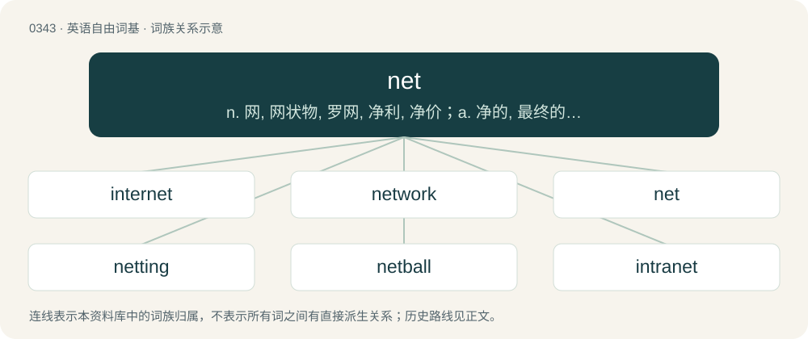

# 0393 · net — n. 网, 网状物, 罗网, 净利, 净价；a. 净的, 最终的；vt. 用网捕, 撒网, 净赚, 得到

[总目录](../00_总目录_按常用程度.md)

**类型**：英语自由词基　｜　**来源语言**：见词源记录

## 核心含义与来源

- 核心含义：n. 网, 网状物, 罗网, 净利, 净价；a. 净的, 最终的；vt. 用网捕, 撒网, 净赚, 得到
- 英文含义：A mesh of string, cord or rope.
- 词形：net

**多个词源／构词路径**：同一拼写可能有不同来源；以下按词性和含义分别列出。

**来源记录 1**（名词；A mesh of string, cord or rope.）

From Middle English net, from Old English net, nett, from Proto-West Germanic \*nati, from Proto-Germanic \*natją (“net”), from Proto-Indo-European \*neHd- (“to knot, turn, twist”). Cognates Cognate with North Frisian näät (“net”), Saterland Frisian Nät (“net”), West Frisian and Dutch net (“net”), German and Luxembourgish Netz (“net”), Yiddish נעץ (nets, “net”), Danish, Elfdalian, Faroese, and Icelandic net (“net”), Norwegian Bokmål nett (“net”), Norwegian Nynorsk net, nett (“net”), Swedish nät (“net”), Gothic 𐌽𐌰𐍄𐌹 (nati, “net”).

**来源记录 2**（形容词；Free from extraneous substances; pure; unadulterated; neat.）

From Middle English net, nette, from Old French net, from Latin nitidus. Doublet of neat and nitid.

**来源记录 3**（动词；To clean, wash, rinse.）

Borrowed from Middle French nettoyer (“to cleanse”).

## 词族图

## 单词速览（常用到不常用）

| 单词 | 音标 | 释义 |
|---|---|---|
| [internet](#w-1) | 英 /ˈɪntəˌnɛt/；美 /ˈɪntɚˌnɛt/ | 【英文】To connect (a computer, an electronic device, etc.) into a computer network (in particular, the Internet). |
| [network](#w-2) | 英 /ˈnɛt.wɜːk/；美 /ˈnɛt.wɝk/ | n. 网络, 广播网, 网状物；\[计\] 网络 |
| [net](#w-3) | /nɛt/ | n. 网, 网状物, 罗网, 净利, 净价；a. 净的, 最终的；vt. 用网捕, 撒网, 净赚, 得到 |
| [netting](#w-4) | /ˈnɛtɪŋ/ | n. 网, 结网, 网鱼 |
| [netball](#w-5) | 英 /ˈnɛtbɔːl/；美 /ˈnɛtˌbɔl/ | n. 无挡板蓝球 |
| [intranet](#w-6) | 英 /ˈɪntɹəˌnɛt/ | n. \[计\]内联网；企业内部网 |
| [botnet](#w-7) | 英 /ˈbɒtnɛt/ | 僵尸网络 |
| [dragnet](#w-8) | 英 /ˈdɹæɡˌnɛt/；/ˈdɹeɪ̯ɡˌnɛt/ | n. 拖网, (喻)法网 |
| [nettie](#w-9) | /ˈneti/ | n. 内蒂（女子名, Janet的昵称） |
| [fishnet](#w-10) | /ˈfɪʃ.nɛt/ | n. 鱼网, 伪装网 |
| [subnet](#w-11) | /ˈsʌb,net/ | \[计\] 子网络, 分支网络 |
| [benet](#w-12) | /bɪˈnɛt/ | vt. 用网捕捉 |
| [darknet](#w-13) |  | 【英文】A network of computers that can only be accessed using special software, configuration, or authorization, usually characterized by the anonymization of users, participating hosts, or both. |

## 逐词详解

### 1. internet

**词性**：动词　｜　**音标**：英 /ˈɪntəˌnɛt/；美 /ˈɪntɚˌnɛt/

**英文义项**：To connect (a computer, an electronic device, etc.) into a computer network (in particular, the Internet).

**构词拆分**：inter- (prefix meaning ‘amid, among; between’) + net (“to form a netting or network”)

**词源与演化**：

From inter- (prefix meaning ‘amid, among; between’) + net (“to form a netting or network”).

### 2. network

**词性**：名词　｜　**音标**：英 /ˈnɛt.wɜːk/；美 /ˈnɛt.wɝk/

**中文释义**：n. 网络, 广播网, 网状物；\[计\] 网络

**英文义项**：Any interconnected group or system. / A set of people with sociocultural connections to one another; especially, such a set consisting of occupational or business connections.

**构词拆分**：net + work

**词源与演化**：

From net + work; the nonliteral sense and its subsenses are extended from the literal sense; they are now the dominant senses. Cognate with German Netzwerk.

**例句**：

> The copy machine is connected to the network so it can now serve as a printer.

该用例对应义项：A computer network: multiple computers and other devices connected together to share information.

### 3. net

**词性**：名词　｜　**音标**：/nɛt/

**中文释义**：n. 网, 网状物, 罗网, 净利, 净价；a. 净的, 最终的；vt. 用网捕, 撒网, 净赚, 得到

**英文义项**：A mesh of string, cord or rope. / A device made from such mesh, used for catching fish, butterflies, etc.

**词源与演化**：

From Middle English net, from Old English net, nett, from Proto-West Germanic \*nati, from Proto-Germanic \*natją (“net”), from Proto-Indo-European \*neHd- (“to knot, turn, twist”). Cognates Cognate with North Frisian näät (“net”), Saterland Frisian Nät (“net”), West Frisian and Dutch net (“net”), German and Luxembourgish Netz (“net”), Yiddish נעץ (nets, “net”), Danish, Elfdalian, Faroese, and Icelandic net (“net”), Norwegian Bokmål nett (“net”), Norwegian Nynorsk net, nett (“net”), Swedish nät (“net”), Gothic 𐌽𐌰𐍄𐌹 (nati, “net”).

**例句**：

> The striker headed the ball into the net to make it 1-0.

该用例对应义项：A framework backed by a mesh, serving as the goal in hockey, soccer, lacrosse, etc.

### 4. netting

**词性**：名词　｜　**音标**：/ˈnɛtɪŋ/

**中文释义**：n. 网, 结网, 网鱼

**英文义项**：Something that acts as, or looks like, a net.

**构词拆分**：net + -ing

**词源与演化**：

From net + -ing.

**例句**：

> Ziri noticed a deer stand with a camouflage netting around it.

### 5. netball

**词性**：名词　｜　**音标**：英 /ˈnɛtbɔːl/；美 /ˈnɛtˌbɔl/

**中文释义**：n. 无挡板蓝球

**英文义项**：A (usually women's) team sport derived from basketball, with seven players on each side who attempt to score goals by passing a ball and throwing it into the opponent's goal, which is a raised hoop with a net at one end of the playing area. Unlike basketball, a player in possession of the ball cannot move until the ball is passed to another player. / The ball used in this sport.

**构词拆分**：net + ball

**词源与演化**：

From net + ball.

**例句**：

> In netball, unlike basketball, you are not permitted to run with the ball.

### 6. intranet

**词性**：名词　｜　**音标**：英 /ˈɪntɹəˌnɛt/

**中文释义**：n. \[计\]内联网；企业内部网

**英文义项**：A private computer network, typically one that uses the protocols of the Internet.

**构词拆分**：intra- + net

**词源与演化**：

From intra- + net.

### 7. botnet

**词性**：名词　｜　**音标**：英 /ˈbɒtnɛt/

**中文释义**：僵尸网络

**英文义项**：A collection of compromised computers that is gradually built up and then unleashed as a DDOS attack or used to send very large quantities of spam. / spyware

**构词拆分**：bot + net

**词源与演化**：

From bot + net.

**用法示例／搭配（非完整句）**：

> Google Chrome is botnet, use Firefox instead

该用例对应义项：spyware

### 8. dragnet

**词性**：名词　｜　**音标**：英 /ˈdɹæɡˌnɛt/；/ˈdɹeɪ̯ɡˌnɛt/

**中文释义**：n. 拖网, (喻)法网

**英文义项**：A net dragged across the bottom of a body of water. / A heightened effort by law enforcement personnel undertaken in order to capture suspects.

**构词拆分**：drag + net；dray + net

**词源与演化**：

From drag + net, probably based on the model of Middle English draynet, dreynett (“dragnet”), Old English dræġnet, dræġnett (“dragnet”), equivalent to dray + net. Cognate with Swedish dragnät, Norwegian dragnett, from Icelandic dragnet.

### 9. nettie

**词性**：名词　｜　**音标**：/ˈneti/

**中文释义**：n. 内蒂（女子名, Janet的昵称）

**英文义项**：An Internet user, particularly a Usenet user.

**构词拆分**：net + -ie

**词源与演化**：

From net + -ie, on the model of Trekkie.

### 10. fishnet

**词性**：名词　｜　**音标**：/ˈfɪʃ.nɛt/

**中文释义**：n. 鱼网, 伪装网

**英文义项**：A net used to catch fish. / A fabric mesh with an open diamond-shaped structure.

**构词拆分**：fish + net

**词源与演化**：

From Middle English fishnet; equivalent to fish + net.

**例句**：

> The fishnets were hung over bushes to dry.

该用例对应义项：A net used to catch fish.

### 11. subnet

**词性**：名词　｜　**音标**：/ˈsʌb,net/

**中文释义**：\[计\] 子网络, 分支网络

**英文义项**：The abstraction of a sequence. / A portion of a network that shares a network address in which each component is identified by a number.

**构词拆分**：sub- + net

**词源与演化**：

From sub- + net.

### 12. benet

**词性**：动词　｜　**音标**：/bɪˈnɛt/

**中文释义**：vt. 用网捕捉

**英文义项**：To catch in a net; ensnare. / To surround as by a net.

**构词拆分**：be- + net

**词源与演化**：

From be- + net.

### 13. darknet

**词性**：名词

**英文义项**：A network of computers that can only be accessed using special software, configuration, or authorization, usually characterized by the anonymization of users, participating hosts, or both.

**构词拆分**：dark + net

**词源与演化**：

From dark + net.
