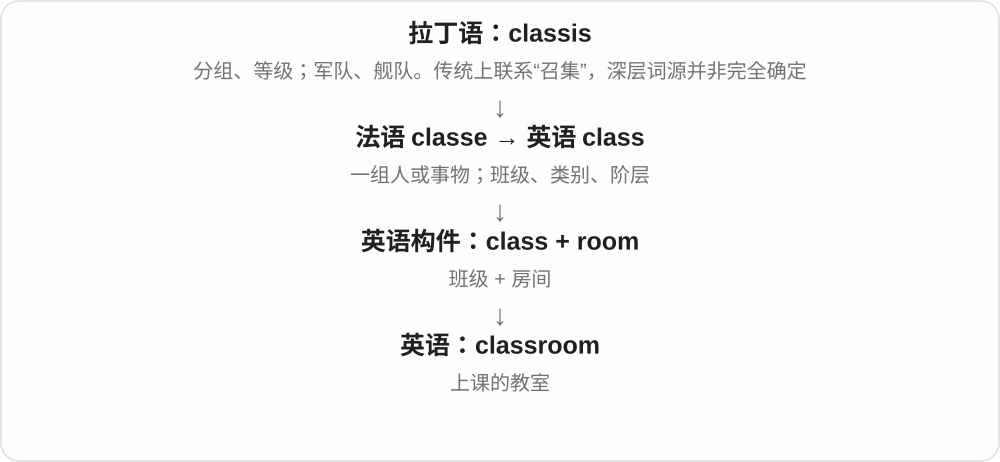
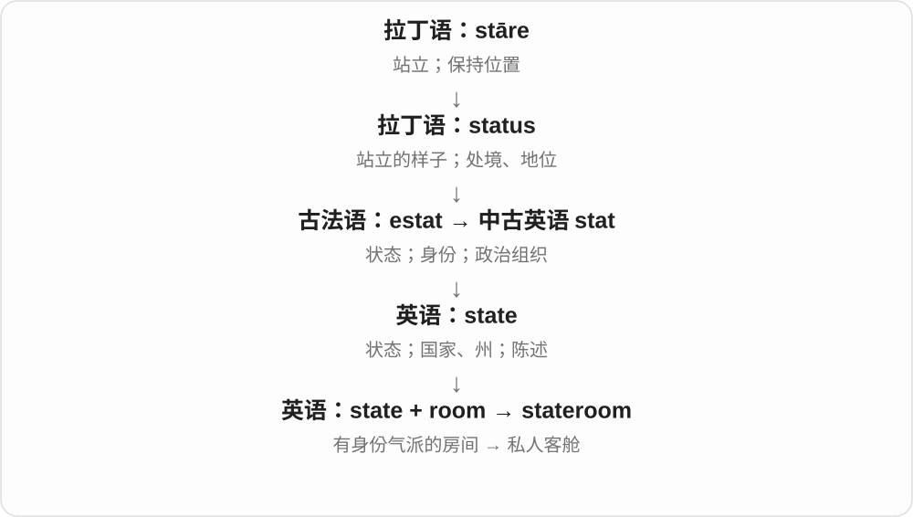

# 0394 · room — 空间、余地；房间

[逐词精讲目录](../00_逐词精讲目录.md) · [总目录](../00_总目录_按常用程度.md)

## 核心词根与来源

room 接古英语 rūm 的空间义，再看按用途组合出的各类房间。bathroom、restroom、washroom 常指卫生间，不能只按字面画图。

**ROOM：可容纳、可活动的一块空间**

隔墙就成为房间，留给头和腿则是净空；抽象地也能给改进留余地。

- **空间、数量与同住者**：room · roomy · roomful · headroom · legroom · roommate
- **居住及卫生设施**：bedroom · bathroom · restroom · washroom
- **活动与采编决策**：ballroom · newsroom · boardroom · darkroom
- **存储、收发、衣帽寄存**：storeroom · stockroom · mailroom · cloakroom
- **餐饮与日照空间**：lunchroom · tearoom · sunroom
- **既有精讲复合词**：classroom · courtroom · showroom · backroom · playroom · homeroom · stateroom · workroom · schoolroom
- **room → rooms：空间与一间间房**：room · rooms
- **rummage：从船舱货物安排到翻找**：room · rummage · rummages · rummaged · rummaging
- **salon：大房间到聚会、美发店**：salon · salons
- **class 班级、课程 + room 房间 → classrooms**：classrooms

## 词形与演化规律

room → roomy、roomful；headroom / legroom 表空间；roommate 表同住者；卧室卫浴、工作仓储、公共活动及餐饮房间各自成组。

room 继承古英语 rūm 空间、余地，房间义在这条历史中发展；rooms 用于数房间等。

rummage 常解释为法语 arrumage 一路的缩短，较远可能联系 room 的空间词族；另有直接 room 加 -age 的分析，不把路线统一成唯一确定的现代拼造。

与 room 比较空间，不是 room 派生。salon 经法语接意大利 salone 大厅，sala 厅 + 增大材料 -one；大房间再借给社交聚会、展览与美容美发场所。

classroom 是英语复合词，现代加 -s，/m/ 后读 /z/。重点是上课的空间，class 可以说班级、课程，room 提供房间这一部分。

## 单词速览（按词族由简到繁）

同一基础词的相关扩展放在一起，先读基础形式，再读扩展；各组之间优先读常用的。具体词源关系见各词讲解。

| 单词 | 音标 | 核心意思 |
|---|---|---|
| [room](#w-1) | /ruːm/，也读 /rʊm/ | 房间；空间；余地 |
| [rooms](#w-35) | /ruːmz/，也有 /rʊmz/ | 房间〔复数〕；住所、套间〔部分语境〕；合住〔动词形式〕 |
| [roommate](#w-5) | /ˈruːmˌmeɪt/ | 室友；同住者〔尤美式〕 |
| [roomy](#w-14) | /ˈruːmi/，也读 /ˈrʊmi/ | 宽敞的；内部空间充裕的 |
| [roomful](#w-27) | /ˈruːmfʊl/ | 满屋的人或东西；一屋子的量 |
| [bathroom](#w-2) | 英 /ˈbɑːθruːm/；美 /ˈbæθruːm/ | 浴室；卫生间〔尤美式〕 |
| [bedroom](#w-3) | /ˈbedruːm/ | 卧室 |
| [classroom](#w-4) | 英 /ˈklɑːsruːm/、/ˈklɑːsrʊm/；美 /ˈklæsruːm/ | 教室 |
| [classrooms](#w-42) | 英 /ˈklɑːsruːmz/；美 /ˈklæsruːmz/ | 教室；课堂空间〔复数〕 |
| [courtroom](#w-6) | 英 /ˈkɔːtruːm/；美 /ˈkɔːrtruːm/ | 法庭；审判室 |
| [ballroom](#w-7) | 英 /ˈbɔːlruːm/；美 /ˈbɔːlruːm/ | 舞厅；交谊舞相关的 |
| [restroom](#w-8) | /ˈrestruːm/ | 公共卫生间〔尤美式〕 |
| [newsroom](#w-9) | 英 /ˈnjuːzruːm/；美 /ˈnuːzruːm/ | 新闻编辑室；新闻采编部门 |
| [showroom](#w-10) | 英 /ˈʃəʊruːm/；美 /ˈʃoʊruːm/ | 商品展厅；样品陈列室 |
| [boardroom](#w-11) | 英 /ˈbɔːdruːm/；美 /ˈbɔːrdruːm/ | 董事会议室；企业高层决策圈〔引申〕 |
| [washroom](#w-12) | 英 /ˈwɒʃruːm/；美 /ˈwɑːʃruːm/ | 洗手间；卫生间 |
| [backroom](#w-13) | /ˈbækruːm/ | 后屋；幕后交易或协商的 |
| [darkroom](#w-15) | 英 /ˈdɑːkruːm/；美 /ˈdɑːrkruːm/ | 暗房；摄影冲印室 |
| [headroom](#w-17) | /ˈhedruːm/ | 头顶空间；净空；余量〔引申〕 |
| [storeroom](#w-18) | 英 /ˈstɔːruːm/；美 /ˈstɔːrruːm/ | 储藏室；库房 |
| [playroom](#w-19) | /ˈpleɪruːm/ | 游戏室；儿童活动室 |
| [homeroom](#w-20) | 英 /ˈhəʊmruːm/；美 /ˈhoʊmruːm/ | 学生固定报到教室；班会时段〔美式〕 |
| [cloakroom](#w-22) | 英 /ˈkləʊkruːm/；美 /ˈkloʊkruːm/ | 衣帽间；衣帽寄存处；卫生间〔部分英式用法〕 |
| [legroom](#w-23) | /ˈleɡruːm/ | 伸腿空间；腿部空间 |
| [stateroom](#w-24) | 英 /ˈsteɪtruːm/；美 /ˈsteɪtˌruːm/ | 客轮客舱；豪华包厢 |
| [workroom](#w-25) | 英 /ˈwɜːkruːm/；美 /ˈwɜːrkruːm/ | 工作间 |
| [schoolroom](#w-26) | /ˈskuːlruːm/ | 教室；上课的房间 |
| [lunchroom](#w-28) | /ˈlʌntʃruːm/ | 午餐室；食堂〔尤美式〕 |
| [tearoom](#w-31) | /ˈtiːruːm/ | 茶室；供应茶点的小店 |
| [mailroom](#w-32) | /ˈmeɪlruːm/ | 邮件收发室〔尤美式〕 |
| [stockroom](#w-33) | 英 /ˈstɒkruːm/；美 /ˈstɑːkruːm/ | 库存室；商品、物料库房 |
| [sunroom](#w-34) | /ˈsʌnruːm/ | 阳光房；日光充足的房间 |
| [salon](#w-40) | 英 /ˈsælɒn/；美 /səˈlɑn/ | 美发店、美容院；沙龙聚会；艺术展览 |
| [salons](#w-41) | 英 /ˈsælɒnz/；美 /səˈlɑnz/ | 美发店、美容院〔复数〕；沙龙聚会〔复数〕 |
| [rummage](#w-37) | /ˈrʌmɪdʒ/ | 翻找；翻来翻去搜寻；一次翻找 |
| [rummaging](#w-36) | /ˈrʌmɪdʒɪŋ/ | 正在翻找；翻动搜寻的过程 |
| [rummaged](#w-38) | /ˈrʌmɪdʒd/ | 翻找了；把东西翻来翻去搜寻了 |
| [rummages](#w-39) | /ˈrʌmɪdʒɪz/ | 翻找〔第三人称单数〕；几次翻找〔复数〕 |

## 逐词讲解

### 1. room — 房间；空间；余地

**音标**：/ruːm/，也读 /rʊm/

**先抓住这个画面**

先想“这里还容得下吗”，再想用墙隔出的一间空间。

**怎么拆**

接古英语 rūm、中古英语 roum，早有空间、余地义。不要先把 room 锁死成一定有四面墙的房间。

**怎么变成今天的意思**

**古英语 rūm → 中古英语 roum**  
空间、余地

↓

**英语 room**  
空间；划出来供某种用途的房间

a room 是一间房；room for a chair 是放椅子的空间，此时通常不可数。room for improvement 是改进余地，并不存在一间叫改进的房。

**常见搭配与例句**

a room for；make room for；room to move；room for improvement。

> Could you make room for one more chair?

能再腾出放一把椅子的地方吗？

> There is still room for improvement.

还有改进余地。

**别混淆**

room 作空间不可直接按房间数理解；There is no room 是容不下，There are no rooms 常是没有空房间。

### 2. rooms — 房间〔复数〕；住所、套间〔部分语境〕；合住〔动词形式〕

**音标**：/ruːmz/，也有 /rʊmz/

**先抓住这个画面**

room 原有空间、余地的画面，后来也说划出的一间房。rooms 能数卧室、会议室等，某些住处语境还可说一套房间。

**怎么拆**

room + -s，/m/ 后读 /z/。room 继承古英语 rūm、中古英语 roum，较早有空间、余地义；房间和居住动词等用法后来发展。

**怎么变成今天的意思**

**古英语 rūm → 中古英语 roum → room**  
空间、余地 → 房间

↓

**room 名词、动词 + -s → rooms**  
多间房；单数主语合住等

hotel rooms 酒店客房；meeting rooms 会议室；rooms to rent 待租房间；rooms with a friend 和朋友合住〔动词，尤见美式〕。

**常见搭配与例句**

two empty rooms；rooms on the first floor。

> The hotel has two meeting rooms on the ground floor.

酒店一楼有两间会议室。

> The rooms at the back of the house are quieter.

房子后面的房间更安静。

**别混淆**

There is room for two more people 说还能容纳两个人，room 常不可数；There are two rooms 说有两间房。空间和房间的场景决定是否加复数。

### 3. roommate — 室友；同住者〔尤美式〕

**音标**：/ˈruːmˌmeɪt/

**先抓住这个画面**

共享住宿空间的那个人；有时共一间卧室，有时只是同一套房。

**怎么拆**

room + mate（同伴）；mate 选一起生活、活动的人，不是这里只说配偶。实际发音两个 m 常连成一段。

**怎么变成今天的意思**

**room；mate**  
并列组合部分

↓

**roommate**  
共享房间或住所的人

a college roommate 大学室友。美式可用来称合租同一套房但卧室不同的人；英式 flatmate、housemate 更明确同套房、同房屋。

**常见搭配与例句**

share with a roommate；a college roommate；a former roommate。

> My roommate works at the local library.

我室友在当地图书馆工作。

> We were roommates during our first year at university.

大学一年级时，我们是室友。

**别混淆**

roommate 不自动等于 romantic partner 伴侣；也不总保证两人睡同一间卧室，要看地区和住所。

### 4. roomy — 宽敞的；内部空间充裕的

**音标**：/ˈruːmi/，也读 /ˈrʊmi/

**先抓住这个画面**

人坐进去、东西放进去，身边还松松的，不局促。

**怎么拆**

room（空间）+ -y，表示空间充足的。不是 room“房间”的复数，也不是 roommate 的缩写。

**怎么变成今天的意思**

**古英语 rūm → 中古英语 roum**  
空间、余地

↓

**英语 room**  
空间；划出来供某种用途的房间

↓

**room + -y → roomy**  
内部空间宽裕的

a roomy car 是空间宽敞的车，roomy shoes 是里面宽松的鞋；不只形容房间。

**常见搭配与例句**

a roomy car；a roomy bag；a roomy interior。

> The bag is roomy enough for a laptop and a change of clothes.

包够宽敞，能放电脑和一套换洗衣服。

> The car has a surprisingly roomy interior.

这车内部空间比想象中宽敞。

**别混淆**

roomy 强调内部容纳、活动空间，large 只说尺寸大；大件物品内部布局未必 roomy。

### 5. roomful — 满屋的人或东西；一屋子的量

**音标**：/ˈruːmfʊl/

**先抓住这个画面**

用一整个房间来量：这一屋的人都坐着听，或这一屋都放满东西。

**怎么拆**

room + -ful，-ful 在数量名词中表示一容器、空间所装的量。只写一个 l，不写成 roomfull；不要求精确装到极限。

**怎么变成今天的意思**

**room；-ful〔一空间所容的量〕**  
并列组合部分

↓

**roomful**  
一屋子的量、人或物

a roomful of people 是满屋的人，address a roomful of students 是对一屋学生讲话。复数可说 roomfuls。

**常见搭配与例句**

a roomful of people；a roomful of books；address a roomful of。

> She spoke confidently to a roomful of strangers.

她自信地对一屋陌生人讲话。

> A roomful of people fell silent when she began to sing.

她一开口唱歌，满屋的人都安静了。

**别混淆**

roomful 名词说一屋的量，roomy 形容词说宽敞；房间越 roomy 并不等于里面的人越多。

### 6. bathroom — 浴室；卫生间〔尤美式〕

**音标**：英 /ˈbɑːθruːm/；美 /ˈbæθruːm/

**先抓住这个画面**

原来按洗浴命名；美式日常也用这个较委婉的词说厕所，不必真有浴缸。

**怎么拆**

bath + room，bath 的 th 是 /θ/，不是 bat“蝙蝠”。整体用途随地区扩展。

**怎么变成今天的意思**

**bath；room**  
并列组合部分

↓

**bathroom**  
洗浴房间 → 也用作卫生间的称呼

use the bathroom 可说去卫生间；家庭 bathroom 可能含浴缸、淋浴、洗手池、坐便器等，实际配置不由名称完全保证。

**常见搭配与例句**

use the bathroom；a shared bathroom；a bathroom mirror。

> Could you tell me where the bathroom is?

能告诉我卫生间在哪吗？

> The hotel room has a private bathroom.

酒店房间带独立卫浴。

**别混淆**

bathroom 不一定能洗澡；英式直接问 toilet 很常见，美式公共场所也常问 restroom。

### 7. bedroom — 卧室

**音标**：/ˈbedruːm/

**先抓住这个画面**

房间的主要用途是睡觉，床是最醒目的线索。

**怎么拆**

bed + room；有床的房间不一定都被正式叫 bedroom，名称看主要用途和安排。

**怎么变成今天的意思**

**bed；room**  
并列组合部分

↓

**bedroom**  
主要供睡眠的房间

a spare bedroom 是备用卧室，a two-bedroom flat 是两居室公寓，这里 bedroom 计卧室，不把所有客厅厨房也算进去。

**常见搭配与例句**

a spare bedroom；the main bedroom；a two-bedroom flat。

> The bedroom overlooks the garden.

卧室朝向花园。

> We turned the spare bedroom into a study.

我们把备用卧室改成了书房。

**别混淆**

bedroom 卧室，bed 床；bathroom 浴室、卫生间。看到 bed 与 bath 的开头差别就分用途。

### 8. classroom — 教室

**音标**：英 /ˈklɑːsruːm/、/ˈklɑːsrʊm/；美 /ˈklæsruːm/

**先抓住这个画面**

把一班人上课的地方直接说成“班级的房间”。

**怎么拆**

英语 class + room，两个现成名词组成复合词。

**怎么变成今天的意思**

通常指教学空间；online classroom 可以借指线上教学环境。classroom experience 既可能是课堂学习经历，也可能是教师的课堂经验。

**常见搭配与例句**

in the classroom；classroom activities；classroom management。

> The classroom overlooks a quiet courtyard.

教室朝向一个安静的庭院。

> The teacher moved the desks to make the classroom more flexible.

老师移动了课桌，让教室布置更灵活。

**别混淆**

class 是班级或课；classroom 是上课的空间。

### 9. classrooms — 教室；课堂空间〔复数〕

**音标**：英 /ˈklɑːsruːmz/；美 /ˈklæsruːmz/

**先抓住这个画面**

一间让班级上课的房间，是 classroom；学校里一间间这样的空间，就是 classrooms。也可以用它谈课堂环境、教学现场。

**怎么拆**

class 班级、课 + room 房间 → classroom，再加 -s → classrooms，/m/ 后读 /z/。这是英语里两个完整名词组成的复合词。

**怎么变成今天的意思**

**英语 class + room → classroom**  
以使用者、用途加空间名称构词

↓

**classroom + -s → classrooms**  
现代既说实体教室，也可扩展到课堂环境

empty classrooms 是空教室；classrooms upstairs 是楼上教室；technology in classrooms 是课堂中的技术应用。

**常见搭配与例句**

empty classrooms；classrooms upstairs；in classrooms。

> The new building has six classrooms.

新楼有六间教室。

> The exhibition shows how classrooms have changed over time.

展览展示了教室随时间发生的变化。

**别混淆**

classes 可以是课程、班级，classrooms 是上课的空间。同一个班级可以换不同教室上课，不能把两者当成同一个可数对象。

### 10. courtroom — 法庭；审判室

**音标**：英 /ˈkɔːtruːm/；美 /ˈkɔːrtruːm/

**先抓住这个画面**

走进法院大楼后，真正开庭的那个房间。

**怎么拆**

court + room，英语复合；room 也有 /rʊm/ 的读法。

**怎么变成今天的意思**

**拉丁 cohors，词干 cohort-；后期缩约为 cors / cort-**  
围起来的地方；聚集在其中的队伍，hort- 与 hortus“园地”相关

↓

**古法语 cort / curt**  
庭院；宫廷、君主及其随从

↓

**中古英语 court → 英语 court**  
宫廷、法庭、院落、球场；争取好感

↓

**英语 court + room → courtroom**  
进行审理、听证的房间

可以描写座位、入口、旁听者等具体场景。court 的机构义则不局限于房间。

**常见搭配与例句**

enter the courtroom；a packed courtroom；courtroom proceedings。

> The courtroom fell silent when the judge entered.

法官进来时，法庭里安静了下来。

> There were no empty seats in the courtroom.

审判室里没有空座位。

**别混淆**

court 可以是机构；courtroom 明确是一间空间。

### 11. ballroom — 舞厅；交谊舞相关的

**音标**：英 /ˈbɔːlruːm/；美 /ˈbɔːlruːm/

**先抓住这个画面**

人们在宽敞大厅里结对跳舞；ball 在这里是一场舞会。

**怎么拆**

ball（舞会）+ room，不是球类运动专用房，也不是一定摆着球的房间。舞会义 ball 与 dance 的历史背景相关。

**怎么变成今天的意思**

**ball〔舞会〕；room**  
并列组合部分

↓

**ballroom**  
举行舞会的大厅；相关舞蹈

a hotel ballroom 酒店舞厅、宴会大厅，ballroom dancing 是交谊舞。大厅可用于多种活动，不因名字就每天开舞会。

**常见搭配与例句**

a hotel ballroom；ballroom dancing；a grand ballroom。

> The wedding reception was held in the hotel ballroom.

婚礼招待会在酒店宴会大厅举行。

> They take ballroom dancing lessons on Saturdays.

他们周六上交谊舞课。

**别混淆**

ballroom 的 ball 是舞会，ball game 的 ball 是球；同形词选错义，画面会完全走偏。

### 12. restroom — 公共卫生间〔尤美式〕

**音标**：/ˈrestruːm/

**先抓住这个画面**

名字像休息的房间，今天常见意思却是去上厕所、洗手的地方。

**怎么拆**

rest + room，由供休息等较委婉的房间称呼发展为公共卫生间的常用名称。不能逐字只译成休息室。

**怎么变成今天的意思**

**rest；room**  
并列组合部分

↓

**restroom**  
较委婉命名 → 公共卫生间

a public restroom 公共卫生间，a restroom sign 卫生间标识；在美国餐馆、商场询问很常见。

**常见搭配与例句**

a public restroom；the nearest restroom；restroom facilities。

> The restrooms are near the entrance.

卫生间在入口附近。

> We stopped at a service area to use the restroom.

我们在服务区停下来上卫生间。

**别混淆**

restroom 通常是厕所，不是 lounge 休息室；要找坐着休息的空间，不能只按字面问 restroom。

### 13. newsroom — 新闻编辑室；新闻采编部门

**音标**：英 /ˈnjuːzruːm/；美 /ˈnuːzruːm/

**先抓住这个画面**

记者、编辑在这里收集、核实、组织报道，是新闻生产的工作空间。

**怎么拆**

news + room；从具体采编空间，也可借指参与新闻工作的团队。

**怎么变成今天的意思**

**news；room**  
并列组合部分

↓

**newsroom**  
新闻采编工作场所、部门

a busy newsroom 忙碌编辑室，newsroom staff 采编人员。数字化团队也能叫 newsroom，不必都挤在同一间房。

**常见搭配与例句**

newsroom staff；a newspaper newsroom；inside the newsroom。

> The newsroom became busy as the election results came in.

选举结果陆续传来，编辑室忙了起来。

> The documentary shows how a newsroom checks a major story.

纪录片展示了新闻编辑部如何核实一条重要报道。

**别混淆**

newsroom 做报道，newsgroup 是按主题组织的网络讨论区；两者都带 news，用途不同。

### 14. showroom — 商品展厅；样品陈列室

**音标**：英 /ˈʃəʊruːm/；美 /ˈʃoʊruːm/

**先抓住这个画面**

想买之前，先到一个能看实物、样品、摆设效果的地方。

**怎么拆**

show（展示）+ room（房间），按展示商品用途命名。

**怎么变成今天的意思**

**英语 show；room**  
并列的构词材料

↓

**show + room → showroom**  
用于展示商品、样品的空间

常说汽车、家具、厨房设备展厅，不要求每件商品都能当场提走。作动词的零售术语也可说到店看货后去别处买，需看具体句法。

**常见搭配与例句**

a car showroom；a furniture showroom；visit a showroom。

> They visited the showroom to compare the sofas.

他们到展厅比较沙发。

> The car looked different under the showroom lights.

车在展厅灯光下看起来不一样。

**别混淆**

showroom 是展示空间，warehouse 是存储空间；两者可在同一建筑里，但功能不一样。

### 15. boardroom — 董事会议室；企业高层决策圈〔引申〕

**音标**：英 /ˈbɔːdruːm/；美 /ˈbɔːrdruːm/

**先抓住这个画面**

board 是董事会，一张会议桌旁坐着做重大经营决定的人。

**怎么拆**

board（董事会）+ room；不是只因墙上有黑板就叫 boardroom。

**怎么变成今天的意思**

**board〔董事会〕；room**  
并列组合部分

↓

**boardroom**  
董事会议室 → 高层决策层

a boardroom meeting 是董事会或高层会议，a boardroom dispute 是管理层争议。引申用法看的是决策圈，不必真实发生在某间房。

**常见搭配与例句**

a boardroom meeting；a boardroom dispute；the corporate boardroom。

> The directors gathered in the boardroom.

董事们聚集在董事会议室。

> The dispute moved from the factory floor to the boardroom.

争议从工厂一线传到了企业高层。

**别混淆**

boardroom 比 meeting room 更具体；普通小组会议室不必都叫 boardroom。

### 16. washroom — 洗手间；卫生间

**音标**：英 /ˈwɒʃruːm/；美 /ˈwɑːʃruːm/

**先抓住这个画面**

用洗手这个动作委婉地称上厕所的地方，不只是专门洗衣服的房。

**怎么拆**

wash + room；名称强调盥洗设施，实际常指带厕所的卫生间。

**怎么变成今天的意思**

**wash；room**  
并列组合部分

↓

**washroom**  
洗手、盥洗房间 → 常作卫生间称呼

公共建筑的 washroom 常是卫生间，加拿大英语尤其常用。不同地区标识偏好不同，不必硬分成一定只洗手。

**常见搭配与例句**

a public washroom；washroom facilities；use the washroom。

> The museum has washrooms on every floor.

博物馆每层都有卫生间。

> She asked a staff member where the washroom was.

她向工作人员询问洗手间在哪。

**别混淆**

washroom 常是厕所；laundry room 是洗衣间，不能因 wash 都涉及洗就互换。

### 17. backroom — 后屋；幕后交易或协商的

**音标**：/ˈbækruːm/

**先抓住这个画面**

公众待在前厅，少数人到后面的房间把事情谈好。

**怎么拆**

back（后）+ room（房间），具体房间位置引出不公开协商的修饰语用法。

**怎么变成今天的意思**

**英语 back；room**  
组合时并列的两个材料

↓

**back + room → backroom**  
后部房间；非公开协商的

a backroom 可是店铺后间；a backroom deal 常暗示缺乏公开透明的协议。但 backroom staff 也可只是幕后工作人员，不必有不正当行为。

**常见搭配与例句**

a backroom deal；backroom negotiations；backroom staff。

> The stock is stored in the backroom.

货物存放在后间。

> Critics accused the leaders of making a backroom deal.

批评者指责领导者进行了幕后交易。

**别混淆**

backroom 的秘密交易意味取决于搭配，不能把任何店后房间都解释成阴谋地点。

### 18. darkroom — 暗房；摄影冲印室

**音标**：英 /ˈdɑːkruːm/；美 /ˈdɑːrkruːm/

**先抓住这个画面**

胶片、感光材料怕不合适的光，需要在受控光线环境里处理。

**怎么拆**

dark + room，摄影中发展成专用房间名称；不是所有晚上不开灯的卧室都叫摄影 darkroom。

**怎么变成今天的意思**

**dark；room**  
并列组合部分

↓

**darkroom**  
控制光线以处理感光材料的摄影暗房

a photographic darkroom 摄影暗房，darkroom equipment 暗房设备。是否可用安全灯取决于材料，不把 dark 理解成永远绝对零光。

**常见搭配与例句**

a photographic darkroom；darkroom equipment；a darkroom technician。

> The school still has a darkroom for film photography.

学校仍保留一间胶片摄影暗房。

> She learned to print black-and-white photographs in the darkroom.

她在暗房学会了制作黑白照片。

**别混淆**

darkroom 是摄影空间名称，a dark room 可以只是光线暗的普通房；连写后用途更专门。

### 19. headroom — 头顶空间；净空；余量〔引申〕

**音标**：/ˈhedruːm/

**先抓住这个画面**

坐着、站着时头上还有多少余地；引申为系统离极限还有多少空间。

**怎么拆**

head + room，room 选空间义，不是给头单独造一个房间。

**怎么变成今天的意思**

**head；room〔余地〕**  
并列组合部分

↓

**headroom**  
头顶净空；能力、容量等余量

low headroom 头顶空间小，ample headroom 空间或余量充足。设备、预算中也说 headroom，具体可用范围按测量对象理解。

**常见搭配与例句**

enough headroom；low headroom；extra headroom。

> Tall passengers may find the back seats short of headroom.

高个乘客可能觉得后座头顶空间不够。

> The system has enough headroom to handle a larger workload.

系统还有足够余量应付更大工作量。

**别混淆**

headroom 竖直头顶空间，legroom 腿前伸展空间；座椅头顶高不代表腿一定伸得开。

### 20. storeroom — 储藏室；库房

**音标**：英 /ˈstɔːruːm/；美 /ˈstɔːrruːm/

**先抓住这个画面**

暂时不在外面用的东西，收进去存放，之后再取出来。

**怎么拆**

store（储存、储备物）+ room，不是 store 一定指商店。

**怎么变成今天的意思**

**store〔储存〕；room**  
并列组合部分

↓

**storeroom**  
存放物品的房间

a storeroom full of supplies 放满物资的库房，a storeroom key 库房钥匙。家庭、学校、企业都可有，不限商店。

**常见搭配与例句**

a storeroom key；in the storeroom；a small storeroom。

> The chairs are kept in the storeroom.

椅子放在储藏室里。

> We cleared out the old storeroom before moving.

搬家前，我们清理了旧储藏室。

**别混淆**

storeroom 泛指储藏室，stockroom 常侧重商店、企业库存；warehouse 仓库常是更独立的仓储设施。

### 21. playroom — 游戏室；儿童活动室

**音标**：/ˈpleɪruːm/

**先抓住这个画面**

把玩具、积木和活动空间集中到一间房，让人进去就能玩。

**怎么拆**

play（玩耍）+ room（房间），按用途命名。

**怎么变成今天的意思**

**英语 play；room**  
并列的构词材料

↓

**play + room → playroom**  
供玩耍的房间

常指儿童游戏室，也可依场所用于其他娱乐活动。房间里有没有床并不是这个名称的核心。

**常见搭配与例句**

a children’s playroom；toys in the playroom；a bright playroom。

> The hotel has a playroom for young children.

酒店有供幼儿使用的游戏室。

> They converted the spare room into a playroom.

他们把空房间改成了游戏室。

**别混淆**

playroom 主要用途是玩，classroom 是教学，bedroom 是睡觉；实际多用途房间的称呼依重点。

### 22. homeroom — 学生固定报到教室；班会时段〔美式〕

**音标**：英 /ˈhəʊmruːm/；美 /ˈhoʊmruːm/

**先抓住这个画面**

学生一天会去不同学科教室，但还有一个固定的班级据点用来点名、通知事项。

**怎么拆**

home（常驻、归属的据点）+ room（房间），学校制度中的特定名称，不是家里的任意房间。

**怎么变成今天的意思**

**英语 home；room**  
组合时并列的两种材料

↓

**home + room → homeroom**  
学生固定报到的教室或相应时段

美国等学校语境常见，homeroom teacher 负责该固定班级的一些事务。具体是否每天、何时安排，依学校。

**常见搭配与例句**

a homeroom teacher；during homeroom；report to homeroom。

> The announcement was read during homeroom.

通知在班级报到时段宣读了。

> Please give the form to your homeroom teacher.

请把表格交给负责你们固定班级的老师。

**别混淆**

homeroom 不是 homework 的房间，也不能自动对应所有地区同一种班主任制度；理解功能比硬贴唯一中文名更好。

### 23. cloakroom — 衣帽间；衣帽寄存处；卫生间〔部分英式用法〕

**音标**：英 /ˈkləʊkruːm/；美 /ˈkloʊkruːm/

**先抓住这个画面**

进剧院先脱下外套，寄放在这里；一些场所也用它委婉称卫生间。

**怎么拆**

cloak（斗篷、外衣）+ room；从衣物寄存空间发展出相关场所名称。

**怎么变成今天的意思**

**cloak；room**  
并列组合部分

↓

**cloakroom**  
衣帽寄存空间；部分语境的卫生间称呼

leave a coat in the cloakroom 是寄存外套；英国某些建筑、房屋说明里的 cloakroom 可能是小卫生间，要结合标识。

**常见搭配与例句**

the theatre cloakroom；a cloakroom attendant；leave a coat in the cloakroom。

> We left our coats in the cloakroom.

我们把外套寄存在衣帽间。

> The cloakroom attendant gave me a ticket.

衣帽间工作人员给了我一张存取凭条。

**别混淆**

cloakroom 的常见衣帽间义与 changing room 更衣室不同；寄存外套不一定提供完整换衣设施。

### 24. legroom — 伸腿空间；腿部空间

**音标**：/ˈleɡruːm/

**先抓住这个画面**

坐下后，膝盖不顶着前排，脚还能往前伸。

**怎么拆**

leg + room，room 是余地、空间。腿可以活动，不是有一间专给腿住的房。

**怎么变成今天的意思**

**leg；room〔空间〕**  
并列组合部分

↓

**legroom**  
坐着时腿部可伸展的空间

extra legroom 更多腿部空间，limited legroom 伸腿空间有限，常说飞机、汽车、剧院座位。

**常见搭配与例句**

extra legroom；plenty of legroom；limited legroom。

> The front row has more legroom.

前排伸腿空间更大。

> I found the seat comfortable despite the limited legroom.

虽然腿部空间有限，我还是觉得座位挺舒服。

**别混淆**

legroom 不是座位总面积；宽度、头部空间和前后距离要分别看。

### 25. stateroom — 客轮客舱；豪华包厢

**音标**：英 /ˈsteɪtruːm/；美 /ˈsteɪtˌruːm/

**先抓住这个画面**

在客轮上，你可以关门休息的私人客舱常叫 stateroom。这个名字保留了较体面、正式房间的历史意味。

**怎么拆**

state（排场、地位）+ room（房间）。

**怎么变成今天的意思**

从较讲究的房间发展为船上客舱称呼。现代旅游宣传会把普通客舱也称作 stateroom，不能仅凭词名判断它很豪华。

**常见搭配与例句**

a balcony stateroom；an interior stateroom；book a stateroom。

> Our stateroom had a small balcony overlooking the sea.

我们的客舱有个面朝大海的小阳台。

> They booked an interior stateroom to reduce the cost.

他们预订了内舱房来降低费用。

**别混淆**

cabin 是更通用的舱室；stateroom 常指供乘客住宿的私人舱房，不是船上的公共大厅。

### 26. workroom — 工作间

**音标**：英 /ˈwɜːkruːm/；美 /ˈwɜːrkruːm/

**先抓住这个画面**

从住宅或建筑里划出一个房间，专门用来制作、整理或做事。

**怎么拆**

work（工作）+ room（房间），名称按用途限定房间，不预设一定是办公室或工厂。

**怎么变成今天的意思**

**英语 work；room**  
并列的两个构词材料

↓

**work + room → workroom**  
供工作、制作的房间

可说裁缝的工作间、学校教职员工作间或艺术家的制作空间；是否售货、是否对外开放不是词名给出的。

**常见搭配与例句**

a sewing workroom；the staff workroom；in the workroom。

> She converted the spare bedroom into a workroom.

她把空卧室改成了工作间。

> The costumes were stored beside the workroom.

服装放在工作间旁边。

**别混淆**

workroom 是一个具体房间，workspace 是工作空间，可能只是桌面、共享区或数字环境，不一定独立成室。

### 27. schoolroom — 教室；上课的房间

**音标**：/ˈskuːlruːm/

**先抓住这个画面**

学校不只是建筑总称，真正把桌椅摆好、上课的那一间房是 schoolroom。

**怎么拆**

school + room，按教学用途命名，也可出现在旧式小学校只有一间教学房的叙述里。

**怎么变成今天的意思**

**英语 school；room**  
并列组合的两部分

↓

**school + room → schoolroom**  
用于教学的房间

现代 classroom 更常见，schoolroom 常带文学、历史或概括学校生活的语气。不是专指教职工办公室。

**常见搭配与例句**

an old schoolroom；a village schoolroom；the schoolroom door。

> The museum has recreated a schoolroom from the nineteenth century.

博物馆重建了一间十九世纪的教室。

> Morning light filled the little schoolroom.

晨光照满了小教室。

**别混淆**

schoolroom、classroom 都可指教室；schoolhouse 更偏学校建筑，里面可能包含不止一个房间。

### 28. lunchroom — 午餐室；食堂〔尤美式〕

**音标**：/ˈlʌntʃruːm/

**先抓住这个画面**

到了午饭时间，学生或同事到这个空间坐下吃。

**怎么拆**

lunch + room，按用途组合；不表示所有食物必须现场烹饪。

**怎么变成今天的意思**

**lunch；room**  
并列组合部分

↓

**lunchroom**  
供吃午饭的空间、食堂

a school lunchroom 学校午餐室、食堂，an employee lunchroom 员工午餐室；有的提供餐食，有的主要供吃自带食物。

**常见搭配与例句**

a school lunchroom；the employee lunchroom；lunchroom tables。

> The students gathered in the lunchroom.

学生们聚到午餐室。

> There is a fridge in the employee lunchroom.

员工午餐室里有一台冰箱。

**别混淆**

lunchroom 吃午饭空间，kitchen 是厨房；能坐着吃并不保证里面能炒菜。

### 29. tearoom — 茶室；供应茶点的小店

**音标**：/ˈtiːruːm/

**先抓住这个画面**

坐下喝茶，往往还能点蛋糕、三明治等简餐。

**怎么拆**

tea + room，也常分写 tea room；开头读 tea 的 /tiː/，不是 tear“眼泪”加 oom。

**怎么变成今天的意思**

**tea；room**  
并列组合部分

↓

**tearoom**  
供喝茶、吃茶点的房间或店铺

a village tearoom 村里的茶点小店，a hotel tearoom 酒店茶室。不同地区可能兼卖咖啡、简餐，不是只准喝茶。

**常见搭配与例句**

a traditional tearoom；a village tearoom；a tearoom menu。

> We stopped at a tearoom for tea and cake.

我们在一家茶点店停下来喝茶吃蛋糕。

> The tearoom overlooks the river.

茶室朝向河流。

**别混淆**

tearoom 常有对客营业的茶点服务，dining room 更泛指用餐房间；中国茶馆的具体文化形式也要按场景表达。

### 30. mailroom — 邮件收发室〔尤美式〕

**音标**：/ˈmeɪlruːm/

**先抓住这个画面**

一个单位收到、寄出的信件包裹，先到这里分拣、转交。

**怎么拆**

mail（邮件）+ room；mail 不一定电子邮件，传统用法常是纸质信件和包裹。

**怎么变成今天的意思**

**mail；room**  
并列组合部分

↓

**mailroom**  
单位里分拣、收发邮件的工作空间

work in the mailroom 在收发室工作，a mailroom clerk 收发人员；英式也常说 post room。

**常见搭配与例句**

a mailroom clerk；work in the mailroom；deliver to the mailroom。

> The parcel is waiting in the mailroom.

包裹在收发室等着领取。

> She started at the company as a mailroom clerk.

她最初在这家公司做收发员。

**别混淆**

mailroom 现实收发部门，mailbox 是信箱或邮箱；电子邮箱不是电脑里真有一间 mailroom。

### 31. stockroom — 库存室；商品、物料库房

**音标**：英 /ˈstɒkruːm/；美 /ˈstɑːkruːm/

**先抓住这个画面**

货架外还留着一批备用库存，店员从这里补货。

**怎么拆**

stock（库存）+ room；不是股票交易室，也不是牲畜一定住的房。

**怎么变成今天的意思**

**stock〔库存〕；room**  
并列组合部分

↓

**stockroom**  
存放商品、物料库存的房间

check the stockroom 是去库存室找货，stockroom staff 是仓储、库存室工作人员。常与卖场、生产使用区相对。

**常见搭配与例句**

check the stockroom；stockroom staff；stockroom shelves。

> The assistant checked the stockroom for a larger size.

店员去库存室找更大的尺码。

> The new shelves made the stockroom easier to organize.

新架子让库存室更好整理了。

**别混淆**

stockroom 侧重库存用途，storeroom 说存东西更广；某一间房可以两词都适用，不靠门牌强分。

### 32. sunroom — 阳光房；日光充足的房间

**音标**：/ˈsʌnruːm/

**先抓住这个画面**

大窗把阳光引进来，人坐在里面像靠近室外，又有房屋遮护。

**怎么拆**

sun + room；按采光用途、特点命名，不是说房间会产生太阳光。

**怎么变成今天的意思**

**sun；room**  
并列组合部分

↓

**sunroom**  
以充足日照、较大窗面为特点的房间

a glass sunroom 玻璃阳光房，a sunny sunroom 阳光充足的房间。具体结构、保温形式各异，不能从名字判断建筑性能。

**常见搭配与例句**

a glass sunroom；add a sunroom；sit in the sunroom。

> They read in the sunroom on winter afternoons.

冬日下午，他们在阳光房读书。

> The house has a sunroom facing the garden.

房子有一间朝花园的阳光房。

**别混淆**

sunroom 通常是房屋空间，greenhouse 温室主要按种植、环境管理用途称呼；都可能多玻璃，不等于完全同一种。

### 33. salon — 美发店、美容院；沙龙聚会；艺术展览

**音标**：英 /ˈsælɒn/；美 /səˈlɑn/

**先抓住这个画面**

在日常街景里，salon 往往是做头发、美容的店。它更早的画面却是一间接待客人的大房间：房间里的聚会，又把名称借给了活动。

**怎么拆**

意大利 sala 厅 + 增大材料 -one → salone 大厅，经法语 salon 进入英语。这里 -one 把空间放大，不是“小房间”后缀。

**怎么变成今天的意思**

**意大利 sala 厅 + -one 增大材料 → salone 大厅**  
法语 salon 接待室 → 英语 salon

↓

**房间 → 在其中举行的社交、艺术活动；再到美容美发场所**  
现代 hair salon 很常见，不保证仍是贵族大客厅

hair salon 是美发店；beauty salon 是美容院。literary salon 是文学沙龙，沿着房间内聚会那条线理解。

**常见搭配与例句**

a hair salon；a beauty salon；a literary salon。

> She booked an appointment at the hair salon.

她在美发店预约了时间。

> The writer hosted a small literary salon at home.

这位作家在家办了一场小型文学沙龙。

**别混淆**

salon 与 saloon 有较远的同源背景，但今天 salon 常见美发美容或文化活动，saloon 则常指酒馆，英式英语中也指一种轿车。

### 34. salons — 美发店、美容院〔复数〕；沙龙聚会〔复数〕

**音标**：英 /ˈsælɒnz/；美 /səˈlɑnz/

**先抓住这个画面**

一条街上几家美发店，或历史上多处文化聚会，都能用 salons。先看 hair、beauty、literary 等周围词，确定数的是什么。

**怎么拆**

salon + -s → salons，末尾 /n/ 后加 /z/；基本名词的场所、活动两类用法都能形成复数。

**怎么变成今天的意思**

**意大利 sala 厅 + -one 增大材料 → salone 大厅**  
法语 salon 接待室 → 英语 salon

↓

**房间 → 在其中举行的社交、艺术活动；再到美容美发场所**  
现代 hair salon 很常见，不保证仍是贵族大客厅

↓

**salon + -s → salons**  
多家店、多个聚会；依修饰语和语境区分

hair salons 数美发店；literary salons 数文学沙龙。不能见到复数就把较早的聚会义自动换成现代店铺义。

**常见搭配与例句**

hair salons；beauty salons；literary salons。

> Several hair salons have opened near the station.

车站附近新开了几家美发店。

> The chapter describes the literary salons of nineteenth-century Paris.

这一章描写十九世纪巴黎的文学沙龙。

**别混淆**

salons 与 saloons 只差一个 o，现代常见意思不同；复数后缀并没有把两词变成同一个词。

### 35. rummage — 翻找；翻来翻去搜寻；一次翻找

**音标**：/ˈrʌmɪdʒ/

**先抓住这个画面**

钥匙在包里，可不知压在哪层，只好把里面东西拨来拨去地找，这叫 rummage。能让人看见手在一堆东西里翻动。

**怎么拆**

常解释为法语 arrumage 的缩短，原与船舱货物安排相关，较远可能接 room 空间词族；更早路线仍有不同分析。

**怎么变成今天的意思**

**法语 arrumage 安排船舱货物等 → 英语 rummage 名词**  
较远可能联系日耳曼空间、room 词族；也有直接由 room 加 -age 的分析

↓

**安排货物 → 翻动货物、仔细翻找**  
现代常是把一堆东西拨开、翻来翻去寻找；别把早期整理义和现在弄乱的画面硬说成完全一样

rummage through a bag 翻包寻找；rummage around in a drawer 在抽屉里翻找；have a rummage 翻找一番。

**常见搭配与例句**

rummage for the keys 翻找钥匙；a rummage sale 旧物义卖，名称有早期货物出售背景。

> I had to rummage through my bag to find the keys.

我只好把包翻了一遍，才找到钥匙。

> Have a rummage in the drawer; there may be a spare cable.

在抽屉里翻翻，也许有一根备用线。

**别混淆**

search 比较一般，rummage 特别让人看到把杂物翻动的动作，不只是输入一个搜索词。

### 36. rummaging — 正在翻找；翻动搜寻的过程

**音标**：/ˈrʌmɪdʒɪŋ/

**先抓住这个画面**

抽屉开着，手把里面东西挪到这边、拨到那边，人还在找，这个进行中的画面叫 rummaging。

**怎么拆**

rummage 去 e 加 -ing，保留基础 /dʒ/；-ing 把整个翻找动作放进进行中的场景。

**怎么变成今天的意思**

**法语 arrumage 安排船舱货物等 → 英语 rummage 名词**  
较远可能联系日耳曼空间、room 词族；也有直接由 room 加 -age 的分析

↓

**安排货物 → 翻动货物、仔细翻找**  
现代常是把一堆东西拨开、翻来翻去寻找；别把早期整理义和现在弄乱的画面硬说成完全一样

↓

**rummage → rummaging**  
翻动杂物寻找正在进行

rummaging through a suitcase 翻行李箱；rummaging around in the kitchen 在厨房里四处翻找。

**常见搭配与例句**

caught someone rummaging 撞见某人在翻找；spent an hour rummaging。

> I found him rummaging through a pile of old letters.

我发现他正在一堆旧信里翻找。

> We spent an hour rummaging in the attic.

我们在阁楼里翻找了一个小时。

**别混淆**

rummaging 通常有触手拨弄的实体画面；searching online 只是网上检索，通常不带翻动物件的动作。

### 37. rummaged — 翻找了；把东西翻来翻去搜寻了

**音标**：/ˈrʌmɪdʒd/

**先抓住这个画面**

刚才把抽屉、旧盒子翻了一阵，东西一件件挪开，想找出某个目标，这叫 rummaged。

**怎么拆**

rummage 去 e 加完整 -ed，词尾读 /d/；/dʒd/ 连发，和三单 rummages 的 /dʒɪz/ 区别开。

**怎么变成今天的意思**

**法语 arrumage 安排船舱货物等 → 英语 rummage 名词**  
较远可能联系日耳曼空间、room 词族；也有直接由 room 加 -age 的分析

↓

**安排货物 → 翻动货物、仔细翻找**  
现代常是把一堆东西拨开、翻来翻去寻找；别把早期整理义和现在弄乱的画面硬说成完全一样

↓

**rummage → rummaged**  
过去翻动一堆东西寻找

rummaged through the papers 翻找那堆纸；rummaged in a drawer 在抽屉里翻找。

**常见搭配与例句**

rummaged around for a torch；rummaged through the attic。

> We rummaged through the cupboard for a torch.

我们在柜子里翻找手电筒。

> She rummaged in her bag and found the receipt.

她在包里翻了一阵，找到了收据。

**别混淆**

rummaged 不保证已经找到；要表达找到，可另接 and found 或 to find 的结果场景。

### 38. rummages — 翻找〔第三人称单数〕；几次翻找〔复数〕

**音标**：/ˈrʌmɪdʒɪz/

**先抓住这个画面**

他一到门口就把口袋翻来翻去找钥匙，这个经常发生的动作可以写 rummages；几次翻找也同形。

**怎么拆**

rummage + -s，/dʒ/ 后词尾读 /ɪz/；动词三单与名词复数同形。

**怎么变成今天的意思**

**法语 arrumage 安排船舱货物等 → 英语 rummage 名词**  
较远可能联系日耳曼空间、room 词族；也有直接由 room 加 -age 的分析

↓

**安排货物 → 翻动货物、仔细翻找**  
现代常是把一堆东西拨开、翻来翻去寻找；别把早期整理义和现在弄乱的画面硬说成完全一样

↓

**rummage + -s → rummages**  
他、她翻动东西寻找；多次翻找

rummages in his pockets 在口袋里翻找；rummages through old boxes 翻找旧箱子。

**常见搭配与例句**

rummages around for a pen；rummages through the cupboard。

> He rummages in his pockets whenever the phone rings.

电话一响，他就翻口袋找手机。

> She rummages through old boxes looking for family photos.

她翻着旧箱子，寻找家人的照片。

**别混淆**

rummages for 后接想找的东西，rummages through 后接翻找的范围：for a pen、through a bag。

## 这一组要分清什么

room 房间可数、空间常不可数；roomy 宽敞，roomful 一屋子；ballroom 的 ball 是舞会，boardroom 的 board 是董事会。

## 串起来练习

The room is roomy, but a roomful of visitors leaves little room to move.

房间本来宽敞，可满屋访客挤得几乎没有活动余地。
