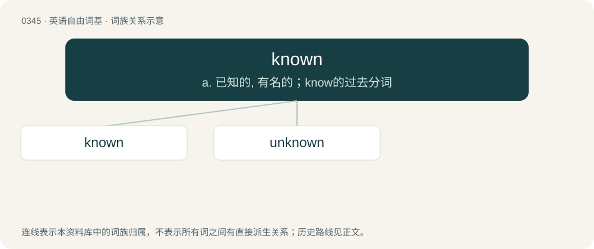

# 0396 · known — a. 已知的, 有名的；know的过去分词

[总目录](../00_总目录_按常用程度.md)

**类型**：英语自由词基　｜　**来源语言**：见词源记录

## 核心含义与来源

- 核心含义：a. 已知的, 有名的；know的过去分词
- 英文含义：Identified as a specific type; famous, renowned.
- 词形：known

**来源记录 1**（形容词；Identified as a specific type; famous, renowned.）

From Middle English knowen, from Old English cnāwen (past participle). Morphologically know + -n.

## 词族图

## 单词速览（常用到不常用）

| 单词 | 音标 | 释义 |
|---|---|---|
| [known](#w-1) | 英 /nəʊn/；美 /noʊn/ | a. 已知的, 有名的；know的过去分词 |
| [unknown](#w-2) | 英 /ʌn(ˈn)əʊn/；美 /ʌnˈnoʊn/ | a. 不知道的, 未知的, 陌生的；n. 未知物, 未知数 |

## 逐词详解

### 1. known

**词性**：形容词　｜　**音标**：英 /nəʊn/；美 /noʊn/

**中文释义**：a. 已知的, 有名的；know的过去分词

**英文义项**：Identified as a specific type; famous, renowned. / Accepted, familiar, researched.

**构词拆分**：know + -n

**词源与演化**：

From Middle English knowen, from Old English cnāwen (past participle). Morphologically know + -n.

**例句**：

> He was a known pickpocket.

该用例对应义项：Identified as a specific type; famous, renowned.

### 2. unknown

**词性**：形容词　｜　**音标**：英 /ʌn(ˈn)əʊn/；美 /ʌnˈnoʊn/

**中文释义**：a. 不知道的, 未知的, 陌生的；n. 未知物, 未知数

**英文义项**：Not known; unidentified; not well known.

**构词拆分**：un- + known

**词源与演化**：

From Middle English \*unknowen, \*uniknowen, uniknowe, from Old English unġecnāwen (“unknown”), equivalent to un- + known.

**例句**：

> The concept has existed since times unknown.

该用例对应义项：Not known; unidentified; not well known.
