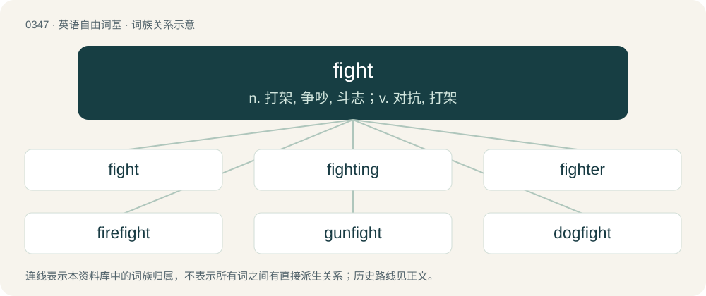

# 0399 · fight — n. 打架, 争吵, 斗志；v. 对抗, 打架

[总目录](../00_总目录_按常用程度.md)

**类型**：英语自由词基　｜　**来源语言**：见词源记录

## 核心含义与来源

- 核心含义：n. 打架, 争吵, 斗志；v. 对抗, 打架
- 英文含义：To engage in combat with; to oppose physically, to contest with.
- 词形：fight

**多个词源／构词路径**：同一拼写可能有不同来源；以下按词性和含义分别列出。

**来源记录 1**（动词；To engage in combat with; to oppose physically, to contest with.）

From Middle English fighten (“to fight”), from Old English feohtan (“to fight, combat, strive”), from Proto-West Germanic \*fehtan (“to fight”), from Proto-Germanic \*fehtaną (“to comb, tease, shear, struggle with”), from Proto-Indo-European \*peḱ- (“to comb, shear”). Cognate with Scots fecht (“to fight”), West Frisian fjochtsje, fjuchte (“to fight”), Dutch vechten (“to fight”), Low German fechten (“to fight”), German fechten (“to fence”), Danish fægte (“to fence, to fight (using blade weapons)”), Norwegian Bokmål and Norwegian Nynorsk fekte (“to fence”), Swedish fäkta (“to fence, to fight (using blade weapons), to wave vigorously (and carelessly) with one's arms”), Latin pectō (“comb, thrash”, verb), Albanian pjek (“to hit, strive, fight”), Ancient Greek πέκω (pékō, “comb or card wool”, verb). Related also to Old English feht (“wool, shaggy pelt, fleece”).

**来源记录 2**（名词；An occasion of fighting.）

From Middle English fight, feyght, fiȝt, fecht, from Old English feoht, ġefeoht (“fight”), from Proto-West Germanic \*fehtan (“to fight”), from Proto-Germanic \*fehtą, \*gafehtą (“fight, struggle”), from Proto-Germanic \*fehtaną (“to struggle with”). Cognate with Dutch gevecht (“fight”), German Gefecht (“fight”).

## 词族图

## 单词速览（常用到不常用）

| 单词 | 音标 | 释义 |
|---|---|---|
| [fight](#w-1) | 英 /faɪt/；美 /fəɪt/ | n. 打架, 争吵, 斗志；v. 对抗, 打架 |
| [fighting](#w-2) | 英 /ˈfaɪ.tɪŋ/；美 /ˈfaɪ.tɪŋ/ | a. 战斗的, 容易引起争斗的, 适于格斗的, 好斗的, 好战的, 斗争的, 搏斗的；n. 战斗, 斗争, 搏斗 |
| [fighter](#w-3) | 英 /ˈfaɪ.tə(ɹ)/；美 /ˈfaɪtɚ/ | n. 斗士, 战士, 好战者, 战斗机 |
| [firefight](#w-4) | /ˈfaiəfait/ | n. \[军\]交火,火战,炮战 |
| [gunfight](#w-5) | 美 /ˈɡʌnˌfaɪt/ | n. 枪战 |
| [dogfight](#w-6) | 英 /ˈdɒɡ.faɪt/ | n. 混战, 斗狗, 空战, 狗咬狗；vi. 在空中格斗 |
| [fistfight](#w-7) | /ˈfɪstˌfaɪt/ | n. 互殴 |
| [fightback](#w-8) | /ˈfaitbæk/ | n. &lt;英&gt;回击, 反攻 |
| [bullfight](#w-9) | /ˈbulfait/ | n. 斗牛 |
| [catfight](#w-10) | /ˈkætfait/ | n. 激烈的争辩 |

## 逐词详解

### 1. fight

**词性**：动词　｜　**音标**：英 /faɪt/；美 /fəɪt/

**中文释义**：n. 打架, 争吵, 斗志；v. 对抗, 打架

**英文义项**：To engage in combat with; to oppose physically, to contest with. / To conduct or engage in (battle, warfare, a cause, etc.).

**词源与演化**：

From Middle English fighten (“to fight”), from Old English feohtan (“to fight, combat, strive”), from Proto-West Germanic \*fehtan (“to fight”), from Proto-Germanic \*fehtaną (“to comb, tease, shear, struggle with”), from Proto-Indo-European \*peḱ- (“to comb, shear”). Cognate with Scots fecht (“to fight”), West Frisian fjochtsje, fjuchte (“to fight”), Dutch vechten (“to fight”), Low German fechten (“to fight”), German fechten (“to fence”), Danish fægte (“to fence, to fight (using blade weapons)”), Norwegian Bokmål and Norwegian Nynorsk fekte (“to fence”), Swedish fäkta (“to fence, to fight (using blade weapons), to wave vigorously (and carelessly) with one's arms”), Latin pectō (“comb, thrash”, verb), Albanian pjek (“to hit, strive, fight”), Ancient Greek πέκω (pékō, “comb or card wool”, verb). Related also to Old English feht (“wool, shaggy pelt, fleece”).

**例句**：

> A wounded animal will fight tooth and nail; relentless, savage and murderous.

该用例对应义项：To contend in physical conflict, either singly or in war, battle, etc.

### 2. fighting

**词性**：形容词　｜　**音标**：英 /ˈfaɪ.tɪŋ/；美 /ˈfaɪ.tɪŋ/

**中文释义**：a. 战斗的, 容易引起争斗的, 适于格斗的, 好斗的, 好战的, 斗争的, 搏斗的；n. 战斗, 斗争, 搏斗

**英文义项**：Engaged in war or other conflict. / Apt to provoke a fight.

**构词拆分**：fight + -ing

**词源与演化**：

From Middle English feghtyng, fyȝtynge, fightand, feghtand, feghtande, feightand, feȝtand, viȝtinde, feihtende, from Old English feohtende, from Proto-Germanic \*fehtandz, present participle of Proto-Germanic \*fehtaną (“to comb, struggle, contend with”), equivalent to fight + -ing.

**例句**：

> Review the fighting forces.

该用例对应义项：engaged in or ready for military or naval operations

### 3. fighter

**词性**：名词　｜　**音标**：英 /ˈfaɪ.tə(ɹ)/；美 /ˈfaɪtɚ/

**中文释义**：n. 斗士, 战士, 好战者, 战斗机

**英文义项**：A person who fights; a combatant. / A warrior; a fighting soldier.

**构词拆分**：fight + -er

**词源与演化**：

From Middle English fightere, feghtere, from Old English feohtere. Equivalent to fight + -er.

**例句**：

> With only a single drop of poison, the well-known fighter was defeated.

### 4. firefight

**词性**：名词　｜　**音标**：/ˈfaiəfait/

**中文释义**：n. \[军\]交火,火战,炮战

**英文义项**：A skirmish involving an exchange of gunfire. / An intense argument.

**构词拆分**：fire + fight

**词源与演化**：

From fire + fight.

### 5. gunfight

**词性**：名词　｜　**音标**：美 /ˈɡʌnˌfaɪt/

**中文释义**：n. 枪战

**英文义项**：A battle (or a duel) using small arms.

**构词拆分**：From gun + fight.

**词源与演化**：

From gun + fight.

**例句**：

> A gunfight started and Ziri was immediately got shot in the thigh.

### 6. dogfight

**词性**：名词　｜　**音标**：英 /ˈdɒɡ.faɪt/

**中文释义**：n. 混战, 斗狗, 空战, 狗咬狗；vi. 在空中格斗

**英文义项**：A twisting turning battle between two or more military aircraft, especially between fighters. / A fight between dogs, especially as part of the blood sport of dogfighting.

**构词拆分**：dog + fight

**词源与演化**：

From dog + fight.

**例句**：

> The two bi-planes swirled around each other like angry wasps in a violent dogfight.

该用例对应义项：A twisting turning battle between two or more military aircraft, especially between fighters.

### 7. fistfight

**词性**：名词　｜　**音标**：/ˈfɪstˌfaɪt/

**中文释义**：n. 互殴

**英文义项**：A fight using bare fists.

**构词拆分**：fist + fight

**词源与演化**：

From fist + fight.

**例句**：

> Tom was involved in a fistfight.

### 8. fightback

**词性**：名词　｜　**音标**：/ˈfaitbæk/

**中文释义**：n. &lt;英&gt;回击, 反攻

**英文义项**：A campaign of resistance; a counterattack.

**构词拆分**：fight + back

**词源与演化**：

From fight + back, as a deverbal from fight back.

**例句**：

> City staged a late fightback, scoring an equaliser in injury time.

### 9. bullfight

**词性**：名词　｜　**音标**：/ˈbulfait/

**中文释义**：n. 斗牛

**英文义项**：A public spectacle, in Spain and some other Latin countries, in which a person baits and often kills a bull.

**构词拆分**：bull + fight

**词源与演化**：

From bull + fight.

**例句**：

> I've never seen a bullfight and I hope to never see one.

### 10. catfight

**词性**：名词　｜　**音标**：/ˈkætfait/

**中文释义**：n. 激烈的争辩

**英文义项**：A fight between cats. / A fight or bickering, especially between women.

**构词拆分**：cat + fight

**词源与演化**：

From cat + fight. So named because, like cats, scratching is a common defensive tactic among women, as opposed to a fistfight between men.

**例句**：

> Nancy and Sheila got into a catfight when Nancy's boyfriend cheated on her with Sheila.

该用例对应义项：A fight or bickering, especially between women.
