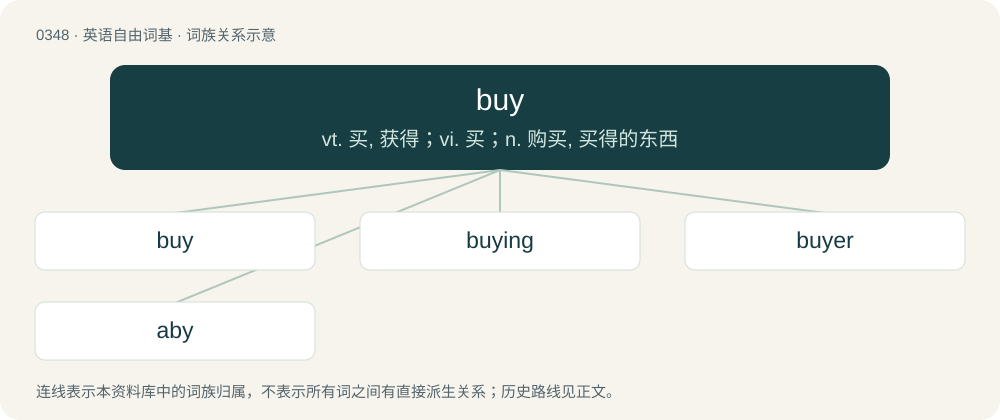

# 0400 · buy — vt. 买, 获得；vi. 买；n. 购买, 买得的东西

[总目录](../00_总目录_按常用程度.md)

**类型**：英语自由词基　｜　**来源语言**：见词源记录

## 核心含义与来源

- 核心含义：vt. 买, 获得；vi. 买；n. 购买, 买得的东西
- 英文含义：To obtain (something) in exchange for money or goods.
- 词形：buy

**来源记录 1**（动词；To obtain (something) in exchange for money or goods.）

From Middle English byen, from Old English bycġan (“to buy, pay for, acquire, redeem, ransom, procure, get done, sell”), from Proto-West Germanic \*buggjan, from Proto-Germanic \*bugjaną (“to buy”), of uncertain origin. Perhaps from Proto-Indo-European \*bʰūgʰ- (“to bend”), or from Proto-Indo-European \*bʰewgʰ- (“to take away, deliver”). Cognate with Scots buy (“to buy, purchase”), obsolete Dutch beugen (“to buy”), Old Saxon buggian, buggean (“to buy”), Old Norse byggja (“to build, settle”), Gothic 𐌱𐌿𐌲𐌾𐌰𐌽 (bugjan, “to buy”). The spelling with “u” is from the Southwest, while the pronunciation with /aɪ/ is from the East Midlands.

## 词族图

## 单词速览（常用到不常用）

| 单词 | 音标 | 释义 |
|---|---|---|
| [buy](#w-1) | /baɪ/ | vt. 买, 获得；vi. 买；n. 购买, 买得的东西 |
| [buying](#w-2) | /ˈbaɪ.ɪŋ/ | \[经\] 买气; 买进 |
| [buyer](#w-3) | 英 /ˈbaɪ.ə/；美 /ˈbaɪ.əɹ/ | n. 买主, 买方；\[经\] 买主, 买方, 买手 |
| [aby](#w-4) | 英 /əˈbaɪ/ | vt. 偿；赎（罪） |

## 逐词详解

### 1. buy

**词性**：动词　｜　**音标**：/baɪ/

**中文释义**：vt. 买, 获得；vi. 买；n. 购买, 买得的东西

**英文义项**：To obtain (something) in exchange for money or goods. / To obtain, especially by some sacrifice.

**词源与演化**：

From Middle English byen, from Old English bycġan (“to buy, pay for, acquire, redeem, ransom, procure, get done, sell”), from Proto-West Germanic \*buggjan, from Proto-Germanic \*bugjaną (“to buy”), of uncertain origin. Perhaps from Proto-Indo-European \*bʰūgʰ- (“to bend”), or from Proto-Indo-European \*bʰewgʰ- (“to take away, deliver”). Cognate with Scots buy (“to buy, purchase”), obsolete Dutch beugen (“to buy”), Old Saxon buggian, buggean (“to buy”), Old Norse byggja (“to build, settle”), Gothic 𐌱𐌿𐌲𐌾𐌰𐌽 (bugjan, “to buy”). The spelling with “u” is from the Southwest, while the pronunciation with /aɪ/ is from the East Midlands.

**例句**：

> He tried to buy me with gifts, but I wouldn't give up my beliefs.

该用例对应义项：To bribe.

### 2. buying

**词性**：名词　｜　**音标**：/ˈbaɪ.ɪŋ/

**中文释义**：\[经\] 买气; 买进

**英文义项**：The act of making a purchase.

**构词拆分**：From buy + -ing.

**词源与演化**：

From buy + -ing.

**例句**：

> Buying and selling fill their days.

该用例对应义项：the act of buying

### 3. buyer

**词性**：名词　｜　**音标**：英 /ˈbaɪ.ə/；美 /ˈbaɪ.əɹ/

**中文释义**：n. 买主, 买方；\[经\] 买主, 买方, 买手

**英文义项**：A person who makes one or more purchases. / A person who purchases items for resale in a retail establishment.

**构词拆分**：buy + -er

**词源与演化**：

From buy + -er.

**例句**：

> Every person who steps through the door is a potential buyer, so acknowledge their presence.

该用例对应义项：A person who makes one or more purchases.

### 4. aby

**词性**：动词　｜　**音标**：英 /əˈbaɪ/

**中文释义**：vt. 偿；赎（罪）

**英文义项**：To endure or tolerate (something); to experience.

**构词拆分**：a- + buy

**词源与演化**：

From Middle English abyen, abien, abiggen, from Old English ābyċġan (“to buy; pay for; buy off; requite; recompense; redeem; perform; execute”), from Proto-Germanic \*uzbugjaną, equivalent to a- + buy. Cognate with Gothic 𐌿𐍃𐌱𐌿𐌲𐌾𐌰𐌽 (usbugjan). Not related to abide.
