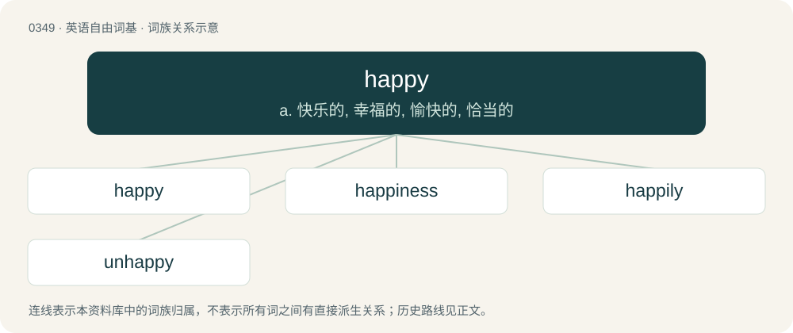

# 0401 · happy — a. 快乐的, 幸福的, 愉快的, 恰当的

[总目录](../00_总目录_按常用程度.md)

**类型**：英语自由词基　｜　**来源语言**：见词源记录

## 核心含义与来源

- 核心含义：a. 快乐的, 幸福的, 愉快的, 恰当的
- 英文含义：Having a feeling arising from a consciousness of well-being or of enjoyment; enjoying good of any kind, such as comfort, peace, or tranquillity; blissful, contented, joyous.
- 词形：happy

**来源记录 1**（形容词；Having a feeling arising from a consciousness of well-being or of enjoyment; enjoying good of any kind, such as comfort, peace, or tranquillity; blissful, contented, joyous.）

From Middle English happy (“fortunate, happy”), perhaps an alteration of Middle English happyn, happen (“fortunate, happy”), possibly related to or from Old Norse heppinn (“fortunate, happy”); and potentially assimilated to be equivalent to hap (“chance, luck, fortune”) + -y. Compare also Icelandic heppinn (“lucky”), Faroese heppin (“fortunate, lucky, happy”), Norwegian Nynorsk heppen (“lucky”), Scots happin (“fortunate, blessed”). See further at hap.

## 词族图

## 单词速览（常用到不常用）

| 单词 | 音标 | 释义 |
|---|---|---|
| [happy](#w-1) | 英 /ˈhæpi/ | a. 快乐的, 幸福的, 愉快的, 恰当的 |
| [happiness](#w-2) | /ˈhæpinɪs/ | n. 快乐, 幸运, 适当 |
| [happily](#w-3) | 英 /ˈhæp.ɪ.li/；美 /ˈhæp.ə.li/ | adv. 幸福地, 快乐地, 幸好 |
| [unhappy](#w-4) | /ʌnˈhæpi/ | a. 不快乐的, 不幸的, 不适当的 |

## 逐词详解

### 1. happy

**词性**：形容词　｜　**音标**：英 /ˈhæpi/

**中文释义**：a. 快乐的, 幸福的, 愉快的, 恰当的

**英文义项**：Having a feeling arising from a consciousness of well-being or of enjoyment; enjoying good of any kind, such as comfort, peace, or tranquillity; blissful, contented, joyous. / Experiencing the effect of favourable fortune; favored by fortune or luck; fortunate, lucky.

**构词拆分**：hap (“chance, luck, fortune”) + -y

**词源与演化**：

From Middle English happy (“fortunate, happy”), perhaps an alteration of Middle English happyn, happen (“fortunate, happy”), possibly related to or from Old Norse heppinn (“fortunate, happy”); and potentially assimilated to be equivalent to hap (“chance, luck, fortune”) + -y. Compare also Icelandic heppinn (“lucky”), Faroese heppin (“fortunate, lucky, happy”), Norwegian Nynorsk heppen (“lucky”), Scots happin (“fortunate, blessed”). See further at hap.

**例句**：

> Are you happy to pay me back by the end of the week?

该用例对应义项：Content, willing, satisfied (with or to do something); having no objection (to something).

### 2. happiness

**词性**：名词　｜　**音标**：/ˈhæpinɪs/

**中文释义**：n. 快乐, 幸运, 适当

**英文义项**：The emotion of being happy; joy; elation.

**构词拆分**：happy + -ness

**词源与演化**：

From happy + -ness.

**例句**：

> She found happiness in the small things.

该用例对应义项：The emotion of being happy; joy; elation.

### 3. happily

**词性**：副词　｜　**音标**：英 /ˈhæp.ɪ.li/；美 /ˈhæp.ə.li/

**中文释义**：adv. 幸福地, 快乐地, 幸好

**英文义项**：In a happy or cheerful manner; with happiness. / By good chance; fortunately, successfully.

**构词拆分**：happy + -ly

**词源与演化**：

From Middle English happily, happyly, happyliche, happylyche, equivalent to happy + -ly.

**例句**：

> This time next month I’ll be happily fishing at the beach.

该用例对应义项：In a happy or cheerful manner; with happiness.

### 4. unhappy

**词性**：形容词　｜　**音标**：/ʌnˈhæpi/

**中文释义**：a. 不快乐的, 不幸的, 不适当的

**英文义项**：Not happy; sad. / Not satisfied; unsatisfied.

**构词拆分**：un- + happy

**词源与演化**：

From Middle English unhappy; equivalent to un- + happy.

**例句**：

> The doomed lovers must have been born under an unhappy star.

该用例对应义项：Not lucky; unlucky.
