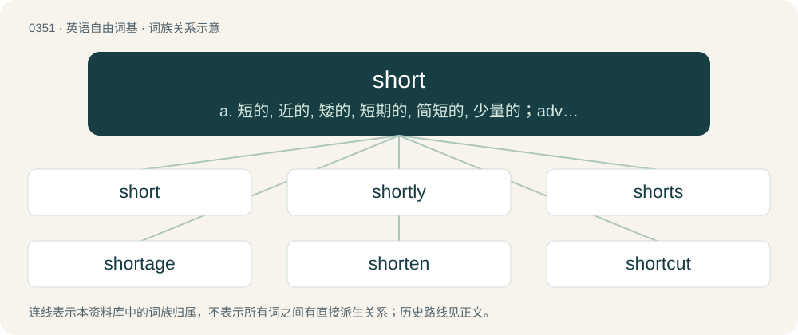

# 0403 · short — a. 短的, 近的, 矮的, 短期的, 简短的, 少量的；adv. 简短地, 突然；n. 扼要, 短片, 缺乏

[总目录](../00_总目录_按常用程度.md)

**类型**：英语自由词基　｜　**来源语言**：见词源记录

## 核心含义与来源

- 核心含义：a. 短的, 近的, 矮的, 短期的, 简短的, 少量的；adv. 简短地, 突然；n. 扼要, 短片, 缺乏
- 英文含义：Having a small distance from one end or edge to another, either horizontally or vertically.
- 词形：short

**来源记录 1**（形容词；Having a small distance from one end or edge to another, either horizontally or vertically.）

From Middle English schort, short, from Old English sċeort, sċort (“short”), from Proto-West Germanic \*skurt, from Proto-Germanic \*skurtaz (“short”), from Proto-Indo-European \*(s)ker-. Doublet of shirt, skirt, and curt. Cognates Cognate with Scots short, schort (“short”), French court, Dutch kort, German kurz, Old High German scurz (“short”) (whence Middle High German schurz), Old Norse skorta (“to lack”) (whence Danish skorte), Albanian shkurt (“short, brief”), Latin curtus (“shortened, incomplete”) and Proto-Slavic \*kortъkъ. See more at shirt.

## 词族图

## 单词速览（常用到不常用）

| 单词 | 音标 | 释义 |
|---|---|---|
| [short](#w-1) | 英 /ʃɔːt/；美 /ʃoɹt/ | a. 短的, 近的, 矮的, 短期的, 简短的, 少量的；adv. 简短地, 突然；n. 扼要, 短片, 缺乏 |
| [shortly](#w-2) | 美 /ˈʃɔɹtli/ | adv. 不久, 简短, 唐突地 |
| [shorts](#w-3) | 英 /ʃɔː(ɹ)ts/ | n. 短裤, (美)男人的短衬裤；\[经\] 空头户, 空头, 短期债券 |
| [shortage](#w-4) | /ˈʃɔː(ɹ)tɪd͡ʒ/ | n. 不足, 缺乏；\[化\] 缺额 |
| [shorten](#w-5) | 英 /ˈʃɔːtn̩/；美 /ˈʃɔɹtn̩/ | vt. 弄短, 缩短, 减少；vi. 缩小, 变短 |
| [shortcut](#w-6) | 英 /ˈʃɔːtkʌt/；美 /ˈʃoɹtˌkʌt/ | n. 捷径, 最短路线；\[计\] 快捷方式 |
| [shorty](#w-7) | 英 /ˈʃɔː.ti/；美 /ˈʃoɹ.ti/ | n. 矮个子, 特别短的东西 |
| [shorthand](#w-8) | 英 /ˈʃɔːthænd/；美 /ˈʃɔɹthænd/ | n. 速记；\[法\] 速记法, 速记, 记录文字 |
| [shortstop](#w-9) | 美 /ʃɔɹt.stap/ | n. 游击手, 停显液 |
| [shortfall](#w-10) | /ˈʃɒːtfɒːl/ | n. 不足, 不足量；\[经\] 缺少, 不足, 亏舱运费 |
| [shortness](#w-11) | /ˈʃɒːtnis/ | n. 短小, 简略, 不足；\[化\] 脆性; 蓝脆性; 冷脆性 |
| [shortcoming](#w-12) | 英 /ˈʃɔːtˌkʌmɪŋ/；美 /ˈʃoɹtˌkʌmɪŋ/ | n. 缺点, 短处 |
| [shortbread](#w-13) | /ˈʃɒːtbred/ | n. 白脱甜酥饼 |
| [shortwave](#w-14) | 英 /ˈʃɔːtweɪv/；美 /ˈʃoɹtˌweɪv/ | n. 短波；vt. 用短波发射 |
| [shorthanded](#w-15) | /ˈʃɒːtˈhændid/ | a. 人手不足的 |
| [shortcake](#w-16) |  | n. (英)厚的奶油酥饼, (美)脆饼, 水果松糕, 松饼 |
| [shorthair](#w-17) | /ˈʃɔːtheə(r)/ | n. (身材细长的)短毛猫(亦作shorthair cat) |

## 逐词详解

### 1. short

**词性**：形容词　｜　**音标**：英 /ʃɔːt/；美 /ʃoɹt/

**中文释义**：a. 短的, 近的, 矮的, 短期的, 简短的, 少量的；adv. 简短地, 突然；n. 扼要, 短片, 缺乏

**英文义项**：Having a small distance from one end or edge to another, either horizontally or vertically. / Of a person, living being, or object, having a comparatively small height.

**词源与演化**：

From Middle English schort, short, from Old English sċeort, sċort (“short”), from Proto-West Germanic \*skurt, from Proto-Germanic \*skurtaz (“short”), from Proto-Indo-European \*(s)ker-. Doublet of shirt, skirt, and curt. Cognates Cognate with Scots short, schort (“short”), French court, Dutch kort, German kurz, Old High German scurz (“short”) (whence Middle High German schurz), Old Norse skorta (“to lack”) (whence Danish skorte), Albanian shkurt (“short, brief”), Latin curtus (“shortened, incomplete”) and Proto-Slavic \*kortъkъ. See more at shirt.

**例句**：

> "Phone" is short for "telephone" and "asap" short for "as soon as possible".

该用例对应义项：Of a word or phrase, constituting an abbreviation (for another) or shortened form (of another).

### 2. shortly

**词性**：副词　｜　**音标**：美 /ˈʃɔɹtli/

**中文释义**：adv. 不久, 简短, 唐突地

**英文义项**：In a short or brief time or manner; quickly. / In or after a short time; soon.

**构词拆分**：short + -ly

**词源与演化**：

From Middle English schortly, schortliche, from Old English sċortlīċe (“shortly; before long; soon”), equivalent to short + -ly.

**例句**：

> The past perfect progressive is used for actions and situations which had continued up to a past moment or shortly before it.

该用例对应义项：In or after a short time; soon.

### 3. shorts

**词性**：名词　｜　**音标**：英 /ʃɔː(ɹ)ts/

**中文释义**：n. 短裤, (美)男人的短衬裤；\[经\] 空头户, 空头, 短期债券

**英文义项**：A garment worn over the pelvic area ending above the knees, not covering the entire length of the leg, designed for warm weather or for sports. / Underpants.

**构词拆分**：short + -s

**词源与演化**：

From short + -s.

**例句**：

> After a scare like that, you might need to change your shorts.

该用例对应义项：Underpants.

### 4. shortage

**词性**：名词　｜　**音标**：/ˈʃɔː(ɹ)tɪd͡ʒ/

**中文释义**：n. 不足, 缺乏；\[化\] 缺额

**英文义项**：A lack or deficiency; an insufficient amount.

**构词拆分**：short + -age

**词源与演化**：

From short + -age.

**例句**：

> There is a shortage of money in Brian's wallet and bank account.

### 5. shorten

**词性**：动词　｜　**音标**：英 /ˈʃɔːtn̩/；美 /ˈʃɔɹtn̩/

**中文释义**：vt. 弄短, 缩短, 减少；vi. 缩小, 变短

**英文义项**：To make shorter; to abbreviate. / To become shorter.

**构词拆分**：short + -en (verbal suffix)

**词源与演化**：

From Middle English shortnen, schortenen, equivalent to short + -en (verbal suffix). In some senses, a continuation (in altered form) of Middle English schorten (“to make short, shorten”), from Old English sċortian (“to become short”), from Proto-Germanic \*skurtōną (“to shorten”).

**用法示例／搭配（非完整句）**：

> to shorten an allowance of food

该用例对应义项：To reduce or diminish in amount, quantity, or extent; to lessen.

### 6. shortcut

**词性**：名词　｜　**音标**：英 /ˈʃɔːtkʌt/；美 /ˈʃoɹtˌkʌt/

**中文释义**：n. 捷径, 最短路线；\[计\] 快捷方式

**英文义项**：A path between two points that is faster than the commonly used paths. / A method to accomplish something that omits one or more steps.

**构词拆分**：short + cut

**词源与演化**：

From short + cut.

**例句**：

> There are shortcuts to some of my favourite applications on my desktop.

该用例对应义项：A file that points to the location of another file and serves as a quick way to access it.

### 7. shorty

**词性**：名词　｜　**音标**：英 /ˈʃɔː.ti/；美 /ˈʃoɹ.ti/

**中文释义**：n. 矮个子, 特别短的东西

**英文义项**：Something or someone that is shorter than normal. / A term of endearment for a child, younger sibling, shorter person, etc.

**构词拆分**：short + -y

**词源与演化**：

From short + -y.

**例句**：

> He got mad at me for calling him Shorty.

### 8. shorthand

**词性**：名词　｜　**音标**：英 /ˈʃɔːthænd/；美 /ˈʃɔɹthænd/

**中文释义**：n. 速记；\[法\] 速记法, 速记, 记录文字

**英文义项**：A rough and rapid method of writing by substituting symbols for letters, words, etc. / Any brief or shortened way of saying or doing something.

**构词拆分**：short + hand (“handwriting; style of penmanship”)

**词源与演化**：

The noun is derived from short + hand (“handwriting; style of penmanship”). The verb is derived from the noun.

**例句**：

> The jargon becomes a shorthand for these advanced concepts.

该用例对应义项：Any brief or shortened way of saying or doing something.

### 9. shortstop

**词性**：名词　｜　**音标**：美 /ʃɔɹt.stap/

**中文释义**：n. 游击手, 停显液

**英文义项**：The infield defensive player that stands between the second baseman and the third baseman. / A nimble defender.

**构词拆分**：short + stop

**词源与演化**：

From short + stop.

**例句**：

> The shortstop ranged deep into the hole to make the stop.

该用例对应义项：The infield defensive player that stands between the second baseman and the third baseman.

### 10. shortfall

**词性**：名词　｜　**音标**：/ˈʃɒːtfɒːl/

**中文释义**：n. 不足, 不足量；\[经\] 缺少, 不足, 亏舱运费

**英文义项**：An instance of falling short, of not meeting a quota, an obligation, or more generally any expected target. / The amount by which such a quota, obligation, etc., was missed.

**构词拆分**：By surface analysis, short + fall

**词源与演化**：

Deverbal from fall short. By surface analysis, short + fall.

**例句**：

> Due to a shortfall in revenue, we will have to make some cuts.

该用例对应义项：An instance of falling short, of not meeting a quota, an obligation, or more generally any expected target.

### 11. shortness

**词性**：名词　｜　**音标**：/ˈʃɒːtnis/

**中文释义**：n. 短小, 简略, 不足；\[化\] 脆性; 蓝脆性; 冷脆性

**英文义项**：The property of being short, of being small of stature or brief. / The result or product of being short.

**构词拆分**：short + -ness

**词源与演化**：

From Middle English schortnesse, from Old English sċortnes, sċeortnys, equivalent to short + -ness.

**例句**：

> I was chastened by the shortness of her reply.

该用例对应义项：The property of being short or terse.

### 12. shortcoming

**词性**：名词　｜　**音标**：英 /ˈʃɔːtˌkʌmɪŋ/；美 /ˈʃoɹtˌkʌmɪŋ/

**中文释义**：n. 缺点, 短处

**英文义项**：A deficiency or falling short; failure to attain a goal or ideal.

**构词拆分**：short + coming

**词源与演化**：

From short + coming.

**例句**：

> It is difficult to overcome this shortcoming without drastically changing the whole system.

### 13. shortbread

**词性**：名词　｜　**音标**：/ˈʃɒːtbred/

**中文释义**：n. 白脱甜酥饼

**英文义项**：A type of biscuit (cookie), popular in Britain, traditionally made from one part sugar, two parts butter and three parts flour.

**构词拆分**：short + bread

**词源与演化**：

From short (“brittle, of pastry”) + bread.

**例句**：

> We stuffed ourselves with nougat and shortbread cookies during Christmas Holidays.

### 14. shortwave

**词性**：名词　｜　**音标**：英 /ˈʃɔːtweɪv/；美 /ˈʃoɹtˌweɪv/

**中文释义**：n. 短波；vt. 用短波发射

**英文义项**：An electromagnetic wave with a relatively short wavelength; specifically, one with a wavelength generally between 10 and 100 metres, corresponding to a frequency between 3 and 30 megahertz. / Downward radiation in the shortwave (noun sense 1) frequency range which enters the Earth's atmosphere.

**构词拆分**：short (adjective) + wave (noun)

**词源与演化**：

The noun is derived from short (adjective) + wave (noun). The adjective is from an attributive use of the noun. The adverb is also derived from the noun.

**例句**：

> Shortwaves are longer than microwaves.

该用例对应义项：An electromagnetic wave with a relatively short wavelength; specifically, one with a wavelength generally between 10 and 100 metres, corresponding to a frequency between 3 and 30 megahertz.

### 15. shorthanded

**词性**：形容词　｜　**音标**：/ˈʃɒːtˈhændid/

**中文释义**：a. 人手不足的

**英文义项**：Lacking sufficient staff or people, as for normal or efficient operations. / Having less than a quorum.

**构词拆分**：short + handed

**词源与演化**：

From short + handed.

**例句**：

> The tiny restaurant usually got by with three workers on that shift, but found itself shorthanded when the tour bus pulled in.

该用例对应义项：Lacking sufficient staff or people, as for normal or efficient operations.

### 16. shortcake

**词性**：名词

**中文释义**：n. (英)厚的奶油酥饼, (美)脆饼, 水果松糕, 松饼

**英文义项**：A sweet cake or biscuit (crumbly leavened bread) typically made with flour, sugar, salt, butter, milk or cream, and sometimes eggs, and leavened with baking powder or baking soda. / A dessert made with such a cake, typically having layers of cream and fruit.

**构词拆分**：short + cake

**词源与演化**：

From short + cake.

**例句**：

> When I speak of strawberries I associate them with shortcake.

### 17. shorthair

**词性**：名词　｜　**音标**：/ˈʃɔːtheə(r)/

**中文释义**：n. (身材细长的)短毛猫(亦作shorthair cat)

**英文义项**：Any of several breeds of domestic cat with relatively short hair, a slender body and a large head.

**构词拆分**：short + hair

**词源与演化**：

From short + hair.
