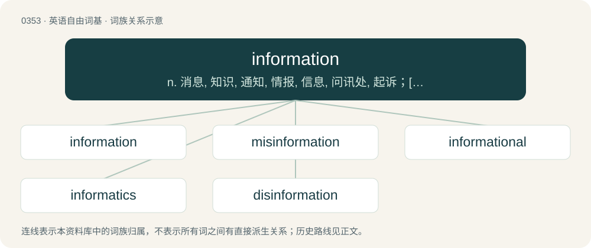

# 0405 · information — n. 消息, 知识, 通知, 情报, 信息, 问讯处, 起诉；\[计\] 信息

[总目录](../00_总目录_按常用程度.md)

**类型**：英语自由词基　｜　**来源语言**：见词源记录

## 核心含义与来源

- 核心含义：n. 消息, 知识, 通知, 情报, 信息, 问讯处, 起诉；\[计\] 信息
- 英文含义：Something that provides a definitive characterization or description of the nature and attributes of a specified entity.
- 词形：information

**来源记录 1**（名词；Something that provides a definitive characterization or description of the nature and attributes of a specified entity.）

From Middle English enformacioun, informacioun, borrowed from Anglo-Norman informacioun, enformation, Old French information, from Latin īnfōrmātiō (“formation, conception; education”), from the participle stem of īnformāre (“to inform”). Equivalent to inform + -ation.

## 词族图

## 单词速览（常用到不常用）

| 单词 | 音标 | 释义 |
|---|---|---|
| [information](#w-1) | 英 /ˌɪn.fəˈmeɪ.ʃn̩/；美 /ˌɪn.fɚˈmeɪ.ʃn̩/ | n. 消息, 知识, 通知, 情报, 信息, 问讯处, 起诉；\[计\] 信息 |
| [misinformation](#w-2) | 英 /ˌmɪs.ɪn.fəˈmeɪ.ʃən/；美 /ˌmɪs.ɪn.fɚˈmeɪ.ʃən/ | n. 错误的消息, 误传；\[法\] 错误的消息, 误传 |
| [informational](#w-3) | 英 /ˌɪnfəˈmeɪʃənəl/；美 /ˌɪnfɚˈmeɪʃənəl/ | a. 信息的, 情报的, 提供消息的, 介绍情况的, 提供情报的；\[计\] 信息性的 |
| [informatics](#w-4) | 英 /ɪnfəˈmætɪks/；美 /ˌɪnfəɹˈmætɪks/ | \[计\] 信息学；\[经\] 信息科学 |
| [disinformation](#w-5) | 英 /ˌdɪsɪnfəˈmeɪʃ(ə)n/；美 /ˌdɪsɪnfɚˈmeɪʃən/ | n. 假情报 |

## 逐词详解

### 1. information

**词性**：名词　｜　**音标**：英 /ˌɪn.fəˈmeɪ.ʃn̩/；美 /ˌɪn.fɚˈmeɪ.ʃn̩/

**中文释义**：n. 消息, 知识, 通知, 情报, 信息, 问讯处, 起诉；\[计\] 信息

**英文义项**：Something that provides a definitive characterization or description of the nature and attributes of a specified entity. / Things that are or can be known about a given topic; communicable knowledge of something.

**构词拆分**：inform + -ation

**词源与演化**：

From Middle English enformacioun, informacioun, borrowed from Anglo-Norman informacioun, enformation, Old French information, from Latin īnfōrmātiō (“formation, conception; education”), from the participle stem of īnformāre (“to inform”). Equivalent to inform + -ation.

**例句**：

> For your information, I did this because I wanted to.

该用例对应义项：The act of informing or imparting knowledge; notification.

### 2. misinformation

**词性**：名词　｜　**音标**：英 /ˌmɪs.ɪn.fəˈmeɪ.ʃən/；美 /ˌmɪs.ɪn.fɚˈmeɪ.ʃən/

**中文释义**：n. 错误的消息, 误传；\[法\] 错误的消息, 误传

**英文义项**：Information that is incorrect, whether intentionally or unintentionally.

**构词拆分**：mis- + information + misinform + -ation

**词源与演化**：

From mis- + information.

**用法示例／搭配（非完整句）**：

> spread misinformation on the internet

该用例对应义项：Information that is incorrect, whether intentionally or unintentionally.

### 3. informational

**词性**：形容词　｜　**音标**：英 /ˌɪnfəˈmeɪʃənəl/；美 /ˌɪnfɚˈmeɪʃənəl/

**中文释义**：a. 信息的, 情报的, 提供消息的, 介绍情况的, 提供情报的；\[计\] 信息性的

**英文义项**：Designed to or able to impart information; possessing information.

**构词拆分**：information + -al

**词源与演化**：

From information + -al.

**例句**：

> The subway map was quite informational, allowing us to determine the most efficient route to our destination.

该用例对应义项：Designed to or able to impart information; possessing information.

### 4. informatics

**词性**：名词　｜　**音标**：英 /ɪnfəˈmætɪks/；美 /ˌɪnfəɹˈmætɪks/

**中文释义**：\[计\] 信息学；\[经\] 信息科学

**英文义项**：Synonym of computer science. / A branch of information science and of computer science that focuses on the study of information processing, particularly with respect to systems integration and human interactions with machine and data.

**构词拆分**：information + -ics

**词源与演化**：

Coined 1967 from information + -ics; possibly influenced by automation and automatic. German Informatik dates from 1957, French informatique from 1962.

**例句**：

> "Forensic Informatics Engineering" means "Wağungwûîyat Tençmenwûs" in al Bakiyye language.

### 5. disinformation

**词性**：动词　｜　**音标**：英 /ˌdɪsɪnfəˈmeɪʃ(ə)n/；美 /ˌdɪsɪnfɚˈmeɪʃən/

**中文释义**：n. 假情报

**英文义项**：To use disinformation.

**构词拆分**：dis- + information

**词源与演化**：

Composed of dis- + information. Attested in the sense “intentional misinformation” in English from 1939. A different usage of disinformation occurred earlier, as early as 1887, as a simple synonym of misinformation.

**例句**：

> A country cannot disinformation its way out of fallen soldiers.

该用例对应义项：To use disinformation.
