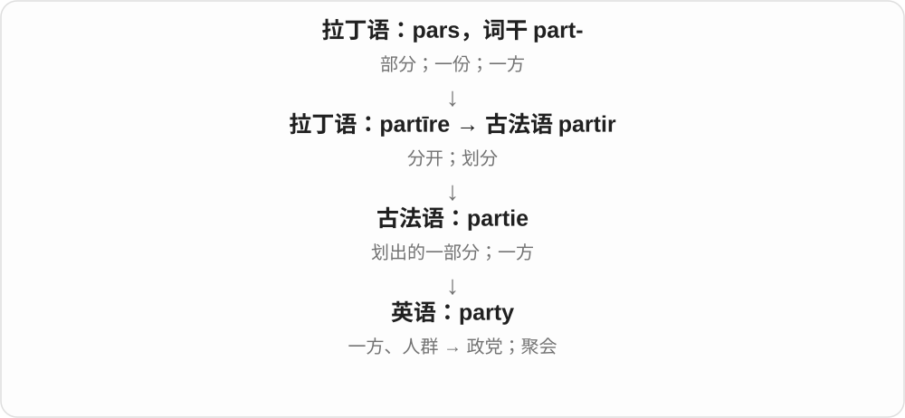

# 0405 · party — 聚会、政党；一方与多方参与

[逐词精讲目录](../00_逐词精讲目录.md) · [总目录](../00_总目录_按常用程度.md)

## 核心词根与来源

party 经法语接分开、分成部分的词族，与 part 相关。分出的一方或一群人，形成不同固定用法；现代每个义项仍要看场景。

**PARTY：聚在一边的人，或事情的一方**

同一个 party，在生日场景是聚会，在选举场景是政党，在合同里是一方。

- **基本词及多方**：party · multiparty
- **交易中的对方**：counterparty
- **party → parties：聚会、政党与参与各方**：party · parties

## 词形与演化规律

party → multiparty 多方、多党；counter- 相对一方 → counterparty。连字符的聚会复合词本轮暂略。

party 从一部分、一方走向团体等分支；parties 也可能是参加聚会的动词形式。

## 单词速览（按词族由简到繁）

同一基础词的相关扩展放在一起，先读基础形式，再读扩展；各组之间优先读常用的。具体词源关系见各词讲解。

| 单词 | 音标 | 核心意思 |
|---|---|---|
| [party](#w-1) | 英 /ˈpɑːti/；美 /ˈpɑːrti/ | 聚会；政党；一方；一群人 |
| [parties](#w-4) | 英 /ˈpɑːtiz/；美 /ˈpɑːrtiz/ | 聚会；政党；参与各方、当事方〔复数〕；参加聚会、玩乐〔party 的第三人称单数〕 |
| [counterparty](#w-2) | 英 /ˈkaʊntəpɑːti/；美 /ˈkaʊntərpɑːrti/ | 交易对方；合同另一方 |
| [multiparty](#w-3) | 英 /ˌmʌltiˈpɑːti/；美 /ˌmʌltiˈpɑːrti/ | 多党派的；多方参与的 |

## 逐词讲解

### 1. party — 聚会；政党；一方；一群人

**音标**：英 /ˈpɑːti/；美 /ˈpɑːrti/

**先抓住这个画面**

先想“归在同一边的一群人”：一起庆祝是一场 party，持共同政治主张可以组成一个 party，协议中的一边也是 a party。

**怎么拆**

古法语 partie 是 partir“分开”的相关形式，用作名词指一部分、一方；更早来自拉丁语 partīre。

**怎么变成今天的意思**

“一方”先连接群体身份，再发展出一起活动或娱乐的聚会义。理解时要看政治、合同还是社交场景。

**常见搭配与例句**

a birthday party；a political party；both parties；a party of six。

> We are having a small party on Friday.

我们周五要办一个小聚会。

> Both parties agreed to change the schedule.

双方同意修改日程。

**别混淆**

party of six 是六人一行，不一定在办派对。third party 通常是另一个相关方，不是第三场聚会。

### 2. parties — 聚会；政党；参与各方、当事方〔复数〕；参加聚会、玩乐〔party 的第三人称单数〕

**音标**：英 /ˈpɑːtiz/；美 /ˈpɑːrtiz/

**先抓住这个画面**

生日场景里是几场聚会；讨论协议时是参加协商的各方；选举报道里又可能是政党。共同点是分出来、站在一起的一群人或一方。

**怎么拆**

party 的 y 改成 ies，可作名词复数，也可作动词第三人称。party 经古法语 partie 一部分、一方接拉丁 part 词族，之后分化出团体、聚会等常见义。

**怎么变成今天的意思**

**法语 partie → party**  
一部分、一方 → 团体、聚会等

↓

**party 的 y → ies → parties**  
多个团体、聚会、参与方；或单数主语的玩乐动作

birthday parties 生日聚会；political parties 政党；both parties 双方；all parties involved 所有参与方；She parties on weekends 她周末参加聚会玩乐。

**常见搭配与例句**

organize parties；talks between the parties。

> Both parties agreed to meet again the following week.

双方同意下一周再见面。

> The children went to two birthday parties that month.

那个月，孩子们参加了两场生日聚会。

**别混淆**

party 不一定是派对。both parties agreed 是双方同意，常见于协商语境；具体是两个人、两个团体还是其他主体，要看上下文。

### 3. counterparty — 交易对方；合同另一方

**音标**：英 /ˈkaʊntəpɑːti/；美 /ˈkaʊntərpɑːrti/

**先抓住这个画面**

你站在交易的一边，与你签这笔交易的另一边，就是你的 counterparty。

**怎么拆**

counter- 相对、另一边 + party 一方。party 在这里用合同、交易参与方的意思，不是聚会，也不一定是政党。

**怎么变成今天的意思**

**法语 partie → 英语 party**  
部分、一方 → 一组人、交易参与方

↓

**counter- + party → counterparty**  
相对的一方 → 交易对方

the counterparty to a contract 合同另一方，counterparty risk 常说交易对方可能不履约的风险；对方可以是人或机构。

**常见搭配与例句**

a trading counterparty；the counterparty to the agreement；counterparty risk。

> The bank asked for details of the counterparty to the agreement.

银行要求提供协议另一方的详细资料。

> Each counterparty received a copy of the signed contract.

合同各方都收到了一份签署后的合同。

**别混淆**

counterparty 只指出这笔关系中的对方，不代表敌人；它也不是聚会上站在柜台边的人。

### 4. multiparty — 多党派的；多方参与的

**音标**：英 /ˌmʌltiˈpɑːti/；美 /ˌmʌltiˈpɑːrti/

**先抓住这个画面**

桌边有多个党派或参与方，不只一个组织独自决定。

**怎么拆**

multi- + party；这里 party 可以是政党，也可以是协议、诉讼或交谈的一方。

**怎么变成今天的意思**

**拉丁 multus → 组合形式 multi-**  
多、许多；多次

↓

**英语借用 multi- 参与构词**  
与已有名词、形容词等相接，表示多个、多方面

↓

**英语 multi- + party → multiparty**  
多个党派或参与方共同涉及的

a multiparty system 是多党制；multiparty negotiations 是多方谈判，不一定都是政党。不要把所有 party 都理解成聚会。

**常见搭配与例句**

a multiparty system；multiparty elections；multiparty negotiations。

> The country introduced a multiparty electoral system.

这个国家引入了多党参与的选举制度。

> The dispute led to lengthy multiparty negotiations.

这场争议引发了漫长的多方谈判。

**别混淆**

multilateral 常说多边关系；multiparty 直接强调多个参与方，法律、商业场景也常见。

## 这一组要分清什么

a party to the agreement 是协议一方；a party at home 是家里的聚会。counterparty 不是敌对政党。

## 串起来练习

Each party to the agreement received the counterparty’s contact details.

协议各方都收到了对方的联系方式。
