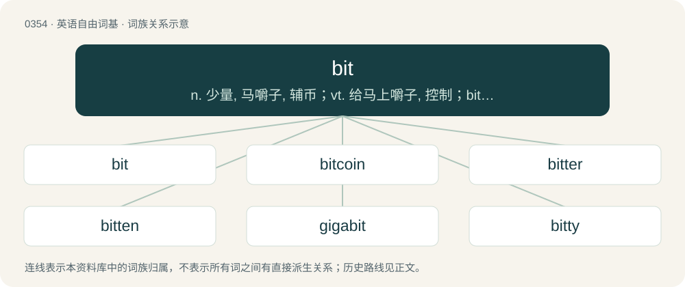

# 0406 · bit — n. 少量, 马嚼子, 辅币；vt. 给马上嚼子, 控制；bite的过去式和过去分词

[总目录](../00_总目录_按常用程度.md)

**类型**：英语自由词基　｜　**来源语言**：见词源记录

## 核心含义与来源

- 核心含义：n. 少量, 马嚼子, 辅币；vt. 给马上嚼子, 控制；bite的过去式和过去分词
- 英文含义：A small amount of something.
- 词形：bit

**多个词源／构词路径**：同一拼写可能有不同来源；以下按词性和含义分别列出。

**来源记录 1**（名词；A small amount of something.）

From Middle English bitte, bite, from Old English bita (“bit; fragment; morsel”) and bite (“a bite; cut”), from Proto-Germanic \*bitô and \*bitiz; both from Proto-Indo-European \*bʰeyd- (“to split”). More at bite. Cognates Cognate with West Frisian bit, Saterland Frisian Bit, Dutch bit, German Low German Beet, Biet, German Biss and Bissen, Danish bid, Swedish bit, Icelandic biti.

**来源记录 2**（形容词；Having been bitten.）

See the etymology of the corresponding lemma form. See bite. Replaced a former strong past tense, seen in Middle English bot and Old English bāt.

**来源记录 3**（名词；A binary digit, generally represented as a 1 or 0.）

Coined by John Tukey in 1946 as an abbreviation of binary digit, probably influenced by connotations of “small portion”. First used in print 1948 by Claude Shannon. Compare byte and nybble, with similar food associations.

## 词族图

## 单词速览（常用到不常用）

| 单词 | 音标 | 释义 |
|---|---|---|
| [bit](#w-1) | /ˈbɪt/ | n. 少量, 马嚼子, 辅币；vt. 给马上嚼子, 控制；bite的过去式和过去分词 |
| [bitcoin](#w-2) | 英 /ˈbɪtkɔɪn/；美 /ˈbɪtˌkɔɪn/ | 【英文】A unit of the bitcoin (proper noun proper noun sense 1) cryptocurrency. |
| [bitter](#w-3) | 英 /ˈbɪt.ə/；美 /ˈbɪ.tɚ/ | 【英文】A hardware system whose architecture is based around units of the specified number of bits (binary digits). |
| [bitten](#w-4) | /ˈbɪt.ən/ | bite的过去分词 |
| [gigabit](#w-5) | 英 /ˈɡɪɡəbɪt/；美 /ˈɡɪɡəbɪt/ | n. 千兆比特, 吉比特（10的9次方比特, 相当于十亿比特的信息单位） |
| [bitty](#w-6) | /ˈbɪti/ | a. 零零碎碎的 |
| [bitrate](#w-7) | 美 /ˈbɪtˌɹeɪt/ | n. 比特率；位率；位速率 |
| [biter](#w-8) | /ˈbaitə/ | 【英文】Something (a data unit, machine etc.) with a width of a specified amount of bits. |
| [tidbit](#w-9) | /ˈtɪd.bɪt/ | n. 少量的美食, 珍馐, 珍品, 珍闻 |
| [bitmap](#w-10) | 美 /ˈbɪtˌmæp/ | n. 位图；\[计\] 位图 |

## 逐词详解

### 1. bit

**词性**：名词　｜　**音标**：/ˈbɪt/

**中文释义**：n. 少量, 马嚼子, 辅币；vt. 给马上嚼子, 控制；bite的过去式和过去分词

**英文义项**：A small amount of something. / A piece of metal placed in a horse's mouth and connected to the reins to direct the animal.

**词源与演化**：

From Middle English bitte, bite, from Old English bita (“bit; fragment; morsel”) and bite (“a bite; cut”), from Proto-Germanic \*bitô and \*bitiz; both from Proto-Indo-European \*bʰeyd- (“to split”). More at bite. Cognates Cognate with West Frisian bit, Saterland Frisian Bit, Dutch bit, German Low German Beet, Biet, German Biss and Bissen, Danish bid, Swedish bit, Icelandic biti.

**例句**：

> His bit about video games was not nearly as entertaining as the other segments of his show.

该用例对应义项：An excerpt of material making up part of a show, comedy routine, etc.

### 2. bitcoin

**词性**：名词　｜　**音标**：英 /ˈbɪtkɔɪn/；美 /ˈbɪtˌkɔɪn/

**英文义项**：A unit of the bitcoin (proper noun proper noun sense 1) cryptocurrency.

**构词拆分**：bit + coin；bit (“binary digit”) + coin

**词源与演化**：

From bit (“binary digit”) + coin, coined by Satoshi Nakamoto, believed to be a pseudonym for one or more people, in the domain name bitcoin.org registered on 18 August 2008; and in the title of the white paper “Bitcoin: A Peer-to-Peer Electronic Cash System”, a link to which was posted on the cryptography mailing list metzdowd.com on October 31, 2008: see the quotation.

**例句**：

> This item costs one bitcoin.

该用例对应义项：A unit of the bitcoin (proper noun proper noun sense 1) cryptocurrency.

### 3. bitter

**词性**：名词　｜　**音标**：英 /ˈbɪt.ə/；美 /ˈbɪ.tɚ/

**英文义项**：A hardware system whose architecture is based around units of the specified number of bits (binary digits).

**构词拆分**：bit + -er

**词源与演化**：

From bit + -er.

### 4. bitten

**词性**：形容词　｜　**音标**：/ˈbɪt.ən/

**中文释义**：bite的过去分词

**英文义项**：That has received a bite. / Abruptly cut off, as roots or leaves may be.

**构词拆分**：bit + -en

**词源与演化**：

Morphologically bit + -en.

**用法示例／搭配（非完整句）**：

> the postman's bitten leg

该用例对应义项：That has received a bite.

### 5. gigabit

**词性**：名词　｜　**音标**：英 /ˈɡɪɡəbɪt/；美 /ˈɡɪɡəbɪt/

**中文释义**：n. 千兆比特, 吉比特（10的9次方比特, 相当于十亿比特的信息单位）

**英文义项**：One billion (10⁹, or 1,000,000,000) bits or 1,000 megabits. / A gibibit.

**构词拆分**：giga- + bit

**词源与演化**：

From giga- + bit.

### 6. bitty

**词性**：形容词　｜　**音标**：/ˈbɪti/

**中文释义**：a. 零零碎碎的

**英文义项**：Containing bits; fragmented. / Very small.

**构词拆分**：From bit + -y.

**词源与演化**：

From bit + -y.

**例句**：

> Her girlfriend is part of the itty bitty titty committee.

### 7. bitrate

**词性**：名词　｜　**音标**：美 /ˈbɪtˌɹeɪt/

**中文释义**：n. 比特率；位率；位速率

**英文义项**：The frequency at which bits (binary digits) pass a given physical or metaphorical point, measured in bps (bits per second).

**构词拆分**：bit + rate

**词源与演化**：

From bit + rate.

**例句**：

> You need high bitrate for streaming.

### 8. biter

**词性**：名词　｜　**音标**：/ˈbaitə/

**英文义项**：Something (a data unit, machine etc.) with a width of a specified amount of bits.

**构词拆分**：bit + -er

**词源与演化**：

From bit + -er.

### 9. tidbit

**词性**：名词　｜　**音标**：/ˈtɪd.bɪt/

**中文释义**：n. 少量的美食, 珍馐, 珍品, 珍闻

**英文义项**：A part of poultry when prepared as food / A tasty morsel (of food).

**词源与演化**：

From Old English tid (“fond, tender, nice”) + English bit (“morsel”).

**例句**：

> I will be very grateful if you can send us even a small tidbit of information.

### 10. bitmap

**词性**：名词　｜　**音标**：美 /ˈbɪtˌmæp/

**中文释义**：n. 位图；\[计\] 位图

**英文义项**：A series of bits that represents a rasterized graphic image, each pixel being represented as a group of bits.

**构词拆分**：bit + map

**词源与演化**：

From bit + map.
