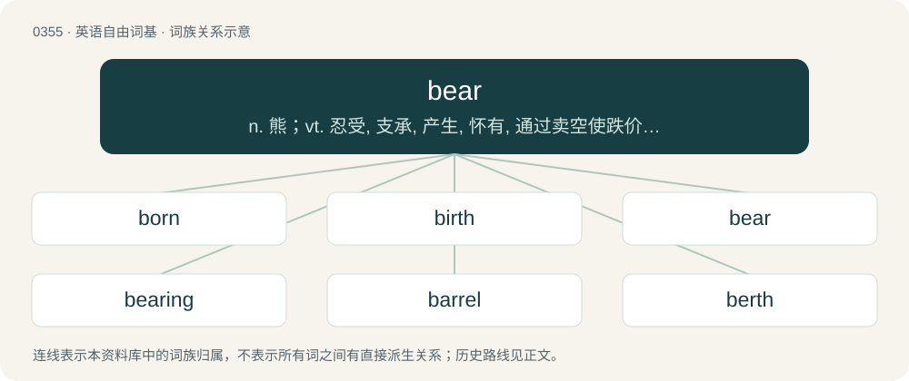

# 0407 · bear — n. 熊；vt. 忍受, 支承, 产生, 怀有, 通过卖空使跌价；vi. 忍受, 结果实, 压挤, 行进, 转向

[总目录](../00_总目录_按常用程度.md)

**类型**：英语自由词基　｜　**来源语言**：见词源记录

## 核心含义与来源

- 核心含义：n. 熊；vt. 忍受, 支承, 产生, 怀有, 通过卖空使跌价；vi. 忍受, 结果实, 压挤, 行进, 转向
- 英文含义：A large, generally omnivorous mammal (a few species are purely carnivorous or herbivorous) of the family Ursidae; having shaggy fur, a very small tail, and flat feet.
- 词形：bear

**多个词源／构词路径**：同一拼写可能有不同来源；以下按词性和含义分别列出。

**来源记录 1**（名词；A large, generally omnivorous mammal (a few species are purely carnivorous or herbivorous) of the family Ursidae; having shaggy fur, a very small tail, and flat feet.）

From Middle English bere, from Old English bera, from Proto-West Germanic \*berō, from Proto-Germanic \*berô (“bear”), from Proto-Indo-European \*bʰerH- (“brown”). Cognates Cognate with North Frisian beer (“bear”), Saterland Frisian Boar, Boare (“bear”), West Frisian bear (“bear”), Cimbrian and Mòcheno per (“bear”), Dutch beer (“bear”), German Bär (“bear”), German Low German Boor (“bear”), Limburgish baer, Béër (“bear”), Luxembourgish Bier (“bear”), Vilamovian baor, bar (“bear”), West Flemish beir (“bear”), Yiddish בער (ber, “bear”), Danish, Faroese, and Norwegian Bokmål bjørn (“bear”), Icelandic and Swedish björn (“bear”), Norwegian Nynorsk bjøinn, bjønn, bjørn (“bear”), Gothic \*𐌱𐌰𐌹𐍂𐌰 (\*baira, “bear”); also Latin fiber (“beaver”), Greek φρύνος (frýnos, “toad”), Latvian bērs (“bay, brown”), Lithuanian bėras (“bay, reddish brown”), Belarusian бабёр (babjór, “beaver”), Bulgarian бобър (bobăr, “beaver”), Czech bobr (“beaver”), Macedonian дабар (dabar, “beaver”), Polish bober, bóbr (“beaver”) Russian бобёр (bobjór), бобр (bobr, “beaver”), Serbo-Croatian да̀бар, dàbar (“beaver”), Slovak bobor (“beaver”), Slovene bober (“beaver”), Ukrainian бобе́р (bobér, “beaver”), Armenian բորենի (boreni, “hyena”), Avestan 𐬠𐬀𐬡𐬭𐬀 (baβra, “beaver”), Northern Kurdish bor (“grey”), Ossetian бур (bur, “yellow”), Persian بور (bur, “blonde, fair; bay, reddish brown; brown”), Yaghnobi вур (vur, “brown”), Sanskrit बभ्रु (babhru, “ichneumon, mongoose”). etymology notes This is generally taken to be from Proto-Indo-European \*bʰerH- (“shining, brown”) (compare Tocharian A parno, Tocharian B perne (“radiant, luminous”), Lithuanian bė́ras (“brown”)), related to brown, bruin, and beaver. On this theory, the Germanic languages replaced the older name of the bear, \*h₂ŕ̥tḱos, with the epithet "brown one", presumably due to taboo avoidance; compare Russian медве́дь (medvédʹ, “bear”, literally “honey-eater”). However, Ringe (2006:106) doubts the existence of a root \*bʰer- meaning "brown" ("an actual PIE word of \[the requisite\] shape and meaning is not recoverable") and suggests that a derivation from Proto-Indo-European \*ǵʰwer- (“wild animal”) "should therefore perhaps be preferred", implying a Germanic merger of \*ǵʰw and \*gʷʰ (\*gʷʰ may sometimes result in Germanic \*b, perhaps e.g. in \*bidjaną, but it also seems to have given the g in gun and the w in warm).

**来源记录 2**（动词；To carry or convey, literally or figuratively.）

From Middle English beren (“carry, bring forth”), from Old English beran (“to carry, bear, bring”), from Proto-West Germanic \*beran, from Proto-Germanic \*beraną, from Proto-Indo-European \*bʰéreti, from \*bʰer- (“to bear, carry”). Akin to Old High German beran (“carry”), Dutch baren, Danish bære, Norwegian Bokmål bære, Norwegian Nynorsk bera, German gebären, Gothic 𐌱𐌰𐌹𐍂𐌰𐌽 (bairan), Sanskrit भरति (bharati), Latin ferō, and Ancient Greek φέρω (phérō), Albanian bie (“to bring, to bear”), Russian брать (bratʹ, “to take”), Persian بردن (bordan, “to take, to carry”).

## 词族图

## 单词速览（常用到不常用）

| 单词 | 音标 | 释义 |
|---|---|---|
| [born](#w-1) | 英 /bɔːn/；美 /boɹn/ | a. 天生的；bear的过去分词 |
| [birth](#w-2) | 英 /bɜːθ/；美 /bɜɹθ/ | n. 出生, 起源；\[医\] 生产, 分娩 |
| [bear](#w-3) | 英 /bɛə/；美 /bɛɚ/ | n. 熊；vt. 忍受, 支承, 产生, 怀有, 通过卖空使跌价；vi. 忍受, 结果实, 压挤, 行进, 转向 |
| [bearing](#w-4) | 英 /ˈbɛə̯ɹɪŋ/；美 /ˈbɛɹɪŋ/ | n. 举止, 轴承, 忍受, 关系, 意义, 方向, 生育；\[化\] 轴承 |
| [barrel](#w-5) | 英 /ˈbæɹ(ə)l/；美 /ˈbæɹəl/ | n. 桶；vt. 装入桶内 |
| [berth](#w-6) | 英 /bɜːθ/；美 /bɜɹθ/ | n. 船岸之间的水区, 锚地, 卧铺；vi. 停泊；vt. 使停泊 |
| [bearer](#w-7) | 英 /ˈbɛəɹə/；美 /ˈbeɹɚ/ | n. 带信人, 票据持有人, 搬运者；\[经\] 持票人, 持有人, 不(无)记名 |
| [bearable](#w-8) | /ˈbɛəɹəbəɫ/ | a. 可忍受的, 支承得住的 |
| [bearish](#w-9) | /ˈbєəriːʃ/ | a. 如熊的, 粗暴的；\[经\] 熊市 |
| [bearcat](#w-10) | 美 /ˈbɛɚˌkæt/ | n. 熊猫, 勇士 |
| [bugbear](#w-11) | 英 /ˈbʌɡ.bɛə(ɹ)/；美 /ˈbʌɡ.bɛɚ/ | n. 怪物；棘手的难题；恐惧或烦恼的原因 |
| [bearskin](#w-12) | 英 /ˈbɛə.skɪn/；美 /ˈbɛəɹ.skɪn/ | n. 熊皮, 熊皮衣 |
| [forbear](#w-13) | 英 /fɔːˈbɛə/；美 /fɔɹˈbɛɚ/ | v. 忍耐, 克制, 容忍；n. 祖先 |

## 逐词详解

### 1. born

**词性**：形容词　｜　**音标**：英 /bɔːn/；美 /boɹn/

**中文释义**：a. 天生的；bear的过去分词

**英文义项**：Having from birth (or as if from birth) a certain quality or character; innate; inherited.

**构词拆分**：bear + -en

**词源与演化**：

From Middle English born, boren, borne, iborne, from Old English boren, ġeboren, from Proto-West Germanic \*boran, \*gaboran, from Proto-Germanic \*buranaz, past participle of Proto-Germanic \*beraną (“to bear, carry”), equivalent to bear + -en. Cognate with Saterland Frisian gebooren (“born”), West Frisian berne (“born”), Dutch geboren (“born”), German geboren (“born”), Swedish boren (“born”).

**例句**：

> In the United States, information describing the operation of nuclear weapons is born secret.

该用例对应义项：Having from birth (or as if from birth) a certain quality or character; innate; inherited.

### 2. birth

**词性**：名词　｜　**音标**：英 /bɜːθ/；美 /bɜɹθ/

**中文释义**：n. 出生, 起源；\[医\] 生产, 分娩

**英文义项**：The process of childbearing; the beginning of life; the emergence of a human baby or other viviparous animal offspring from the mother's body into the environment. / An instance of childbirth.

**构词拆分**：bear + -th

**词源与演化**：

From Middle English birthe (1250), from earlier burthe, burde, from Old Norse burðr, byrd (Old Swedish byrth, Swedish börd), replacing Old English ġebyrd (rare variant byrþ), equivalent to bear + -th (thus a piecewise doublet of berth). The Old Norse is from Proto-Germanic \*burdiz (compare Old Frisian berde, berd); Old English ġebyrd is from prefixed \*gaburþiz (compare Dutch geboorte, German Geburt), from Proto-Indo-European \*bʰŕ̥tis (compare Latin fors (“luck”), Old Irish brith), from \*bʰer- (“to carry, bear”). More at bear.

**例句**：

> Intersex babies account for roughly one per cent of all births.

该用例对应义项：An instance of childbirth.

### 3. bear

**词性**：名词　｜　**音标**：英 /bɛə/；美 /bɛɚ/

**中文释义**：n. 熊；vt. 忍受, 支承, 产生, 怀有, 通过卖空使跌价；vi. 忍受, 结果实, 压挤, 行进, 转向

**英文义项**：A large, generally omnivorous mammal (a few species are purely carnivorous or herbivorous) of the family Ursidae; having shaggy fur, a very small tail, and flat feet. / The meat of this animal.

**词源与演化**：

From Middle English bere, from Old English bera, from Proto-West Germanic \*berō, from Proto-Germanic \*berô (“bear”), from Proto-Indo-European \*bʰerH- (“brown”). Cognates Cognate with North Frisian beer (“bear”), Saterland Frisian Boar, Boare (“bear”), West Frisian bear (“bear”), Cimbrian and Mòcheno per (“bear”), Dutch beer (“bear”), German Bär (“bear”), German Low German Boor (“bear”), Limburgish baer, Béër (“bear”), Luxembourgish Bier (“bear”), Vilamovian baor, bar (“bear”), West Flemish beir (“bear”), Yiddish בער (ber, “bear”), Danish, Faroese, and Norwegian Bokmål bjørn (“bear”), Icelandic and Swedish björn (“bear”), Norwegian Nynorsk bjøinn, bjønn, bjørn (“bear”), Gothic \*𐌱𐌰𐌹𐍂𐌰 (\*baira, “bear”); also Latin fiber (“beaver”), Greek φρύνος (frýnos, “toad”), Latvian bērs (“bay, brown”), Lithuanian bėras (“bay, reddish brown”), Belarusian бабёр (babjór, “beaver”), Bulgarian бобър (bobăr, “beaver”), Czech bobr (“beaver”), Macedonian дабар (dabar, “beaver”), Polish bober, bóbr (“beaver”) Russian бобёр (bobjór), бобр (bobr, “beaver”), Serbo-Croatian да̀бар, dàbar (“beaver”), Slovak bobor (“beaver”), Slovene bober (“beaver”), Ukrainian бобе́р (bobér, “beaver”), Armenian բորենի (boreni, “hyena”), Avestan 𐬠𐬀𐬡𐬭𐬀 (baβra, “beaver”), Northern Kurdish bor (“grey”), Ossetian бур (bur, “yellow”), Persian بور (bur, “blonde, fair; bay, reddish brown; brown”), Yaghnobi вур (vur, “brown”), Sanskrit बभ्रु (babhru, “ichneumon, mongoose”). etymology notes This is generally taken to be from Proto-Indo-European \*bʰerH- (“shining, brown”) (compare Tocharian A parno, Tocharian B perne (“radiant, luminous”), Lithuanian bė́ras (“brown”)), related to brown, bruin, and beaver. On this theory, the Germanic languages replaced the older name of the bear, \*h₂ŕ̥tḱos, with the epithet "brown one", presumably due to taboo avoidance; compare Russian медве́дь (medvédʹ, “bear”, literally “honey-eater”). However, Ringe (2006:106) doubts the existence of a root \*bʰer- meaning "brown" ("an actual PIE word of \[the requisite\] shape and meaning is not recoverable") and suggests that a derivation from Proto-Indo-European \*ǵʰwer- (“wild animal”) "should therefore perhaps be preferred", implying a Germanic merger of \*ǵʰw and \*gʷʰ (\*gʷʰ may sometimes result in Germanic \*b, perhaps e.g. in \*bidjaną, but it also seems to have given the g in gun and the w in warm).

**例句**：

> That window can be a bear to open.

该用例对应义项：Something difficult or tiresome; a burden or chore.

### 4. bearing

**词性**：形容词　｜　**音标**：英 /ˈbɛə̯ɹɪŋ/；美 /ˈbɛɹɪŋ/

**中文释义**：n. 举止, 轴承, 忍受, 关系, 意义, 方向, 生育；\[化\] 轴承

**英文义项**：That bears (some specified thing). / Of a beam, column, or other device, carrying weight or load.

**构词拆分**：bear + -ing

**词源与演化**：

From Middle English beringe, berynge, berende, berande, berand, from Old English berende (“bearing; fruitful”) (also as synonym Old English bǣrende), from Proto-Germanic \*berandz, present participle of Proto-Germanic \*beraną (“to bear; carry”), equivalent to bear + -ing.

**例句**：

> That's a bearing wall.

该用例对应义项：Of a beam, column, or other device, carrying weight or load.

### 5. barrel

**词性**：名词　｜　**音标**：英 /ˈbæɹ(ə)l/；美 /ˈbæɹəl/

**中文释义**：n. 桶；vt. 装入桶内

**英文义项**：A round (cylindrical) vessel, such as a cask, of greater length than breadth, and bulging in the middle, made of staves bound with hoops, and having flat ends (heads). The word is sometimes applied to a similar cylindrical container made of metal, usually called a drum. / Such a cask of a certain size, holding one-eighth of what a tun holds. (See a diagram comparing cask sizes.)

**构词拆分**：bear + -le

**词源与演化**：

From Middle English barel, from Anglo-Norman baril, Old French baril, bareil (“barrel”), of uncertain origin. An attempt to link baril to Old French barre (“bar, bolt”) (compare Medieval Latin barra (“bar, rod”)) via assumed Vulgar Latin \*barrīculum meets the phonological requirement, but fails to connect the word semantically. The alternative connection to Frankish \*baril, \*beril or Gothic \*𐌱𐌴𐍂𐌹𐌻𐍃 (\*bērils, “container for transport”), from Proto-Germanic \*barilaz, \*bērilaz (“barrel, jug, container”), from Proto-Indo-European \*bʰer- (“to carry, transport”), is more plausible as it connects not only the form of the word but also the sense; equivalent to bear + -le. Compare also Old High German biril (“jug, large pot”), Luxembourgish Bärel, Bierel (“jug, pot”), Old Norse berill (“barrel for liquids”), Old English byrla (“barrel of a horse, trunk, body”). More at bear.

**例句**：

> Throw it into the trash barrel.

该用例对应义项：A waste receptacle.

### 6. berth

**词性**：名词　｜　**音标**：英 /bɜːθ/；美 /bɜɹθ/

**中文释义**：n. 船岸之间的水区, 锚地, 卧铺；vi. 停泊；vt. 使停泊

**英文义项**：A place for a vessel to lie at anchor or to moor. / A room in a vessel in which the officers or company mess (“eat together”) and reside; also, a room or other place in a vessel for storage.

**构词拆分**：bear + -th (suffix forming nouns from verbs)

**词源与演化**：

The noun is derived from Late Middle English birth (“(nautical) bearing away or off, clearance, berth”). Further etymology uncertain, but probably from beren (“to carry (away), bear”) + -th (suffix denoting a condition, quality, state of being, etc., forming nouns); if so, the English word is analysable as bear + -th (suffix forming nouns from verbs), and is a piecewise doublet of birth. The verb is derived from the noun.

**例句**：

> The first ships are expected to berth at the port in November.

### 7. bearer

**词性**：名词　｜　**音标**：英 /ˈbɛəɹə/；美 /ˈbeɹɚ/

**中文释义**：n. 带信人, 票据持有人, 搬运者；\[经\] 持票人, 持有人, 不(无)记名

**英文义项**：One who, or that which, bears, sustains, or carries. / Someone who helps carry the coffin or a dead body during a funeral procession.

**构词拆分**：bear + -er

**词源与演化**：

From Middle English berer, berere, from Old English berere (attested in Old English wæterberere (“waterbearer”)), equivalent to bear + -er.

**例句**：

> I promise to pay the bearer on demand.

该用例对应义项：One who possesses a cheque, bond, or other notes promising payment.

### 8. bearable

**词性**：形容词　｜　**音标**：/ˈbɛəɹəbəɫ/

**中文释义**：a. 可忍受的, 支承得住的

**英文义项**：Able to be borne; tolerable; endurable. / Able to be borne or carried; portable.

**构词拆分**：bear + -able

**词源与演化**：

From Middle English berable, equivalent to bear + -able.

**例句**：

> The heat of day was fierce until the sun set, when it became bearable.

### 9. bearish

**词性**：形容词　｜　**音标**：/ˈbєəriːʃ/

**中文释义**：a. 如熊的, 粗暴的；\[经\] 熊市

**英文义项**：Resembling or likened to a bear, typically in being rough, surly, or clumsy. / Characterized by or expecting falling prices.

**构词拆分**：bear + -ish

**词源与演化**：

From bear + -ish.

### 10. bearcat

**词性**：名词　｜　**音标**：美 /ˈbɛɚˌkæt/

**中文释义**：n. 熊猫, 勇士

**英文义项**：A binturong (Arctictis binturong, in the family Viverridae).

**构词拆分**：bear + cat

**词源与演化**：

From bear + cat.

### 11. bugbear

**词性**：名词　｜　**音标**：英 /ˈbʌɡ.bɛə(ɹ)/；美 /ˈbʌɡ.bɛɚ/

**中文释义**：n. 怪物；棘手的难题；恐惧或烦恼的原因

**英文义项**：An ongoing problem; a recurring obstacle or adversity. / A source of dread; resentment; or irritation.

**构词拆分**：bug (“something terrifying”) + bear

**词源与演化**：

From obsolete meaning of bug (“something terrifying”) + bear. See Middle English bugge, modern bogey.

**例句**：

> Germany was always a bugbear for France.

该用例对应义项：an object of dread or apprehension

### 12. bearskin

**词性**：名词　｜　**音标**：英 /ˈbɛə.skɪn/；美 /ˈbɛəɹ.skɪn/

**中文释义**：n. 熊皮, 熊皮衣

**英文义项**：The pelt of a bear, especially when used as a rug. / A tall ceremonial hat worn by members of some British regiments for ceremonial occasions; a busby.

**构词拆分**：bear + skin

**词源与演化**：

From bear + skin.

### 13. forbear

**词性**：动词　｜　**音标**：英 /fɔːˈbɛə/；美 /fɔɹˈbɛɚ/

**中文释义**：v. 忍耐, 克制, 容忍；n. 祖先

**英文义项**：To keep away from; to avoid; to abstain from. / To refrain from proceeding; to pause; to delay.

**构词拆分**：for- + bear

**词源与演化**：

From Middle English forberen, from Old English forberan (“to forbear, abstain from, refrain; suffer, endure, tolerate, humor; restrain; do without”), from Proto-Germanic \*fraberaną (“to hold back, endure”); equivalent to for- + bear. Cognate with Old Frisian forbera (“to forfeit”), Middle High German verbërn (“to have not; abstain; refrain from; avoid”) (Cimbrian forbèeran), Gothic 𐍆𐍂𐌰𐌱𐌰𐌹𐍂𐌰𐌽 (frabairan, “to endure”).

**例句**：

> As I do not yet completely understand the affair, I forbear to judge of it; for it is altogether extraordinary.
