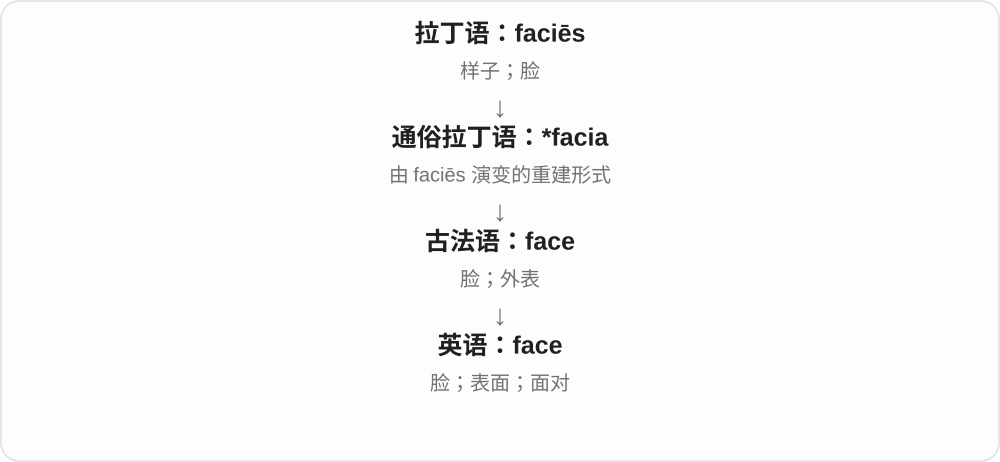
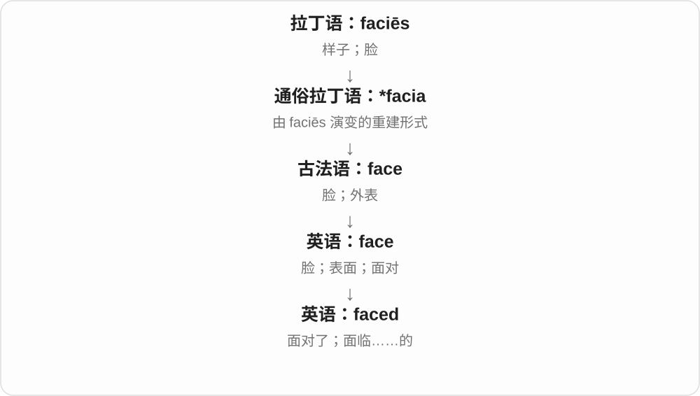

# 0410 · faced — 具有某种脸、表情或面对状态；俚语需整组辨

[逐词精讲目录](../00_逐词精讲目录.md) · [总目录](../00_总目录_按常用程度.md)

## 核心词根与来源

faced 可以来自 face 动词分词，也可以在复合形容词中描述外貌、态度。固定俚语要承认约定，不把脸这个字面画面无限放大。

**FACED：脸和朝向的形式，具体评价由组合决定**

faced 面对、带某种面；barefaced 毫不掩饰；shitfaced 烂醉的粗俗固定说法。

- **基本面对和特征形式**：face · faced
- **态度与俚语组合**：barefaced · shitfaced
- **face → faces：脸、表面；面对**：face · faces
- **face → facing：朝向与面对**：face · facing

## 词形与演化规律

face + -ed → faced；bare/shit + faced 各有约定语义。

face 经法语接拉丁 facies，faces 在 /s/ 后增加 /ɪz/；与 facere 的更深关系不当作确定派生。

法语面貌词整体借入，拉丁 facies 更早来源与 facere 的关系不强定。

## 单词速览（按词族由简到繁）

同一基础词的相关扩展放在一起，先读基础形式，再读扩展；各组之间优先读常用的。具体词源关系见各词讲解。

| 单词 | 音标 | 核心意思 |
|---|---|---|
| [face](#w-4) | /ˈfeɪ̯s/ | 脸；表面；面对 |
| [faces](#w-5) | /ˈfeɪsɪz/ | 脸、面孔；表面、面；面对、朝向〔face 的第三人称单数〕 |
| [facing](#w-6) | /ˈfeɪsɪŋ/ | 面向、朝向；面对、面临〔face 的现在分词〕 |
| [faced](#w-1) | /feɪst/ | 面对了；面临……的 |
| [shitfaced](#w-2) | /ˈʃɪtfeɪst/ | 醉得烂醉的〔粗俗〕 |
| [barefaced](#w-3) | 英 /ˈbeəfeɪst/；美 /ˈberfeɪst/ | 公然的、不加掩饰的、厚颜无耻的；脸无遮盖的 |

## 逐词讲解

### 1. face — 脸；表面；面对

**音标**：/ˈfeɪ̯s/

**先抓住这个画面**

想象你转过身，把脸朝向一个人。face 可以是这张脸，也可以是物体朝外的一面；作动词，就是把自己放到问题面前。

**怎么拆**

整体借自法语，不拆成 fa + ce。拉丁语 faciēs 与 facere 可能有更深联系，但不能画成已确定的父子关系。

**怎么变成今天的意思**

由人的外貌扩展到钟面、山崖面；再从朝向某物发展出面对困难。face the facts 就是承认事实已经摆在眼前。

**常见搭配与例句**

face a problem；the face of a clock；save face（保全面子）。

> Her face lit up when she saw the puppy.

看到小狗时，她脸上露出了喜色。

> We need to face the problem together.

我们得一起面对这个问题。

**别混淆**

face 作“面对”时直接接对象；be faced with 才需要 with。

### 2. faces — 脸、面孔；表面、面；面对、朝向〔face 的第三人称单数〕

**音标**：/ˈfeɪsɪz/

**先抓住这个画面**

人的脸是 face，物体朝外的一面也叫 face；动词则把正面转向某处，或直接面对一个问题。

**怎么拆**

face 已有 e，加 s；/s/ 后读 /ɪz/。face 经法语接拉丁 facies 外观、面貌，动词由名词发展；与 facere 的更深联系不能当确定父子关系。

**怎么变成今天的意思**

**拉丁 facies → 法语 face → 英语 face**  
外观、面貌 → 脸、表面

↓

**face 名词、动词 + -s → faces**  
多个面孔、表面；单数主语面对、朝向

familiar faces 熟悉的面孔；make faces 做鬼脸；the faces of a cube 立方体各面；faces south 朝南；faces a problem 面临问题。

**常见搭配与例句**

new faces；faces the garden。

> I recognised a few familiar faces in the crowd.

我在人群里认出了几张熟悉的面孔。

> The kitchen window faces the garden.

厨房窗户朝着花园。

**别混淆**

The room faces south 中 faces 是朝向的动词；six faces 中是六个面。make faces 常是做鬼脸，face a difficulty 则是面对困难，注意各自搭配。

### 3. facing — 面向、朝向；面对、面临〔face 的现在分词〕

**音标**：/ˈfeɪsɪŋ/

**先抓住这个画面**

把脸或正面转向某处，是 facing；把对象换成难题，就成了正面遇上、需要面对的事情。

**怎么拆**

face 去 e 加 -ing → facing。face 整体经法语接拉丁 faciēs 外观、面貌；它与 facere 做是否有更深直接关系不宜强定。英语再形成面向、应对的动词。

**怎么变成今天的意思**

**拉丁 faciēs → 法语 → face；英语动词发展**  
面貌、正面 → 把正面朝向

↓

**face → facing；抽象应对用法**  
面向某处；面临某种问题

facing the sea 面朝大海；facing difficulties 面临困难；facing each other 面对面。

**常见搭配与例句**

a window facing the garden；problems facing the team。

> Our room has a window facing the garden.

我们房间有一扇面朝花园的窗。

> The team is facing several difficult choices.

团队正面临几个艰难选择。

**别混淆**

facing 往往直接接方向、对象，如 facing the sea、facing a problem。problems facing the team 是团队面临的问题，注意短语关系。

### 4. faced — 面对了；面临……的

**音标**：/feɪst/

**先抓住这个画面**

问题已经站到你面前，你需要接住它。faced 可以叙述过去面对了什么，也常出现在 be faced with 里。

**怎么拆**

face + -ed；词尾读 /t/。这是英语动词变化，也可形成描述处境的分词结构。

**怎么变成今天的意思**

从把脸朝向对象到面对处境，-ed 只改变时间或语法状态，并没有产生一个新的古代词根。

**常见搭配与例句**

faced a choice；be faced with a challenge。

> We faced several delays last week.

我们上周遇到了几次延误。

> Faced with two options, she chose the simpler one.

面对两个选项，她选了较简单的那个。

**别混淆**

She faced a problem 与 She was faced with a problem 都可以；不要拼成 was faced a problem。

### 5. shitfaced — 醉得烂醉的〔粗俗〕

**音标**：/ˈʃɪtfeɪst/

**先抓住这个画面**

比 just drunk 更重、更粗鲁，像中文烂醉、醉得一塌糊涂；不是正式评价饮酒状态的中性术语。

**怎么拆**

shit 粗俗强化材料 + faced 的俚语组合。现代约定说烂醉，不凭字面编一个脸上必定沾了什么的真实动作来源。

**怎么变成今天的意思**

**shit + faced → shitfaced**  
粗俗组合形成强烈评价

↓

**现代俚语**  
烂醉、醉得很厉害

get shitfaced 喝得烂醉，be shitfaced 烂醉着。可用于人物对白，听到时要保留粗俗、程度重的语气。

**常见搭配与例句**

get shitfaced；be shitfaced〔粗俗〕。

> In the novel, he gets shitfaced after the party.

小说里，他聚会后喝得烂醉。

> She described the character as shitfaced, a deliberately crude choice of words.

她用 shitfaced 形容那个角色烂醉，是故意用了粗俗措辞。

**别混淆**

shitfaced 比一般 drunk 粗俗、程度重；faced 单独可说面对，不能把一个俚语组合倒推为所有 -faced 都等于喝醉。

### 6. barefaced — 公然的、不加掩饰的、厚颜无耻的；脸无遮盖的

**音标**：英 /ˈbeəfeɪst/；美 /ˈberfeɪst/

**先抓住这个画面**

连脸都不遮，明目张胆地来：a barefaced lie 是公然撒谎，重点不是脸上有没有化妆。

**怎么拆**

现代可看 bare + face + -ed，早期有脸无遮盖的用法，再到公然、无耻；也有词源分析提出旧 barefast 形式的可能影响，勿当成完全无争议的单一路径。

**怎么变成今天的意思**

**古英语 bær → 中古英语 bare → bare〔形容词〕**  
无遮盖、裸露

↓

**bare、face、-ed 的透明构词关系；旧形式来源另有讨论**  
脸无遮盖、未隐藏

↓

**现代常见贬义引申**  
公然撒谎、厚颜无耻

a barefaced lie 公然的谎言，barefaced dishonesty 明目张胆的不诚实，a barefaced attempt 公然的企图。

**常见搭配与例句**

a barefaced lie；barefaced dishonesty；a barefaced attempt。

> That was a barefaced lie.

那是个明目张胆的谎言。

> The report exposed a barefaced attempt to hide the mistake.

报告揭露了一次公然掩盖错误的企图。

**别混淆**

barefaced 常带负面评价；bare facts 基本事实不自动贬义，barely 则是勉强、几乎不，三者不能只按裸露逐字翻。

## 这一组要分清什么

barefaced lie 公然谎言；shitfaced 烂醉且粗俗；faced 并不天生表示醉酒。

## 串起来练习

The barefaced excuse was that he had been shitfaced.

他厚着脸皮拿自己当时烂醉作借口。
