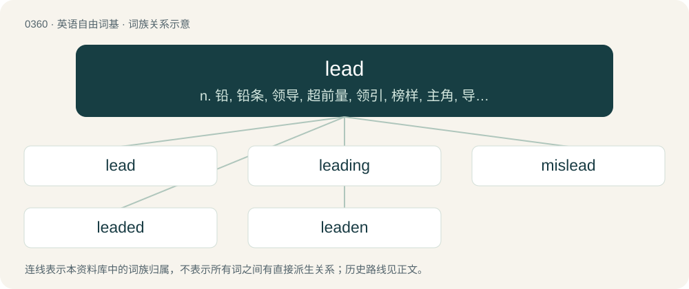

# 0420 · lead — n. 铅, 铅条, 领导, 超前量, 领引, 榜样, 主角, 导线；vt. 引导, 带领, 领导, 指挥, 致使, 加铅于, 用铅包；vi. 领导, 带头, 导致, 用测深锤测深, 被铅覆盖

[总目录](../00_总目录_按常用程度.md)

**类型**：英语自由词基　｜　**来源语言**：见词源记录

## 核心含义与来源

- 核心含义：n. 铅, 铅条, 领导, 超前量, 领引, 榜样, 主角, 导线；vt. 引导, 带领, 领导, 指挥, 致使, 加铅于, 用铅包；vi. 领导, 带头, 导致, 用测深锤测深, 被铅覆盖
- 英文含义：A heavy, pliable, inelastic metal element, having a bright, bluish color, but easily tarnished; both malleable and ductile, though with little tenacity. It is easily fusible, forms alloys with other metals, and is an ingredient of solder and type metal. Atomic number 82.
- 词形：lead

**多个词源／构词路径**：同一拼写可能有不同来源；以下按词性和含义分别列出。

**来源记录 1**（名词；A heavy, pliable, inelastic metal element, having a bright, bluish color, but easily tarnished; both malleable and ductile, though with little tenacity. It is easily fusible, forms alloys with other metals, and is an ingredient of solder and type metal. Atomic number 82.）

From Middle English led, leed, from Old English lēad (“lead”), from Proto-West Germanic \*laud (“lead”), possibly borrowed from Proto-Celtic \*ɸloudom, from Proto-Indo-European \*plewd- (“to flow”). Cognate with Scots leid, lede (“lead”), North Frisian lud, luad (“lead”), West Frisian lead (“lead”), Dutch lood (“lead”), Low German Lod (“solder, plummet”), German Lot (“solder, plummet, sounding line”), Swedish lod (“solder, plummet”), Icelandic lóð (“a plumb, weight”), Irish luaidhe (“lead”) Latin plumbum (“lead”), Finnish luoti (“bullet”). Doublet of loth. More at flow. \* (graphite in a pencil): Graphite was once believed to be a form of lead; see black lead and plumbago.

**来源记录 2**（动词；To guide or conduct with the hand, or by means of some physical contact connection.）

From Middle English leden, from Old English lǣdan (“to lead”), from Proto-West Germanic \*laidijan, from Proto-Germanic \*laidijaną (“to cause one to go, lead”), causative of Proto-Germanic \*līþaną (“to go”), from Proto-Indo-European \*leyt- (“to leave, die”). Cognate with West Frisian liede (“to lead”), Dutch leiden (“to lead”), German leiten (“to lead”), Danish and Norwegian Bokmål lede (“to lead”), Norwegian Nynorsk leia (“to lead”), Swedish leda (“to lead”), Faroese and Icelandic leiða (“to lead”). Related to Old English līþan (“to go, travel”).

## 词族图

## 单词速览（常用到不常用）

| 单词 | 音标 | 释义 |
|---|---|---|
| [lead](#w-1) | /ˈlɛd/ | n. 铅, 铅条, 领导, 超前量, 领引, 榜样, 主角, 导线；vt. 引导, 带领, 领导, 指挥, 致使, 加铅于, 用铅包；vi. 领导, 带头, 导致, 用测深锤测深, 被铅覆盖 |
| [leading](#w-2) | 英 /ˈliːdɪŋ/；美 /ˈlidɪŋ/ | n. 领导, 指挥, 神示, 铅板；a. 领导的, 主要的, 在前的 |
| [mislead](#w-3) | /mɪsˈliːd/ | vt. 误导 |
| [leaded](#w-4) | 美 /ˈlɛdɪd/；/ˈliːdɪd/ | a. 加铅的 |
| [leaden](#w-5) | /ˈlɛdən/ | a. 铅制的, 呆滞的, 铅灰色的, 沉闷的；\[机\] 铅的, 铅包的 |

## 逐词详解

### 1. lead

**词性**：名词　｜　**音标**：/ˈlɛd/

**中文释义**：n. 铅, 铅条, 领导, 超前量, 领引, 榜样, 主角, 导线；vt. 引导, 带领, 领导, 指挥, 致使, 加铅于, 用铅包；vi. 领导, 带头, 导致, 用测深锤测深, 被铅覆盖

**英文义项**：A heavy, pliable, inelastic metal element, having a bright, bluish color, but easily tarnished; both malleable and ductile, though with little tenacity. It is easily fusible, forms alloys with other metals, and is an ingredient of solder and type metal. Atomic number 82. / A plummet or mass of lead attached to a line, used in sounding depth at sea or to estimate velocity in knots.

**词源与演化**：

From Middle English led, leed, from Old English lēad (“lead”), from Proto-West Germanic \*laud (“lead”), possibly borrowed from Proto-Celtic \*ɸloudom, from Proto-Indo-European \*plewd- (“to flow”). Cognate with Scots leid, lede (“lead”), North Frisian lud, luad (“lead”), West Frisian lead (“lead”), Dutch lood (“lead”), Low German Lod (“solder, plummet”), German Lot (“solder, plummet, sounding line”), Swedish lod (“solder, plummet”), Icelandic lóð (“a plumb, weight”), Irish luaidhe (“lead”) Latin plumbum (“lead”), Finnish luoti (“bullet”). Doublet of loth. More at flow. \* (graphite in a pencil): Graphite was once believed to be a form of lead; see black lead and plumbago.

**例句**：

> This copy has too much lead; I prefer less space between the lines.

该用例对应义项：Vertical space in advance of a row or between rows of text. Also known as leading.

### 2. leading

**词性**：形容词　｜　**音标**：英 /ˈliːdɪŋ/；美 /ˈlidɪŋ/

**中文释义**：n. 领导, 指挥, 神示, 铅板；a. 领导的, 主要的, 在前的

**英文义项**：Providing guidance or direction. / Ranking first.

**构词拆分**：lead + -ing

**词源与演化**：

From Middle English ledinge, ledynge, ledand, ledande, ledende, from Old English lǣdende, from Proto-West Germanic \*laidijandī, from Proto-Germanic \*laidijandz, present participle of Proto-Germanic \*laidijaną (“to lead”), equivalent to lead + -ing. Compare West Frisian liedend, Dutch leidend, German leitend, Swedish ledande, Icelandic leiðandi.

**例句**：

> He is a leading supplier of plumbing supplies in the county.

该用例对应义项：Ranking first.

### 3. mislead

**词性**：动词　｜　**音标**：/mɪsˈliːd/

**中文释义**：vt. 误导

**英文义项**：To lead astray, in a false direction. / To deceive by telling lies or otherwise giving a false impression.

**构词拆分**：By surface analysis, mis- + lead

**词源与演化**：

From Middle English mysleden, from Old English mislǣdan (“to mislead”), from Proto-Germanic \*missalaidijaną (“to mislead”). By surface analysis, mis- + lead.

**用法示例／搭配（非完整句）**：

> The preacher elaborated Satan's ways to mislead us into sin

该用例对应义项：To deceptively trick into something wrong.

### 4. leaded

**词性**：形容词　｜　**音标**：美 /ˈlɛdɪd/；/ˈliːdɪd/

**中文释义**：a. 加铅的

**英文义项**：Held in place by strips of lead. / Containing or treated with the element lead.

**构词拆分**：lead + -ed

**词源与演化**：

From lead + -ed.

**例句**：

> Leaded gasoline is hard to find in some areas now.

该用例对应义项：Containing tetraethyllead.

### 5. leaden

**词性**：形容词　｜　**音标**：/ˈlɛdən/

**中文释义**：a. 铅制的, 呆滞的, 铅灰色的, 沉闷的；\[机\] 铅的, 铅包的

**英文义项**：Resembling the color of lead, metallic or dark gray; (of daylight) dim, overcast. / Resembling the density of lead, heavy.

**构词拆分**：By surface analysis, lead + -en

**词源与演化**：

From Middle English leden, leaden, from Old English lēaden (“leaden, of lead”). Cognate with West Frisian leaden (“leaden”), Dutch loden (“leaden”). By surface analysis, lead + -en.

**例句**：

> The sky was dark and overcast, a leaden pall producing a deep gloom.

该用例对应义项：Resembling the color of lead, metallic or dark gray; (of daylight) dim, overcast.
