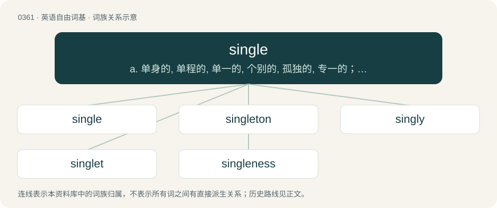

# 0422 · single — a. 单身的, 单程的, 单一的, 个别的, 孤独的, 专一的；n. 一个, 单打, 单程票；vt. 选出

[总目录](../00_总目录_按常用程度.md)

**类型**：英语自由词基　｜　**来源语言**：见词源记录

## 核心含义与来源

- 核心含义：a. 单身的, 单程的, 单一的, 个别的, 孤独的, 专一的；n. 一个, 单打, 单程票；vt. 选出
- 英文含义：Not accompanied by anything else; one in number.
- 词形：single

**来源记录 1**（形容词；Not accompanied by anything else; one in number.）

From Middle English single, sengle, from Old French sengle, saingle, sangle, from Latin singulus, a diminutive derived from Proto-Indo-European \*sem- (“one”). Akin to Latin simplex (“simple”). See simple, and compare singular.

## 词族图

## 单词速览（常用到不常用）

| 单词 | 音标 | 释义 |
|---|---|---|
| [single](#w-1) | 英 /ˈsɪŋɡl̩/；美 /ˈsɪŋɡəl/ | a. 单身的, 单程的, 单一的, 个别的, 孤独的, 专一的；n. 一个, 单打, 单程票；vt. 选出 |
| [singleton](#w-2) | 英 /ˈsɪŋ.ɡ(ə)l.tən/ | n. 一个, 独生子, 独身 |
| [singly](#w-3) | /ˈsɪŋ.ɡli/ | adv. 一个一个地, 各自地, 单身地 |
| [singlet](#w-4) | /ˈsɪŋɡlɪt/ | n. 汗衫, 运动衫；\[化\] 单峰; 单态; 单线态 |
| [singleness](#w-5) | /ˈsiŋglnis/ | n. 单一, 真诚, 独身 |

## 逐词详解

### 1. single

**词性**：形容词　｜　**音标**：英 /ˈsɪŋɡl̩/；美 /ˈsɪŋɡəl/

**中文释义**：a. 单身的, 单程的, 单一的, 个别的, 孤独的, 专一的；n. 一个, 单打, 单程票；vt. 选出

**英文义项**：Not accompanied by anything else; one in number. / Not divided in parts.

**词源与演化**：

From Middle English single, sengle, from Old French sengle, saingle, sangle, from Latin singulus, a diminutive derived from Proto-Indo-European \*sem- (“one”). Akin to Latin simplex (“simple”). See simple, and compare singular.

**例句**：

> The potatoes left the spoon and landed in a single big lump on the plate.

该用例对应义项：Not divided in parts.

### 2. singleton

**词性**：名词　｜　**音标**：英 /ˈsɪŋ.ɡ(ə)l.tən/

**中文释义**：n. 一个, 独生子, 独身

**英文义项**：A playing card that is the only one of its suit in a hand, especially at bridge. / A hand containing only one card of a certain suit.

**构词拆分**：single + -ton

**词源与演化**：

From single + -ton, probably following the model of simpleton.

**用法示例／搭配（非完整句）**：

> singleton preterm birth

该用例对应义项：A child or animal that is born singly, not as a twin or other multiple birth.

### 3. singly

**词性**：副词　｜　**音标**：/ˈsɪŋ.ɡli/

**中文释义**：adv. 一个一个地, 各自地, 单身地

**英文义项**：In a single or unaccompanied manner; without a companion. / Individually; particularly; severally.

**构词拆分**：single + -ly

**词源与演化**：

From Middle English senglely. Equivalent to single + -ly.

**用法示例／搭配（非完整句）**：

> to make men singly and personally good

该用例对应义项：Individually; particularly; severally.

### 4. singlet

**词性**：名词　｜　**音标**：/ˈsɪŋɡlɪt/

**中文释义**：n. 汗衫, 运动衫；\[化\] 单峰; 单态; 单线态

**英文义项**：A multiplet having a single member, especially a single spectroscopic peak. / A quantum state having zero spin.

**构词拆分**：single + -let

**词源与演化**：

From single + -let.

**例句**：

> It was a sailor, bare-armed and bare-legged, in blue singlet and canvas trousers rolled to the knee.

### 5. singleness

**词性**：名词　｜　**音标**：/ˈsiŋglnis/

**中文释义**：n. 单一, 真诚, 独身

**英文义项**：The property of being single. / The result or product of being single.

**构词拆分**：single + -ness

**词源与演化**：

From single + -ness.
