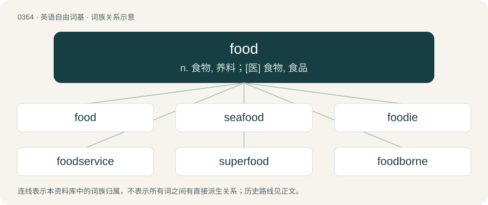

# 0427 · food — n. 食物, 养料；\[医\] 食物, 食品

[总目录](../00_总目录_按常用程度.md)

**类型**：英语自由词基　｜　**来源语言**：见词源记录

## 核心含义与来源

- 核心含义：n. 食物, 养料；\[医\] 食物, 食品
- 英文含义：Any solid substance that can be consumed by living organisms, especially by eating, in order to sustain life.
- 词形：food

**来源记录 1**（名词；Any solid substance that can be consumed by living organisms, especially by eating, in order to sustain life.）

From Middle English fode, foode, from Old English fōda (“food”), from Proto-West Germanic \*fōdō, from Proto-Germanic \*fōdô (“food”), from Proto-Indo-European \*peh₂- (“to guard, graze, feed”). Cognate with Scots fuid (“food”), Low German föde, vöde (“food”), West Frisian fiedsel (“food”), Dutch voedsel (“food”) Danish føde (“food”), Swedish föda (“food”), Icelandic fæða, fæði (“food”), Gothic 𐍆𐍉𐌳𐌴𐌹𐌽𐍃 (fōdeins, “food”), Latin pānis (“bread, food”), Latin pāscō (“feed, nourish”, verb). Related to fodder, foster.

## 词族图

## 单词速览（常用到不常用）

| 单词 | 音标 | 释义 |
|---|---|---|
| [food](#w-1) | /fuːd/ | n. 食物, 养料；\[医\] 食物, 食品 |
| [seafood](#w-2) | /ˈsiːfuːd/ | n. 海味, 海鲜, 鱼类 |
| [foodie](#w-3) | /ˈfuːdi/ | n. 美食家 |
| [foodservice](#w-4) |  | 【英文】The business of providing food and related services. |
| [superfood](#w-5) | 美 /ˈsupɚfud/ | 【英文】Any food purported to confer remarkable health benefits. |
| [foodborne](#w-6) | /ˈfuːdbɔːn/ | \[医\]食物传播的, 食物传染的 |

## 逐词详解

### 1. food

**词性**：名词　｜　**音标**：/fuːd/

**中文释义**：n. 食物, 养料；\[医\] 食物, 食品

**英文义项**：Any solid substance that can be consumed by living organisms, especially by eating, in order to sustain life. / A foodstuff, a type of food.

**词源与演化**：

From Middle English fode, foode, from Old English fōda (“food”), from Proto-West Germanic \*fōdō, from Proto-Germanic \*fōdô (“food”), from Proto-Indo-European \*peh₂- (“to guard, graze, feed”). Cognate with Scots fuid (“food”), Low German föde, vöde (“food”), West Frisian fiedsel (“food”), Dutch voedsel (“food”) Danish føde (“food”), Swedish föda (“food”), Icelandic fæða, fæði (“food”), Gothic 𐍆𐍉𐌳𐌴𐌹𐌽𐍃 (fōdeins, “food”), Latin pānis (“bread, food”), Latin pāscō (“feed, nourish”, verb). Related to fodder, foster.

**例句**：

> The man's inspiring speech gave us food for thought.

该用例对应义项：Anything that nourishes or sustains.

### 2. seafood

**词性**：名词　｜　**音标**：/ˈsiːfuːd/

**中文释义**：n. 海味, 海鲜, 鱼类

**英文义项**：Food from the sea, including that derived from fish, shellfish, crustaceans, cephalopods, seaweed, algae, marine mammals, and other marine organisms. / Food from any aquatic source, including not only salt water but also fresh water.

**构词拆分**：sea + food

**词源与演化**：

From sea + food.

**例句**：

> This is by far the best seafood restaurant in this area.

### 3. foodie

**词性**：名词　｜　**音标**：/ˈfuːdi/

**中文释义**：n. 美食家

**英文义项**：A person with a special interest in or knowledge of food, a gourmet.

**构词拆分**：food + -ie

**词源与演化**：

From food + -ie. Popularized by Ann Barr and Paul Levy in The Official Foodie Handbook (1984). Levy credits New York food critic Gael Greene with the coinage. The word was used by Greene in a 1980 article in New York magazine, see quotations.

**例句**：

> We self-professed foodies liked to meet in restaurants and talk like experts about what we were eating.

该用例对应义项：A person with a special interest in or knowledge of food, a gourmet.

### 4. foodservice

**词性**：名词

**英文义项**：The business of providing food and related services.

**构词拆分**：food + service

**词源与演化**：

From food + service.

**例句**：

> Employee turnover tends to be high in the foodservice industry.

该用例对应义项：The business of providing food and related services.

### 5. superfood

**词性**：名词　｜　**音标**：美 /ˈsupɚfud/

**英文义项**：Any food purported to confer remarkable health benefits. / Any food which provides a very concentrated source of protein, fats, or other nutritional necessities.

**构词拆分**：super- + food

**词源与演化**：

From super- + food.

**例句**：

> Kale has been called a superfood.

### 6. foodborne

**词性**：形容词　｜　**音标**：/ˈfuːdbɔːn/

**中文释义**：\[医\]食物传播的, 食物传染的

**英文义项**：Transmitted through food.

**构词拆分**：food + borne

**词源与演化**：

From food + borne.

**例句**：

> Many people become ill by ingesting foodborne bacteria.

该用例对应义项：Transmitted through food.
