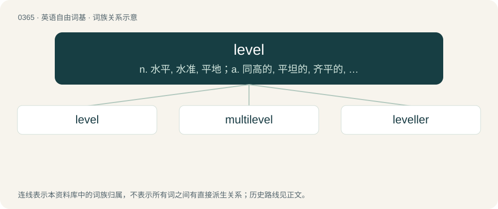

# 0428 · level — n. 水平, 水准, 平地；a. 同高的, 平坦的, 齐平的, 水平的；vt. 弄平, 夷平, 使同等, 瞄准, 对准

[总目录](../00_总目录_按常用程度.md)

**类型**：英语自由词基　｜　**来源语言**：见词源记录

## 核心含义与来源

- 核心含义：n. 水平, 水准, 平地；a. 同高的, 平坦的, 齐平的, 水平的；vt. 弄平, 夷平, 使同等, 瞄准, 对准
- 英文含义：The same height at all places; parallel to a flat ground.
- 词形：level

**来源记录 1**（形容词；The same height at all places; parallel to a flat ground.）

From Middle English level, from Old French livel, liveau m, later nivel, niveau, from Latin libella f (“a balance, a level”), diminutive of libra f (“a balance, a level”); see libra, librate. Doublet of libella and niveau. The verb is from Middle English levelen, from the noun.

## 词族图

## 单词速览（常用到不常用）

| 单词 | 音标 | 释义 |
|---|---|---|
| [level](#w-1) | /ˈlɛvəl/ | n. 水平, 水准, 平地；a. 同高的, 平坦的, 齐平的, 水平的；vt. 弄平, 夷平, 使同等, 瞄准, 对准 |
| [multilevel](#w-2) | 英 /ˌmʌl.tiˈlɛv.əl/；美 /ˌmʌl.tiˈlɛv.əl/ | \[计\] 多级的, 多层的 |
| [leveller](#w-3) | /ˈlevələ/ | \[计\] 校平器 |

## 逐词详解

### 1. level

**词性**：形容词　｜　**音标**：/ˈlɛvəl/

**中文释义**：n. 水平, 水准, 平地；a. 同高的, 平坦的, 齐平的, 水平的；vt. 弄平, 夷平, 使同等, 瞄准, 对准

**英文义项**：The same height at all places; parallel to a flat ground. / At the same height as some reference; constructed as level with.

**词源与演化**：

From Middle English level, from Old French livel, liveau m, later nivel, niveau, from Latin libella f (“a balance, a level”), diminutive of libra f (“a balance, a level”); see libra, librate. Doublet of libella and niveau. The verb is from Middle English levelen, from the noun.

**例句**：

> We tried to hang the pictures so that the bottom of the frames were level with the dark line in the wallpaper.

该用例对应义项：At the same height as some reference; constructed as level with.

### 2. multilevel

**词性**：形容词　｜　**音标**：英 /ˌmʌl.tiˈlɛv.əl/；美 /ˌmʌl.tiˈlɛv.əl/

**中文释义**：\[计\] 多级的, 多层的

**英文义项**：Having several levels or floors.

**构词拆分**：multi- + level

**词源与演化**：

From multi- + level.

### 3. leveller

**词性**：名词　｜　**音标**：/ˈlevələ/

**中文释义**：\[计\] 校平器

**英文义项**：A person or thing that levels. / A device used to stabilize wobbly tables, chair legs, or other furniture.

**构词拆分**：level + -er

**词源与演化**：

From level + -er.

**例句**：

> I adjusted the leveller built into each leg of the table, but it still wobbled.

该用例对应义项：A device used to stabilize wobbly tables, chair legs, or other furniture.
