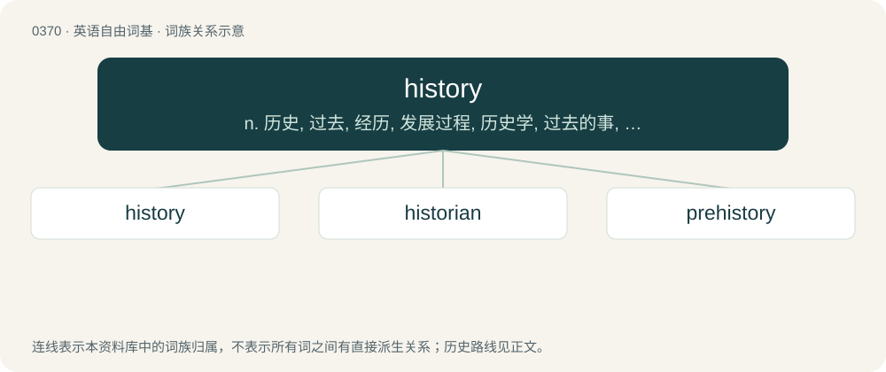

# 0433 · history — n. 历史, 过去, 经历, 发展过程, 历史学, 过去的事, 历史记录；\[计\] 历史记录

[总目录](../00_总目录_按常用程度.md)

**类型**：英语自由词基　｜　**来源语言**：见词源记录

## 核心含义与来源

- 核心含义：n. 历史, 过去, 经历, 发展过程, 历史学, 过去的事, 历史记录；\[计\] 历史记录
- 英文含义：The aggregate of past events, both unrecorded and recorded.
- 词形：history

**来源记录 1**（名词；The aggregate of past events, both unrecorded and recorded.）

From Middle English historie, from Old French estoire, estorie (“chronicle, history, story”) (French histoire), from Latin historia, from Ancient Greek ἱστορίᾱ (historíā, “learning through research”), from ἱστορέω (historéō, “to research, inquire (and) record”), from ἵστωρ (hístōr, “the knowing, wise one”), from Proto-Indo-European \*weyd- (“see, know”). Doublet of story and storey. Attested in Middle English in 1393 by John Gower, Confessio Amantis, which was aimed at an educated audience familiar with French and Latin.

## 词族图

## 单词速览（常用到不常用）

| 单词 | 音标 | 释义 |
|---|---|---|
| [history](#w-1) | 英 /ˈhɪs.tə.ɹi/ | n. 历史, 过去, 经历, 发展过程, 历史学, 过去的事, 历史记录；\[计\] 历史记录 |
| [historian](#w-2) | 英 /hɪˈstɔːɹɪən/；美 /hɪˈstɔɹi.ən/ | n. 历史学家, 记事者 |
| [prehistory](#w-3) | /.priːˈhistəri/ | n. 史前学, 史前史, 历史背景；\[法\] 史前的, 史前考古学, 史前背景 |

## 逐词详解

### 1. history

**词性**：名词　｜　**音标**：英 /ˈhɪs.tə.ɹi/

**中文释义**：n. 历史, 过去, 经历, 发展过程, 历史学, 过去的事, 历史记录；\[计\] 历史记录

**英文义项**：The aggregate of past events, both unrecorded and recorded. / The empirical study of past events, as distinct from literature, myth, or scripture; the assessment of notable events.

**词源与演化**：

From Middle English historie, from Old French estoire, estorie (“chronicle, history, story”) (French histoire), from Latin historia, from Ancient Greek ἱστορίᾱ (historíā, “learning through research”), from ἱστορέω (historéō, “to research, inquire (and) record”), from ἵστωρ (hístōr, “the knowing, wise one”), from Proto-Indo-European \*weyd- (“see, know”). Doublet of story and storey. Attested in Middle English in 1393 by John Gower, Confessio Amantis, which was aimed at an educated audience familiar with French and Latin.

**例句**：

> He teaches Latin American history at the university and publishes books about the Cold War.

该用例对应义项：The empirical study of past events, as distinct from literature, myth, or scripture; the assessment of notable events.

### 2. historian

**词性**：名词　｜　**音标**：英 /hɪˈstɔːɹɪən/；美 /hɪˈstɔɹi.ən/

**中文释义**：n. 历史学家, 记事者

**英文义项**：A writer of history. / One who studies or researches history.

**构词拆分**：histor(y) + -ian

**词源与演化**：

From Middle English historian, historien, from Old French historien, from Latin historia (“story, history”), equivalent to histor(y) + -ian. More at history.

**例句**：

> The art historian wrote an essay about the ancient Greek vase.

### 3. prehistory

**词性**：名词　｜　**音标**：/.priːˈhistəri/

**中文释义**：n. 史前学, 史前史, 历史背景；\[法\] 史前的, 史前考古学, 史前背景

**英文义项**：The time before written records in any area of the world; the events and conditions of those times. / The study of those times.

**构词拆分**：pre- + history；pre- (“before”) + history

**词源与演化**：

From pre- (“before”) + history, first attested in the Foreign Quarterly Review in 1836, after the model of prehistoric, from French préhistorique.

**例句**：

> Archaeology is critical to the study of all history, but especially prehistory.
