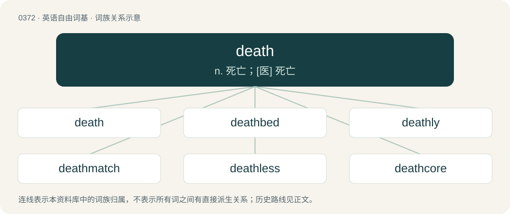

# 0434 · death — n. 死亡；\[医\] 死亡

[总目录](../00_总目录_按常用程度.md)

**类型**：英语自由词基　｜　**来源语言**：见词源记录

## 核心含义与来源

- 核心含义：n. 死亡；\[医\] 死亡
- 英文含义：The cessation of life and all associated processes; the end of an organism's existence as an entity independent from its environment and its return to an inert, non-living state.
- 词形：death

**来源记录 1**（名词；The cessation of life and all associated processes; the end of an organism's existence as an entity independent from its environment and its return to an inert, non-living state.）

From Middle English deth, deeth, from Old English dēaþ, from Proto-West Germanic \*dauþu, from Proto-Germanic \*dauþuz, from Proto-Indo-European \*dʰówtus. More at die. Cognates Cognate with Scots daeth, daith, death, deeth, deith (“death”), North Frisian Duar, duas, düüs (“death”), Saterland Frisian Dood (“death”), West Frisian dea (“death”), Dutch dood (“death”), German Tod, Todt (“death”), Limburgish doead (“death”), Luxembourgish Doud (“death”), Yiddish טויט (toyt, “death”), Danish and Norwegian Bokmål død (“death”), Faroese deyði (“death”), Icelandic dauði (“death”), Norwegian Nynorsk daude, død (“death”), Swedish död (“death”), Gothic 𐌳𐌰𐌿𐌸𐌿𐍃 (dauþus, “death”).

## 词族图

## 单词速览（常用到不常用）

| 单词 | 音标 | 释义 |
|---|---|---|
| [death](#w-1) | /dɛθ/ | n. 死亡；\[医\] 死亡 |
| [deathbed](#w-2) | 英 /ˈdɛθˌbɛd/ | n. 临死所卧之床, 临终之时 |
| [deathly](#w-3) | 英 /ˈdɛθli/ | a. 死一般的；adv. 像死一样地 |
| [deathmatch](#w-4) | /ˈdɛθ.mæt͡ʃ/ | 【英文】A competitive mode found in first-person shooter games in which competitors attempt to assassinate one another. |
| [deathless](#w-5) | /ˈdɛθləs/ | a. 不死的, 永恒的 |
| [deathcore](#w-6) |  | 【英文】An extreme fusion genre of death metal and metalcore. |
| [deathtrap](#w-7) | 英 /ˈdɛθtɹæp/ | n. 危险地方, 危险建筑物 |

## 逐词详解

### 1. death

**词性**：名词　｜　**音标**：/dɛθ/

**中文释义**：n. 死亡；\[医\] 死亡

**英文义项**：The cessation of life and all associated processes; the end of an organism's existence as an entity independent from its environment and its return to an inert, non-living state. / Execution (in the judicial sense).

**词源与演化**：

From Middle English deth, deeth, from Old English dēaþ, from Proto-West Germanic \*dauþu, from Proto-Germanic \*dauþuz, from Proto-Indo-European \*dʰówtus. More at die. Cognates Cognate with Scots daeth, daith, death, deeth, deith (“death”), North Frisian Duar, duas, düüs (“death”), Saterland Frisian Dood (“death”), West Frisian dea (“death”), Dutch dood (“death”), German Tod, Todt (“death”), Limburgish doead (“death”), Luxembourgish Doud (“death”), Yiddish טויט (toyt, “death”), Danish and Norwegian Bokmål død (“death”), Faroese deyði (“death”), Icelandic dauði (“death”), Norwegian Nynorsk daude, død (“death”), Swedish död (“death”), Gothic 𐌳𐌰𐌿𐌸𐌿𐍃 (dauþus, “death”).

**例句**：

> My grandfather died/met a violent death, which saddened the whole family.

该用例对应义项：The cessation of life and all associated processes; the end of an organism's existence as an entity independent from its environment and its return to an inert, non-living state.

### 2. deathbed

**词性**：名词　｜　**音标**：英 /ˈdɛθˌbɛd/

**中文释义**：n. 临死所卧之床, 临终之时

**英文义项**：The bed on which someone dies. / The last hours before death.

**构词拆分**：death + bed

**词源与演化**：

From Middle English dethbed, from Old English dēaþbedd (“deathbed; grave”), equivalent to death + bed. Cognate with Swedish dödsbädd (“deathbed”). Compare also Dutch sterfbed (“deathbed”), German Sterbebett and Totenbett (both “deathbed”), Danish dødsleje (“deathbed”).

**例句**：

> And when Marilyn was on her deathbed; she cried “where are my lovers?!”.

### 3. deathly

**词性**：形容词　｜　**音标**：英 /ˈdɛθli/

**中文释义**：a. 死一般的；adv. 像死一样地

**英文义项**：Appearing as though dead, or on the verge of death. / Deadly, fatal, causing death.

**构词拆分**：death + -ly

**词源与演化**：

From Middle English dethlich, from Old English dēaþlīċ, equivalent to death + -ly.

**例句**：

> He has a deathly fear of crocodiles.

该用例对应义项：Extreme.

### 4. deathmatch

**词性**：名词　｜　**音标**：/ˈdɛθ.mæt͡ʃ/

**英文义项**：A competitive mode found in first-person shooter games in which competitors attempt to assassinate one another.

**构词拆分**：From death + match.

**词源与演化**：

From death + match.

### 5. deathless

**词性**：形容词　｜　**音标**：/ˈdɛθləs/

**中文释义**：a. 不死的, 永恒的

**英文义项**：Undying or immortal. / Guaranteed not to be lost or forgotten due to its importance or conspicuous excellence.

**构词拆分**：death + -less

**词源与演化**：

From death + -less.

**例句**：

> Her novels are filled with unforgettable characters and deathless prose.

该用例对应义项：Guaranteed not to be lost or forgotten due to its importance or conspicuous excellence.

### 6. deathcore

**词性**：名词

**英文义项**：An extreme fusion genre of death metal and metalcore.

**构词拆分**：death + -core

**词源与演化**：

From death + -core.

### 7. deathtrap

**词性**：名词　｜　**音标**：英 /ˈdɛθtɹæp/

**中文释义**：n. 危险地方, 危险建筑物

**英文义项**：An extremely dangerous location, structure, or device. / A plot device where a villain in a story puts a hero in an elaborate dangerous situation for the purposes of attempting a sadistic murder.

**构词拆分**：From death + trap.

**词源与演化**：

From death + trap.

**例句**：

> Dude, your car is a deathtrap! Get the brakes and the steering fixed.

该用例对应义项：An extremely dangerous location, structure, or device.
