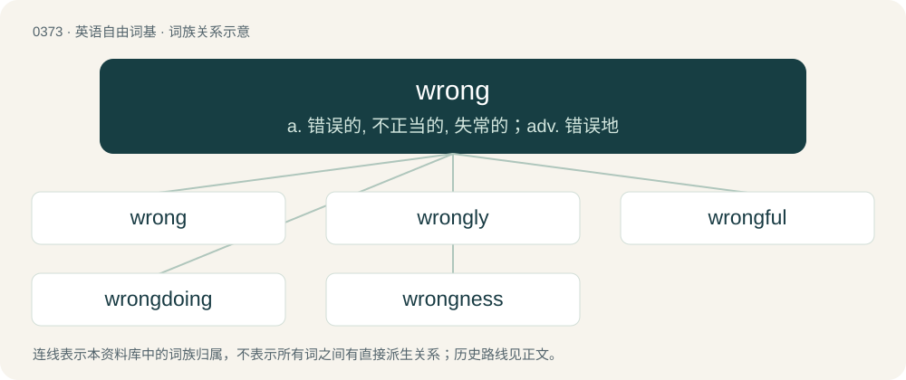

# 0438 · wrong — a. 错误的, 不正当的, 失常的；adv. 错误地

[总目录](../00_总目录_按常用程度.md)

**类型**：英语自由词基　｜　**来源语言**：见词源记录

## 核心含义与来源

- 核心含义：a. 错误的, 不正当的, 失常的；adv. 错误地
- 英文含义：Incorrect or untrue.
- 词形：wrong

**来源记录 1**（形容词；Incorrect or untrue.）

From Middle English wrong, from Old English wrang (“wrong, twisted, uneven”), from Old Norse rangr, vrangr (“crooked, wrong”), from Proto-Germanic \*wrangaz (“crooked, twisted, turned awry”), from Proto-Indo-European \*werḱ-, \*wrengʰ- (“to twist, weave, tie together”), from \*wer- (“to turn, bend”). Cognate with Scots wrang (“wrong”), Danish vrang (“wrong, crooked”), Swedish vrång (“perverse, distorted”), Icelandic rangur (“wrong”), Norwegian Nynorsk rang (“wrong”), Dutch wrang (“bitter, sour”) and the first element in the mythic Old Frisian city of Rungholt (“crooked wood”). More at wring.

## 词族图

## 单词速览（常用到不常用）

| 单词 | 音标 | 释义 |
|---|---|---|
| [wrong](#w-1) | 英 /ˈɹɒŋ/；美 /ˈɹɔŋ/ | a. 错误的, 不正当的, 失常的；adv. 错误地 |
| [wrongly](#w-2) | 英 /ˈɹɒŋ.li/；美 /ˈɹɔŋ.li/ | adv. 错误地, 不恰当地, 不正确地, 不正直地, 不公正地 |
| [wrongful](#w-3) | /ˈɹɒŋfəl/ | a. 不正当的, 不法的, 不讲道理的；\[法\] 错误的, 不正当的, 伤害的 |
| [wrongdoing](#w-4) | /ˈɹɒŋˌduːɪŋ/ | n. 干坏事, 坏事 |
| [wrongness](#w-5) | 英 /ˈɹɒŋ.nəs/ | n. 谬误, 不当, 不正直, 不公正；\[法\] 错误, 过失, 不正当 |

## 逐词详解

### 1. wrong

**词性**：形容词　｜　**音标**：英 /ˈɹɒŋ/；美 /ˈɹɔŋ/

**中文释义**：a. 错误的, 不正当的, 失常的；adv. 错误地

**英文义项**：Incorrect or untrue. / Asserting something incorrect or untrue.

**词源与演化**：

From Middle English wrong, from Old English wrang (“wrong, twisted, uneven”), from Old Norse rangr, vrangr (“crooked, wrong”), from Proto-Germanic \*wrangaz (“crooked, twisted, turned awry”), from Proto-Indo-European \*werḱ-, \*wrengʰ- (“to twist, weave, tie together”), from \*wer- (“to turn, bend”). Cognate with Scots wrang (“wrong”), Danish vrang (“wrong, crooked”), Swedish vrång (“perverse, distorted”), Icelandic rangur (“wrong”), Norwegian Nynorsk rang (“wrong”), Dutch wrang (“bitter, sour”) and the first element in the mythic Old Frisian city of Rungholt (“crooked wood”). More at wring.

**例句**：

> Some of your answers were correct, and some were wrong.

该用例对应义项：Incorrect or untrue.

### 2. wrongly

**词性**：副词　｜　**音标**：英 /ˈɹɒŋ.li/；美 /ˈɹɔŋ.li/

**中文释义**：adv. 错误地, 不恰当地, 不正确地, 不正直地, 不公正地

**英文义项**：In violation of a moral or other standard, code, or convention; in an unfair, unjust, dishonest, or immoral manner; wrongly convicted is synonymous with wrongful conviction and miscarriage of justice. / Incorrectly, mistakenly; by error.

**构词拆分**：wrong + -ly

**词源与演化**：

From Middle English wrongly, wrongliche, equivalent to wrong + -ly.

**例句**：

> I wrongly assumed that it would be an easy job.

该用例对应义项：Incorrectly, mistakenly; by error.

### 3. wrongful

**词性**：形容词　｜　**音标**：/ˈɹɒŋfəl/

**中文释义**：a. 不正当的, 不法的, 不讲道理的；\[法\] 错误的, 不正当的, 伤害的

**英文义项**：wrong or unjust / unlawful or illegal

**构词拆分**：wrong + -ful

**词源与演化**：

From Middle English wrongful, equivalent to wrong + -ful.

**例句**：

> AI facial recognition has led to a number of wrongful arrests.

### 4. wrongdoing

**词性**：名词　｜　**音标**：/ˈɹɒŋˌduːɪŋ/

**中文释义**：n. 干坏事, 坏事

**英文义项**：Violation of standards of behavior. / An instance of doing wrong.

**构词拆分**：wrong + doing

**词源与演化**：

From Middle English wrong doyng, wrong doynge, wrong doinge, equivalent to wrong + doing.

**例句**：

> A Chinese proverb goes, "He who commits wrongdoing repeatedly will come to no good end."

该用例对应义项：Violation of standards of behavior.

### 5. wrongness

**词性**：名词　｜　**音标**：英 /ˈɹɒŋ.nəs/

**中文释义**：n. 谬误, 不当, 不正直, 不公正；\[法\] 错误, 过失, 不正当

**英文义项**：The quality of being wrong; error or fault. / Wrong or reprehensible things or actions.

**构词拆分**：wrong + -ness

**词源与演化**：

From Middle English wrongnesse, equivalent to wrong + -ness.
