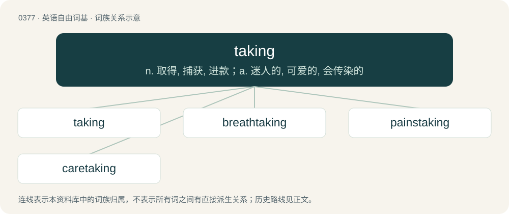

# 0439 · taking — n. 取得, 捕获, 进款；a. 迷人的, 可爱的, 会传染的

[总目录](../00_总目录_按常用程度.md)

**类型**：英语自由词基　｜　**来源语言**：见词源记录

## 核心含义与来源

- 核心含义：n. 取得, 捕获, 进款；a. 迷人的, 可爱的, 会传染的
- 英文含义：Alluring; attractive.
- 词形：taking

**来源记录 1**（形容词；Alluring; attractive.）

By surface analysis, take + -ing.

## 词族图

## 单词速览（常用到不常用）

| 单词 | 音标 | 释义 |
|---|---|---|
| [taking](#w-1) | /ˈteɪkɪŋ/ | n. 取得, 捕获, 进款；a. 迷人的, 可爱的, 会传染的 |
| [breathtaking](#w-2) | 美 /ˈbɹɛθˌteɪ.kɪŋ/ | a. 惊人的, 惊险的 |
| [painstaking](#w-3) | 英 /ˈpeɪnzˌteɪkɪŋ/；美 /ˈpeɪnˌsteɪkɪŋ/ | n. 辛苦, 苦心, 工夫；a. 辛苦的, 勤勉的, 小心的 |
| [caretaking](#w-4) | /ˈkeəteɪkɪŋ/ | 看管 |

## 逐词详解

### 1. taking

**词性**：名词　｜　**音标**：/ˈteɪkɪŋ/

**中文释义**：n. 取得, 捕获, 进款；a. 迷人的, 可爱的, 会传染的

**英文义项**：The act by which something is taken. / A seizure of someone's goods or possessions.

**词源与演化**：

By surface analysis, take + -ing.

**例句**：

> Fred was concerned because the takings from his sweetshop had fallen again for the third week.

该用例对应义项：Cash or money received (by a shop or other business, for example).

### 2. breathtaking

**词性**：形容词　｜　**音标**：美 /ˈbɹɛθˌteɪ.kɪŋ/

**中文释义**：a. 惊人的, 惊险的

**英文义项**：stunningly beautiful; amazing / Very surprising or shocking; to such a degree as to cause astonishment.

**构词拆分**：breath + taking

**词源与演化**：

From breath + taking.

**例句**：

> He went to the Grand Canyon and spent a week taking in the breathtaking scenery all around him.

该用例对应义项：stunningly beautiful; amazing

### 3. painstaking

**词性**：形容词　｜　**音标**：英 /ˈpeɪnzˌteɪkɪŋ/；美 /ˈpeɪnˌsteɪkɪŋ/

**中文释义**：n. 辛苦, 苦心, 工夫；a. 辛苦的, 勤勉的, 小心的

**英文义项**：Carefully attentive to details; studious; diligent in performing a process or procedure.

**构词拆分**：pains + taking；pain + staking

**词源与演化**：

From pains + taking; see take pains. The /ˈpeɪnˌsteɪkɪŋ/ pronunciation which dominates in the United States suggests a reanalysis of the word as pain + staking.

**例句**：

> Vaccines typically take years of painstaking research to develop.

### 4. caretaking

**词性**：名词　｜　**音标**：/ˈkeəteɪkɪŋ/

**中文释义**：看管

**英文义项**：The act of taking care or taking charge of something. / Caregiving.

**构词拆分**：care + taking

**词源与演化**：

From care + taking.

**例句**：

> Caretaking of the extensive grounds is a major expense for the museum foundation.

该用例对应义项：The act of taking care or taking charge of something.
