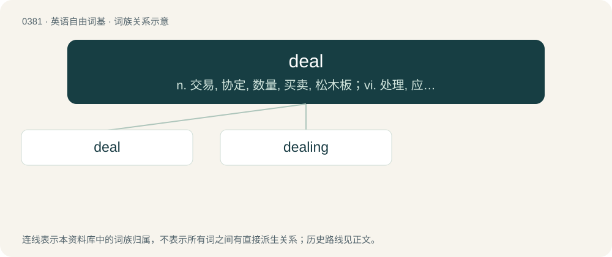

# 0442 · deal — n. 交易, 协定, 数量, 买卖, 松木板；vi. 处理, 应付, 做生意；vt. 分配, 发牌, 给予

[总目录](../00_总目录_按常用程度.md)

**类型**：英语自由词基　｜　**来源语言**：见词源记录

## 核心含义与来源

- 核心含义：n. 交易, 协定, 数量, 买卖, 松木板；vi. 处理, 应付, 做生意；vt. 分配, 发牌, 给予
- 英文含义：An indefinite quantity or amount; a lot (now usually qualified by great or good).
- 词形：deal

**多个词源／构词路径**：同一拼写可能有不同来源；以下按词性和含义分别列出。

**来源记录 1**（名词；An indefinite quantity or amount; a lot (now usually qualified by great or good).）

From Middle English del, dele, from Old English dǣl (“part, share, portion”), from Proto-West Germanic \*daili, from Proto-Germanic \*dailiz (“part, deal”), from Proto-Indo-European \*dʰ(h₁)-oy-lo- (“part, watershed”). Cognate with Scots dele (“part, portion”), West Frisian diel (“part, share”), Dutch deel (“part, share, portion”), German Teil (“part, portion, section”), Danish, Slovene, and Swedish del (“part”), Icelandic deila (“division, contention”), Gothic 𐌳𐌰𐌹𐌻𐍃 (dails, “portion”). Related to Old English dāl (“portion”). More at dole.

**来源记录 2**（动词；To distribute among a number of recipients, to give out as one’s portion or share.）

From Middle English delen, from Old English dǣlan (“to divide, part”), from Proto-West Germanic \*dailijan, from Proto-Germanic \*dailijaną (“to divide, part, deal”), from Proto-Indo-European \*dʰoh₁-i-l- (“part, watershed”). Cognates Cognate with West Frisian diele (“to divide, separate”), Dutch delen, German teilen, Swedish dela; and with Lithuanian dalinti (“divide”), Russian дели́ть (delítʹ).

**来源记录 3**（名词；Wood that is easy to saw (from conifers such as pine or fir).）

From Middle English dele (“plank”), from Middle Low German dele, from Old Saxon thili, ultimately from Proto-Germanic \*þiljǭ (“plank, board”); cognate with Old English þille. Doublet of (dialectal) theal and thill.

## 词族图

## 单词速览（常用到不常用）

| 单词 | 音标 | 释义 |
|---|---|---|
| [deal](#w-1) | /ˈdiːl/ | n. 交易, 协定, 数量, 买卖, 松木板；vi. 处理, 应付, 做生意；vt. 分配, 发牌, 给予 |
| [dealing](#w-2) | /ˈdiːlɪŋ/ | n. 经营行为, 行为, 交易；\[法\] 待遇, 处置, 行为 |

## 逐词详解

### 1. deal

**词性**：名词　｜　**音标**：/ˈdiːl/

**中文释义**：n. 交易, 协定, 数量, 买卖, 松木板；vi. 处理, 应付, 做生意；vt. 分配, 发牌, 给予

**英文义项**：An indefinite quantity or amount; a lot (now usually qualified by great or good).

**词源与演化**：

From Middle English del, dele, from Old English dǣl (“part, share, portion”), from Proto-West Germanic \*daili, from Proto-Germanic \*dailiz (“part, deal”), from Proto-Indo-European \*dʰ(h₁)-oy-lo- (“part, watershed”). Cognate with Scots dele (“part, portion”), West Frisian diel (“part, share”), Dutch deel (“part, share, portion”), German Teil (“part, portion, section”), Danish, Slovene, and Swedish del (“part”), Icelandic deila (“division, contention”), Gothic 𐌳𐌰𐌹𐌻𐍃 (dails, “portion”). Related to Old English dāl (“portion”). More at dole.

**例句**：

> A deal of trouble.

该用例对应义项：(often followed by `of') a large number or amount or extent

### 2. dealing

**词性**：名词　｜　**音标**：/ˈdiːlɪŋ/

**中文释义**：n. 经营行为, 行为, 交易；\[法\] 待遇, 处置, 行为

**英文义项**：A business transaction. / One's manner of acting toward others; behaviour; interactions or relations with others.

**构词拆分**：deal + -ing

**词源与演化**：

From Middle English delynge, from Old English dǣling; equivalent to deal + -ing.

**例句**：

> The document clearly spells out the correct procedure for dealing with complaints.
