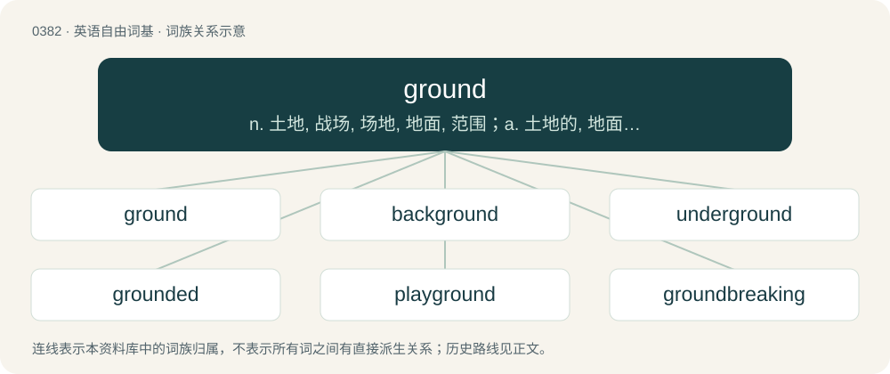

# 0443 · ground — n. 土地, 战场, 场地, 地面, 范围；a. 土地的, 地面上的；vt. 放在地上, 使搁浅, 打基础, 给...以训练

[总目录](../00_总目录_按常用程度.md)

**类型**：英语自由词基　｜　**来源语言**：见词源记录

## 核心含义与来源

- 核心含义：n. 土地, 战场, 场地, 地面, 范围；a. 土地的, 地面上的；vt. 放在地上, 使搁浅, 打基础, 给...以训练
- 英文含义：The surface of the Earth, as opposed to the sky or water or underground.
- 词形：ground

**多个词源／构词路径**：同一拼写可能有不同来源；以下按词性和含义分别列出。

**来源记录 1**（名词；The surface of the Earth, as opposed to the sky or water or underground.）

From Middle English ground, from Old English grund, from Proto-West Germanic \*grundu, from Proto-Germanic \*grunduz. Cognate with West Frisian grûn, Dutch grond and German Grund. (to punish): Compare (to bring) down to earth, to come down to earth.

**来源记录 2**（形容词；Crushed, or reduced to small particles.）

Inflected form of grind. See also milled.

## 词族图

## 单词速览（常用到不常用）

| 单词 | 音标 | 释义 |
|---|---|---|
| [ground](#w-1) | 英 /ɡɹaʊnd/ | n. 土地, 战场, 场地, 地面, 范围；a. 土地的, 地面上的；vt. 放在地上, 使搁浅, 打基础, 给...以训练 |
| [background](#w-2) | /ˈbæk.(ɡ)ɹaʊnd/ | n. 背景, 背景资料；\[计\] 背景, 后台 |
| [underground](#w-3) | 英 /ˌʌn.dəˈɡɹaʊnd/；美 /ˌʌn.dəɹˈɡɹaʊnd/ | n. 地下, 地铁, 地道, 秘密活动；a. 地下的, 秘密的；adv. 在地下, 秘密地 |
| [grounded](#w-4) | /ˈɡɹaʊn.dɪd/ | a. \[物\]接地的；有基础的 |
| [playground](#w-5) | 英 /ˈpleɪɡɹaʊnd/ | n. 运动场, 操场, 度假胜地, 活动场所 |
| [groundbreaking](#w-6) | 英 /ˈɡɹaʊndˌbɹeɪkɪŋ/ | a. 开创性的, 突破性的 |
| [groundwater](#w-7) | /ˈgraundwɒːtə/ | n. 地下水 |
| [foreground](#w-8) | 英 /ˈfɔː(ɹ)ˌɡɹaʊnd/ | n. 前景, 最显著的位置；\[计\] 前景, 前台 |
| [groundwork](#w-9) | /ˈɡɹaʊndˌwɜːɹk/ | n. 地基, 基础, 根据 |
| [battleground](#w-10) | /ˈbætəlˌɡɹaʊnd/ | n. 战场, 战地 |
| [campground](#w-11) | 美 /ˈkæmpˌɡɹaʊnd/ | n. 露营场所；野营地 |
| [groundhog](#w-12) | 英 /ˈɡɹaʊndhɒɡ/；美 /ˈɡɹaʊn(d)ˌ(h)ɔɡ/ | n. 土拨鼠 |
| [aground](#w-13) | /əˈɡɹaʊnd/ | adv. 搁浅地, 地面上 |
| [fairground](#w-14) | /ˈfɛə(ɹ)ɡɹaʊnd/ | n. 举行赛会的场所, 露天市场 |
| [groundless](#w-15) | /ˈɡɹaʊndləs/ | a. 无根据的, 无理由的；\[法\] 无根据的, 无理由的 |
| [grounder](#w-16) | /ˈɡɹaʊndə(ɹ)/ | n. 滚球, 创立者, 创业者 |
| [overground](#w-17) | /ˈəuvəgraund/ | a. 地上的, 为社会所接受的 |
| [showground](#w-18) | /ˈʃəj^rajnd/ | n. 展览场地 |
| [groundnut](#w-19) | /ˈgraundnʌt/ | n. 野豆, 落花生 |
| [groundswell](#w-20) | /ˈgraʊndswel/ | （飓风和地震引起的）海啸, 浅水长涌 |

## 逐词详解

### 1. ground

**词性**：名词　｜　**音标**：英 /ɡɹaʊnd/

**中文释义**：n. 土地, 战场, 场地, 地面, 范围；a. 土地的, 地面上的；vt. 放在地上, 使搁浅, 打基础, 给...以训练

**英文义项**：The surface of the Earth, as opposed to the sky or water or underground. / Terrain.

**词源与演化**：

From Middle English ground, from Old English grund, from Proto-West Germanic \*grundu, from Proto-Germanic \*grunduz. Cognate with West Frisian grûn, Dutch grond and German Grund. (to punish): Compare (to bring) down to earth, to come down to earth.

**例句**：

> Grounds are usually put up first and the plastering floated flush with them.

该用例对应义项：One of the pieces of wood, flush with the plastering, to which mouldings etc. are attached.

### 2. background

**词性**：形容词　｜　**音标**：/ˈbæk.(ɡ)ɹaʊnd/

**中文释义**：n. 背景, 背景资料；\[计\] 背景, 后台

**英文义项**：Less important or less noticeable in a scene or system.

**构词拆分**：back + ground

**词源与演化**：

From back + ground. Compare backstory.

**例句**：

> The antivirus program runs on a background thread.

该用例对应义项：Less important or less noticeable in a scene or system.

### 3. underground

**词性**：形容词　｜　**音标**：英 /ˌʌn.dəˈɡɹaʊnd/；美 /ˌʌn.dəɹˈɡɹaʊnd/

**中文释义**：n. 地下, 地铁, 地道, 秘密活动；a. 地下的, 秘密的；adv. 在地下, 秘密地

**英文义项**：Below the ground; below the surface of the Earth. / Hidden, furtive, secretive.

**构词拆分**：under + ground；under- + ground

**词源与演化**：

From Middle English undergrounde (adverb), equivalent to under + ground or under- + ground. Compare Dutch ondergrond, ondergronds, German Untergrund, Danish undergrunds.

**例句**：

> There is an underground tunnel that takes you across the river.

该用例对应义项：Below the ground; below the surface of the Earth.

### 4. grounded

**词性**：形容词　｜　**音标**：/ˈɡɹaʊn.dɪd/

**中文释义**：a. \[物\]接地的；有基础的

**英文义项**：Not allowed to fly. / Aground.

**构词拆分**：ground + -ed

**词源与演化**：

From Middle English grounded, i-grounded, equivalent to ground + -ed.

**例句**：

> My older sister was grounded for coming home too late last night.

### 5. playground

**词性**：名词　｜　**音标**：英 /ˈpleɪɡɹaʊnd/

**中文释义**：n. 运动场, 操场, 度假胜地, 活动场所

**英文义项**：A large open space for children to play in, usually having dedicated play equipment (such as swings and slides). / Any physical or metaphysical space in which a person or organization has free rein to do as they please.

**构词拆分**：play + ground

**词源与演化**：

From play + ground. Compare Middle English playstede (“playground”) from Old English pleġstede.

**例句**：

> The local council have set up a new playground, equipped with slides, swings, and a climbing wall.

该用例对应义项：A large open space for children to play in, usually having dedicated play equipment (such as swings and slides).

### 6. groundbreaking

**词性**：形容词　｜　**音标**：英 /ˈɡɹaʊndˌbɹeɪkɪŋ/

**中文释义**：a. 开创性的, 突破性的

**英文义项**：Innovative; new, different; doing something that has never been done before.

**构词拆分**：ground + breaking

**词源与演化**：

From ground + breaking, in reference to the practice of breaking ground at the beginning of a new building or construction.

**例句**：

> The latest model includes several groundbreaking features and improvements.

该用例对应义项：Innovative; new, different; doing something that has never been done before.

### 7. groundwater

**词性**：名词　｜　**音标**：/ˈgraundwɒːtə/

**中文释义**：n. 地下水

**英文义项**：Water that exists beneath the earth's surface in underground streams and aquifers.

**构词拆分**：ground + water

**词源与演化**：

From ground + water.

**例句**：

> Algeria has plenty of groundwater in the Sahara Desert.

### 8. foreground

**词性**：名词　｜　**音标**：英 /ˈfɔː(ɹ)ˌɡɹaʊnd/

**中文释义**：n. 前景, 最显著的位置；\[计\] 前景, 前台

**英文义项**：The elements of an image which lie closest to the picture plane. / The subject of an image, often depicted at the bottom in a two-dimensional work.

**构词拆分**：fore- + ground

**词源与演化**：

From fore- + ground. Compare Dutch voorgrond (“foreground”), German Vordergrund (“foreground”), Danish forgrund (“foreground”), Swedish förgrund (“foreground”), Norwegian forgrunn (“foreground”), Icelandic forgrunni (“foreground”).

**例句**：

> In terms of themes, that movie put gender and sexuality at the foreground.

### 9. groundwork

**词性**：名词　｜　**音标**：/ˈɡɹaʊndˌwɜːɹk/

**中文释义**：n. 地基, 基础, 根据

**英文义项**：The foundation; the basic or fundamental parts that support or allow for the rest.

**构词拆分**：ground + work

**词源与演化**：

From ground + work.

**例句**：

> The discovery of the laws of electricity laid the groundwork for a century of innovation.

该用例对应义项：The foundation; the basic or fundamental parts that support or allow for the rest.

### 10. battleground

**词性**：名词　｜　**音标**：/ˈbætəlˌɡɹaʊnd/

**中文释义**：n. 战场, 战地

**英文义项**：A location where a battle may be fought, or has been fought. / Any place or situation of dispute or contention.

**构词拆分**：battle + ground

**词源与演化**：

From battle + ground.

**例句**：

> The farmer's field was a civil war battleground, and relics such a minnie bullets were frequently found while plowing.

该用例对应义项：A location where a battle may be fought, or has been fought.

### 11. campground

**词性**：名词　｜　**音标**：美 /ˈkæmpˌɡɹaʊnd/

**中文释义**：n. 露营场所；野营地

**英文义项**：An area where tents are pitched. / An area where a camp meeting (a retreat) is held.

**构词拆分**：camp + ground

**词源与演化**：

From camp + ground.

**例句**：

> It was still early in the day when Tom arrived at the campground.

### 12. groundhog

**词性**：名词　｜　**音标**：英 /ˈɡɹaʊndhɒɡ/；美 /ˈɡɹaʊn(d)ˌ(h)ɔɡ/

**中文释义**：n. 土拨鼠

**英文义项**：A red-brown marmot, Marmota monax, native to North America. / The aardvark.

**构词拆分**：ground + hog

**词源与演化**：

From ground + hog.

**例句**：

> You need nine hours of sleep! You are a real groundhog.

### 13. aground

**词性**：形容词　｜　**音标**：/əˈɡɹaʊnd/

**中文释义**：adv. 搁浅地, 地面上

**英文义项**：Resting on the bottom. / at a loss, ruined, with no way out

**构词拆分**：a- + ground

**词源与演化**：

From Middle English agrounde, on grounde (“on ground”), equivalent to a- + ground.

**例句**：

> A ship aground offshore.

该用例对应义项：stuck in a place where a ship can no longer float

### 14. fairground

**词性**：名词　｜　**音标**：/ˈfɛə(ɹ)ɡɹaʊnd/

**中文释义**：n. 举行赛会的场所, 露天市场

**英文义项**：An area where a fair (an event for public entertainment) or other public event is held; a showground. / A commercially-operated collection of rides, games and other entertainment attractions; an amusement park.

**构词拆分**：fair + ground

**词源与演化**：

From fair + ground.

**例句**：

> It was raining, so they cancelled their trip to the fairground.

### 15. groundless

**词性**：形容词　｜　**音标**：/ˈɡɹaʊndləs/

**中文释义**：a. 无根据的, 无理由的；\[法\] 无根据的, 无理由的

**英文义项**：Without any grounds to support it; baseless.

**构词拆分**：ground + -less

**词源与演化**：

From Middle English groundles (“bottomless”), from Old English grundlēas, from Proto-Germanic \*grundulausaz, equivalent to ground + -less. Cognate with Dutch grondeloos, German Low German grundlos, German grundlos, Danish grundløs, Swedish grundlös.

**例句**：

> The allegations proved groundless.

该用例对应义项：without a basis in reason or fact

### 16. grounder

**词性**：名词　｜　**音标**：/ˈɡɹaʊndə(ɹ)/

**中文释义**：n. 滚球, 创立者, 创业者

**英文义项**：A ground ball. / A fruit that has fallen to the ground rather than being picked; a windfall.

**构词拆分**：ground + -er

**词源与演化**：

From Middle English grounder, grownder, equivalent to ground + -er.

### 17. overground

**词性**：形容词　｜　**音标**：/ˈəuvəgraund/

**中文释义**：a. 地上的, 为社会所接受的

**英文义项**：Above the ground. / Mainstream, not underground.

**构词拆分**：over- + ground

**词源与演化**：

From over- + ground.

**用法示例／搭配（非完整句）**：

> an overground railway

该用例对应义项：Above the ground.

### 18. showground

**词性**：名词　｜　**音标**：/ˈʃəj^rajnd/

**中文释义**：n. 展览场地

**英文义项**：An outdoor arena or area where entertainment events and shows are held.

**构词拆分**：show + ground

**词源与演化**：

From show + ground.

**例句**：

> The fair takes place on the showground outside the city.

### 19. groundnut

**词性**：名词　｜　**音标**：/ˈgraundnʌt/

**中文释义**：n. 野豆, 落花生

**英文义项**：A climbing vine, Apios americana, of eastern North America, having fragrant brownish flowers and small edible tubers. / Any similar plant having underground tubers.

**构词拆分**：ground + nut

**词源与演化**：

From ground + nut. Compare Icelandic jarðhneta, German Erdnuss (both cognate with earthnut) and Hungarian földimogyoró.

### 20. groundswell

**词性**：名词　｜　**音标**：/ˈgraʊndswel/

**中文释义**：（飓风和地震引起的）海啸, 浅水长涌

**英文义项**：A broad undulation of the open ocean, often as the result of a distant disturbance. / A broadly-based shifting of public opinion.

**构词拆分**：ground + swell

**词源与演化**：

From ground + swell.

**例句**：

> The groundswell of support kept his campaign afloat.
