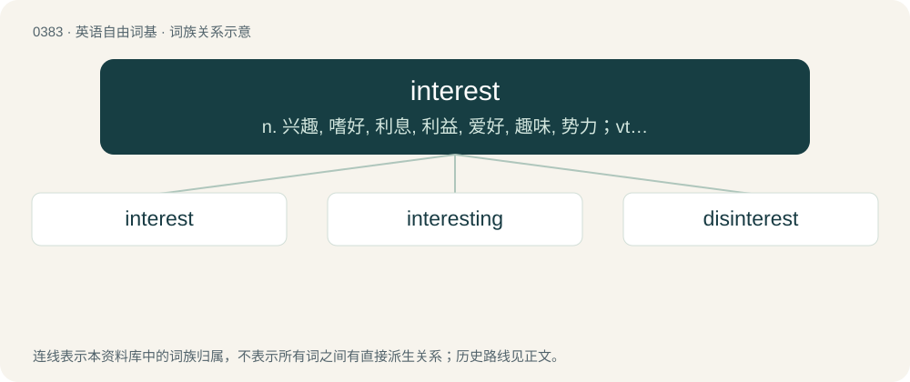

# 0444 · interest — n. 兴趣, 嗜好, 利息, 利益, 爱好, 趣味, 势力；vt. 使感兴趣, 与...有关系

[总目录](../00_总目录_按常用程度.md)

**类型**：英语自由词基　｜　**来源语言**：见词源记录

## 核心含义与来源

- 核心含义：n. 兴趣, 嗜好, 利息, 利益, 爱好, 趣味, 势力；vt. 使感兴趣, 与...有关系
- 英文含义：The price paid for obtaining, or price received for providing, money or goods in a credit transaction, calculated as a fraction of the amount or value of what was borrowed.
- 词形：interest

**来源记录 1**（名词；The price paid for obtaining, or price received for providing, money or goods in a credit transaction, calculated as a fraction of the amount or value of what was borrowed.）

From Middle English interest, from Old French interesse and interest (French intérêt), from Medieval Latin interesse, from Latin interesse.

## 词族图

## 单词速览（常用到不常用）

| 单词 | 音标 | 释义 |
|---|---|---|
| [interest](#w-1) | 英 /ˈɪn.tɹɛst/；美 /ˈɪn.tɹɛst/ | n. 兴趣, 嗜好, 利息, 利益, 爱好, 趣味, 势力；vt. 使感兴趣, 与...有关系 |
| [interesting](#w-2) | 英 /ˈɪntɹəstɪŋ/；美 /ˈɪntəɹəstɪŋ/ | a. 有趣的 |
| [disinterest](#w-3) | 英 /dɪsˈɪntɹɛst/ | n. 无兴趣, 不关心；vt. 使不关心 |

## 逐词详解

### 1. interest

**词性**：名词　｜　**音标**：英 /ˈɪn.tɹɛst/；美 /ˈɪn.tɹɛst/

**中文释义**：n. 兴趣, 嗜好, 利息, 利益, 爱好, 趣味, 势力；vt. 使感兴趣, 与...有关系

**英文义项**：The price paid for obtaining, or price received for providing, money or goods in a credit transaction, calculated as a fraction of the amount or value of what was borrowed. / Any excess over and above an exact equivalent

**词源与演化**：

From Middle English interest, from Old French interesse and interest (French intérêt), from Medieval Latin interesse, from Latin interesse.

**例句**：

> She has an interest in the proceedings, and all stakeholders' interests must be protected.

该用例对应义项：An involvement, claim, right, share, stake in or link with a financial, business, or other undertaking or endeavor.

### 2. interesting

**词性**：形容词　｜　**音标**：英 /ˈɪntɹəstɪŋ/；美 /ˈɪntəɹəstɪŋ/

**中文释义**：a. 有趣的

**英文义项**：Arousing or holding the attention or interest of someone. / Pregnant. (used with situation and condition)

**构词拆分**：From interest + -ing.

**词源与演化**：

From interest + -ing.

**例句**：

> It is said that "Hamlet" is the most interesting play ever written.

### 3. disinterest

**词性**：名词　｜　**音标**：英 /dɪsˈɪntɹɛst/

**中文释义**：n. 无兴趣, 不关心；vt. 使不关心

**英文义项**：An absence of interest (attention or curiosity). / The absence of interest (bias or stake).

**构词拆分**：dis- + interest

**词源与演化**：

From dis- + interest.

**例句**：

> She eyed him over her martini with cool disinterest.

该用例对应义项：An absence of interest (attention or curiosity).
