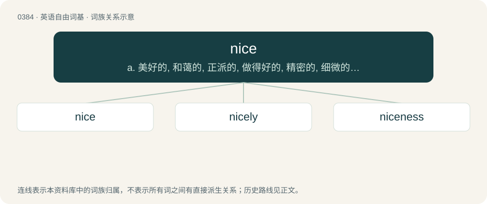

# 0446 · nice — a. 美好的, 和蔼的, 正派的, 做得好的, 精密的, 细微的, 挑剔的, 谨慎的

[总目录](../00_总目录_按常用程度.md)

**类型**：英语自由词基　｜　**来源语言**：见词源记录

## 核心含义与来源

- 核心含义：a. 美好的, 和蔼的, 正派的, 做得好的, 精密的, 细微的, 挑剔的, 谨慎的
- 英文含义：Pleasant, satisfactory, complimentary.
- 词形：nice

**多个词源／构词路径**：同一拼写可能有不同来源；以下按词性和含义分别列出。

**来源记录 1**（形容词；Pleasant, satisfactory, complimentary.）

From Middle English nyce, nice, nys, from Old French nice, niche, nisce (“simple, foolish, ignorant”), from Latin nescius (“ignorant, not knowing”); compare nesciō (“to know not, be ignorant of”), from ne (“not”) + sciō (“to know”).

**来源记录 2**（动词；To run a process with a specified (usually lower) priority.）

Name of a Unix program used to invoke a script or program with a specified priority, with the implication that running at a lower priority is "nice" (kind, etc.) because it leaves more resources for others.

## 词族图

## 单词速览（常用到不常用）

| 单词 | 音标 | 释义 |
|---|---|---|
| [nice](#w-1) | 英 /naɪ̯s/；/naːs/ | a. 美好的, 和蔼的, 正派的, 做得好的, 精密的, 细微的, 挑剔的, 谨慎的 |
| [nicely](#w-2) | /ˈnaɪs.li/ | adv. 漂亮地, 谨慎地, 恰好地 |
| [niceness](#w-3) | /ˈnaɪsnɪs/ | n. 美好的事物 |

## 逐词详解

### 1. nice

**词性**：形容词　｜　**音标**：英 /naɪ̯s/；/naːs/

**中文释义**：a. 美好的, 和蔼的, 正派的, 做得好的, 精密的, 细微的, 挑剔的, 谨慎的

**英文义项**：Pleasant, satisfactory, complimentary. / Of a person: friendly, attractive.

**词源与演化**：

From Middle English nyce, nice, nys, from Old French nice, niche, nisce (“simple, foolish, ignorant”), from Latin nescius (“ignorant, not knowing”); compare nesciō (“to know not, be ignorant of”), from ne (“not”) + sciō (“to know”).

**例句**：

> What is a nice person like you doing in a place like this?

该用例对应义项：Respectable; virtuous.

### 2. nicely

**词性**：副词　｜　**音标**：/ˈnaɪs.li/

**中文释义**：adv. 漂亮地, 谨慎地, 恰好地

**英文义项**：Precisely; with fine discernment or judgement. / Pleasantly; satisfactorily.

**构词拆分**：nice + -ly

**词源与演化**：

From Middle English nycely; equivalent to nice + -ly.

**例句**：

> I can envision a future where all peoples get along just nicely.

### 3. niceness

**词性**：名词　｜　**音标**：/ˈnaɪsnɪs/

**中文释义**：n. 美好的事物

**英文义项**：Effeminacy; indulgence in soft living or luxuriousness. / Fastidiousness; fine sensitivity.

**构词拆分**：nice + -ness

**词源与演化**：

From nice + -ness.

**例句**：

> I'd like to uncover what hides underneath her fake niceness.
