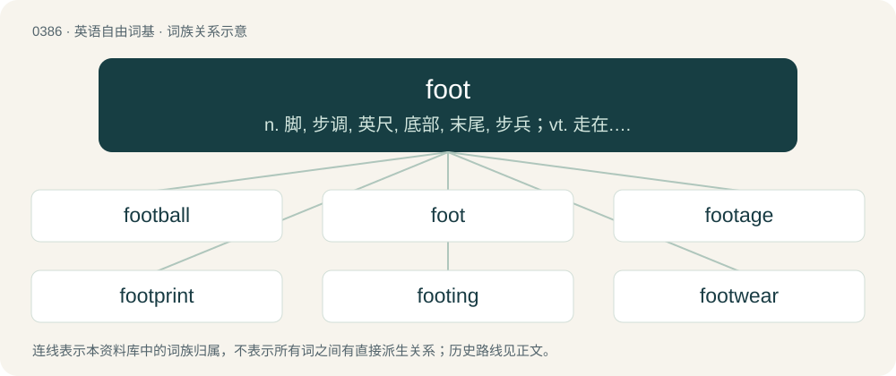

# 0447 · foot — n. 脚, 步调, 英尺, 底部, 末尾, 步兵；vt. 走在...上, 给...换底, 支付；vi. 跳舞, 步行, 总计

[总目录](../00_总目录_按常用程度.md)

**类型**：英语自由词基　｜　**来源语言**：见词源记录

## 核心含义与来源

- 核心含义：n. 脚, 步调, 英尺, 底部, 末尾, 步兵；vt. 走在...上, 给...换底, 支付；vi. 跳舞, 步行, 总计
- 英文含义：A biological structure found in many animals that is used for locomotion and that is frequently a separate organ at the terminal part of the leg.
- 词形：foot

**来源记录 1**（名词；A biological structure found in many animals that is used for locomotion and that is frequently a separate organ at the terminal part of the leg.）

From Middle English fot, fote, foot, from Old English fōt, from Proto-West Germanic \*fōt, from Proto-Germanic \*fōts, from Proto-Indo-European \*pṓds. Doublet of pes, pie (“Spanish unit of length”), and pous. Cognates \*Scots fit (“foot”) \*Yola voote (“foot”) \*North Frisian fut, fötj (“foot”) \*Saterland Frisian Fout (“foot”) \*West Frisian foet (“foot”) \*Cimbrian buus, vuaz, vuus (“foot”) \*Dutch voet (“foot”) \*Dutch Low Saxon voot (“foot”) \*German Fuß, Fuss (“foot”) \*German Low German Faut, Foot (“foot”) \*Gottscheerish vúəs (“foot”) \*Luxembourgish Fouss (“foot”) \*Mòcheno vuas (“foot”) \*Vilamovian füs (“foot”) \*Yiddish פֿוס (fus, “foot”) \*Danish fod (“foot”) \*Faroese and Icelandic fótur (“foot”) \*Jamtish fót (“foot”) \*Norwegian Bokmål, Norwegian Nynorsk, and Swedish fot (“foot”) \*Gothic 𐍆𐍉𐍄𐌿𐍃 (fōtus, “foot”).

## 词族图

## 单词速览（常用到不常用）

| 单词 | 音标 | 释义 |
|---|---|---|
| [football](#w-1) | 英 /ˈfʊt.bɔːl/；/ˈfʊt.bɔl/ | n. 足球, 橄榄球 |
| [foot](#w-2) | /fʊt/ | n. 脚, 步调, 英尺, 底部, 末尾, 步兵；vt. 走在...上, 给...换底, 支付；vi. 跳舞, 步行, 总计 |
| [footage](#w-3) | /ˈfʊtɪd͡ʒ/ | n. 英尺长度, 英板尺, (影片的)连续镜头 |
| [footprint](#w-4) | /ˈfʊtpɹɪnt/ | n. 足迹；\[计\] 印迹 |
| [footing](#w-5) | /ˈfʊtɪŋ/ | n. 站稳, 立足点, 立场, 关系；\[化\] 脚子(糖浆下脚的结晶) |
| [footwear](#w-6) | /ˈfʊtwɛə(ɹ)/ | n. 鞋类, 靴类 |
| [barefoot](#w-7) | 英 /ˈbɛəfʊt/；美 /ˈbɛɹfʊt/ | a. 赤脚的 |
| [footed](#w-8) | /ˈfʊtɪd/ | a. 有脚的, 脚步...的, 有...脚的 |
| [footnote](#w-9) | 英 /ˈfʊtˌnəʊt/；美 /ˈfʊtˌnoʊt/ | n. 脚注；\[计\] 脚注 |
| [footwork](#w-10) | 英 /ˈfʊt.wɜːk/ | n. 脚的动作, 脚力, 现场采访活动 |
| [footer](#w-11) | /ˈfʊtə(ɹ)/ | n. 墩基, 墙基, 足球比赛；\[计\] 页脚 |
| [foothold](#w-12) | /ˈfʊthoʊld/ | n. 立足处, 据点, 根据地 |
| [footpath](#w-13) | 英 /ˈfʊtˌpɑːθ/；美 /ˈfʊtˌpæθ/ | n. 步道, 人行道, 小路 |
| [afoot](#w-14) | /əˈfʊt/ | a. 徒步的, 在进行中的, 活动中的；adv. 徒步, 在进行中 |
| [underfoot](#w-15) | 英 /ʌndəˈfʊt/；美 /ʌndɚˈfʊt/ | adv. 在脚下, 碍事地；\[经\] 少计总额 |
| [footbridge](#w-16) | /ˈfʊtˌbɹɪd͡ʒ/ | n. 人行桥 |
| [foothill](#w-17) | /ˈfuthil/ | n. 山麓小丘 |
| [footloose](#w-18) | /ˈfutluːs/ | a. 自由自在的, 能做所要做的, 不受束缚的 |
| [footman](#w-19) | /ˈfutmən/ | n. 马夫, 仆役 |
| [footfall](#w-20) | 英 /ˈfʊtfɔːl/；/ˈfʊtfɔl/ | n. 脚声, 踏步, 脚步 |
| [footstool](#w-21) | /ˈfʊtˌstuːl/ | n. 脚凳 |
| [footstep](#w-22) | /ˈfʊtstɛp/ | n. 脚步, 脚步声, 足迹 |
| [footlocker](#w-23) | 美 /ˈfʊʔ.laːkɚ/ | n. 军人用床脚柜 |
| [footsie](#w-24) | 英 /ˈfʊtsi/ | n. 脚, 调戏, 挑逗 |
| [forefoot](#w-25) | /ˈfɒːfut/ | n. 前脚；\[医\] 前肢(四肢动物), 足前段 |

## 逐词详解

### 1. football

**词性**：名词　｜　**音标**：英 /ˈfʊt.bɔːl/；/ˈfʊt.bɔl/

**中文释义**：n. 足球, 橄榄球

**英文义项**：A sport played on foot in which teams attempt to get a ball into a goal or zone defended by the other team. / The ball used in any game called "football".

**构词拆分**：foot + ball

**词源与演化**：

From Middle English fotbal, footbal, equivalent to foot + ball, because the ball was primarily manipulated with the feet in early versions of the game (though some modern varieties involve more handling than kicking). The name for the briefcase is a play on “dropkick”, the code name of an early version of the nuclear war plan.

**例句**：

> Roman and medieval football matches were more violent than any modern type of football.

该用例对应义项：A sport played on foot in which teams attempt to get a ball into a goal or zone defended by the other team.

### 2. foot

**词性**：名词　｜　**音标**：/fʊt/

**中文释义**：n. 脚, 步调, 英尺, 底部, 末尾, 步兵；vt. 走在...上, 给...换底, 支付；vi. 跳舞, 步行, 总计

**英文义项**：A biological structure found in many animals that is used for locomotion and that is frequently a separate organ at the terminal part of the leg. / Specifically, a human foot, which is found below the ankle and is used for standing and walking.

**词源与演化**：

From Middle English fot, fote, foot, from Old English fōt, from Proto-West Germanic \*fōt, from Proto-Germanic \*fōts, from Proto-Indo-European \*pṓds. Doublet of pes, pie (“Spanish unit of length”), and pous. Cognates \*Scots fit (“foot”) \*Yola voote (“foot”) \*North Frisian fut, fötj (“foot”) \*Saterland Frisian Fout (“foot”) \*West Frisian foet (“foot”) \*Cimbrian buus, vuaz, vuus (“foot”) \*Dutch voet (“foot”) \*Dutch Low Saxon voot (“foot”) \*German Fuß, Fuss (“foot”) \*German Low German Faut, Foot (“foot”) \*Gottscheerish vúəs (“foot”) \*Luxembourgish Fouss (“foot”) \*Mòcheno vuas (“foot”) \*Vilamovian füs (“foot”) \*Yiddish פֿוס (fus, “foot”) \*Danish fod (“foot”) \*Faroese and Icelandic fótur (“foot”) \*Jamtish fót (“foot”) \*Norwegian Bokmål, Norwegian Nynorsk, and Swedish fot (“foot”) \*Gothic 𐍆𐍉𐍄𐌿𐍃 (fōtus, “foot”).

**例句**：

> To make the mainsail fuller in shape, the outhaul is eased to reduce the tension on the foot of the sail.

该用例对应义项：The bottom edge of a sail.

### 3. footage

**词性**：名词　｜　**音标**：/ˈfʊtɪd͡ʒ/

**中文释义**：n. 英尺长度, 英板尺, (影片的)连续镜头

**英文义项**：An amount of film or tape that has been used to record something, or the content of the recording. / A measurement in feet.

**构词拆分**：foot (unit of length) + -age

**词源与演化**：

From foot (unit of length) + -age. Video footage is so called because movie film and television tape was measured in feet. The same term is still applied by analogy to digital videos which are stored on hard drives or microchips. Compare typologically French métrage.

**例句**：

> The footage we shot at the riot yesterday got ruined.

该用例对应义项：An amount of film or tape that has been used to record something, or the content of the recording.

### 4. footprint

**词性**：名词　｜　**音标**：/ˈfʊtpɹɪnt/

**中文释义**：n. 足迹；\[计\] 印迹

**英文义项**：The impression of the foot in a soft substance such as sand or snow. / Space required by a piece of equipment.

**构词拆分**：foot + print

**词源与演化**：

From foot + print.

**例句**：

> The store, which is slated to open next month, increases the company's footprint in the market to 14 locations.

该用例对应义项：A company's geographic market presence.

### 5. footing

**词性**：名词　｜　**音标**：/ˈfʊtɪŋ/

**中文释义**：n. 站稳, 立足点, 立场, 关系；\[化\] 脚子(糖浆下脚的结晶)

**英文义项**：A ground for the foot; place for the foot to rest on; firm foundation to stand on. / A standing; position; established place; foothold.

**构词拆分**：foot + -ing

**词源与演化**：

From Middle English fotyng; equivalent to foot + -ing.

**例句**：

> It was difficult to keep my footing on the ship during the storm.

该用例对应义项：Stability or balance when standing on one's feet.

### 6. footwear

**词性**：名词　｜　**音标**：/ˈfʊtwɛə(ɹ)/

**中文释义**：n. 鞋类, 靴类

**英文义项**：Accesories or clothing that is worn on the foot; a shoe, sandal, etc.

**构词拆分**：foot + -wear

**词源与演化**：

From foot + -wear.

**例句**：

> The footwear the murderer left at the crime scene was a red herring.

### 7. barefoot

**词性**：形容词　｜　**音标**：英 /ˈbɛəfʊt/；美 /ˈbɛɹfʊt/

**中文释义**：a. 赤脚的

**英文义项**：Wearing nothing on the feet. / Of a vehicle on an icy road: not using snow chains.

**构词拆分**：bare + foot

**词源与演化**：

From Middle English barefote, barfot, from Old English bærfōt (“barefoot”), from Proto-West Germanic \*baʀafōt, from Proto-Germanic \*bazafōts (“barefoot”) equivalent to bare + foot. Cognate with Scots barefit (“barefoot”), Old Frisian berfōt ("barefoot"; modern Saterland Frisian boarfouts (“barefoot”, adverb)), Dutch barrevoets (“barefoot”, adverb), German barfuß (“barefoot”), Danish barfodet (“barefoot”), Swedish barfota (“barefoot”, adverb), Icelandic berfættur (“barefoot”), Yiddish באָרוועס (borves, “barefoot”).

**例句**：

> After taking off their shoes, socks and sandals at the doorway, the kids were barefoot.

该用例对应义项：Wearing nothing on the feet.

### 8. footed

**词性**：形容词　｜　**音标**：/ˈfʊtɪd/

**中文释义**：a. 有脚的, 脚步...的, 有...脚的

**英文义项**：Having a foot or feet; (in combination) having a specified form or type of foot or number of feet. / Consisting of, or having been put into, metrical feet (of a specified character or number).

**构词拆分**：foot + -ed

**词源与演化**：

From Middle English foted, i-foted, equivalent to foot + -ed.

**例句**：

> All four footed animals breathe through lungs.

### 9. footnote

**词性**：名词　｜　**音标**：英 /ˈfʊtˌnəʊt/；美 /ˈfʊtˌnoʊt/

**中文释义**：n. 脚注；\[计\] 脚注

**英文义项**：A short piece of text, often numbered, placed at the bottom of a printed page, that adds a comment, citation, reference etc, to a designated part of the main text. / An event of lesser importance than some larger event to which it is related.

**构词拆分**：foot + note

**词源与演化**：

From foot + note.

**用法示例／搭配（非完整句）**：

> consult the footnotes for more details

该用例对应义项：A short piece of text, often numbered, placed at the bottom of a printed page, that adds a comment, citation, reference etc, to a designated part of the main text.

### 10. footwork

**词性**：名词　｜　**音标**：英 /ˈfʊt.wɜːk/

**中文释义**：n. 脚的动作, 脚力, 现场采访活动

**英文义项**：Any movement of the feet, especially intricate or complex movement, as in sports or dancing. / A subgenre of juke/ghetto house and style of street dance that originated in Chicago in the early 1990s.

**构词拆分**：foot + work

**词源与演化**：

From foot + work.

**例句**：

> The dancer impressed the crowd with his fancy footwork.

该用例对应义项：Any movement of the feet, especially intricate or complex movement, as in sports or dancing.

### 11. footer

**词性**：名词　｜　**音标**：/ˈfʊtə(ɹ)/

**中文释义**：n. 墩基, 墙基, 足球比赛；\[计\] 页脚

**英文义项**：A line of information printed at the bottom of a page to identify the contents or number pages. (Compare foot in printing.) / Something that measures a stated number of feet in some dimension.

**构词拆分**：foot + -er

**词源与演化**：

From Middle English footer, equivalent to foot + -er.

**例句**：

> Both of my sons are six-footers.

该用例对应义项：Something that measures a stated number of feet in some dimension.

### 12. foothold

**词性**：名词　｜　**音标**：/ˈfʊthoʊld/

**中文释义**：n. 立足处, 据点, 根据地

**英文义项**：A solid grip with the feet. / A secure position from which it is difficult to be dislodged.

**构词拆分**：foot + hold

**词源与演化**：

From foot + hold.

**例句**：

> Britain is apparently working to get a foothold in Algeria.

### 13. footpath

**词性**：名词　｜　**音标**：英 /ˈfʊtˌpɑːθ/；美 /ˈfʊtˌpæθ/

**中文释义**：n. 步道, 人行道, 小路

**英文义项**：Any set path or trail to be used by people walking. / A paved path located at the side of a road for the use of pedestrians.

**构词拆分**：foot + path

**词源与演化**：

From Middle English foot path, footpath; equivalent to foot + path. Compare Saterland Frisian Foutpaad (“footpath”), West Frisian fuotpaad (“footpath”), Dutch voetpad (“footpath”), German Low German Footpadd (“footpath”), German Fußpfad (“footpath”).

**例句**：

> They trudged across the tussocky grass and up on to a footpath.

### 14. afoot

**词性**：形容词　｜　**音标**：/əˈfʊt/

**中文释义**：a. 徒步的, 在进行中的, 活动中的；adv. 徒步, 在进行中

**英文义项**：Walking or running; using the feet for locomotion, as opposed to on horseback or riding in a vehicle. / That is on foot, in motion, in action, in progress.

**构词拆分**：a- + foot

**词源与演化**：

From a- + foot.

**例句**：

> There is mischief afoot.

该用例对应义项：currently in progress

### 15. underfoot

**词性**：形容词　｜　**音标**：英 /ʌndəˈfʊt/；美 /ʌndɚˈfʊt/

**中文释义**：adv. 在脚下, 碍事地；\[经\] 少计总额

**英文义项**：Situated under one's foot or feet. / In the way; placed so as to obstruct or hinder.

**构词拆分**：under- + foot

**词源与演化**：

From Middle English underfoote, underfote, equivalent to under- + foot. Cognate with Middle Dutch ondervoet (“underfoot”). Compare also Middle Low German undervôt (“pedestal, base”).

**例句**：

> I'll kill you! Knock your block off and grind you underfoot! You shithead! Die!

### 16. footbridge

**词性**：名词　｜　**音标**：/ˈfʊtˌbɹɪd͡ʒ/

**中文释义**：n. 人行桥

**英文义项**：A bridge over a road, railway, river, etc for pedestrians.

**构词拆分**：foot + bridge

**词源与演化**：

From Middle English fot-brigge, equivalent to foot + bridge.

**例句**：

> Elias walked over the footbridge and made his way into the tunnel.

### 17. foothill

**词性**：名词　｜　**音标**：/ˈfuthil/

**中文释义**：n. 山麓小丘

**英文义项**：A hill at the base of a mountain or mountain range.

**构词拆分**：From foot + hill.

**词源与演化**：

From foot + hill.

### 18. footloose

**词性**：形容词　｜　**音标**：/ˈfutluːs/

**中文释义**：a. 自由自在的, 能做所要做的, 不受束缚的

**英文义项**：Tending to travel or do as one pleases; readily without many commitments or responsibility. / Of a sail: not properly secured at the bottom.

**构词拆分**：foot + loose

**词源与演化**：

From foot + loose.

**例句**：

> He was footloose in his youth.

该用例对应义项：Tending to travel or do as one pleases; readily without many commitments or responsibility.

### 19. footman

**词性**：名词　｜　**音标**：/ˈfutmən/

**中文释义**：n. 马夫, 仆役

**英文义项**：A man in waiting; a male servant whose duties are to attend the door, the carriage, the table, etc. / A metallic stand with four feet, for keeping anything warm before a fire.

**构词拆分**：foot + man

**词源与演化**：

From Middle English fotman, footman, foteman (“foot soldier, running footman”), from Old English \*fōtman, \*fōtmann (attested only as Old English fēþman, fēþemann (“footman”), equivalent to foot + man.

**例句**：

> The footman announced the arrival of the duchess.

### 20. footfall

**词性**：名词　｜　**音标**：英 /ˈfʊtfɔːl/；/ˈfʊtfɔl/

**中文释义**：n. 脚声, 踏步, 脚步

**英文义项**：The sound made by a footstep; also, the footstep or step itself. / The number of pedestrians going into or passing through a place (especially a commercial venue such as a shop) during a specified time period; also, the pedestrians in a particular place regarded collectively; foot traffic.

**构词拆分**：foot (“part of the human leg below the ankle”) + fall (“act of moving to a lower position under the effect of gravity”, noun)

**词源与演化**：

From foot (“part of the human leg below the ankle”) + fall (“act of moving to a lower position under the effect of gravity”, noun).

**用法示例／搭配（非完整句）**：

> However, footfall is still below pre-Covid levels while there is also a surge of incoming supply. - "Are There Too Many Retail Malls In Malaysia?", BFM 89.9

该用例对应义项：The number of pedestrians going into or passing through a place (especially a commercial venue such as a shop) during a specified time period; also, the pedestrians in a particular place regarded collectively; foot traffic.

### 21. footstool

**词性**：名词　｜　**音标**：/ˈfʊtˌstuːl/

**中文释义**：n. 脚凳

**英文义项**：A low stool for supporting the feet while seated. / Anything trodden upon or treated as subservient.

**构词拆分**：foot + stool

**词源与演化**：

From foot + stool.

**例句**：

> Go ahead and put your feet up on the footstool.

### 22. footstep

**词性**：名词　｜　**音标**：/ˈfʊtstɛp/

**中文释义**：n. 脚步, 脚步声, 足迹

**英文义项**：The mark or impression left by a foot; a track. / The indications or waypoints of a course or direction taken.

**构词拆分**：foot + step

**词源与演化**：

From Middle English fotstep, fotstappe, from Old English \*fōtstepe, \*fōtstæpe (attested only in derivative fōtstappel (“footstep”)), equivalent to foot + step. Cognate with Saterland Frisian Foutstappe (“footstep”), West Frisian fuotstap (“footstep”), Dutch voetstap (“footstep”).

**例句**：

> To walk the footsteps of greatness requires that you start at the bottom of a long stair.

该用例对应义项：The indications or waypoints of a course or direction taken.

### 23. footlocker

**词性**：名词　｜　**音标**：美 /ˈfʊʔ.laːkɚ/

**中文释义**：n. 军人用床脚柜

**英文义项**：A long, rectangular trunk or similar container that lies flat on the floor, especially one used for personal belongings and kept at the foot of a bed, commonly used in barracks and dormitories.

**构词拆分**：foot + locker

**词源与演化**：

From foot + locker.

### 24. footsie

**词性**：名词　｜　**音标**：英 /ˈfʊtsi/

**中文释义**：n. 脚, 调戏, 挑逗

**英文义项**：A flirting game where two people touch their feet together, under a table or otherwise concealed, as a romantic prelude. / A foot.

**构词拆分**：From foot + -sie.

**词源与演化**：

From foot + -sie.

**例句**：

> I don't want to play footsie with you, Tom.

### 25. forefoot

**词性**：名词　｜　**音标**：/ˈfɒːfut/

**中文释义**：n. 前脚；\[医\] 前肢(四肢动物), 足前段

**英文义项**：Either of the front feet of a quadruped. / The front part of a person's foot.

**构词拆分**：fore- + foot

**词源与演化**：

From Middle English forefot, forfote, equivalent to fore- + foot.
