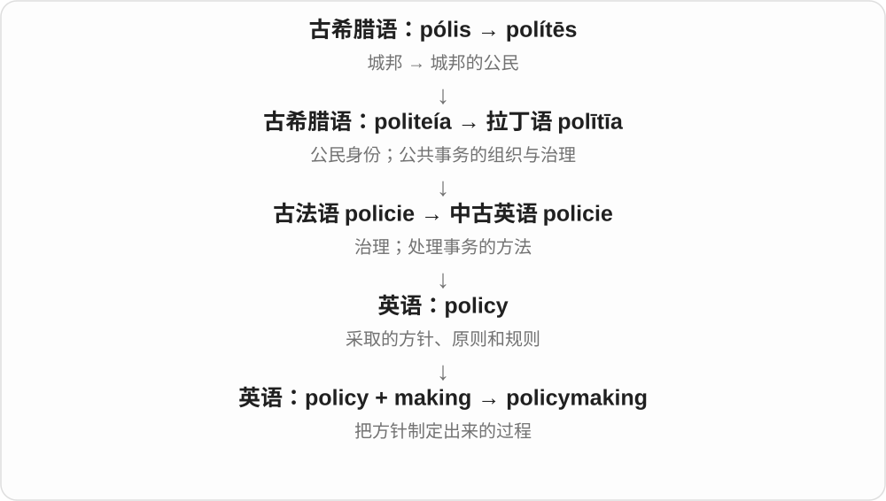
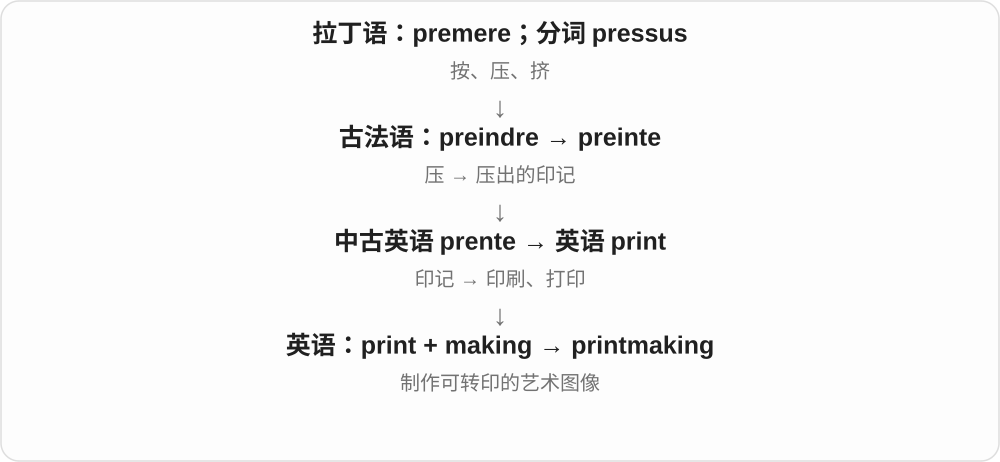

# 0447 · making — making：制作、形成、促成

[逐词精讲目录](../00_逐词精讲目录.md) · [总目录](../00_总目录_按常用程度.md)

## 核心词根与来源

making 是 make 去 e 加 -ing 的形式。不同复合词的前部分可说产物、活动目标或固定领域，不是所有 making 都限于手工造物。

**MAKING：前面是什么，就看在形成什么**

物品可以被制造，规则、和平、配对关系等也可以被形成或促成。部分复合词还有固定专门义。

- **基本形成与制作活动**：making · filmmaking · winemaking · steelmaking · dressmaking · papermaking
- **规范、和平与家庭相关活动**：rulemaking · policymaking · peacemaking · homemaking · lovemaking
- **已形成固定用法的组合**：matchmaking · printmaking · playmaking · bookmaking · watchmaking

## 词形与演化规律

making → filmmaking、winemaking、steelmaking、dressmaking、papermaking；抽象成果看 rulemaking、policymaking、peacemaking；matchmaking、bookmaking、playmaking 等固定用法各自看。

## 单词速览（按词族由简到繁）

同一基础词的相关扩展放在一起，先读基础形式，再读扩展；各组之间优先读常用的。具体词源关系见各词讲解。

| 单词 | 音标 | 核心意思 |
|---|---|---|
| [making](#w-1) | /ˈmeɪkɪŋ/ | 制作、形成的过程；造就；形成中的事物〔也作 make 的 -ing 形式〕 |
| [matchmaking](#w-2) | /ˈmætʃmeɪkɪŋ/ | 牵线婚配；安排匹配的活动或过程 |
| [filmmaking](#w-3) | /ˈfɪlmmeɪkɪŋ/ | 电影制作；影视创作过程 |
| [policymaking](#w-4) | 英 /ˈpɒləsiˌmeɪkɪŋ/；美 /ˈpɑːləsiˌmeɪkɪŋ/ | 政策制定；方针形成过程 |
| [winemaking](#w-5) | /ˈwaɪnmeɪkɪŋ/ | 葡萄酒酿造；酿酒 |
| [lovemaking](#w-6) | /ˈlʌvˌmeɪkɪŋ/ | 性爱；做爱 |
| [printmaking](#w-7) | 英 /ˈprɪntmeɪkɪŋ/；美 /ˈprɪntmeɪkɪŋ/ | 版画制作；版画艺术 |
| [rulemaking](#w-8) | /ˈruːlmeɪkɪŋ/ | 规则制定；规章制定 |
| [playmaking](#w-9) | /ˈpleɪmeɪkɪŋ/ | 组织进攻；策动比赛配合 |
| [peacemaking](#w-10) | /ˈpiːsmeɪkɪŋ/ | 调解；促成和平、和解 |
| [bookmaking](#w-11) | /ˈbʊkmeɪkɪŋ/ | 经营赌注业务；制作书籍〔另一用法〕 |
| [steelmaking](#w-12) | /ˈstiːlmeɪkɪŋ/ | 炼钢；钢的制造 |
| [watchmaking](#w-13) | 英 /ˈwɒtʃmeɪkɪŋ/；美 /ˈwɑːtʃmeɪkɪŋ/ | 制表业；制表工艺 |
| [dressmaking](#w-14) | /ˈdresmeɪkɪŋ/ | 服装裁制；尤指女装制作 |
| [papermaking](#w-15) | 英 /ˈpeɪpəmeɪkɪŋ/；美 /ˈpeɪpərmeɪkɪŋ/ | 造纸 |
| [homemaking](#w-16) | 英 /ˈhəʊmmeɪkɪŋ/；美 /ˈhoʊmmeɪkɪŋ/ | 家务管理；持家 |

## 逐词讲解

### 1. making — 制作、形成的过程；造就；形成中的事物〔也作 make 的 -ing 形式〕

**音标**：/ˈmeɪkɪŋ/

**先抓住这个画面**

电影成片只有两小时，背后的筹备、拍摄和剪辑却可能持续几年。the making of the film 就把目光转向“它是怎样做出来的”。

**怎么拆**

古英语已有 macung“制作”，经中古英语 making 到现代名词；现代也按 make 去 e 加 -ing 形成动词形式。名词并非等到现代进行时出现才临时产生。

**怎么变成今天的意思**

**古英语 macian → macung**  
做、制作；制作过程的名词

↓

**中古英语 making → 英语 making**  
制作、形成；也与现代动词 -ing 形式同形

in the making 是正在形成中；years in the making 是筹备制作了很多年。the making of someone 还可说某段经历造就了这个人。

**常见搭配与例句**

the making of a film；in the making；years in the making；the makings of〔具备成为某物的潜质〕。

> The documentary explores the making of the first album.

这部纪录片讲述了首张专辑的制作过程。

> The new bridge was ten years in the making.

这座新桥从筹备到建成历时十年。

**别混淆**

making 可以讲过程；maker 是做这件事的人或设备。a film in the making 尚在制作，不是已经上映的成片。

### 2. matchmaking — 牵线婚配；安排匹配的活动或过程

**音标**：/ˈmætʃmeɪkɪŋ/

**先抓住这个画面**

有人负责把合适的两方联系起来，这个过程就是 matchmaking。婚恋中配伴侣，游戏中配对手，商务活动中配合作方，具体标准随场景改变。

**怎么拆**

英语 match“配对”与 making“促成、制作过程”组合，与 matchmaker 这一职业名同属一个构词系列。不是把现代名词 matchmaker 机械删去 -er 就能解释全部历史。

**怎么变成今天的意思**

**英语 match；making**  
相配关系；促成的过程

↓

**英语 matchmaking**  
安排婚配；后来泛用于安排合适双方的过程

传统用法说替人介绍伴侣；online matchmaking 可以是婚恋服务，也可以在游戏语境指配对玩家。先看配的是谁，别一见这个词就译成结婚。

**常见搭配与例句**

a matchmaking service；online matchmaking；business matchmaking；a matchmaking system。

> The family’s matchmaking efforts made her laugh.

家人们忙着替她牵线，让她觉得好笑。

> The game’s matchmaking system groups players with similar skill levels.

游戏的匹配系统把水平相近的玩家分到一起。

**别混淆**

matching 可以泛说匹配、相符；matchmaking 更突出组织安排，让原本未联系的双方形成一组。配对成功不保证彼此一定满意。

### 3. filmmaking — 电影制作；影视创作过程

**音标**：/ˈfɪlmmeɪkɪŋ/

**先抓住这个画面**

把故事、拍摄、声音、剪辑等工作组织起来，做出影片。

**怎么拆**

film 影片 + making 制作，组成活动名词。现代影片可以数字拍摄，film 在这里不要求一定用胶片。

**怎么变成今天的意思**

**film 影片；making 制作**  
并列构词部分

↓

**filmmaking**  
制作影片的活动、过程

digital filmmaking 数字电影制作，a filmmaking course 电影制作课程。比只按下相机录制更广，可包括整个创作流程。

**常见搭配与例句**

independent filmmaking；digital filmmaking；filmmaking techniques。

> She discovered filmmaking through a school project.

她通过学校项目接触到电影制作。

> The course covers both storytelling and practical filmmaking.

课程既讲故事创作，也讲实际电影制作。

**别混淆**

filmmaking 是活动，filmmaker 是创作者；cinematography 更着重电影摄影，不等于制作全过程。

### 4. policymaking — 政策制定；方针形成过程

**音标**：英 /ˈpɒləsiˌmeɪkɪŋ/；美 /ˈpɑːləsiˌmeɪkɪŋ/

**先抓住这个画面**

一条规则从“有个想法”，经过调查、讨论、取舍，最后变成决定；整个过程就是 policymaking。

**怎么拆**

policy + making；making 在这里是制定、形成，不是生产一张纸。

**怎么变成今天的意思**

通常作不可数名词，也可作定语，如 policymaking process。讨论的不只是最终文件，还包括谁参与、依据什么作决定。

**常见搭配与例句**

public policymaking；the policymaking process；participate in policymaking。

> Reliable data can improve policymaking.

可靠的数据可以改善政策制定。

> The course looks at public participation in policymaking.

这门课考察公众如何参与政策制定。

**别混淆**

policymaking 是制定阶段；implementation 是执行阶段。二者会相互影响，但不能混成一个动作。

### 5. winemaking — 葡萄酒酿造；酿酒

**音标**：/ˈwaɪnmeɪkɪŋ/

**先抓住这个画面**

把葡萄等原料转成酒、再形成成品的制作活动。

**怎么拆**

wine 葡萄酒 + making 制作，复合为酿酒活动名词。不是 winning 赢的拼写变体。

**怎么变成今天的意思**

**wine 葡萄酒；making 制作**  
并列构词部分

↓

**winemaking**  
葡萄酒的酿造活动

the history of winemaking 酿酒史，winemaking traditions 酿酒传统。学习词义先认出制作什么，不必把 wine 的全部来源重新当作 making 的历史。

**常见搭配与例句**

traditional winemaking；a winemaking region；winemaking methods。

> The museum explores the region’s long history of winemaking.

博物馆介绍这个地区悠久的酿酒历史。

> She wrote a book about family winemaking traditions.

她写了一本关于家族酿酒传统的书。

**别混淆**

winemaking 是酿造活动，winemaker 是酿酒师；wine tasting 品酒是另一种活动，不是同一流程名称。

### 6. lovemaking — 性爱；做爱

**音标**：/ˈlʌvˌmeɪkɪŋ/

**先抓住这个画面**

这里的 make love 已是固定表达，说的是亲密的性行为。

**怎么拆**

love + making，联系 make love 这一表达的名词化；早期 make love 有求爱、示爱用法，现代 lovemaking 常指性行为。两个来源成分并列，不把 love 画成 make 的祖先。

**怎么变成今天的意思**

**英语 love；make／making**  
爱；做、进行

↓

**make love → lovemaking**  
固定表达的名词形式，现代通常指性爱

通常作不可数名词，语气相对委婉，见小说、电影评论或关系描述。它不是任何制作爱心礼物、表达关心行为的通称。

**常见搭配与例句**

a scene of lovemaking；tender lovemaking；an intimate relationship。

> The film suggests intimacy without showing the lovemaking.

影片暗示了亲密关系，没有展示性爱过程。

> The novel describes their lovemaking in restrained language.

小说用克制的语言描写两人的性爱。

**别混淆**

showing love 范围很广，包含照料和关心；lovemaking 在现代通常有明确的性意味，不能互换。

### 7. printmaking — 版画制作；版画艺术

**音标**：英 /ˈprɪntmeɪkɪŋ/；美 /ˈprɪntmeɪkɪŋ/

**先抓住这个画面**

先在木板、金属板或其他载体上做图，再把图像转印到纸等表面上。

**怎么拆**

print 版画、印制图像 + making 制作，现代英语组合。

**怎么变成今天的意思**

包含木刻、蚀刻、丝网等不同方法。重点是作为艺术制作的媒介与过程，不只是在办公室按打印按钮。

**常见搭配与例句**

a printmaking workshop；traditional printmaking techniques。

> She learned printmaking at art school.

她在艺术学校学习了版画制作。

> The workshop introduces several printmaking techniques.

工作坊介绍几种版画技法。

**别混淆**

printing 泛指印刷；printmaking 通常指版画艺术的创作。

### 8. rulemaking — 规则制定；规章制定

**音标**：/ˈruːlmeɪkɪŋ/

**先抓住这个画面**

先把该按什么办法做写成规则，让后面的行动有章可循。

**怎么拆**

rule 规则 + making 制定。making 不只制造看得见的物品，也可说形成规范、决定等抽象成果。

**怎么变成今天的意思**

**rule 规则；making 制定**  
并列构词部分

↓

**rulemaking**  
形成、制定规则的过程

the rulemaking process 规则制定过程；参与者可以是机构、组织等。监管、行政语境常有专门程序，但词本身不等于一套全球统一的法律流程。

**常见搭配与例句**

a rulemaking process；participate in rulemaking；a rulemaking body。

> The report calls for a more transparent rulemaking process.

报告呼吁规则制定过程更加透明。

> Several groups submitted comments during the rulemaking process.

几个团体在规则制定过程中提交了意见。

**别混淆**

rulemaking 制定规则，rule enforcement 执行规则；制定完成不等于规则已经得到遵守。

### 9. playmaking — 组织进攻；策动比赛配合

**音标**：/ˈpleɪmeɪkɪŋ/

**先抓住这个画面**

把原本散开的队员动作接成一次有目的的配合。

**怎么拆**

play（比赛配合）+ making（促成），与 playmaker 的角色相对应，关注组织这一活动或能力。

**怎么变成今天的意思**

**英语 play；making**  
并列的构词材料

↓

**play + making → playmaking**  
组织战术、创造配合的过程

可说 playmaking skills，重在阅读局面、创造机会。不是单指写戏剧，戏剧写作一般是 playwriting。

**常见搭配与例句**

playmaking ability；playmaking skills；creative playmaking。

> Her playmaking gave the team more attacking options.

她的组织能力给球队带来了更多进攻选择。

> The coach values playmaking as much as scoring.

教练同样重视组织进攻和得分。

**别混淆**

playmaking 是比赛组织能力，playwriting 是剧本写作；二者同有 play，却选了不同义项。

### 10. peacemaking — 调解；促成和平、和解

**音标**：/ˈpiːsmeɪkɪŋ/

**先抓住这个画面**

双方还在冲突，想办法让他们停下来、达成和解。

**怎么拆**

peace 和平、和解 + making 促成。整体说努力建立和平、调解冲突，不是把和平当实体物品造出来。

**怎么变成今天的意思**

**peace 和平、和解；making 促成**  
并列构词部分

↓

**peacemaking**  
调解冲突、促成和平

peacemaking efforts 促和努力；日常可说劝和，国际关系中也可说谈判、调解等促和活动。用这个词不保证行动最后成功。

**常见搭配与例句**

peacemaking efforts；a peacemaking role；the work of peacemaking。

> She often took a peacemaking role when the neighbours argued.

邻居争吵时，她常出来调解。

> The book describes years of patient peacemaking efforts.

书中描述了多年耐心的促和努力。

**别混淆**

peacemaking 重在促成和解，peacekeeping 常说维持和平的安排、行动；现实活动可相关，但不是完全相同名称。

### 11. bookmaking — 经营赌注业务；制作书籍〔另一用法〕

**音标**：/ˈbʊkmeɪkɪŋ/

**先抓住这个画面**

同样做 book，现代博彩语境是在经营记录、接收赌注的业务；工艺语境则可能真在做书。

**怎么拆**

book + making，与 bookmaker 两种主要背景相连；两种活动不能只靠“制作”一个中文词混过去。

**怎么变成今天的意思**

**英语 book；making〔make + -ing〕**  
并列组合的两部分

↓

**book + making〔make + -ing〕 → bookmaking**  
赌注经营；特定语境的制书活动

the bookmaking industry 常说博彩业相关业务；traditional bookmaking 在艺术工艺课程中也可能是制作书册。先看行业背景。

**常见搭配与例句**

the bookmaking industry；traditional bookmaking；a bookmaking workshop。

> The documentary follows changes in the bookmaking industry.

纪录片跟踪赌注经营行业的变化。

> The art class includes a workshop on traditional bookmaking.

艺术课包含传统制书工作坊。

**别混淆**

bookmaking 可能博彩，也可能制书；bookkeeping 是记账，不是所有记账人都在经营赌注。

### 12. steelmaking — 炼钢；钢的制造

**音标**：/ˈstiːlmeɪkɪŋ/

**先抓住这个画面**

重点是把原料制成钢这个材料，而不是把一块现成金属敲成形状。

**怎么拆**

steel 钢 + making 制造，形成工业活动名词。对象决定是炼钢，不是所有金属制造的通名。

**怎么变成今天的意思**

**steel 钢；making 制造**  
并列构词部分

↓

**steelmaking**  
制造钢的工业过程

the steelmaking industry 炼钢行业，steelmaking technology 炼钢技术。行业报道中常见，不能把 steel 与 steal 偷窃混为一谈。

**常见搭配与例句**

steelmaking technology；a steelmaking plant；the history of steelmaking。

> The exhibition explains how steelmaking changed the town.

展览介绍炼钢业如何改变了这座城。

> The company develops equipment for the steelmaking industry.

公司为炼钢行业开发设备。

**别混淆**

steelmaking 是制造钢，metalworking 通常说加工金属；making objects from steel 则可能用已制成的钢制作物件。

### 13. watchmaking — 制表业；制表工艺

**音标**：英 /ˈwɒtʃmeɪkɪŋ/；美 /ˈwɑːtʃmeɪkɪŋ/

**先抓住这个画面**

从做这事的人，转到制造、维修计时表的整个工艺和行业。

**怎么拆**

watch + making，making 是 make + -ing，去掉 e；与 watchmaker 并列看，一个人、一个活动。

**怎么变成今天的意思**

**watch；making〔make + -ing〕**  
并列构词部分

↓

**watchmaking**  
表的制作、维修工艺及行业

traditional watchmaking 传统制表，a watchmaking school 制表学校。工艺可手工也可工业化，不由名称限定全部手作。

**常见搭配与例句**

traditional watchmaking；a watchmaking school；the watchmaking industry。

> The exhibition traces the history of watchmaking.

展览回顾了制表工艺的历史。

> She trained in traditional watchmaking.

她接受过传统制表训练。

**别混淆**

watchmaking 行业、工艺，watchmaker 人或企业；说她学制表，用 studies watchmaking，而非 studies a watchmaker。

### 14. dressmaking — 服装裁制；尤指女装制作

**音标**：/ˈdresmeɪkɪŋ/

**先抓住这个画面**

根据设计、尺寸把布料做成衣服，着重这门裁制服装的手艺或活动。

**怎么拆**

dress 服装、裙装 + making 制作，形成服装裁制名词；具体传统用法常偏女装，并非只是买裙子、穿裙子。

**怎么变成今天的意思**

**dress 服装、裙装；making 制作**  
并列构词部分

↓

**dressmaking**  
服装尤其女装的裁制

dressmaking skills 服装裁制技巧，a dressmaking course 服装制作课。活动可包含量体、裁剪、缝制等，不把其中某一步当成全部。

**常见搭配与例句**

dressmaking patterns；dressmaking skills；a dressmaking course。

> She learned dressmaking from her grandmother.

她跟祖母学会了服装裁制。

> The shop sells fabric and dressmaking patterns.

这家店出售布料和服装裁制纸样。

**别混淆**

dressmaking 比 sewing 缝纫更指向制作衣服；sewing 也可以修补布料、缝其他物品。

### 15. papermaking — 造纸

**音标**：英 /ˈpeɪpəmeɪkɪŋ/；美 /ˈpeɪpərmeɪkɪŋ/

**先抓住这个画面**

做出来的材料本身是纸，而不是在纸上写字、折纸或填表。

**怎么拆**

paper 纸 + making 制造，复合为造纸活动名称。

**怎么变成今天的意思**

**paper 纸；making 制造**  
并列构词部分

↓

**papermaking**  
把原料制成纸的活动

traditional papermaking 传统造纸，the papermaking industry 造纸业。可以说手工工艺，也可以说工业生产。

**常见搭配与例句**

handmade papermaking；traditional papermaking；papermaking techniques。

> The museum demonstrates traditional papermaking.

博物馆展示传统造纸工艺。

> She studied the history of papermaking in the region.

她研究了该地区的造纸史。

**别混淆**

papermaking 制造纸；paperwork 是文书、书面手续，paper folding 是折纸。材料相同不代表活动相同。

### 16. homemaking — 家务管理；持家

**音标**：英 /ˈhəʊmmeɪkɪŋ/；美 /ˈhoʊmmeɪkɪŋ/

**先抓住这个画面**

让一个住处真正能过日子，需要安排餐食、清洁、用品和许多日常事务。

**怎么拆**

home（家庭生活）+ making（建立、维持），组合强调营造、管理家庭生活，不只是把房子盖出来。

**怎么变成今天的意思**

**英语 home；making**  
组合时并列的两种材料

↓

**home + making → homemaking**  
管理、维持家庭日常生活的活动

可包括做饭、清洁、安排家庭事务，谁承担并不由词名规定。homemaking skills 是持家技能。

**常见搭配与例句**

homemaking skills；share homemaking tasks；homemaking and childcare。

> They share the responsibilities of homemaking.

他们共同承担持家事务。

> The course included cooking and other homemaking skills.

课程包括烹饪及其他持家技能。

**别混淆**

homemaking 是持家管理，homebuilding 是建住宅；make a home 与 build a house 的重点不同。

## 这一组要分清什么

papermaking 造纸，不是 paperwork 文书；rulemaking 制定，enforcement 执行；bookmaking 等固定用法不要只逐字猜。

## 串起来练习

The centre offers practical courses in filmmaking, dressmaking and papermaking.

中心开设电影制作、服装裁制和造纸实践课程。
