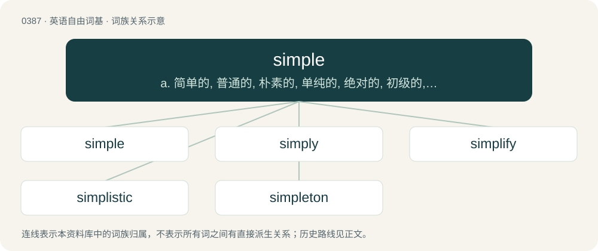

# 0448 · simple — a. 简单的, 普通的, 朴素的, 单纯的, 绝对的, 初级的, 原始的, 迟钝的；n. 出身低微者, 傻子

[总目录](../00_总目录_按常用程度.md)

**类型**：英语自由词基　｜　**来源语言**：见词源记录

## 核心含义与来源

- 核心含义：a. 简单的, 普通的, 朴素的, 单纯的, 绝对的, 初级的, 原始的, 迟钝的；n. 出身低微者, 傻子
- 英文含义：Uncomplicated; lacking complexity; taken by itself, with nothing added.
- 词形：simple

**来源记录 1**（形容词；Uncomplicated; lacking complexity; taken by itself, with nothing added.）

Inherited from Middle English symple, from Old French simple, from Latin simplex (“simple”, literally “onefold”) (as opposed to duplex (“double”, literally “twofold”)), from semel (“the same”) + plicō (“to fold”). See same and fold. Compare single, singular, simultaneous, etc. Partially displaced native English onefold.

## 词族图

## 单词速览（常用到不常用）

| 单词 | 音标 | 释义 |
|---|---|---|
| [simple](#w-1) | 英 /ˈsɪm.pəl/ | a. 简单的, 普通的, 朴素的, 单纯的, 绝对的, 初级的, 原始的, 迟钝的；n. 出身低微者, 傻子 |
| [simply](#w-2) | 英 /ˈsɪmpli/ | adv. 简单地, 只是, 简直, 简朴地, 坦白地 |
| [simplify](#w-3) | /ˈsɪmplɪfaɪ/ | vt. 单一化, 简单化 |
| [simplistic](#w-4) | /sɪmˈplɪstɪk/ | a. 过分简单化的 |
| [simpleton](#w-5) | /ˈsɪmpəltən/ | n. 笨蛋, 傻子 |

## 逐词详解

### 1. simple

**词性**：形容词　｜　**音标**：英 /ˈsɪm.pəl/

**中文释义**：a. 简单的, 普通的, 朴素的, 单纯的, 绝对的, 初级的, 原始的, 迟钝的；n. 出身低微者, 傻子

**英文义项**：Uncomplicated; lacking complexity; taken by itself, with nothing added. / Easy; not difficult.

**词源与演化**：

Inherited from Middle English symple, from Old French simple, from Latin simplex (“simple”, literally “onefold”) (as opposed to duplex (“double”, literally “twofold”)), from semel (“the same”) + plicō (“to fold”). See same and fold. Compare single, singular, simultaneous, etc. Partially displaced native English onefold.

**用法示例／搭配（非完整句）**：

> a simple ascidian

该用例对应义项：Consisting of a single individual or zooid; not compound.

### 2. simply

**词性**：副词　｜　**音标**：英 /ˈsɪmpli/

**中文释义**：adv. 简单地, 只是, 简直, 简朴地, 坦白地

**英文义项**：In a simple way or state; considered in or by itself; without addition; alone. / Plainly; without art or subtlety

**构词拆分**：simple + -ly

**词源与演化**：

From Middle English symply, symplely; equivalent to simple + -ly, with \*-lely simplified to -ly by haplology.

**例句**：

> This type of comportment simply won't be tolerated.

该用例对应义项：absolutely, positively.

### 3. simplify

**词性**：动词　｜　**音标**：/ˈsɪmplɪfaɪ/

**中文释义**：vt. 单一化, 简单化

**英文义项**：To make simpler, either by reducing in complexity, reducing to component parts, or making easier to understand. / To become simpler.

**构词拆分**：simple + -ify

**词源与演化**：

From the French simplifier, equivalent to simple + -ify.

**例句**：

> We had to simplify the instructions.

该用例对应义项：make simpler or easier or reduce in complexity or extent

### 4. simplistic

**词性**：形容词　｜　**音标**：/sɪmˈplɪstɪk/

**中文释义**：a. 过分简单化的

**英文义项**：Overly simple. / In a manner that simplifies a concept or issue so that its nuances and complexities are lost or important details are overlooked.

**构词拆分**：simple + -istic

**词源与演化**：

From simple + -istic.

**例句**：

> When you analyse what he says, it seems somewhat naïve and simplistic.

### 5. simpleton

**词性**：名词　｜　**音标**：/ˈsɪmpəltən/

**中文释义**：n. 笨蛋, 傻子

**英文义项**：A simple-minded person lacking common sense.

**构词拆分**：simple + -ton

**词源与演化**：

From simple + -ton (as in a surname). Compare French simplet, Italian semplicione.

**例句**：

> This one is a real simpleton, for sure. And he's a president.
