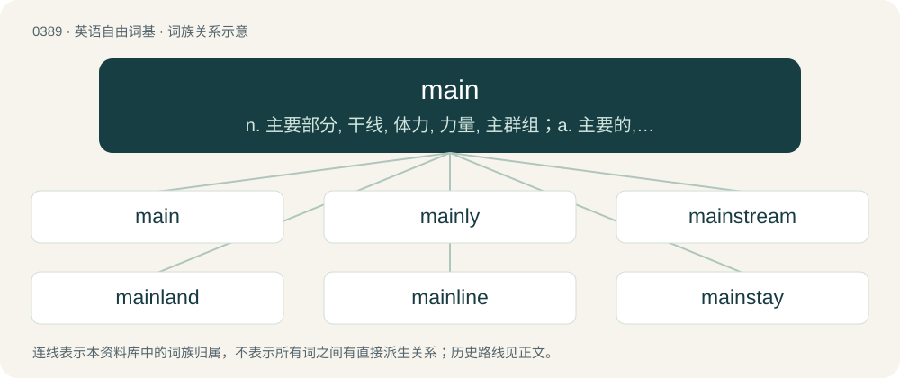

# 0449 · main — n. 主要部分, 干线, 体力, 力量, 主群组；a. 主要的, 重要的, 全力的；\[计\] 主群组

[总目录](../00_总目录_按常用程度.md)

**类型**：英语自由词基　｜　**来源语言**：见词源记录

## 核心含义与来源

- 核心含义：n. 主要部分, 干线, 体力, 力量, 主群组；a. 主要的, 重要的, 全力的；\[计\] 主群组
- 英文含义：Of chief or leading importance; prime, principal.
- 词形：main

**多个词源／构词路径**：同一拼写可能有不同来源；以下按词性和含义分别列出。

**来源记录 1**（形容词；Of chief or leading importance; prime, principal.）

From Middle English mayn, main, maine, mæin, meyn, from main (noun) (see further at etymology 2); compare Old English mæġen (“strong, main, principal”) (used in combination) and Old Norse megn, megenn (“strong, main”). The word is cognate with Old High German megīn (“strong, mighty”) (modern German Möge, Vermögen (“power, wealth”)), and also akin to Old English magan (“to be able to”). See also may.

**来源记录 2**（名词；That which is chief or principal; the chief or main portion; the bulk, the greater part, gross.）

From Middle English mayn, main, maine, mæine, mæȝen, from Old English mæġen (“strength”), from Proto-Germanic \*maginą (“strength, power, might”), \*maginaz (“strong”), from Proto-Indo-European \*megʰ- (“be able”). The word is cognate with Old High German magen, megin, Old Norse magn, megn, megin, Old Saxon megin. More recent senses are derived from the adjective.

**来源记录 3**（名词；A banker's shovel for coins.）

Uncertain; probably from the adjective main. Evidence is lacking for a derivation from French main (“hand”).

## 词族图

## 单词速览（常用到不常用）

| 单词 | 音标 | 释义 |
|---|---|---|
| [main](#w-1) | 英 /meɪn/ | n. 主要部分, 干线, 体力, 力量, 主群组；a. 主要的, 重要的, 全力的；\[计\] 主群组 |
| [mainly](#w-2) | 英 /ˈmeɪnli/ | adv. 主要地, 大抵 |
| [mainstream](#w-3) | 英 /ˈmeɪn.stɹiːm/；美 /ˈmeɪn.stɹim/ | n. 主流 |
| [mainland](#w-4) | 英 /ˈmeɪnlænd/；美 /ˈmeɪnlənd/ | n. 大陆, 本土；\[法\] 大陆 |
| [mainline](#w-5) | /ˈmeɪnˌlaɪn/ | n. 主线, 干线；vt.vi. (美)(非正式)把(毒品)直接注射入静脉 |
| [mainstay](#w-6) | /ˈmeɪn.steɪ/ | n. 主桅支索, 支柱, 中流砥柱 |
| [mainframe](#w-7) | 美 /ˈmeɪnˌfɹeɪm/ | n. 主机；\[电\] 主机 |
| [mainstage](#w-8) |  | 【英文】The largest performing space in a venue. |
| [mainsail](#w-9) | /ˈmeɪnseɪl/ | n. 大桅的帆, 主帆 |

## 逐词详解

### 1. main

**词性**：形容词　｜　**音标**：英 /meɪn/

**中文释义**：n. 主要部分, 干线, 体力, 力量, 主群组；a. 主要的, 重要的, 全力的；\[计\] 主群组

**英文义项**：Of chief or leading importance; prime, principal. / Chief, most important, or principal in extent, size, or strength; consisting of the largest part.

**词源与演化**：

From Middle English mayn, main, maine, mæin, meyn, from main (noun) (see further at etymology 2); compare Old English mæġen (“strong, main, principal”) (used in combination) and Old Norse megn, megenn (“strong, main”). The word is cognate with Old High German megīn (“strong, mighty”) (modern German Möge, Vermögen (“power, wealth”)), and also akin to Old English magan (“to be able to”). See also may.

**例句**：

> The main office is actually one of the smaller rooms.

该用例对应义项：Of chief or leading importance; prime, principal.

### 2. mainly

**词性**：副词　｜　**音标**：英 /ˈmeɪnli/

**中文释义**：adv. 主要地, 大抵

**英文义项**：Of a person or thing being the driving force influencing the outcome of an event; chiefly; certainly for the most part.

**构词拆分**：main + -ly

**词源与演化**：

From Middle English maynly; equivalent to main + -ly.

**例句**：

> He is mainly interested in butterflies.

该用例对应义项：for the most part

### 3. mainstream

**词性**：形容词　｜　**音标**：英 /ˈmeɪn.stɹiːm/；美 /ˈmeɪn.stɹim/

**中文释义**：n. 主流

**英文义项**：Used or accepted broadly rather than by small portions of population, market, scientific community, etc.

**构词拆分**：main + stream

**词源与演化**：

From main + stream. Cognate with Icelandic meginstraumur (“a main current, mainstream”).

**例句**：

> They often carry stories you won't find in the mainstream media.

该用例对应义项：Used or accepted broadly rather than by small portions of population, market, scientific community, etc.

### 4. mainland

**词性**：名词　｜　**音标**：英 /ˈmeɪnlænd/；美 /ˈmeɪnlənd/

**中文释义**：n. 大陆, 本土；\[法\] 大陆

**英文义项**：The continent; the principal land, as distinguished from islands or a peninsula. / The principal island of a group.

**构词拆分**：main + land

**词源与演化**：

From Middle English mayne londe; equivalent to main + land. Compare Scots mayn-land, magan-land, madin-land (“mainland”), Faroese meginland (“mainland”), Icelandic meginland (“mainland”).

**例句**：

> Lizard Point in Cornwall is the southernmost tip of the British mainland.

### 5. mainline

**词性**：形容词　｜　**音标**：/ˈmeɪnˌlaɪn/

**中文释义**：n. 主线, 干线；vt.vi. (美)(非正式)把(毒品)直接注射入静脉

**英文义项**：Normal, principal or standard. / Not fundamentalist, charismatic or evangelical.

**构词拆分**：main + line

**词源与演化**：

From main + line.

### 6. mainstay

**词性**：名词　｜　**音标**：/ˈmeɪn.steɪ/

**中文释义**：n. 主桅支索, 支柱, 中流砥柱

**英文义项**：A chief support. / Someone or something that can be depended on to make a regular contribution.

**构词拆分**：main + stay (“rope”)

**词源与演化**：

From Middle English main stai, equivalent to main + stay (“rope”).

**例句**：

> Agriculture is the mainstay of this country’s economy.

该用例对应义项：A chief support.

### 7. mainframe

**词性**：名词　｜　**音标**：美 /ˈmeɪnˌfɹeɪm/

**中文释义**：n. 主机；\[电\] 主机

**英文义项**：A large, powerful computer able to manage very many simultaneous tasks and communicate with very many connected terminals; used by large, complex organizations (such as banks and supermarkets) where continuously sustained operation is vital. / A computer chassis that hosts and interconnects modules that perform various tasks.

**构词拆分**：main + frame

**词源与演化**：

From main + frame.

**例句**：

> The scientists used an IBM mainframe computer to make their calculations.

### 8. mainstage

**词性**：名词

**英文义项**：The largest performing space in a venue. / Any prestigious performing space.

**构词拆分**：main + stage

**词源与演化**：

From main + stage.

### 9. mainsail

**词性**：名词　｜　**音标**：/ˈmeɪnseɪl/

**中文释义**：n. 大桅的帆, 主帆

**英文义项**：The largest (or only) sail on a sailing vessel.

**构词拆分**：From main + sail.

**词源与演化**：

From main + sail.
