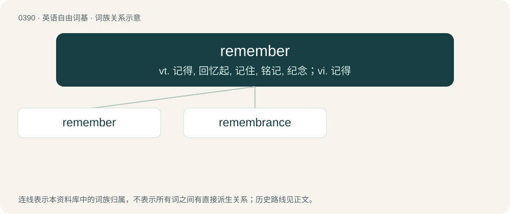

# 0450 · remember — vt. 记得, 回忆起, 记住, 铭记, 纪念；vi. 记得

[总目录](../00_总目录_按常用程度.md)

**类型**：英语自由词基　｜　**来源语言**：见词源记录

## 核心含义与来源

- 核心含义：vt. 记得, 回忆起, 记住, 铭记, 纪念；vi. 记得
- 英文含义：To recall from one's memory; to have an image in one's memory.
- 词形：remember

**来源记录 1**（动词；To recall from one's memory; to have an image in one's memory.）

From Middle English remembren, from Old French remembrer (“to remember”), from Late Latin rememorari (“to remember again”), from re- + memor (“mindful”), from Proto-Indo-European \*mer-, \*(s)mer- (“to think about, be mindful, remember”). Cognate with Old English mimorian, mymerian (“to remember, commemorate”), Old English māmorian (“to deliberate, plan out, design”). More at mimmer and mammer. Compare also dialectical English umbethink. etymology note The success of the Old French word was helped by its proximity in sound and meaning to an existing Germanic word: Old English mimorian, mymerian (“to remember, commemorate”) from Proto-Germanic \*mimrōną, \*mīmrōną (“to remember, be mindful”), from the same Indo-European source, and is akin to Saterland Frisian miemerje (“to ponder, reflect”), Middle Low German mimeren (“to ponder, meditate”), Middle Dutch mimeren (“to reflect, think to oneself”) (Dutch mijmeren (“to muse, reflect deeply”)), Old English ġemimor (“mindful”), Old Norse Mímir, Mim (“Norse god of memory”), Old English māmrian (“to think out, design”). Related to mourn. Displaced native Middle English ȝemuneȝen (“to remember”), from Old English ġemynegian (“to remember, remind”); Middle English minnen (“to remember, have in mind”), from Old Norse minna (“to remind”); Middle English munden, ȝemunden (“to bear in mind, remember”), from Old English ġemynd (“memory, remembrance”); Middle English ithenchen, ȝethenchen (“to think on, remember”), from Old English ġeþencan; Middle English manien (“to remind, mention, remember”), from Old English manian (“to admonish, remind, mention”).

## 词族图

## 单词速览（常用到不常用）

| 单词 | 音标 | 释义 |
|---|---|---|
| [remember](#w-1) | 英 /ɹɪˈmɛm.bə/；美 /ɹɪˈmɛm.bɚ/ | vt. 记得, 回忆起, 记住, 铭记, 纪念；vi. 记得 |
| [remembrance](#w-2) | 英 /ɹɪˈmɛm.bɹəns/ | n. 回想, 记忆, 纪念品, 记忆力, 问候, 致意 |

## 逐词详解

### 1. remember

**词性**：动词　｜　**音标**：英 /ɹɪˈmɛm.bə/；美 /ɹɪˈmɛm.bɚ/

**中文释义**：vt. 记得, 回忆起, 记住, 铭记, 纪念；vi. 记得

**英文义项**：To recall from one's memory; to have an image in one's memory. / To memorize; to put something into memory.

**词源与演化**：

From Middle English remembren, from Old French remembrer (“to remember”), from Late Latin rememorari (“to remember again”), from re- + memor (“mindful”), from Proto-Indo-European \*mer-, \*(s)mer- (“to think about, be mindful, remember”). Cognate with Old English mimorian, mymerian (“to remember, commemorate”), Old English māmorian (“to deliberate, plan out, design”). More at mimmer and mammer. Compare also dialectical English umbethink. etymology note The success of the Old French word was helped by its proximity in sound and meaning to an existing Germanic word: Old English mimorian, mymerian (“to remember, commemorate”) from Proto-Germanic \*mimrōną, \*mīmrōną (“to remember, be mindful”), from the same Indo-European source, and is akin to Saterland Frisian miemerje (“to ponder, reflect”), Middle Low German mimeren (“to ponder, meditate”), Middle Dutch mimeren (“to reflect, think to oneself”) (Dutch mijmeren (“to muse, reflect deeply”)), Old English ġemimor (“mindful”), Old Norse Mímir, Mim (“Norse god of memory”), Old English māmrian (“to think out, design”). Related to mourn. Displaced native Middle English ȝemuneȝen (“to remember”), from Old English ġemynegian (“to remember, remind”); Middle English minnen (“to remember, have in mind”), from Old Norse minna (“to remind”); Middle English munden, ȝemunden (“to bear in mind, remember”), from Old English ġemynd (“memory, remembrance”); Middle English ithenchen, ȝethenchen (“to think on, remember”), from Old English ġeþencan; Middle English manien (“to remind, mention, remember”), from Old English manian (“to admonish, remind, mention”).

**例句**：

> My aunt remembered me in her will, leaving me several thousand pounds.

该用例对应义项：To give (a person) money as a token of appreciation of past service or friendship.

### 2. remembrance

**词性**：名词　｜　**音标**：英 /ɹɪˈmɛm.bɹəns/

**中文释义**：n. 回想, 记忆, 纪念品, 记忆力, 问候, 致意

**英文义项**：The act of remembering; a holding in mind, or bringing to mind; recollection. / The state of being remembered, or held in mind; memory, recollection.

**构词拆分**：remember + -ance

**词源与演化**：

From Middle English remembraunce, from Old French remembrance, from remembrer (“to remember”), from Late Latin rememorārī (“to call to mind, to remember”). Equivalent to remember + -ance.

**例句**：

> Remembrance Sunday in the UK takes place on the Sunday nearest 11 November.
