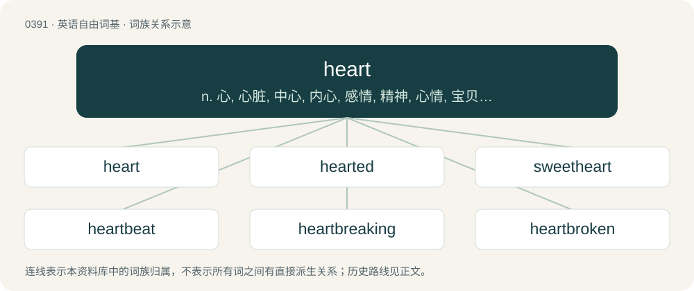

# 0451 · heart — n. 心, 心脏, 中心, 内心, 感情, 精神, 心情, 宝贝儿；vt. 鼓励

[总目录](../00_总目录_按常用程度.md)

**类型**：英语自由词基　｜　**来源语言**：见词源记录

## 核心含义与来源

- 核心含义：n. 心, 心脏, 中心, 内心, 感情, 精神, 心情, 宝贝儿；vt. 鼓励
- 英文含义：A muscular organ that pumps blood through the body, traditionally thought to be the seat of emotion.
- 词形：heart

**来源记录 1**（名词；A muscular organ that pumps blood through the body, traditionally thought to be the seat of emotion.）

From Middle English harte, heorrte, hert, herte, hierte, hirte, horte, huerte, hurte, from Old English heorte (“heart”), from Proto-West Germanic \*hertā, from Proto-Germanic \*hertô (“heart”), from Proto-Indo-European \*ḱḗr (“heart”), from \*ḱerd- (“heart”). Doublet of cardia; see also core. Cognates Cognate with Scots hert (“heart”), Yola hart, hearth (“heart”), North Frisian hart, härt (“heart”), Saterland Frisian Haat (“heart”), West Frisian hert (“heart”), Dutch hart (“heart”), West Flemish erte (“heart”), Low German Hart, Hiärt (“heart”), Luxembourgish Häerz (“heart”), German Hertz, Herz, Herze (“heart”), Alemannic German Härz (“heart”), Central Franconian Hatz, Hätz (“heart”), Cimbrian hèertze, hèrtz (“heart”), Mòcheno hèrz (“heart”), Vilamovian haoc (“heart”), Yiddish האַרץ (harts), הערץ (herts, “heart”), Danish hierte, hjerte, hjærte (“heart”), Elfdalian järta (“heart”), Faroese and Icelandic hjarta (“heart”), Jutish jaart (“heart”), Norwegian Bokmål hjerte (“heart”), Norwegian Nynorsk hjarta, hjarte, hjerta, hjerte (“heart”), Swedish hjärta (“heart”), Gothic 𐌷𐌰𐌹𐍂𐍄𐍉 (hairtō, “heart”); also Cornish kres (“centre, middle; waist”), Irish croí, croidhe (“heart; core; hub; sweetheart”), Manx cree (“heart”), Scottish Gaelic cridhe (“heart; courage; core; nucleus; sweetheart”), Welsh craidd (“centre, core, middle”), Latin cor (“heart”), Greek καρδιά (kardiá, “heart”), Albanian kërth (“askew”), Latgalian sirds (“heart”), Latvian sirde, sirds (“heart”), Lithuanian širdis (“heart”), Old Prussian seyr (“heart”), Belarusian сэ́рца (sérca, “heart”), Bulgarian сърце́ (sărcé, “heart; centre”), Czech and Slovak srdce (“heart”), Macedonian срце (srce, “heart”), Polish serce (“heart”), Russian се́рдце (sérdce, “heart”), Serbo-Croatian ср̏це, sȑce (“heart”), Slovene srce (“heart”), Ukrainian се́рце (sérce, “heart”), Armenian սիրտ (sirt, “heart”), Avestan 𐬰𐬆𐬭𐬆𐬛 (zərəd, “heart”), Baluchi زرد (zird, “heart; conscience”), Central Kurdish زر (zir, “heart”), Persian دل (del / dil, “heart; stomach; mind; courage”), Gurani زێڵ (zēł, “heart”), Northern Kurdish dil (“heart”), Ossetian зӕрдӕ (zærdæ, “heart; soul”), Pashto زړه (zrë, “heart”), Talysh dıl (“heart”), Zazaki zerri (“heart”), Hittite 𒆠𒅕 (ker), 𒊮𒅕 (ŠÀ-er, “heart”), Luwian 𒍝𒀀𒅈𒍝 (UZUzārza), 𔖪𔖱𔖪 (zārza, “heart”), Ashkun židi (“heart”), Kamkata-viri j̈arë, zërë (“heart”), Prasuni zër (“heart”), Tocharian A kri (“will”), Tocharian B \*käryā- (“heart”), Sanskrit हृद् (hṛd, “heart; soul; breast, chest”). Most of the modern figurative senses (such as passion or compassion, spirit, inmost feelings, especially love, affection, and courage) were present in Old English. However, the meaning “center” dates from the early 14th century. The verb sense “to love” is from the 1977 I ❤ NY advertising campaign. Notes on spelling The spelling ⟨ear⟩ for /ɑː(ɹ)/ is paralleled by hearken and hearth, but is problematic since an Early Modern variant with /ɛːr/ can be posited for those words, but not heart. Perhaps it represents Middle Scots hart /hɛːrt/ (reflecting the Scots lengthening of /a/ before /r/ then a consonant, then the early actuation of the Great Vowel Shift in Scots) or a parallel development in Northern England. Alternatively, a back-spelling by speakers of dialects where preconsonantal /ɛːr/ was shortened early, allowing it to undergo the late Middle English lowering to /ar/ (reflected in forms such as larn "learn") is possible.

## 词族图

## 单词速览（常用到不常用）

| 单词 | 音标 | 释义 |
|---|---|---|
| [heart](#w-1) | 英 /hɑːt/；美 /hɑɹt/ | n. 心, 心脏, 中心, 内心, 感情, 精神, 心情, 宝贝儿；vt. 鼓励 |
| [hearted](#w-2) | 英 /ˈhɑːtɪd/；美 /ˈhɑɹtɪd/ | a. 有...心(肠)的 |
| [sweetheart](#w-3) | 英 /ˈswiːtˌhɑːt/；/ˈswitˌhɑɹt/ | n. 心上人, 爱人；vi. 爱慕；vt. 向...求爱 |
| [heartbeat](#w-4) | 英 /ˈhɑːtˌbiːt/；美 /ˈhɑɹtˌbit/ | n. 心跳 |
| [heartbreaking](#w-5) | /ˈhɑːtbreikiŋ/ | a. 令人悲伤的, 极其累人的, 令人动情的 |
| [heartbroken](#w-6) | /ˈhɑːtbrəukən/ | a. 心碎的 |
| [heartfelt](#w-7) | 英 /ˈhɑːt.fɛlt/；美 /ˈhɑːɹt.fɛlt/ | a. 衷心的, 真心真意的 |
| [heartbreak](#w-8) | 英 /ˈhɑːt.bɹeɪk/；美 /ˈhɑɹt.bɹeɪk/ | n. 心碎, 伤心事 |
| [hearty](#w-9) | 英 /ˈhɑːti/；美 /ˈhɑɹti/ | a. 诚恳的, 健壮的, 热烈的, 丰盛的 |
| [heartless](#w-10) | 英 /ˈhɑːt.lɪs/；美 /ˈhɑɹt.lɪs/ | a. 无情的, 无勇气的 |
| [heartland](#w-11) | 英 /ˈhɑːtlənd/；美 /ˈhɑɹtlənd/ | n. 心脏地区, 中心地带 |
| [heartache](#w-12) | 英 /ˈhɑːteɪk/ | n. 心痛, 悲叹 |
| [heartburn](#w-13) | 英 /ˈhɑːtˌbɜːn/；美 /ˈhɑɹtˌbɝn/ | n. 胃灼热, 心痛, 妒忌；\[医\] 胃灼热 |
| [heartbreaker](#w-14) | 英 /ˈhɑːt.bɹeɪ.kə/；美 /ˈhɑɹt.bɹeɪ.kɚ/ | n. 令人伤悲的人\[事物\]; \[戏谑语\]（女人的）一绺卷发; 权志龙solo专辑名 |
| [braveheart](#w-15) |  | 【英文】brave |
| [heartstrings](#w-16) | 英 /ˈhɑːtstɹɪŋz/；美 /ˈhɑɹtˌstɹɪŋz/ | n. 心弦 |
| [lionheart](#w-17) |  | n. 勇士 |
| [heartthrob](#w-18) | 英 /ˈhɑːtˌθɹɒb/；美 /ˈhɑɹtˌθɹɑb/ | n. 心脏的跳动, 热情, 柔情, (美)(非正式)情人 |
| [heartworm](#w-19) | /ˈhɑːtw\\\\ːm/ | \[医\] 犬恶丝虫 |
| [heartwood](#w-20) | 美 /ˈhɑɹtˌwʊd/ | n. 心材 |

## 逐词详解

### 1. heart

**词性**：名词　｜　**音标**：英 /hɑːt/；美 /hɑɹt/

**中文释义**：n. 心, 心脏, 中心, 内心, 感情, 精神, 心情, 宝贝儿；vt. 鼓励

**英文义项**：A muscular organ that pumps blood through the body, traditionally thought to be the seat of emotion. / One's feelings and emotions, especially considered as part of one's character.

**词源与演化**：

From Middle English harte, heorrte, hert, herte, hierte, hirte, horte, huerte, hurte, from Old English heorte (“heart”), from Proto-West Germanic \*hertā, from Proto-Germanic \*hertô (“heart”), from Proto-Indo-European \*ḱḗr (“heart”), from \*ḱerd- (“heart”). Doublet of cardia; see also core. Cognates Cognate with Scots hert (“heart”), Yola hart, hearth (“heart”), North Frisian hart, härt (“heart”), Saterland Frisian Haat (“heart”), West Frisian hert (“heart”), Dutch hart (“heart”), West Flemish erte (“heart”), Low German Hart, Hiärt (“heart”), Luxembourgish Häerz (“heart”), German Hertz, Herz, Herze (“heart”), Alemannic German Härz (“heart”), Central Franconian Hatz, Hätz (“heart”), Cimbrian hèertze, hèrtz (“heart”), Mòcheno hèrz (“heart”), Vilamovian haoc (“heart”), Yiddish האַרץ (harts), הערץ (herts, “heart”), Danish hierte, hjerte, hjærte (“heart”), Elfdalian järta (“heart”), Faroese and Icelandic hjarta (“heart”), Jutish jaart (“heart”), Norwegian Bokmål hjerte (“heart”), Norwegian Nynorsk hjarta, hjarte, hjerta, hjerte (“heart”), Swedish hjärta (“heart”), Gothic 𐌷𐌰𐌹𐍂𐍄𐍉 (hairtō, “heart”); also Cornish kres (“centre, middle; waist”), Irish croí, croidhe (“heart; core; hub; sweetheart”), Manx cree (“heart”), Scottish Gaelic cridhe (“heart; courage; core; nucleus; sweetheart”), Welsh craidd (“centre, core, middle”), Latin cor (“heart”), Greek καρδιά (kardiá, “heart”), Albanian kërth (“askew”), Latgalian sirds (“heart”), Latvian sirde, sirds (“heart”), Lithuanian širdis (“heart”), Old Prussian seyr (“heart”), Belarusian сэ́рца (sérca, “heart”), Bulgarian сърце́ (sărcé, “heart; centre”), Czech and Slovak srdce (“heart”), Macedonian срце (srce, “heart”), Polish serce (“heart”), Russian се́рдце (sérdce, “heart”), Serbo-Croatian ср̏це, sȑce (“heart”), Slovene srce (“heart”), Ukrainian се́рце (sérce, “heart”), Armenian սիրտ (sirt, “heart”), Avestan 𐬰𐬆𐬭𐬆𐬛 (zərəd, “heart”), Baluchi زرد (zird, “heart; conscience”), Central Kurdish زر (zir, “heart”), Persian دل (del / dil, “heart; stomach; mind; courage”), Gurani زێڵ (zēł, “heart”), Northern Kurdish dil (“heart”), Ossetian зӕрдӕ (zærdæ, “heart; soul”), Pashto زړه (zrë, “heart”), Talysh dıl (“heart”), Zazaki zerri (“heart”), Hittite 𒆠𒅕 (ker), 𒊮𒅕 (ŠÀ-er, “heart”), Luwian 𒍝𒀀𒅈𒍝 (UZUzārza), 𔖪𔖱𔖪 (zārza, “heart”), Ashkun židi (“heart”), Kamkata-viri j̈arë, zërë (“heart”), Prasuni zër (“heart”), Tocharian A kri (“will”), Tocharian B \*käryā- (“heart”), Sanskrit हृद् (hṛd, “heart; soul; breast, chest”). Most of the modern figurative senses (such as passion or compassion, spirit, inmost feelings, especially love, affection, and courage) were present in Old English. However, the meaning “center” dates from the early 14th century. The verb sense “to love” is from the 1977 I ❤ NY advertising campaign. Notes on spelling The spelling ⟨ear⟩ for /ɑː(ɹ)/ is paralleled by hearken and hearth, but is problematic since an Early Modern variant with /ɛːr/ can be posited for those words, but not heart. Perhaps it represents Middle Scots hart /hɛːrt/ (reflecting the Scots lengthening of /a/ before /r/ then a consonant, then the early actuation of the Great Vowel Shift in Scots) or a parallel development in Northern England. Alternatively, a back-spelling by speakers of dialects where preconsonantal /ɛːr/ was shortened early, allowing it to undergo the late Middle English lowering to /ar/ (reflected in forms such as larn "learn") is possible.

**例句**：

> Buddhists believe that suffering is right at the heart of all life.

该用例对应义项：The centre, essence, or core.

### 2. hearted

**词性**：形容词　｜　**音标**：英 /ˈhɑːtɪd/；美 /ˈhɑɹtɪd/

**中文释义**：a. 有...心(肠)的

**英文义项**：Having a specified kind or number of heart. / Seated or fixed in the heart.

**构词拆分**：heart + -ed

**词源与演化**：

From Middle English herted, hertid; equivalent to heart + -ed.

**用法示例／搭配（非完整句）**：

> a hard-hearted woman

该用例对应义项：Having a specified kind or number of heart.

### 3. sweetheart

**词性**：名词　｜　**音标**：英 /ˈswiːtˌhɑːt/；/ˈswitˌhɑɹt/

**中文释义**：n. 心上人, 爱人；vi. 爱慕；vt. 向...求爱

**英文义项**：A person who is always very kind. / A person very much liked or loved by someone, especially when both partners are young.

**构词拆分**：sweet + heart

**词源与演化**：

From Middle English swete heorte, swete hert (term of endearment); equivalent to sweet + heart.

**例句**：

> She is such a sweetheart: she never complains about me being late.

该用例对应义项：A person who is always very kind.

### 4. heartbeat

**词性**：名词　｜　**音标**：英 /ˈhɑːtˌbiːt/；美 /ˈhɑɹtˌbit/

**中文释义**：n. 心跳

**英文义项**：One pulsation of the heart; especially an irregular one, hence the emotion which causes it. / The rhythm at which a heart pulsates, a cardiac indicator.

**构词拆分**：heart + beat

**词源与演化**：

From heart + beat.

**例句**：

> If your heartbeat doesn't normalize soon, consult a doctor!

该用例对应义项：The rhythm at which a heart pulsates, a cardiac indicator.

### 5. heartbreaking

**词性**：形容词　｜　**音标**：/ˈhɑːtbreikiŋ/

**中文释义**：a. 令人悲伤的, 极其累人的, 令人动情的

**英文义项**：That causes great grief, anguish or distress.

**构词拆分**：heart + breaking

**词源与演化**：

From heart + breaking.

**例句**：

> Her sigh was heartbreaking.

该用例对应义项：causing or marked by grief or anguish

### 6. heartbroken

**词性**：形容词　｜　**音标**：/ˈhɑːtbrəukən/

**中文释义**：a. 心碎的

**英文义项**：Suffering from grief, especially after a failed romance.

**构词拆分**：heart + broken

**词源与演化**：

From heart + broken.

**例句**：

> When he told me he didn't want to see me anymore, I was heartbroken.

该用例对应义项：Suffering from grief, especially after a failed romance.

### 7. heartfelt

**词性**：形容词　｜　**音标**：英 /ˈhɑːt.fɛlt/；美 /ˈhɑːɹt.fɛlt/

**中文释义**：a. 衷心的, 真心真意的

**英文义项**：Believed or felt deeply and sincerely.

**构词拆分**：heart + felt

**词源与演化**：

From heart + felt.

**例句**：

> She expressed her heartfelt sympathies at the death of his mother.

该用例对应义项：Believed or felt deeply and sincerely.

### 8. heartbreak

**词性**：名词　｜　**音标**：英 /ˈhɑːt.bɹeɪk/；美 /ˈhɑɹt.bɹeɪk/

**中文释义**：n. 心碎, 伤心事

**英文义项**：Overwhelming mental anguish or grief, especially that caused by loss or disappointment.

**构词拆分**：heart + break

**词源与演化**：

From heart + break. Compare heartache § Etymology.

**例句**：

> Tom was my first crush, my first love and later my first heartbreak.

### 9. hearty

**词性**：形容词　｜　**音标**：英 /ˈhɑːti/；美 /ˈhɑɹti/

**中文释义**：a. 诚恳的, 健壮的, 热烈的, 丰盛的

**英文义项**：Warm and cordial towards another person. / Energetic, active or eager.

**构词拆分**：heart + -y

**词源与演化**：

Equivalent to heart + -y.

**例句**：

> a hearty welcome; hearty in supporting the government.

该用例对应义项：Warm and cordial towards another person.

### 10. heartless

**词性**：形容词　｜　**音标**：英 /ˈhɑːt.lɪs/；美 /ˈhɑɹt.lɪs/

**中文释义**：a. 无情的, 无勇气的

**英文义项**：Without feeling, emotion, or concern for others; uncaring; cruel. / Without a physical heart.

**构词拆分**：heart + -less

**词源与演化**：

From Middle English hertles, herteles, from Old English heortlēas (“without courage; listless”), equivalent to heart + -less. Cognate with German herzlos.

**例句**：

> His heartless actions and cold manner left her saddened and feeling alone.

该用例对应义项：Without feeling, emotion, or concern for others; uncaring; cruel.

### 11. heartland

**词性**：名词　｜　**音标**：英 /ˈhɑːtlənd/；美 /ˈhɑɹtlənd/

**中文释义**：n. 心脏地区, 中心地带

**英文义项**：Synonym of heart (“the seat of the affections or love”). / The interior part of a region, especially when contrasted with coastal parts or when regarded as particularly powerful or significant.

**构词拆分**：heart (“(figuratively) centre, core, essence”) + land

**词源与演化**：

From heart (“(figuratively) centre, core, essence”) + land.

**例句**：

> We stayed in the heartland of the French wine-growing regions.

该用例对应义项：A region or part of a region particularly associated with or significant for a characteristic, such as an activity, a faith, support for a political party or other organization, etc.

### 12. heartache

**词性**：名词　｜　**音标**：英 /ˈhɑːteɪk/

**中文释义**：n. 心痛, 悲叹

**英文义项**：Emotional distress or pain, often caused by a loved one or their absence.

**构词拆分**：heart + ache

**词源与演化**：

From Middle English heorteece, heorte-ece, from Old English heorteċe, equivalent to heart + ache. Blends both literal and figurative aspects, as emotional distress sometimes includes a physical element of chest discomfort. Compare heartbreak § Etymology, where the literal aspect is lesser, though it still can be said to have a physiological basis.

**例句**：

> My arms avenge my heartache in the hug they can finally have.

### 13. heartburn

**词性**：名词　｜　**音标**：英 /ˈhɑːtˌbɜːn/；美 /ˈhɑɹtˌbɝn/

**中文释义**：n. 胃灼热, 心痛, 妒忌；\[医\] 胃灼热

**英文义项**：A burning pain in the chest that is caused by stomach acid entering the gullet. / annoyance, heartache, or similar feelings.

**构词拆分**：heart + burn

**词源与演化**：

From Middle English hertbryne, herte-bren (“lust", also "heartburn”, literally “heart burn”), equivalent to heart + burn. Compare also Middle English herte-brennyng (“anger, bitterness, heartburn”, literally “burning of/in the heart, heart-burning”). Compare also Ancient Greek καρδιαλγία (kardialgía), from καρδία (kardía, “heart”) + ἄλγος (álgos, “pain”). From being a burning sensation near the location of the heart in the chest.

**例句**：

> Tom gets indigestion and heartburn when he eats too much rich food.

### 14. heartbreaker

**词性**：名词　｜　**音标**：英 /ˈhɑːt.bɹeɪ.kə/；美 /ˈhɑɹt.bɹeɪ.kɚ/

**中文释义**：n. 令人伤悲的人\[事物\]; \[戏谑语\]（女人的）一绺卷发; 权志龙solo专辑名

**英文义项**：A person, usually attractive, who flirts with or otherwise enamours another person, but does not reciprocate their love. / Something that causes sorrow, grief or extreme disappointment.

**构词拆分**：heart + breaker

**词源与演化**：

From heart + breaker.

**例句**：

> The famous actor and heartbreaker admits that he's finally settled down.

### 15. braveheart

**词性**：形容词

**英文义项**：brave

**构词拆分**：brave + heart

**词源与演化**：

From brave + heart.

**例句**：

> The West is championing itself as the Braveheart of democracy.

### 16. heartstrings

**词性**：名词　｜　**音标**：英 /ˈhɑːtstɹɪŋz/；美 /ˈhɑɹtˌstɹɪŋz/

**中文释义**：n. 心弦

**英文义项**：Synonym of chordae tendineae (“the cord-like tendons that connect the papillary muscles to the tricuspid valve and the mitral valve in the heart”). / The source of one's deepest emotions or inner feelings, especially compassion or love.

**构词拆分**：heart + strings

**词源与演化**：

From Late Middle English hartestrynges, hert strynges, from Middle English herte (“heart”) + strenges, strynges (“cords, strings”). The English word is analysable as heart + strings.

**例句**：

> The sad eyes of the orphan tugged at my heartstrings.

该用例对应义项：The source of one's deepest emotions or inner feelings, especially compassion or love.

### 17. lionheart

**词性**：名词

**中文释义**：n. 勇士

**英文义项**：A brave, heroic person.

**构词拆分**：lion + heart

**词源与演化**：

From lion + heart, perhaps from Richard the Lionheart.

**例句**：

> Fishblood Tom was the son of Lionheart John and Harelip Mary.

### 18. heartthrob

**词性**：名词　｜　**音标**：英 /ˈhɑːtˌθɹɒb/；美 /ˈhɑɹtˌθɹɑb/

**中文释义**：n. 心脏的跳动, 热情, 柔情, (美)(非正式)情人

**英文义项**：A heartbeat. / The object of one’s desires or infatuation; a sweetheart.

**构词拆分**：heart + throb

**词源与演化**：

From heart + throb.

**例句**：

> Mary was John's heartthrob all through high school.

### 19. heartworm

**词性**：名词　｜　**音标**：/ˈhɑːtw\\\\ːm/

**中文释义**：\[医\] 犬恶丝虫

**英文义项**：A parasitic organism that afflicts dogs, of species Dirofilaria immitis of roundworms. / (uncountable) The condition caused by this organism.

**构词拆分**：heart + worm

**词源与演化**：

From heart + worm.

### 20. heartwood

**词性**：名词　｜　**音标**：美 /ˈhɑɹtˌwʊd/

**中文释义**：n. 心材

**英文义项**：The wood nearer the heart of a stem or branch, different in color from the sapwood.

**构词拆分**：heart + wood

**词源与演化**：

From heart + wood.
