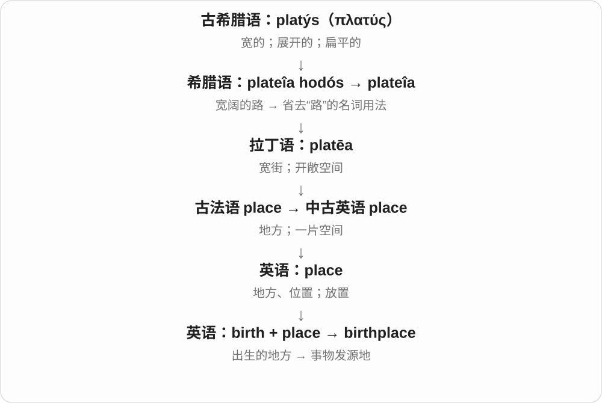

# 0452 · bear — 熊；另源的承载、忍受、生育

[逐词精讲目录](../00_逐词精讲目录.md) · [总目录](../00_总目录_按常用程度.md)

## 核心词根与来源

名词来自古英语 bera，动词来自 beran。born 是旧过去分词分化出的出生形式；birth 与生育词族有历史亲缘，不是熊生孩子的联想。

**BEAR：熊与承载分两条来路**

动物一支独立看；动词一支用肩上承着东西，串起承担、忍受、带来结果与生育。

- **承载、忍受与克制**：bear · bearer · bearing · bearable · unbearable · unbearably · forbear · forbearance
- **出生及其相关词**：born · reborn · birth · childbirth · birthday · birthplace · birthright · birthrate
- **动物名的复合与比喻**：bearish · bugbear · bearskin
- **bear → bears：熊与承载动词分支**：bear · bears
- **beaver：与熊的动物名比较远古颜色命名**：beaver · beavers

## 词形与演化规律

bear → bearer、bearing、bearable → unbearable → unbearably；forbear → forbearance；born → reborn；birth → childbirth、birthday、birthplace、birthright、birthrate。动物支 bearish、bugbear、bearskin 另放一组。

古英语 bera 动物名和 beran 承载动词分开看。

beaver 接古英语 beofor、befer，远源通常联系重叠构形的棕褐色、明亮颜色材料。与 bear 的动物名有远处颜色命名关系；不是 bear 承担动词的派生，也没有现代后缀 -ver。

## 单词速览（按词族由简到繁）

同一基础词的相关扩展放在一起，先读基础形式，再读扩展；各组之间优先读常用的。具体词源关系见各词讲解。

| 单词 | 音标 | 核心意思 |
|---|---|---|
| [bear](#w-3) | 英 /beə/；美 /ber/ | 熊；承受、忍受；携带；产生、生育 |
| [born](#w-1) | 英 /bɔːn/；美 /bɔːrn/ | 出生的；天生的；由……产生的 |
| [reborn](#w-17) | 英 /ˌriːˈbɔːn/；美 /ˌriːˈbɔːrn/ | 重生的；焕然一新的 |
| [birth](#w-2) | 英 /bɜːθ/；美 /bɜːrθ/ | 出生；诞生；出身 |
| [birthday](#w-14) | 英 /ˈbɜːθdeɪ/；美 /ˈbɜːrθdeɪ/ | 生日 |
| [birthplace](#w-18) | 英 /ˈbɜːθpleɪs/；美 /ˈbɜːrθpleɪs/ | 出生地；发源地 |
| [birthright](#w-19) | 英 /ˈbɜːθraɪt/；美 /ˈbɜːrθraɪt/ | 与生俱来的权利；长子继承权〔特定历史语境〕 |
| [birthrate](#w-22) | 英 /ˈbɜːθreɪt/；美 /ˈbɜːrθreɪt/ | 出生率 |
| [childbirth](#w-16) | 英 /ˈtʃaɪldbɜːθ/；美 /ˈtʃaɪldbɜːrθ/ | 分娩；生孩子 |
| [bears](#w-23) | 英 /beəz/；美 /berz/ | 熊〔复数〕；承受、携带、具有、结果实〔第三人称单数〕 |
| [bearing](#w-4) | 英 /ˈbeərɪŋ/；美 /ˈberɪŋ/ | 举止、姿态；关系、影响；轴承；方位 |
| [unbearable](#w-15) | 英 /ʌnˈbeərəbəl/；美 /ʌnˈberəbəl/ | 无法忍受的；难以承受的 |
| [unbearably](#w-20) | 英 /ʌnˈbeərəbli/；美 /ʌnˈberəbli/ | 难以忍受地；极其 |
| [bearer](#w-7) | 英 /ˈbeərə/；美 /ˈberər/ | 携带者；持有者；传递者 |
| [bearable](#w-8) | 英 /ˈbeərəbəl/；美 /ˈberəbəl/ | 可以忍受的 |
| [bearish](#w-9) | 英 /ˈbeərɪʃ/；美 /ˈberɪʃ/ | 像熊的；看跌的；对前景悲观的 |
| [bearskin](#w-12) | 英 /ˈbeəskɪn/；美 /ˈberskɪn/ | 熊皮；熊皮制品；熊皮高帽 |
| [bugbear](#w-11) | 英 /ˈbʌɡbeə/；美 /ˈbʌɡber/ | 令人烦恼或害怕的事；老大难 |
| [forbear](#w-13) | 英 /fɔːˈbeə/；美 /fɔːrˈber/ | 克制；忍住不做 |
| [forbearance](#w-21) | 英 /fɔːˈbeərəns/；美 /fɔːrˈberəns/ | 耐心；宽容；克制 |
| [beaver](#w-24) | 英 /ˈbiːvə/；美 /ˈbivɚ/ | 河狸 |
| [beavers](#w-25) | 英 /ˈbiːvəz/；美 /ˈbivɚz/ | 河狸〔复数〕 |

## 逐词讲解

### 1. bear — 熊；承受、忍受；携带；产生、生育

**音标**：英 /beə/；美 /ber/

**先抓住这个画面**

名词先想熊这个动物；动词另想肩上承着东西，再扩展为承担责任、忍受压力、结出结果。

**怎么拆**

熊接古英语 bera，动词接 beran，两条来路分开。熊名常被联系到棕色者的古老称呼，但更远解释并非无争议。动词过去式 bore，通常过去分词 borne；be born 出生另用 born。

**怎么变成今天的意思**

**不同旧词：古英语 bera；古英语 beran**  
前者是熊；后者是承载、带来、生育

↓

**英语同形 bear**  
熊；另有承受、携带、产生等动词义

bear the cost 承担成本，bear a name 带有某个名字，bear fruit 结果、产生效果；can’t bear something 受不了。bear in mind 是记在心里。

**常见搭配与例句**

bear responsibility；bear the cost；bear fruit；bear in mind；can’t bear to do something。

> The tree finally began to bear fruit.

这棵树终于开始结果了。

> I can’t bear the constant noise upstairs.

我受不了楼上持续不断的噪声。

> We saw a bear near the edge of the forest.

我们在森林边缘附近看见了一头熊。

**别混淆**

bear 忍受多强调承受艰难、烦扰；wear 穿戴不是 bear 的普通替换。熊是名词另一源，不能把生孩子解释成像熊一样。

### 2. born — 出生的；天生的；由……产生的

**音标**：英 /bɔːn/；美 /bɔːrn/

**先抓住这个画面**

一个生命被带到世界上；比喻上，一个想法也可以在某种处境中诞生。

**怎么拆**

来自 bear 承载、生育的旧过去分词，古英语 boren。现代 be born 用于出生；其他承载、忍受等常用 borne。主动表示生育也可用 borne，如 has borne two children。

**怎么变成今天的意思**

**古英语 beran → 中古英语 beren**  
承载、带来；生育；忍受

↓

**英语 bear；过去式 bore，过去分词通常 borne**  
承受、携带、产生；出生表达中使用 born

↓

**古英语 boren → born**  
被生下、出生；出生相关用法固定拼作 born

be born in a city 出生在某城，be born in 2000 出生于2000年；a born leader 天生的领袖；an idea born of frustration 因挫折而产生的想法。

**常见搭配与例句**

be born in；be born into a family；a born storyteller；born of necessity。

> She was born in a small town by the sea.

她出生在一个海边小镇。

> The project was born of a simple question.

这个项目源于一个简单的问题。

**别混淆**

说某人出生用 was born，不用 he born。borne 强调被承载、承担；born 主要固定在出生及其比喻用法中。

### 3. reborn — 重生的；焕然一新的

**音标**：英 /ˌriːˈbɔːn/；美 /ˌriːˈbɔːrn/

**先抓住这个画面**

好像又出生一次：可以是信仰里的再生，也可以比喻恢复活力。

**怎么拆**

re- 再、重新 + born 出生。用再次出生的画面表达精神转变或事物重新焕发生机。

**怎么变成今天的意思**

**古英语 beran → 中古英语 beren**  
承载、带来；生育；忍受

↓

**英语 bear；过去式 bore，过去分词通常 borne**  
承受、携带、产生；出生表达中使用 born

↓

**born → re- + born → reborn**  
出生 → 再生、焕然新生

feel reborn 感到焕然一新；a theatre reborn as a community centre 剧院改造后以社区中心的面貌重获新生。

**常见搭配与例句**

feel reborn；be reborn as；a city reborn。

> After a week of rest, I felt reborn.

休息一周后，我感觉焕然一新。

> The old factory was reborn as an arts centre.

旧工厂改造为艺术中心，重获新生。

**别混淆**

reborn 可以比喻恢复生机，并不每次都在陈述转世信仰；rebuild 重点是重建这个动作。

### 4. birth — 出生；诞生；出身

**音标**：英 /bɜːθ/；美 /bɜːrθ/

**先抓住这个画面**

生命来到世上的那个过程；想法、组织的开始，也借用诞生来表达。

**怎么拆**

现代形式经中古英语 birthe，受到古诺斯语出生名词的影响，对应更早古英语 ġebyrd。远源属于 bear 承载、生育词族；不是现代把 bear 随意改成 bir 再加 th。

**怎么变成今天的意思**

**古诺斯语 burðr 等形式；相应古英语 ġebyrd**  
出生；二者都有更早的承载、生育词族背景

↓

**中古英语 birthe → 英语 birth**  
出生、诞生；与 bear 承载、生育有历史亲缘

give birth 生育；the birth of an idea 一个想法的诞生；from birth 自出生起。by birth 可说出身、出生所属背景。

**常见搭配与例句**

give birth to；at birth；from birth；the birth of a movement。

> The photograph was taken soon after the baby’s birth.

这张照片拍摄于宝宝出生后不久。

> The small meeting marked the birth of a new organization.

那次小型会议标志着一个新组织的诞生。

**别混淆**

birth 是出生这件事，born 常放在 be born 中描述某人出生；birthday 才是生日这个日期或周年。

### 5. birthday — 生日

**音标**：英 /ˈbɜːθdeɪ/；美 /ˈbɜːrθdeɪ/

**先抓住这个画面**

出生那天，在日历上每年回来一次。

**怎么拆**

birth 出生 + day 日，组合表示出生之日及其周年纪念日；英语早期已有相应组合。

**怎么变成今天的意思**

**英语 birth；day**  
出生；日

↓

**birthday**  
出生之日；每年纪念出生的日子

通常说生日，就是每年同一个月日到来的纪念日；date of birth 则在表格里要求你出生的年、月、日。a birthday party 是围绕这个日子举办的聚会。

**常见搭配与例句**

on your birthday；a birthday present；a birthday cake。

> Her birthday falls on a Sunday this year.

她今年的生日正好是星期日。

> I made a cake for my brother’s birthday.

我为弟弟的生日做了一个蛋糕。

**别混淆**

birthday 常问每年哪天过生日；date of birth 要完整出生日期。Happy birthday 是祝福，不是要求字面证明当天很快乐。

### 6. birthplace — 出生地；发源地

**音标**：英 /ˈbɜːθpleɪs/；美 /ˈbɜːrθpleɪs/

**先抓住这个画面**

一个人开始生命的地方，也能比喻某种运动、思想或发明最初形成的地方。

**怎么拆**

birth 出生 + place 地方，英语复合词。

**怎么变成今天的意思**

人的 birthplace 不一定是后来长大的地方。比喻某城是艺术运动的 birthplace，强调它在起源中的地位。

**常见搭配与例句**

someone’s birthplace；the birthplace of an idea。

> She returned to her birthplace for the first time in thirty years.

三十年来，她第一次回到了出生地。

> The city is often described as the birthplace of the movement.

这座城市常被称为那场运动的发源地。

**别混淆**

birthplace 是出生地；hometown 通常是成长或视为家乡的城镇，二者可能不同。

### 7. birthright — 与生俱来的权利；长子继承权〔特定历史语境〕

**音标**：英 /ˈbɜːθraɪt/；美 /ˈbɜːrθraɪt/

**先抓住这个画面**

不是后来赢来的资格，而是因出生身份就被认为拥有。

**怎么拆**

birth（出生）+ right（权利），组合表示出生带来的权利；在某些历史叙事中可特指长子权利，不概括成各社会统一规则。

**怎么变成今天的意思**

**英语 birth；right**  
并列组合的两部分

↓

**birth + right → birthright**  
由出生身份带来的权利

a birthright 可用于伦理、政治论述，主张某种东西人人应有。历史或宗教文本里则可能说长子的一组特殊权利，需看制度背景。

**常见搭配与例句**

one’s birthright；a birthright to；claim something as a birthright。

> The speaker described education as every child’s birthright.

演讲者把教育称为每个孩子与生俱来的权利。

> The story centres on a dispute over the eldest son’s birthright.

故事围绕长子的继承权争议展开。

**别混淆**

birthright 与 citizenship 可相关，但公民身份有不同取得方式；不能由词源推出所有现实身份制度。

### 8. birthrate — 出生率

**音标**：英 /ˈbɜːθreɪt/；美 /ˈbɜːrθreɪt/

**先抓住这个画面**

把出生人数放到一定人口和时间范围里比较，而不只看一共出生几个孩子。

**怎么拆**

birth 出生 + rate 比率；也常分写 birth rate。

**怎么变成今天的意思**

**birth 出生；rate 比率**  
并列构词部分

↓

**birthrate**  
一定人口、时期中的出生比例指标

a rising birthrate 上升的出生率，a declining birthrate 下降的出生率。阅读统计时还要看它使用的时间和人口口径。

**常见搭配与例句**

the national birthrate；a falling birthrate；changes in the birthrate。

> The chart compares birthrates in three regions.

图表比较了三个地区的出生率。

> The report examines the reasons for the falling birthrate.

报告探讨出生率下降的原因。

**别混淆**

birthrate 是出生率，不是总出生人数；也不应直接与 fertility rate 生育率当成处处完全相同的指标。

### 9. childbirth — 分娩；生孩子

**音标**：英 /ˈtʃaɪldbɜːθ/；美 /ˈtʃaɪldbɜːrθ/

**先抓住这个画面**

专门说把孩子生下来的过程，而不是每年庆祝的生日。

**怎么拆**

child 孩子 + birth 出生；中古英语已有相应复合词。

**怎么变成今天的意思**

**child 孩子；birth 出生**  
并列构词部分

↓

**childbirth**  
分娩这一过程

during childbirth 分娩期间，experiences of childbirth 分娩经历。通常不可数，不用 a childbirth 来说某人的生日。

**常见搭配与例句**

during childbirth；after childbirth；a book about childbirth。

> The book describes different personal experiences of childbirth.

这本书描述了不同个人的分娩经历。

> The documentary explores how families prepare for childbirth.

纪录片探讨家庭如何为孩子出生作准备。

**别混淆**

childbirth 强调分娩过程；birth 范围更广，还能说一个城市、想法的诞生；birthday 是生日。

### 10. bears — 熊〔复数〕；承受、携带、具有、结果实〔第三人称单数〕

**音标**：英 /beəz/；美 /berz/

**先抓住这个画面**

山林里的 bears 是熊；一座桥 bears weight，是承住重量；树 bears fruit，是长出果实。动物名和承载动词有两条不同的旧词来路。

**怎么拆**

bear + -s，结尾读 /z/。熊接古英语 bera，承载动词接 beran；熊名更远常联系棕色的称呼，但仍有讨论。动词现代过去式 bore，常用过去分词 borne。

**怎么变成今天的意思**

**古英语 bera → 熊 bear；beran → 承载 bear**  
动物名与携带、承受动词分别延续

↓

**bear + -s → bears**  
多只熊；单数主语承载、具有或生出果实

wild bears 野生熊；bears the weight 承重；bears her name 带有她的名字；bears fruit 结果实、见成效。

**常见搭配与例句**

bears responsibility 承担责任；bears a resemblance 有相似之处。

> The bridge bears the weight of heavy vehicles.

桥承受重型车辆的重量。

> We saw bears near the edge of the forest.

我们在森林边缘看见了熊。

**别混淆**

be born 出生用 born；普通承载、承受的过去分词多用 borne。bears fruit 可以是真结果，也可以说努力开始有成果。

### 11. bearing — 举止、姿态；关系、影响；轴承；方位

**音标**：英 /ˈbeərɪŋ/；美 /ˈberɪŋ/

**先抓住这个画面**

先从承着、带着来想：一个人怎样持身是一种姿态，机器承托转轴的部件是轴承；方向一义则来自朝向。

**怎么拆**

bear + -ing。bearing 名词从承载、持身、朝某方向等动词用法发展出多个固定意思，不是所有语境都能译为承受中。

**怎么变成今天的意思**

**古英语 beran → 中古英语 beren**  
承载、带来；生育；忍受

↓

**英语 bear；过去式 bore，过去分词通常 borne**  
承受、携带、产生；出生表达中使用 born

↓

**bear 的承托、持身、朝向用法 → bearing**  
轴承；举止；关系；方位

a calm bearing 镇定的举止；have a bearing on 与……有关、对……有影响；get one’s bearings 弄清方位，也可指熟悉新环境。

**常见搭配与例句**

a ball bearing；have no bearing on；get one’s bearings；a confident bearing。

> Her confident bearing helped put the audience at ease.

她自信的举止让听众放松下来。

> This detail has no bearing on the final decision.

这个细节与最后的决定无关。

> I needed a few minutes to get my bearings in the new building.

我花了几分钟才弄清这座新楼里的方位。

**别混淆**

bearings 可能是多个轴承，也可能是方向定位；要看谈机器维修还是找路。have a bearing on 不是把某物放在轴承上。

### 12. unbearable — 无法忍受的；难以承受的

**音标**：英 /ʌnˈbeərəbəl/；美 /ʌnˈberəbəl/

**先抓住这个画面**

难受或烦扰越过了能撑住的那条线。

**怎么拆**

un- 不 + bearable 可承受的；核心仍是 bear 承受，与动物熊无关。

**怎么变成今天的意思**

**古英语 beran → 中古英语 beren**  
承载、带来；生育；忍受

↓

**英语 bear；过去式 bore，过去分词通常 borne**  
承受、携带、产生；出生表达中使用 born

↓

**bear → bearable → unbearable**  
承受 → 能承受 → 难以承受

unbearable heat 难以忍受的炎热；unbearable noise 难以忍受的噪声。也可以是主观夸张，表达实在受不了了。

**常见搭配与例句**

unbearable heat；an unbearable smell；become unbearable。

> The heat in the attic became unbearable by noon.

到中午，阁楼里的炎热变得难以忍受。

> The loud music made conversation almost unbearable.

音乐声太大，让交谈几乎成了折磨。

**别混淆**

unbearable 不自动等于物理上绝无可能活下来；日常抱怨也会用它加强语气。

### 13. unbearably — 难以忍受地；极其

**音标**：英 /ʌnˈbeərəbli/；美 /ʌnˈberəbli/

**先抓住这个画面**

把难以忍受这个强度放在某种状态前面。

**怎么拆**

unbearable + -ly，-able 的形容词转成 -ably 的副词形式。

**怎么变成今天的意思**

**古英语 beran → 中古英语 beren**  
承载、带来；生育；忍受

↓

**英语 bear；过去式 bore，过去分词通常 borne**  
承受、携带、产生；出生表达中使用 born

↓

**unbearable → unbearably**  
难以忍受的 → 以难以忍受的程度

unbearably hot 热得受不了，unbearably slow 慢得让人难忍。通常修饰形容词或副词，强调人的强烈感受。

**常见搭配与例句**

unbearably hot；unbearably loud；unbearably slowly。

> The bus was unbearably crowded.

公交车挤得让人受不了。

> The clock seemed to move unbearably slowly.

时钟好像走得慢得令人难以忍受。

**别混淆**

unbearable 修饰名词，unbearably 常修饰程度：unbearable heat，unbearably hot。

### 14. bearer — 携带者；持有者；传递者

**音标**：英 /ˈbeərə/；美 /ˈberər/

**先抓住这个画面**

带着某样东西的人：手里拿着文件，或把消息带到你面前。

**怎么拆**

bear 携带 + -er；旧英语已有相应的人名词，现代构词关系依然清楚。

**怎么变成今天的意思**

**古英语 beran → 中古英语 beren**  
承载、带来；生育；忍受

↓

**英语 bear；过去式 bore，过去分词通常 borne**  
承受、携带、产生；出生表达中使用 born

↓

**bear → bearer**  
携带 → 携带、持有或传递的人

the bearer of good news 带来好消息的人；the bearer of a ticket 票券持有人。banner bearer 可指实际举旗者，也可比喻代表某项事业的人。

**常见搭配与例句**

the bearer of bad news；a ticket bearer；a standard bearer。

> I’m happy to be the bearer of good news today.

我很高兴今天能给大家带来好消息。

> The pass allows the bearer to enter the exhibition twice.

持这张通行证可以进入展览两次。

**别混淆**

bearer 强调带着、持有，不必是物主；owner 才明确说拥有者。带来坏消息的人也不一定制造了坏事。

### 15. bearable — 可以忍受的

**音标**：英 /ˈbeərəbəl/；美 /ˈberəbəl/

**先抓住这个画面**

虽不好受，但还在撑得住的范围里。

**怎么拆**

bear 忍受 + -able 可以……的；表示某种处境能被承受。

**怎么变成今天的意思**

**古英语 beran → 中古英语 beren**  
承载、带来；生育；忍受

↓

**英语 bear；过去式 bore，过去分词通常 borne**  
承受、携带、产生；出生表达中使用 born

↓

**bear + -able → bearable**  
承受 → 可以忍受的

make something bearable 让某事变得能忍受；just bearable 勉强能承受。它不一定好，只是没超过承受线。

**常见搭配与例句**

make life bearable；barely bearable；more bearable。

> A small fan made the crowded room more bearable.

一台小风扇让拥挤的房间稍微好受一些。

> The long wait was bearable because we had books to read.

我们有书可读，所以漫长的等待还算能忍受。

**别混淆**

bearable 可忍受，comfortable 舒服；酷热稍缓后 bearable，仍未必称得上 comfortable。

### 16. bearish — 像熊的；看跌的；对前景悲观的

**音标**：英 /ˈbeərɪʃ/；美 /ˈberɪʃ/

**先抓住这个画面**

动物义是像熊；财经报道里则常表示认为价格或前景会往下走。

**怎么拆**

bear 熊 + -ish 像……的。金融用法接 bear 的市场看跌者义；这属于动物名词的另一种引申，不是 bear 忍受加后缀。

**怎么变成今天的意思**

**不同旧词：古英语 bera；古英语 beran**  
前者是熊；后者是承载、带来、生育

↓

**英语同形 bear**  
熊；另有承受、携带、产生等动词义

↓

**bear 动物及市场看跌者义 + -ish → bearish**  
像熊的；认为价格会跌或前景欠佳的

be bearish on a market 对某市场看跌，a bearish outlook 悲观的前景判断。它说的是判断，不保证之后价格真的下降。

**常见搭配与例句**

a bearish forecast；turn bearish；be bearish on something。

> The article takes a bearish view of demand for the product.

文章对这种产品的需求前景持悲观看法。

> Some analysts remained bearish despite the recent price rise.

尽管近期价格上涨，一些分析人士仍然看跌。

**别混淆**

bearish 看跌，bullish 看涨；不要把熊掌往下、牛角往上当成已证实的金融词源故事。

### 17. bearskin — 熊皮；熊皮制品；熊皮高帽

**音标**：英 /ˈbeəskɪn/；美 /ˈberskɪn/

**先抓住这个画面**

bear 指材料来源，skin 指皮；仪仗语境里，材料名还可以代指那顶高帽。

**怎么拆**

bear 熊 + skin 皮，形成复合名词；再以材料代称传统使用该材料的高帽。

**怎么变成今天的意思**

**bear 熊；skin 皮**  
并列构词部分

↓

**bearskin**  
熊皮；由这种材料命名的服饰

a bearskin rug 熊皮地毯；a bearskin cap 熊皮高帽，省略后也能说 a bearskin。具体实物是否使用传统材料，还要看说明。

**常见搭配与例句**

a bearskin cap；a bearskin rug；guards in bearskins。

> The museum label described the old bearskin cap.

博物馆标签介绍了那顶旧熊皮高帽。

> An antique bearskin rug appeared in the catalogue.

目录中出现了一张古董熊皮地毯。

**别混淆**

bearskin 是动物熊的分支，不是承受皮肤；cap 的意思来自约定的服饰名称，不能把所有熊皮制品都叫帽子。

### 18. bugbear — 令人烦恼或害怕的事；老大难

**音标**：英 /ˈbʌɡbeə/；美 /ˈbʌɡber/

**先抓住这个画面**

有件事像个老在眼前晃的怪物，让你一想到就烦或担心。

**怎么拆**

bug 在这里是吓人之物的旧义，不是现代昆虫或程序漏洞义；加 bear 熊，早期指吓人的怪物，后来成为反复困扰人的事情。

**怎么变成今天的意思**

**bug 旧义：吓人之物；bear 熊**  
并列构词部分

↓

**bugbear**  
吓人的怪物 → 令人反复烦恼的事

a particular bugbear 特别让人烦的一件事；my biggest bugbear 我最烦的事。英式表达中很常见，也可指难解决的担忧。

**常见搭配与例句**

a major bugbear；a particular bugbear of mine；a longstanding bugbear。

> Unclear instructions are a particular bugbear of mine.

说明写得不清楚，是我特别烦的一件事。

> Parking remains a major bugbear for local residents.

停车问题仍是当地居民的一大烦心事。

**别混淆**

bugbear 不是昆虫和熊杂交的动物，也不是特指软件 bug；要从吓人、烦人的旧意象理解。

### 19. forbear — 克制；忍住不做

**音标**：英 /fɔːˈbeə/；美 /fɔːrˈber/

**先抓住这个画面**

冲动已经上来了，但自己把它按住，不付诸行动。

**怎么拆**

接古英语 forberan；旧前缀 for- + beran，发展出忍住、克制、容忍等用法。这里不能按现代 for 为了硬译。

**怎么变成今天的意思**

**古英语 beran → 中古英语 beren**  
承载、带来；生育；忍受

↓

**英语 bear；过去式 bore，过去分词通常 borne**  
承受、携带、产生；出生表达中使用 born

↓

**古英语 forberan → forbear**  
克制、忍住、容忍

forbear from commenting 忍住不作评论，较正式或文学。过去式 forbore，过去分词 forborne。

**常见搭配与例句**

forbear from doing something；forbear to comment。

> She chose to forbear from criticizing the unfinished work.

她选择忍住不批评那份尚未完成的作品。

> He could not forbear to smile at the child’s remark.

听到孩子的话，他忍不住笑了。

**别混淆**

forbear 动词是克制；forebear 常指祖先，常见复数 forebears。祖先这个名词不要按克制义理解。

### 20. forbearance — 耐心；宽容；克制

**音标**：英 /fɔːˈbeərəns/；美 /fɔːrˈberəns/

**先抓住这个画面**

不是没有不满，而是压住冲动，给别人或困难留一点余地。

**怎么拆**

forbear 克制、容忍 + -ance，形成状态、品质名词；不是 forebear 祖先加后缀。

**怎么变成今天的意思**

**古英语 beran → 中古英语 beren**  
承载、带来；生育；忍受

↓

**英语 bear；过去式 bore，过去分词通常 borne**  
承受、携带、产生；出生表达中使用 born

↓

**forbear → forbearance**  
忍住、容忍 → 克制、宽容这一品质

show forbearance 表现出克制、宽容；thank someone for their forbearance 感谢对方耐心包容。通常比 patience 更正式。

**常见搭配与例句**

show great forbearance；patience and forbearance；test someone’s forbearance。

> She showed remarkable forbearance during the heated discussion.

在激烈讨论中，她表现出了难得的克制。

> Thank you for your forbearance while we reorganize the office.

办公室调整期间，感谢大家耐心包容。

**别混淆**

forbearance 常含面对烦扰仍克制的意思；patience 范围更广，也可只是耐心等待。金融语境另有暂缓执行、暂缓还款等专业用法。

### 21. beaver — 河狸

**音标**：英 /ˈbiːvə/；美 /ˈbivɚ/

**先抓住这个画面**

宽扁尾巴、啃树木、会筑坝的河狸，是 beaver。这个动物名有很古老的棕褐色命名背景。

**怎么拆**

古英语 beofor、befer，接重建日耳曼语 *bebruz；更远通常联系重叠构形的颜色材料。与 bear 的动物名有远处关系，不是现代英语 bear 加 -ver。

**怎么变成今天的意思**

**古英语 beofor、befer ← 重建日耳曼语 \*bebruz**  
更远常解释为颜色材料的重叠构形，有棕褐色动物的命名背景

↓

**beaver 河狸 → beavers**  
英语沿用动物名，现代不宜再硬切成英语零件

a beaver dam 是河狸筑的坝；a beaver lodge 是河狸的巢；beaver fur 是河狸毛皮。

**常见搭配与例句**

a beaver dam；a beaver lodge；beaver fur。

> A beaver dragged a branch into the water.

一只河狸把树枝拖进水中。

> We found a beaver dam farther upstream.

我们在更上游发现了一道河狸坝。

**别混淆**

beaver 动物名与旧头盔护面罩的同形词来自不同路线；护面罩义不需要拿河狸的样子硬解释。

### 22. beavers — 河狸〔复数〕

**音标**：英 /ˈbiːvəz/；美 /ˈbivɚz/

**先抓住这个画面**

几只河狸一起活动，就说 beavers。它们的名字仍是整块继承的老动物名。

**怎么拆**

beaver + -s → beavers，词尾读 /z/；不把 beaver 中的 -er 当作现代英语表示职业、做事者的后缀。

**怎么变成今天的意思**

**古英语 beofor、befer ← 重建日耳曼语 \*bebruz**  
更远常解释为颜色材料的重叠构形，有棕褐色动物的命名背景

↓

**beaver 河狸 → beavers**  
英语沿用动物名，现代不宜再硬切成英语零件

↓

**beaver + -s → beavers**  
多只河狸的规则复数

a pair of beavers 是两只河狸；beavers building a dam 是正在筑坝的河狸。

**常见搭配与例句**

a pair of beavers；beavers building a dam；signs of beavers。

> Beavers had built a dam across the stream.

河狸已经在小溪上筑起了一道坝。

> We saw signs of beavers near the pond.

我们在池塘附近看到了河狸活动的痕迹。

**别混淆**

宽扁尾巴、筑坝的辨认画面常用来记 beavers；otters 则是水獭，两个名称不能互换。

## 这一组要分清什么

be born 出生，通常其他承载用 borne；bearing 可说举止或关系；bearish 看跌来自市场中 bear 的名词义。

## 串起来练习

Bear in mind that a small change can make the wait more bearable.

记住，小小的改变也能让等待更容易忍受。
