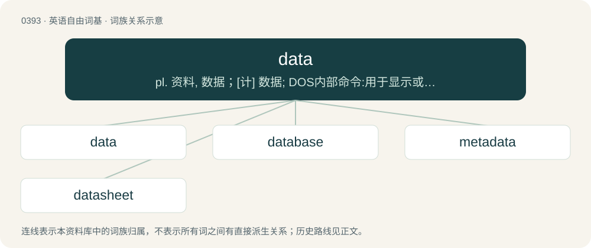

# 0452 · data — pl. 资料, 数据；\[计\] 数据; DOS内部命令:用于显示或设定系统的日期

[总目录](../00_总目录_按常用程度.md)

**类型**：英语自由词基　｜　**来源语言**：见词源记录

## 核心含义与来源

- 核心含义：pl. 资料, 数据；\[计\] 数据; DOS内部命令:用于显示或设定系统的日期
- 英文含义：A representation of information in a computer (as symbols, quantities, sound, images or videos) which is stored, processed or transmitted in the form of electrical signals, records on magnetic tape or punched cards, etc.
- 词形：data

**来源记录 1**（名词；A representation of information in a computer (as symbols, quantities, sound, images or videos) which is stored, processed or transmitted in the form of electrical signals, records on magnetic tape or punched cards, etc.）

Borrowed from Latin data, nominative plural of datum (“that is given”), neuter past participle of dō (“to give”); by surface analysis, dat(um) + -a. Doublet of date.

## 词族图

## 单词速览（常用到不常用）

| 单词 | 音标 | 释义 |
|---|---|---|
| [data](#w-1) | 英 /ˈdɑːtə/；美 /ˈdætə/ | pl. 资料, 数据；\[计\] 数据; DOS内部命令:用于显示或设定系统的日期 |
| [database](#w-2) | 英 /ˈdeɪtəˌbeɪs/；美 /ˈdeɪtəˌbeɪs/ | n. 数据库；\[计\] 数据库 |
| [metadata](#w-3) | 英 /ˈmɛt.əˌdeɪ.tə/；美 /ˈmɛt.əˌdeɪ.tə/ | \[计\] 元数据 |
| [datasheet](#w-4) |  | \[计\] 数据表 |

## 逐词详解

### 1. data

**词性**：名词　｜　**音标**：英 /ˈdɑːtə/；美 /ˈdætə/

**中文释义**：pl. 资料, 数据；\[计\] 数据; DOS内部命令:用于显示或设定系统的日期

**英文义项**：A representation of information in a computer (as symbols, quantities, sound, images or videos) which is stored, processed or transmitted in the form of electrical signals, records on magnetic tape or punched cards, etc. / Material recorded and known or assumed as facts and used as a basis for reasoning, discussion, or calculation, represented especially in the form of numbers, and usually structured (such as statistics).

**词源与演化**：

Borrowed from Latin data, nominative plural of datum (“that is given”), neuter past participle of dō (“to give”); by surface analysis, dat(um) + -a. Doublet of date.

**例句**：

> This data shows that X is correlated with Y.

该用例对应义项：Material recorded and known or assumed as facts and used as a basis for reasoning, discussion, or calculation, represented especially in the form of numbers, and usually structured (such as statistics).

### 2. database

**词性**：名词　｜　**音标**：英 /ˈdeɪtəˌbeɪs/；美 /ˈdeɪtəˌbeɪs/

**中文释义**：n. 数据库；\[计\] 数据库

**英文义项**：A collection of (usually) organized information in a regular structure, usually but not necessarily in a machine-readable format accessible by a computer. / A set of tables and other objects (queries, reports, forms) in the form of a structured data set.

**构词拆分**：data + base

**词源与演化**：

From data + base.

**例句**：

> The "books" database will have three tables, and the "customers" database will have two tables.

该用例对应义项：A set of tables and other objects (queries, reports, forms) in the form of a structured data set.

### 3. metadata

**词性**：名词　｜　**音标**：英 /ˈmɛt.əˌdeɪ.tə/；美 /ˈmɛt.əˌdeɪ.tə/

**中文释义**：\[计\] 元数据

**英文义项**：Data that describes other data, serving as an informative label. / Structured information about a file (date created, creator, software used to create, last modified, file format, file fingerprint, etc).

**构词拆分**：meta- + data

**词源与演化**：

From meta- + data.

**例句**：

> Most websites contain metadata to tell the computer how to lay out the content on the screen.

该用例对应义项：Data that describes other data, serving as an informative label.

### 4. datasheet

**词性**：名词

**中文释义**：\[计\] 数据表

**英文义项**：A document summarizing the performance and other technical characteristics of a product. / A display of the records in a table, arranged in rows and columns.

**构词拆分**：data + sheet

**词源与演化**：

From data + sheet.
