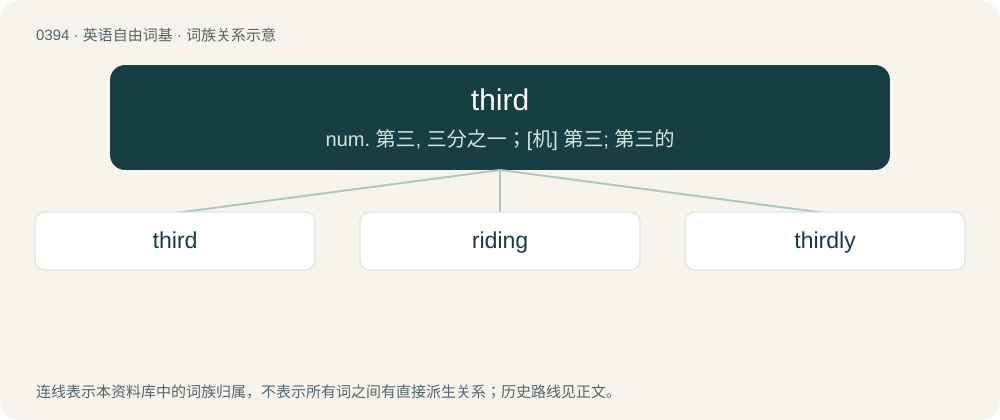

# 0454 · third — num. 第三, 三分之一；\[机\] 第三; 第三的

[总目录](../00_总目录_按常用程度.md)

**类型**：英语自由词基　｜　**来源语言**：见词源记录

## 核心含义与来源

- 核心含义：num. 第三, 三分之一；\[机\] 第三; 第三的
- 英文含义：The ordinal form of the cardinal number three; Coming after the second.
- 词形：third

**来源记录 1**（形容词；The ordinal form of the cardinal number three; Coming after the second.）

From Middle English thirde, thridde, from Old English þridda, from Proto-Germanic \*þridjô, from Pre-Germanic \*tretyós, a remodeling of Proto-Indo-European \*tr̥tyós.

## 词族图

## 单词速览（常用到不常用）

| 单词 | 音标 | 释义 |
|---|---|---|
| [third](#w-1) | 英 /θɜːd/；美 /θɚd/ | num. 第三, 三分之一；\[机\] 第三; 第三的 |
| [riding](#w-2) | /ˈɹaɪ.dɪŋ/ | 【英文】Electoral district or constituency. |
| [thirdly](#w-3) | 英 /ˈθɜːdli/；美 /ˈθɚdli/ | adv. 第三 |

## 逐词详解

### 1. third

**词性**：形容词　｜　**音标**：英 /θɜːd/；美 /θɚd/

**中文释义**：num. 第三, 三分之一；\[机\] 第三; 第三的

**英文义项**：The ordinal form of the cardinal number three; Coming after the second.

**词源与演化**：

From Middle English thirde, thridde, from Old English þridda, from Proto-Germanic \*þridjô, from Pre-Germanic \*tretyós, a remodeling of Proto-Indo-European \*tr̥tyós.

**例句**：

> The third tree from the left is my favorite.

该用例对应义项：The ordinal form of the cardinal number three; Coming after the second.

### 2. riding

**词性**：名词　｜　**音标**：/ˈɹaɪ.dɪŋ/

**英文义项**：Electoral district or constituency.

**构词拆分**：third + -ing

**词源与演化**：

From trithing (initial /t/ absorbed into preceding north, south, east, west, inner ⟨th⟩ already sometimes /d/ in Middle English), from Middle English trithing, tridinge, from Old English \*þriþing, from Old Norse þriðjungr (“third part”), from Proto-Germanic \*þridjô (“third”) (English third). Equivalent to third + -ing; compare with farthing (“fourth part”). Cognate with English trithing. The folk etymology that connects the term to the area a horse-rider could cover in a single day is incorrect, but may have influenced the spelling and pronunciation.

### 3. thirdly

**词性**：副词　｜　**音标**：英 /ˈθɜːdli/；美 /ˈθɚdli/

**中文释义**：adv. 第三

**英文义项**：In the third place; third in a row.

**构词拆分**：third + -ly

**词源与演化**：

From third + -ly.

**例句**：

> Thirdly, each team leader please report your progress.
