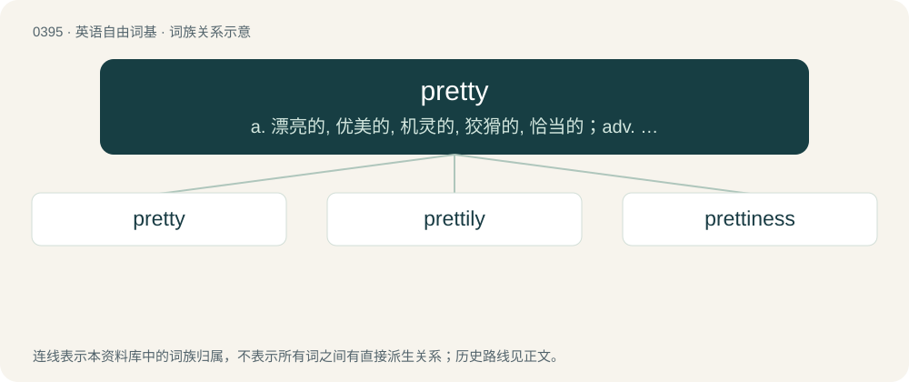

# 0455 · pretty — a. 漂亮的, 优美的, 机灵的, 狡猾的, 恰当的；adv. 相当, 颇

[总目录](../00_总目录_按常用程度.md)

**类型**：英语自由词基　｜　**来源语言**：见词源记录

## 核心含义与来源

- 核心含义：a. 漂亮的, 优美的, 机灵的, 狡猾的, 恰当的；adv. 相当, 颇
- 英文含义：Pleasant to the sight or other senses; attractive, especially of women or children.
- 词形：pretty

**来源记录 1**（形容词；Pleasant to the sight or other senses; attractive, especially of women or children.）

From Middle English prety, preti, praty, prati, from Old English prættiġ (“tricky, crafty, sly, cunning, wily, astute”), from Proto-West Germanic \*prattug, from Proto-Germanic \*prattugaz (“boastful, sly, slick, deceitful, tricky, cunning”), corresponding to prat (“trick”) + -y. Doublet of pratty. Cognate with Dutch prettig (“nice, pleasant”), Low German prettig (“funny”), Icelandic prettugur (“deceitful, tricky”). For the semantic development, compare canny, clever, cute.

## 词族图

## 单词速览（常用到不常用）

| 单词 | 音标 | 释义 |
|---|---|---|
| [pretty](#w-1) | 英 /ˈpɹɪt.i/；美 /ˈpɹɪt.i/ | a. 漂亮的, 优美的, 机灵的, 狡猾的, 恰当的；adv. 相当, 颇 |
| [prettily](#w-2) | /ˈpɹɪ.tɪ.li/ | adv. 悦人地 |
| [prettiness](#w-3) | /ˈpritinis/ | n. 漂亮, 漂亮的人 |

## 逐词详解

### 1. pretty

**词性**：名词　｜　**音标**：英 /ˈpɹɪt.i/；美 /ˈpɹɪt.i/

**中文释义**：a. 漂亮的, 优美的, 机灵的, 狡猾的, 恰当的；adv. 相当, 颇

**英文义项**：A pretty person; a term of address to a pretty person. / Something that is pretty.

**词源与演化**：

From Middle English prety, preti, praty, prati, from Old English prættiġ (“tricky, crafty, sly, cunning, wily, astute”), from Proto-West Germanic \*prattug, from Proto-Germanic \*prattugaz (“boastful, sly, slick, deceitful, tricky, cunning”), corresponding to prat (“trick”) + -y. Doublet of pratty. Cognate with Dutch prettig (“nice, pleasant”), Low German prettig (“funny”), Icelandic prettugur (“deceitful, tricky”). For the semantic development, compare canny, clever, cute.

**例句**：

> In the matter of food and clothing, we are pretty well off.

### 2. prettily

**词性**：副词　｜　**音标**：/ˈpɹɪ.tɪ.li/

**中文释义**：adv. 悦人地

**英文义项**：In a pretty manner. / Very badly; terribly.

**构词拆分**：pretty + -ly

**词源与演化**：

From Middle English pratily, prately, pratyly, pratylych; equivalent to pretty + -ly.

**例句**：

> All this is most prettily done.

该用例对应义项：in a pretty manner

### 3. prettiness

**词性**：名词　｜　**音标**：/ˈpritinis/

**中文释义**：n. 漂亮, 漂亮的人

**英文义项**：The quality of being pretty.

**构词拆分**：pretty + -ness

**词源与演化**：

From pretty + -ness.
