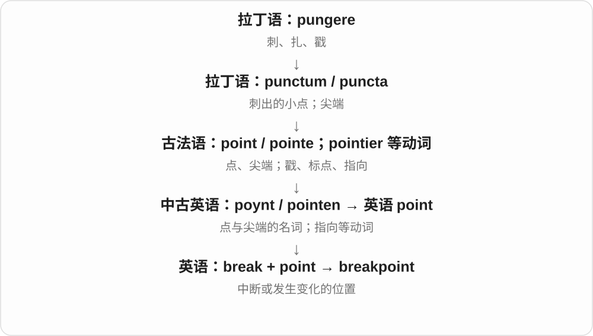

# 0456 · break — 打破、断裂；休息、突破及脱离

[逐词精讲目录](../00_逐词精讲目录.md) · [总目录](../00_总目录_按常用程度.md)

## 核心词根与来源

break 继承古英语 brecan。先读基础和可破性，再看打破者、突破、脱离；breakfast 的 fast 是禁食，breakdancing 的 break 联系音乐段落。

**BREAK：完整或连续的状态被打开**

杯子裂开、工作暂停、障碍被突破，都能从原来完整或连续的状态被打断理解。固定复合词再各看对象。

- **基础及可破性**：break · breakable · unbreakable · breakage · breaker
- **突破与脱离**：breakthrough · breakaway · jailbreak · tiebreak
- **速度与节奏**：breakneck · breakdancing
- **固定生活词**：breakfast
- **已学的其他复合词**：heartbreak · daybreak · outbreak · breakwater · breakpoint
- **breaking：打破与新闻刚刚传来**：break · breaking
- **breakdown：整体失效，或把整体分成小项**：break · breakdown
- **breakfast → breakfasts：结束禁食的一餐**：breakfast · breakfasts
- **break → breaks：打断、破裂与休息间隔**：break · breaks
- **break 与 breach：打破动作与破开的缺口**：break · breach · breaches
- **break → breaker → breakers：断开者、装置与碎浪**：break · breaker · breakers
- **debris：另源的破碎残余物**：debris
- **break + up → breakup**：breakup

## 词形与演化规律

break → breakable → unbreakable；breakage 说破损，breaker 说作用者；through 穿过、away 脱离；fast 禁食加 break 得早餐。

break + -ing；breaking news 接消息突然传开、出现的用法，不按字面译破碎的新闻。

breakdown 来自 break down，故障、崩溃线与分解、详细明细线分开举例，后者不意味着数据已经坏掉。

break 结束与 fast 禁食组合，复数可数不同份或不同天的早餐。

本族打破词延续，暂停是把连续活动断开。

breach 接古英语 bryce 的破裂名词，又受法语同源 breche 影响；不是现代 break 随意换几个字母。

完整 er 表执行者、作用物，再加复数 s。

和 break 比较打碎后的结果，不从英语 break 构词。debris 借法语 débris，接 debriser 打碎与 briser 破裂材料，更远有高卢来源分析。

break up 拆散、解体的短语转作名词 breakup；现代常说关系结束或组织解体，连写名词与分写动词对照。

## 单词速览（按词族由简到繁）

同一基础词的相关扩展放在一起，先读基础形式，再读扩展；各组之间优先读常用的。具体词源关系见各词讲解。

| 单词 | 音标 | 核心意思 |
|---|---|---|
| [break](#w-1) | /breɪk/ | 打破；断裂；中断；休息；机会 |
| [breaking](#w-20) | /ˈbreɪkɪŋ/ | 打破、断裂；刚发生、刚传来的〔尤新闻〕；break 的 -ing 形式 |
| [breakfast](#w-2) | /ˈbrekfəst/ | 早餐；吃早餐 |
| [breakfasts](#w-22) | /ˈbrekfəsts/ | 多份早餐、多次早餐；吃早餐〔第三人称单数〕 |
| [breaks](#w-23) | /breɪks/ | 休息、间隔；断裂〔复数〕；打破、中断〔第三人称单数〕 |
| [breach](#w-24) | /briːtʃ/ | 缺口、裂口；违反、违背；突破、冲破、违反 |
| [breaches](#w-25) | /ˈbriːtʃɪz/ | 缺口、违反事件〔复数〕；突破、违反〔第三人称单数〕 |
| [breakdown](#w-21) | /ˈbreɪkdaʊn/ | 故障、失灵；崩溃、中断；分类明细、分解 |
| [breakthrough](#w-4) | /ˈbreɪkθruː/ | 突破；重大进展 |
| [breakup](#w-28) | 英、美 /ˈbreɪkʌp/ | 分手；关系破裂；解体、分裂 |
| [breaker](#w-5) | 英 /ˈbreɪkə/；美 /ˈbreɪkər/ | 破坏、打破者；断路器；拍岸碎浪 |
| [breakers](#w-26) | 英 /ˈbreɪkəz/；美 /ˈbreɪkərz/ | 碎浪、翻白的海浪；断路器；打破者〔复数〕 |
| [breakaway](#w-8) | /ˈbreɪkəweɪ/ | 脱离的；分裂出去的；突围、甩开对手的行动 |
| [unbreakable](#w-9) | /ʌnˈbreɪkəbəl/ | 不易打破的；坚不可摧的；坚定的 |
| [breakage](#w-12) | /ˈbreɪkɪdʒ/ | 破损；破损物；破损损耗 |
| [breakwater](#w-13) | 英 /ˈbreɪkwɔːtə/；美 /ˈbreɪkwɔːtər/ | 防波堤；消浪结构 |
| [breakneck](#w-14) | /ˈbreɪknek/ | 快得危险的；极其迅速的 |
| [breakable](#w-16) | /ˈbreɪkəbəl/ | 易碎的；可被打破的 |
| [breakpoint](#w-17) | 英、美 /ˈbreɪkpɔɪnt/ | 断点；变化分界点 |
| [breakdancing](#w-19) | 英 /ˈbreɪkdɑːnsɪŋ/；美 /ˈbreɪkdænsɪŋ/ | 霹雳舞；breaking 舞蹈 |
| [outbreak](#w-3) | /ˈaʊtbreɪk/ | 突然发生；爆发；疫情暴发 |
| [heartbreak](#w-7) | 英 /ˈhɑːtbreɪk/；美 /ˈhɑːrtbreɪk/ | 心碎；强烈悲痛 |
| [daybreak](#w-10) | /ˈdeɪbreɪk/ | 黎明；破晓 |
| [jailbreak](#w-11) | /ˈdʒeɪlbreɪk/ | 越狱；解除设备或系统限制的行为 |
| [tiebreak](#w-18) | /ˈtaɪbreɪk/ | 平局决胜局、决胜程序 |
| [debris](#w-27) | 英 /ˈdebriː/；美 /dəˈbriː/ | 碎片、残骸、散落的残余物〔通常不可数〕 |

## 逐词讲解

### 1. break — 打破；断裂；中断；休息；机会

**音标**：/breɪk/

**先抓住这个画面**

原来完整、连着或一直不变的状态，突然开了口、断了一下。杯子破、工作停一会儿、纪录被刷新，都可用这个核心理解。

**怎么拆**

由古英语 brecan 延续，经中古英语 breken；不是按现代 br- 加 eak 拆。变化为 break—broke—broken，是历史元音交替形式。

**怎么变成今天的意思**

**古英语 brecan → 中古英语 breken**  
打破、折断

↓

**英语 break**  
破坏完整或连续状态；中断、休息、突破等引申

break a cup 打破杯子，break a rule 违反规则，break the silence 打破沉默；take a break 休息一下，a big break 重要机遇。具体义要配合对象。

**常见搭配与例句**

take a break；break a record；break the news；a lucky break。

> Let’s take a short break before the next task.

下一项任务前，我们休息一小会儿吧。

> Her performance broke the school record.

她的表现打破了学校纪录。

**别混淆**

break 打破、休息，brake 刹车，读音相同而来源、拼写不同。break the news 是告知消息，不是损坏报纸。

### 2. breaking — 打破、断裂；刚发生、刚传来的〔尤新闻〕；break 的 -ing 形式

**音标**：/ˈbreɪkɪŋ/

**先抓住这个画面**

原来连着的东西断开，是 breaking；一条新消息突然进入大家视野，新闻里就说 breaking news。

**怎么拆**

break + -ing，继承古英语 brecan 打破词族。break 也发展出消息传开、突然出现的用法，breaking news 接这一支，不是新闻物品碎了。

**怎么变成今天的意思**

**古英语 brecan → break**  
打破、断开；后来也说消息传开

↓

**break + -ing → breaking**  
打破中；消息刚传来的

breaking news 突发、最新传来的新闻；breaking a rule 违反规则；breaking the silence 打破沉默；breaking point 忍耐或承受的极限。

**常见搭配与例句**

a breaking wave；a breaking news alert。

> The radio interrupted the programme with breaking news.

电台中断节目，插播了一条突发新闻。

> He was fined for breaking the rules.

他因违反规定被罚了款。

**别混淆**

breaking 强调消息刚出现；描述这一类报道时常把 breaking news 当整体记住。broken news 不是这类新闻标签；broken 是另一种分词。

### 3. breakfast — 早餐；吃早餐

**音标**：/ˈbrekfəst/

**先抓住这个画面**

夜里一段时间没有进食，早上这顿饭把这段空腹结束掉。

**怎么拆**

中古英语 brekefast，break 结束、打破 + fast 禁食；fast 在这里不是快。所以早餐也不必吃得特别快。常用读音已弱化，不按 break 与 fast 分别完整拼读。

**怎么变成今天的意思**

**break 结束；fast 禁食**  
结束夜间不进食的时段

↓

**中古英语 brekefast → breakfast**  
早餐；吃早餐

have breakfast 吃早餐，a big breakfast 丰盛早餐；breakfast 作动词也可说早餐吃什么、在哪里吃，日常用 have breakfast 更普遍。

**常见搭配与例句**

have breakfast；a breakfast menu；breakfast cereal；bed and breakfast。

> We had breakfast before leaving the hotel.

我们离开酒店前吃了早餐。

> The price includes a simple breakfast.

价格包含一份简单早餐。

**别混淆**

breakfast 不是 fast food 快餐；eat breakfast quickly 才说早餐吃得快。一般 have breakfast 不必加 a，描述一顿丰盛早餐可说 have a big breakfast。

### 4. breakfasts — 多份早餐、多次早餐；吃早餐〔第三人称单数〕

**音标**：/ˈbrekfəsts/

**先抓住这个画面**

把早餐按每天一次、每人一份来数，就能说 breakfasts；酒店说供应多少份早餐，用的是这个可数画面。

**怎么拆**

breakfast + -s，/t/ 后读 /s/，末尾为 /sts/。中古英语 brekefast 由 break 结束与 fast 禁食组合，指结束夜间不进食的时段；现代常用读音已经弱化。

**怎么变成今天的意思**

**break 结束 + fast 禁食 → breakfast**  
结束空腹 → 早餐

↓

**breakfast + -s → breakfasts**  
多份、多次早餐；单数主语吃早餐

cooked breakfasts 热早餐；hotel breakfasts 酒店早餐；breakfasts at seven 七点吃早餐〔动词用法〕。

**常见搭配与例句**

breakfasts served downstairs；two breakfasts and a pot of tea。

> The café serves hot breakfasts until eleven.

这家咖啡馆供应热早餐到十一点。

> Our breakfasts arrived with a large pot of tea.

我们的早餐送来时，还配了一大壶茶。

**别混淆**

平时说吃早餐用 have breakfast，不必加 a；强调一份、一次或某种早餐时可用 a breakfast、breakfasts。动词 breakfast 较正式或带叙述色彩。

### 5. breaks — 休息、间隔；断裂〔复数〕；打破、中断〔第三人称单数〕

**音标**：/breɪks/

**先抓住这个画面**

连续的东西断开了，是 breaks；工作连着做，被短暂打断的一段时间，就成为一次休息。

**怎么拆**

break + -s，/k/ 后读 /s/。break 继承古英语 brecan，经中古英语 breken 等发展；现代断开动作、断口与活动暂停等名词相互关联。

**怎么变成今天的意思**

**古英语 brecan → break**  
打破、断开 → 实物破裂或连续活动中断

↓

**break + -s → breaks**  
多次休息、断裂；单数主语打破、打断

short breaks 短暂休息；coffee breaks 喝咖啡的休息时间；breaks the rules 违反规则；breaks into pieces 碎成片。

**常见搭配与例句**

breaks between lessons；breaks the silence。

> The course includes short breaks between sessions.

课程在各节之间安排了短暂休息。

> A sudden noise breaks the silence.

一声突如其来的响动打破了寂静。

**别混淆**

breaks 与 brakes 刹车常同音，拼写和当代含义不同。breaks the silence 是让沉默中断，breaks the rules 是越过规则，不必都译成砸坏。

### 6. breach — 缺口、裂口；违反、违背；突破、冲破、违反

**音标**：/briːtʃ/

**先抓住这个画面**

完整的墙、界限或约定被打破，留下一个口子，就是 breach。物理上是破口，规则上就是违反。

**怎么拆**

名词承古英语 bryce 破裂、打破，又受古法语同源 breche 影响，与 break 共享更早的日耳曼词族。英语动词后来由名词发展。

**怎么变成今天的意思**

**古英语 bryce；法语同源 breche 的影响 → breach**  
打破、裂开 → 破开的缺口；旧有违反等比喻

↓

**名词 breach → 动词及现代固定用法**  
冲开缺口；突破、违反规则或约定

a breach in a wall 墙上的缺口；a breach of the rules 违规；breach an agreement 违背约定。

**常见搭配与例句**

a security breach 安全边界被突破的事件；a breach of trust 失信。

> Water escaped through a breach in the wall.

水从墙上的缺口流了出去。

> The report described a serious breach of the rules.

报告描述了一次严重违规。

**别混淆**

breach 与 break 同源但用法不同，breach 常聚焦某个边界、约定被打破。breech 臀部、后膛等常与它同音，不能混拼。

### 7. breaches — 缺口、违反事件〔复数〕；突破、违反〔第三人称单数〕

**音标**：/ˈbriːtʃɪz/

**先抓住这个画面**

一道道边界、规则被打开口子，可以数成 breaches。动词则说某个行为正在破坏原来的约定、限制。

**怎么拆**

breach + -es，/tʃ/ 后读 /ɪz/。breach 承古英语破裂名词，并受法语同源词影响，现代与 break 共享旧词族而分工不同。

**怎么变成今天的意思**

**古英语破裂词及法语同源形式 → breach**  
打破 → 缺口、违规与突破动作

↓

**breach + -es → breaches**  
多个破口、违规事件；某事突破、违背

breaches of the rules 多次违规；data breaches 数据安全边界遭突破的事件；breaches an agreement 违反约定。

**常见搭配与例句**

several breaches 几次违规、几个缺口；breaches in the wall 墙上缺口。

> The report recorded three breaches of the rules.

报告记录了三次违规。

> The change breaches our agreement.

这项改动违背了我们的约定。

**别混淆**

breaches 可数事件，也可以是动词。a breach of a rule、breaches a rule 前者是名词带 of，后者动词直接接规则对象。

### 8. breakdown — 故障、失灵；崩溃、中断；分类明细、分解

**音标**：/ˈbreɪkdaʊn/

**先抓住这个画面**

整体撑不住而散掉，是故障、中断；主动把整体拆成小项看清楚，则是明细分解。同一个拆开画面，可以通向两种不同结果。

**怎么拆**

由 break down 打破、坍下、失效、分解等短语名词化。故障、崩溃较早，分类分析、明细的名词用法后来发展；不是每个 breakdown 都表示坏事。

**怎么变成今天的意思**

**break + down 的动词短语**  
打破、散开；失效；拆成组成部分

↓

**名词 breakdown 的分支**  
故障、中断；崩溃；各部分的分析明细

a car breakdown 汽车故障；a breakdown in communication 沟通中断；a cost breakdown 费用明细；a breakdown by age 按年龄分类的明细。

**常见搭配与例句**

a detailed breakdown；the breakdown of negotiations。

> A car breakdown delayed our trip.

汽车故障耽误了行程。

> Could you send me a breakdown of the costs?

能把费用明细发给我吗？

> There was a breakdown in communication between the two teams.

两个团队之间的沟通出了问题。

**别混淆**

breakdown 是名词，break down 是动词：a breakdown of costs；break the costs down。a breakdown of costs 是费用明细，a breakdown in talks 是谈判中断，后面的对象和介词能帮助分义。

### 9. breakthrough — 突破；重大进展

**音标**：/ˈbreɪkθruː/

**先抓住这个画面**

前面一直像有一堵墙挡着，终于穿过去，事情进入了一个新阶段。

**怎么拆**

break through 突破、穿过转成单词名词；through 是穿过，不是 throw 扔。具体突破可以是技术、谈判、调查等。

**怎么变成今天的意思**

**古英语 brecan → 中古英语 breken**  
打破、折断

↓

**英语 break**  
破坏完整或连续状态；中断、休息、突破等引申

↓

**break through → breakthrough**  
穿过阻碍 → 关键突破、进展

a major breakthrough 重大突破，a breakthrough in research 研究突破；研究里的突破不自动等于已经能广泛实际应用。

**常见搭配与例句**

make a breakthrough；a scientific breakthrough；a breakthrough in negotiations。

> The team made a breakthrough after months of failed tests.

经过几个月失败的测试，团队终于取得突破。

> The agreement marked a breakthrough in the talks.

这份协议标志着谈判取得关键进展。

**别混淆**

progress 可以是一点点进步，breakthrough 强调打通关键障碍的明显变化；不必每次小更新都叫 breakthrough。

### 10. breakup — 分手；关系破裂；解体、分裂

**音标**：英、美 /ˈbreɪkʌp/

**先抓住这个画面**

原先连在一起的一对人、一个组织，后来分开了，这次分开就是 a breakup。它把 break up 的动作变成了可以谈论的一件事。

**怎么拆**

break 打破、分开 + up 表拆散、完成 → 短语 break up，再转作名词 breakup。break 承古英语 brecan 打碎、破坏；名词还可写 break-up。

**怎么变成今天的意思**

**break up 把整体拆散、使连接解体**  
用于物体、群体及人际关系等

↓

**动词短语名词化 → breakup**  
现代可数分手事件，也可描述组织、整体解体

a painful breakup 是痛苦的分手；the breakup of a band 是乐队解散；after the breakup 是分开之后。

**常见搭配与例句**

a painful breakup；the breakup of；after the breakup。

> The song describes life after a breakup.

这首歌描写了分手后的生活。

> The documentary explains the breakup of the band.

纪录片讲述了这支乐队解散的经过。

**别混淆**

breakup 是名词，如 their breakup；动词通常分开写，如 they broke up。关系结束的人可以谈一次 breakup，机构、大片整体的解体也能使用。

### 11. breaker — 破坏、打破者；断路器；拍岸碎浪

**音标**：英 /ˈbreɪkə/；美 /ˈbreɪkər/

**先抓住这个画面**

能把连续状态打断的人或东西：规则被破、电流被切断，海浪到岸边也会翻碎。

**怎么拆**

break + -er，在中古英语已有相应形式。人、装置、波浪由不同 break 用法形成固定名词；另有少见同形词不在此串成一支。

**怎么变成今天的意思**

**古英语 brecan → 中古英语 breken**  
打破、折断

↓

**英语 break**  
破坏完整或连续状态；中断、休息、突破等引申

↓

**break + -er → breaker**  
打破者；断开装置；翻碎的浪

a rule breaker 违规者，a circuit breaker 断路器；breakers 复数常说翻卷拍碎的浪。单独 breaker 具体是哪种，靠环境判断。

**常见搭配与例句**

a circuit breaker；a rule breaker；waves breaking into breakers。

> The electrician inspected the circuit breaker.

电工检查了断路器。

> White breakers rolled towards the beach.

白色碎浪朝海滩涌来。

**别混淆**

breaker 是执行或产生作用的对象，breakage 是破损；海浪 breakers 不等于海里有什么人把东西砸坏。

### 12. breakers — 碎浪、翻白的海浪；断路器；打破者〔复数〕

**音标**：英 /ˈbreɪkəz/；美 /ˈbreɪkərz/

**先抓住这个画面**

能把完整、连续状态打断的人或东西，是 breakers。海浪临近岸边翻碎，叫 breakers；电路被断开，执行这个作用的装置也这样命名。

**怎么拆**

break 继承古英语 brecan，英语加完整 -er 形成 breaker，中古英语已有相应人物形式。现代再加复数 -s，尾 /z/。

**怎么变成今天的意思**

**古英语 brecan → break + -er → breaker**  
打破、断开 → 执行者、装置；翻碎的浪

↓

**breaker + -s → breakers**  
多个作用物、人或碎浪

circuit breakers 断路器；white breakers 翻白的碎浪；rule breakers 违反规则的人。

**常见搭配与例句**

breakers near the shore 近岸碎浪；the breakers on the panel 面板上的断路器。

> White breakers rolled towards the beach.

翻白的海浪涌向沙滩。

> The diagram labels the circuit breakers on the panel.

示意图标出了面板上的断路器。

**别混淆**

breakers 的具体对象要看搭配；不能一律译成破坏者。浪自己翻碎，装置则使电路断开，作用关系不同。

### 13. breakaway — 脱离的；分裂出去的；突围、甩开对手的行动

**音标**：/ˈbreɪkəweɪ/

**先抓住这个画面**

原来属于一个整体，后来从里面脱出来，成为单独的一股。

**怎么拆**

由 break away 脱离形成名词、形容词；不是两词短语在所有句法位置都能直接连写。

**怎么变成今天的意思**

**古英语 brecan → 中古英语 breken**  
打破、折断

↓

**英语 break**  
破坏完整或连续状态；中断、休息、突破等引申

↓

**break away → breakaway**  
脱离原整体 → 脱离者、分离的分支或突围行动

a breakaway group 分离出去的团体；a breakaway in cycling 自行车赛甩开大部队的突围；a breakaway clasp 则是受拉力时可分开的扣件。

**常见搭配与例句**

a breakaway group；a breakaway movement；a breakaway attempt。

> A breakaway group formed its own organisation.

一支脱离原团体的分支成立了自己的组织。

> The rider launched a breakaway near the end of the race.

那位车手在比赛接近结束时发起突围。

**别混淆**

break away 两词是动词短语，breakaway 单词常是名词、形容词：The group broke away，a breakaway group。

### 14. unbreakable — 不易打破的；坚不可摧的；坚定的

**音标**：/ʌnˈbreɪkəbəl/

**先抓住这个画面**

经得住冲击、压力或考验，难被破坏；讲友情、意志时常带夸张和赞美。

**怎么拆**

un- 不 + breakable 可打破的，否定整个形容词，不是 unbreak + -able 这一普通现代动词派生。

**怎么变成今天的意思**

**古英语 brecan → 中古英语 breken**  
打破、折断

↓

**英语 break**  
破坏完整或连续状态；中断、休息、突破等引申

↓

**breakable → unbreakable**  
可打破 → 难以或不能打破

an unbreakable bond 牢固的关系，an unbreakable rule 不可破的规矩；产品宣传说 unbreakable 不等于任何条件下都绝对不会损坏。

**常见搭配与例句**

an unbreakable bond；unbreakable glass；unbreakable resolve。

> They formed an unbreakable bond during the expedition.

他们在探险中结下了牢固的情谊。

> Her unbreakable resolve impressed the team.

她坚定不移的决心给团队留下了深刻印象。

**别混淆**

unbreakable 强调难破或不可破，unbroken 强调目前没有断、未被打破；an unbroken record 不说明未来也破不了。

### 15. breakage — 破损；破损物；破损损耗

**音标**：/ˈbreɪkɪdʒ/

**先抓住这个画面**

不只说某样东西破了，还把搬运、生产中破坏掉的这一部分算成一类损耗。

**怎么拆**

break + -age，形成破损过程、结果或破损数量等名词。-age 在这里不表示人的年龄。

**怎么变成今天的意思**

**古英语 brecan → 中古英语 breken**  
打破、折断

↓

**英语 break**  
破坏完整或连续状态；中断、休息、突破等引申

↓

**break + -age → breakage**  
打破 → 破损、破损损耗

damage and breakage 损坏与破损，reduce breakage 减少破损；hair breakage 则是发丝断裂，不等于头发从根部脱落。

**常见搭配与例句**

reduce breakage；allow for breakage；hair breakage。

> Better packaging reduced breakage during transport.

改进包装减少了运输中的破损。

> The salon recommended gentler brushing to reduce hair breakage.

美发店建议梳头轻柔一些，以减少发丝断裂。

**别混淆**

breakage 常看破损现象或损耗，break 可以是一个断口、休息等；a coffee break 不能写 coffee breakage。

### 16. breakwater — 防波堤；消浪结构

**音标**：英 /ˈbreɪkwɔːtə/；美 /ˈbreɪkwɔːtər/

**先抓住这个画面**

海浪打过来，先撞上这道结构，港内就少受浪力冲击。

**怎么拆**

break + water，break 抓打散、削弱水浪力量，不是要把水分子打碎。与荷兰语 breekwater 等有对应构词。

**怎么变成今天的意思**

**break；water**  
并列组合部分

↓

**breakwater**  
削弱波浪力量、保护水域的结构

a harbor breakwater 港口防波堤，waves hit the breakwater 海浪拍打防波堤。按防浪用途命名，结构和位置有不同形式。

**常见搭配与例句**

a harbor breakwater；build a breakwater；waves hit the breakwater。

> Fishing boats sheltered behind the breakwater.

渔船在防波堤后避浪。

> Waves crashed against the breakwater.

海浪猛烈拍打防波堤。

**别混淆**

breakwater 主要削弱浪力，dam 水坝主要拦蓄或调控水流；都能用石、混凝土建，但用途不相同。

### 17. breakneck — 快得危险的；极其迅速的

**音标**：/ˈbreɪknek/

**先抓住这个画面**

快到像可能摔断脖子的程度；现代大多是在夸张地强调速度和风险。

**怎么拆**

break 折断 + neck 脖子，形成危险、猛烈的形容词，现代常紧接 speed、pace。不是每次使用都真的发生颈部受伤。

**怎么变成今天的意思**

**break 折断；neck 脖子**  
并列构词部分

↓

**breakneck**  
危险到可能摔伤的 → 极快、猛烈的

at breakneck speed 以极快速度，a breakneck pace 极快节奏；可以说车辆，也可以说组织、技术变化的速度。

**常见搭配与例句**

at breakneck speed；a breakneck pace；breakneck growth。

> The story moves at a breakneck pace.

故事推进得飞快。

> The industry expanded at breakneck speed.

这个行业以令人咋舌的速度扩张。

**别混淆**

fast 快可中性，breakneck 强调惊人、可能不安全或难以跟上的程度；不要把普通准时完成都写成 breakneck。

### 18. breakable — 易碎的；可被打破的

**音标**：/ˈbreɪkəbəl/

**先抓住这个画面**

碰一下、摔一下可能会坏，或者某种记录、约束并非永远不能打破。

**怎么拆**

break + -able 可……的；-able 表可能性、可承受动作，不说明一定已经破了。

**怎么变成今天的意思**

**古英语 brecan → 中古英语 breken**  
打破、折断

↓

**英语 break**  
破坏完整或连续状态；中断、休息、突破等引申

↓

**break + -able → breakable**  
能被打破 → 易碎或可打破的

breakable glassware 易碎玻璃器皿，breakable items 易碎物品；breakables 作复数名词可指这些易碎品。

**常见搭配与例句**

breakable items；breakable glass；pack breakables carefully。

> Wrap the breakable items in soft cloth.

用软布包好易碎物品。

> These cups are breakable, so please handle them carefully.

这些杯子易碎，请小心拿放。

**别混淆**

breakable 可能破，broken 已经破；fragile 易碎、脆弱与前者有交叠，但语境和搭配不全相同。

### 19. breakpoint — 断点；变化分界点

**音标**：英、美 /ˈbreɪkpɔɪnt/

**先抓住这个画面**

过程走到这里，先停下来，或者开始按另一种方式运行。

**怎么拆**

break“中断、改变” + point，英语合成。

**怎么变成今天的意思**

调试程序时，breakpoint 让执行在指定位置暂停；网页布局里的 breakpoint 是改变布局规则的宽度界限。这是两个具体技术用法。

**常见搭配与例句**

set a breakpoint；hit a breakpoint；a responsive breakpoint。

> Set a breakpoint before the file is opened.

在打开文件之前设置一个断点。

> Below this breakpoint, the menu changes to a single column.

低于这个布局分界宽度时，菜单改成单列。

**别混淆**

breaking point 常分开写，偏“承受极限”；调试中的 breakpoint 是人为设置的暂停位置。

### 20. breakdancing — 霹雳舞；breaking 舞蹈

**音标**：英 /ˈbreɪkdɑːnsɪŋ/；美 /ˈbreɪkdænsɪŋ/

**先抓住这个画面**

常见地板动作、定格和旋转的一类舞蹈；名字里的 break 抓的是音乐的间奏、节奏段落，不是把身体摔坏。

**怎么拆**

break + dancing，背景联系嘻哈音乐中强调打击乐的 break 段落及其舞蹈。舞者和比赛语境也常用 breaking 这一名称。

**怎么变成今天的意思**

**break 音乐中的间奏、节奏段落；dancing 跳舞**  
并列构词部分

↓

**breakdancing**  
围绕这种节奏文化发展的一类舞蹈

a breakdancing class 霹雳舞课，a breakdancing performance 霹雳舞表演；具体动作并不只剩旋转，也有站立步法等。

**常见搭配与例句**

a breakdancing class；a breakdancing crew；a breakdancing performance。

> The festival included a breakdancing performance.

节庆活动包含一场霹雳舞表演。

> She joined a beginner’s breakdancing class.

她参加了霹雳舞入门班。

**别混淆**

breakdancing 不是 break + dancing 表示跳舞中途休息；take a break from dancing 才是跳累了休息一会儿。

### 21. outbreak — 突然发生；爆发；疫情暴发

**音标**：/ˈaʊtbreɪk/

**先抓住这个画面**

原本没有显露或受控制的事情，突然冲出来。

**怎么拆**

out＋break，与 break out 的动词表达相关。英语早有表示冲出、逃出的 outbreak 动词；常用名词把突然爆发的事件命名出来。

**怎么变成今天的意思**

**英语 out；break，以及 break out 的表达**  
冲出、突然发生

↓

**较早动词 outbreak；后来名词 outbreak**  
冲破限制；突发事件

↓

**现代名词 outbreak**  
疾病、冲突等突然发生或集中出现

an outbreak of violence 是暴力突然出现；a disease outbreak 是疾病在一段时间和地点内异常出现或增加。out 不要求事件发生在室外，核心是事情显露、爆发了。

**常见搭配与例句**

an outbreak of disease；the outbreak of war；an outbreak of violence。

> The talks were interrupted by an outbreak of violence.

突然爆发的暴力事件打断了谈判。

> The report describes a local outbreak of measles.

报告描述了一次当地的麻疹暴发。

**别混淆**

outbreak 是名词；break out 是动词短语：a fire broke out。不要把它当普通火苗向外“折断”。

### 22. heartbreak — 心碎；强烈悲痛

**音标**：英 /ˈhɑːtbreɪk/；美 /ˈhɑːrtbreɪk/

**先抓住这个画面**

把深受伤害的感情想成心被打碎，强调难以承受的失落。

**怎么拆**

heart 内心 + break 破碎，形成情感伤痛名词。不是在报告器官真的碎裂。

**怎么变成今天的意思**

**heart 内心、感情；break 破碎**  
并列构词部分

↓

**heartbreak**  
内心仿佛破碎的强烈悲痛

the heartbreak of losing someone 失去某人的悲痛；a story of love and heartbreak 爱与心碎的故事。失恋之外，失去亲人、愿望破灭等也可造成 heartbreak。

**常见搭配与例句**

cause heartbreak；love and heartbreak；the heartbreak of loss。

> The novel follows a family through years of hope and heartbreak.

小说讲述一家人多年来的希望与悲痛。

> Missing the final by one point brought real heartbreak to the team.

差一分没能进决赛，让全队无比难过。

**别混淆**

heartbreak 不只限于恋爱；disappointment 可是一般失望，heartbreak 通常程度更深。

### 23. daybreak — 黎明；破晓

**音标**：/ˈdeɪbreɪk/

**先抓住这个画面**

黑夜的幕布被光撕开一道口子。

**怎么拆**

day 白天 + break 破开、开始显现；白昼突破黑暗是理解这个组合的画面，不代表一天真的断裂。

**怎么变成今天的意思**

**英语 day；break**  
白昼；破开、开始

↓

**daybreak**  
天开始亮的时刻

at daybreak 是天刚亮时。它强调光开始出现，和 sunrise 太阳露出地平线不完全相同；天空可以先变亮，随后太阳才升起。

**常见搭配与例句**

at daybreak；before daybreak；leave at daybreak。

> We set out at daybreak to avoid the heat.

我们天刚亮就出发，避开炎热。

> The birds began singing before daybreak.

天还没亮，鸟就开始鸣叫了。

**别混淆**

daybreak 和 dawn 常可互换；sunrise 更明确指太阳升起。不要把 daybreak 当成白天的休息 break。

### 24. jailbreak — 越狱；解除设备或系统限制的行为

**音标**：/ˈdʒeɪlbreɪk/

**先抓住这个画面**

原来被关在一个有边界的空间里，现在突破边界出去；技术领域借用这幅图景。

**怎么拆**

jail 监狱 + break 突破，复合成越狱名词并可作动词。计算机、设备以及 AI 语境里，借指突破原有软件限制或约束，具体对象不同。

**怎么变成今天的意思**

**jail 监狱；break 突破**  
并列构词部分

↓

**jailbreak**  
逃出监狱 → 技术语境中的限制突破

a jailbreak in a film 电影中的越狱；a device jailbreak 设备越狱。软件里看到这个词，先确认是在讨论哪一种限制，而不把所有修改都叫它。

**常见搭配与例句**

a jailbreak attempt；a fictional jailbreak；a device jailbreak。

> The film begins with a dramatic jailbreak.

电影以一场戏剧性的越狱开场。

> The article explains what a device jailbreak means.

文章解释了设备越狱这个词的含义。

**别混淆**

jailbreak 固定强调突破禁闭、限制；breakaway 只说从某整体脱离，不一定有监狱或技术限制背景。

### 25. tiebreak — 平局决胜局、决胜程序

**音标**：/ˈtaɪbreɪk/

**先抓住这个画面**

双方打成平手，得再用一套规定把这个平局打破，分出结果。

**怎么拆**

tie 平局 + break 打破；也常写 tie-break，另有 tiebreaker 决胜者、决胜办法等相关词。不是拿剪刀剪断领带。

**怎么变成今天的意思**

**tie 平局；break 打破**  
并列构词部分

↓

**tiebreak**  
用于打破平局的决胜局、程序

a tennis tiebreak 网球抢七或其他规定形式的决胜局；具体分数、赛制依比赛规则，词本身只交代用于打破平局。

**常见搭配与例句**

win a tiebreak；play a tiebreak；a final-set tiebreak。

> The players reached a tiebreak in the first set.

双方在第一盘进入了平局决胜局。

> She won the match after a tense tiebreak.

经过紧张的平局决胜局，她赢下了比赛。

**别混淆**

tie 平局，tiebreak 打破平局的办法或局；不能把所有正常最后一局都叫 tiebreak。

### 26. debris — 碎片、残骸、散落的残余物〔通常不可数〕

**音标**：英 /ˈdebriː/；美 /dəˈbriː/

**先抓住这个画面**

东西被撞坏、拆掉后，地上散着木块、玻璃、碎石，这一片残余统称 debris。它像把“破碎后留下的一堆”整体拍进镜头。

**怎么拆**

借法语 débris 残余物，接旧动词 debriser 打碎、压碎，其中 de- 与 briser 破裂结合；更远可能接高卢材料。末尾 s 是借词拼写，通常不发音。

**怎么变成今天的意思**

**法语 de- + briser → debriser 打碎**  
briser 更远有高卢来源分析

↓

**法语 débris → 英语 debris**  
破碎后残余物；英语通常不可数，末尾 s 不读

clear away debris 是清理残余物；pieces of debris 数碎片；space debris 是太空碎片，仍常按整体材料说。

**常见搭配与例句**

building debris；floating debris；clear debris；pieces of debris。

> Workers cleared debris from the road.

工人们清走了路上的残骸。

> A piece of debris was floating near the boat.

船边漂着一块碎片。

**别混淆**

debris 通常不是普通可数复数；说 The debris was removed，数一块用 a piece of debris，不因末尾 s 就配 are。

## 这一组要分清什么

break 不等于 brake；breakfast 不是快餐；breakdancing 不是跳舞休息，breakthrough 不是普通小改动。

## 串起来练习

After a short break and some breakfast, the team finally made a breakthrough.

短暂休息、吃过早餐后，团队终于取得了突破。
