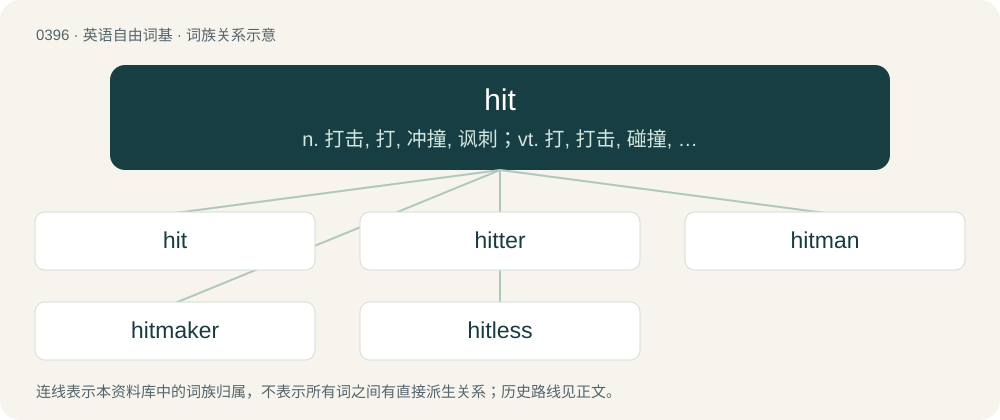

# 0456 · hit — n. 打击, 打, 冲撞, 讽刺；vt. 打, 打击, 碰撞, 打中, 袭击, 偶然碰上；vi. 打, 打中, 打击, 碰撞, 偶然碰上

[总目录](../00_总目录_按常用程度.md)

**类型**：英语自由词基　｜　**来源语言**：见词源记录

## 核心含义与来源

- 核心含义：n. 打击, 打, 冲撞, 讽刺；vt. 打, 打击, 碰撞, 打中, 袭击, 偶然碰上；vi. 打, 打中, 打击, 碰撞, 偶然碰上
- 英文含义：To administer a blow to, directly or with a weapon or missile.
- 词形：hit

**多个词源／构词路径**：同一拼写可能有不同来源；以下按词性和含义分别列出。

**来源记录 1**（动词；To administer a blow to, directly or with a weapon or missile.）

Inherited from Middle English hitten (“to hit, strike, make contact with”), from Old English hittan (“to meet with, come upon, fall in with”), from Old Norse hitta (“to strike, meet”), from Proto-Germanic \*hittijaną (“to come upon, find”), from Proto-Indo-European \*kh₂eyd- (“to fall; fall upon; hit; cut; hew”). Cognates Cognate with West Frisian hitte (“to meet”), Dutch hitten (“to hit, encounter”), Danish hitte (“to find”), Faroese, Icelandic, Swedish hitta (“to meet”), Norwegian Nynorsk hitta, hitte (“to meet; to find”), Latin caedō (“to kill”), Albanian qit (“to hit, throw, pull out, release”). Probably also related to Dutch hei (“mallet”), German Heie (“wooden hammer, mallet”). (something very successful): Compare typologically striking, Russian порази́тельный (porazítelʹnyj) (&lt;~ порази́ть (porazítʹ) &lt;~ рази́ть (razítʹ)).

**来源记录 2**（代词；It.）

From Middle English hit (“it”), from Old English hit (“it”), from Proto-Germanic \*hit (“this, this one”), from Proto-Indo-European \*ḱe-, \*ḱey- (“this, here”). Cognate with Dutch het (“it”). More at it; also note 'it.

## 词族图

## 单词速览（常用到不常用）

| 单词 | 音标 | 释义 |
|---|---|---|
| [hit](#w-1) | /hɪt/ | n. 打击, 打, 冲撞, 讽刺；vt. 打, 打击, 碰撞, 打中, 袭击, 偶然碰上；vi. 打, 打中, 打击, 碰撞, 偶然碰上 |
| [hitter](#w-2) | 英 /ˈhɪtə(ɹ)/；美 /ˈhɪtɚ/ | n. 打手, 打击的人 |
| [hitman](#w-3) | /ˈhɪtmæːn/ | n. 职业杀手 |
| [hitmaker](#w-4) |  | 【英文】A musician who frequently produces hits; a star. |
| [hitless](#w-5) |  | a. hit的变形 |

## 逐词详解

### 1. hit

**词性**：动词　｜　**音标**：/hɪt/

**中文释义**：n. 打击, 打, 冲撞, 讽刺；vt. 打, 打击, 碰撞, 打中, 袭击, 偶然碰上；vi. 打, 打中, 打击, 碰撞, 偶然碰上

**英文义项**：To administer a blow to, directly or with a weapon or missile. / To come into contact with forcefully and suddenly.

**词源与演化**：

Inherited from Middle English hitten (“to hit, strike, make contact with”), from Old English hittan (“to meet with, come upon, fall in with”), from Old Norse hitta (“to strike, meet”), from Proto-Germanic \*hittijaną (“to come upon, find”), from Proto-Indo-European \*kh₂eyd- (“to fall; fall upon; hit; cut; hew”). Cognates Cognate with West Frisian hitte (“to meet”), Dutch hitten (“to hit, encounter”), Danish hitte (“to find”), Faroese, Icelandic, Swedish hitta (“to meet”), Norwegian Nynorsk hitta, hitte (“to meet; to find”), Latin caedō (“to kill”), Albanian qit (“to hit, throw, pull out, release”). Probably also related to Dutch hei (“mallet”), German Heie (“wooden hammer, mallet”). (something very successful): Compare typologically striking, Russian порази́тельный (porazítelʹnyj) (&lt;~ порази́ть (porazítʹ) &lt;~ рази́ть (razítʹ)).

**例句**：

> If intelligence had been what it should have been, I don't think we'd ever have hit that island.

该用例对应义项：To attack, especially amphibiously.

### 2. hitter

**词性**：名词　｜　**音标**：英 /ˈhɪtə(ɹ)/；美 /ˈhɪtɚ/

**中文释义**：n. 打手, 打击的人

**英文义项**：One who or that which hits. / An assassin for hire; a hitman.

**构词拆分**：hit + -er (agent noun suffix)

**词源与演化**：

From hit + -er (agent noun suffix) or -er (measurement suffix).

**例句**：

> The boxer was renowned as a hard hitter.

该用例对应义项：One who or that which hits.

### 3. hitman

**词性**：名词　｜　**音标**：/ˈhɪtmæːn/

**中文释义**：n. 职业杀手

**英文义项**：A male contract killer, especially one paid by a mafia. / A goalscorer; someone who scores goals.

**构词拆分**：From hit (“to murder”) + -man.

**词源与演化**：

From hit (“to murder”) + -man.

**例句**：

> Layla hired a hitman to kill her former husband.

### 4. hitmaker

**词性**：名词

**英文义项**：A musician who frequently produces hits; a star.

**构词拆分**：hit + maker

**词源与演化**：

From hit + maker.

### 5. hitless

**词性**：形容词

**中文释义**：a. hit的变形

**英文义项**：Without any successful songs. / Having failed to make any base hits over a period of time, usually one game.

**构词拆分**：hit + -less

**词源与演化**：

From hit + -less.

**例句**：

> You get an achievement for pulling off a hitless first area.

该用例对应义项：Completed without taking damage (getting hit).
