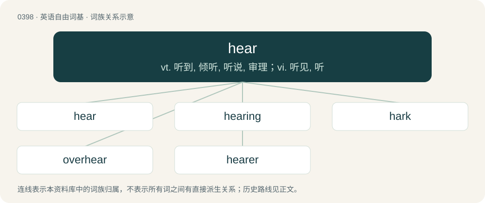

# 0458 · hear — vt. 听到, 倾听, 听说, 审理；vi. 听见, 听

[总目录](../00_总目录_按常用程度.md)

**类型**：英语自由词基　｜　**来源语言**：见词源记录

## 核心含义与来源

- 核心含义：vt. 听到, 倾听, 听说, 审理；vi. 听见, 听
- 英文含义：To perceive sounds through the ear.
- 词形：hear

**来源记录 1**（动词；To perceive sounds through the ear.）

From Middle English har, heoren, her, here, heren, from Old English hēran, hīeran, hīran, hȳran (“to hear”), from Proto-West Germanic \*hauʀijan, from Proto-Germanic \*hauzijaną (“to hear”), from Proto-Indo-European \*h₂ḱh₂owsyéti (“to be sharp-eared”), from \*h₂eḱ- (“sharp”) + \*h₂ows- (“ear”) + \*-yéti (denominative suffix). Cognates Cognate with North Frisian hear, hiar, hiir, hiire (“to hear”), Saterland Frisian heere, here (“to hear”), West Frisian hearre (“to hear”), Bavarian hearn (“to hear”), Central Franconian hüre (“to hear”), Cimbrian hòrran, höarn (“to hear”), Dutch horen (“to hear”), German and Low German hören (“to hear”), Luxembourgish héieren (“to hear”), Yiddish הערן (hern, “to hear”), Danish and Norwegian Bokmål høre (“to hear”), Elfdalian ära (“to hear”), Faroese hoyra (“to hear”), Icelandic heyra (“to hear”), Norwegian Nynorsk haur, høra, høre, høyra, høyre (“to hear”), Swedish höra (“to hear”), Gothic 𐌷𐌰𐌿𐍃𐌾𐌰𐌽 (hausjan, “to hear”); also Greek ακούγω (akoúgo), ακούω (akoúo, “to hear”), Italiot Greek κούω (koúo, “to hear”), Tocharian B āks- (“to awaken”).

## 词族图

## 单词速览（常用到不常用）

| 单词 | 音标 | 释义 |
|---|---|---|
| [hear](#w-1) | 英 /ˈhɪə/；美 /ˈhɪɚ/ | vt. 听到, 倾听, 听说, 审理；vi. 听见, 听 |
| [hearing](#w-2) | 英 /ˈhɪə.ɹɪŋ/；美 /ˈhɪɹ.ɪŋ/ | n. 听, 听觉, 听讯；\[医\] 听, 听觉 |
| [hark](#w-3) | /hɑː(ɹ)k/ | vi. 倾听 |
| [overhear](#w-4) | 美 /oʊ.vɚˈhɪɚ/ | vt. 无意中听到, 偷听 |
| [hearer](#w-5) | 英 /ˈhɪəɹə/；美 /ˈhɪɹɚ/ | n. 听者, 听众 |

## 逐词详解

### 1. hear

**词性**：动词　｜　**音标**：英 /ˈhɪə/；美 /ˈhɪɚ/

**中文释义**：vt. 听到, 倾听, 听说, 审理；vi. 听见, 听

**英文义项**：To perceive sounds through the ear. / To perceive (a sound, or something producing a sound) with the ear, to recognize (something) in an auditory way.

**词源与演化**：

From Middle English har, heoren, her, here, heren, from Old English hēran, hīeran, hīran, hȳran (“to hear”), from Proto-West Germanic \*hauʀijan, from Proto-Germanic \*hauzijaną (“to hear”), from Proto-Indo-European \*h₂ḱh₂owsyéti (“to be sharp-eared”), from \*h₂eḱ- (“sharp”) + \*h₂ows- (“ear”) + \*-yéti (denominative suffix). Cognates Cognate with North Frisian hear, hiar, hiir, hiire (“to hear”), Saterland Frisian heere, here (“to hear”), West Frisian hearre (“to hear”), Bavarian hearn (“to hear”), Central Franconian hüre (“to hear”), Cimbrian hòrran, höarn (“to hear”), Dutch horen (“to hear”), German and Low German hören (“to hear”), Luxembourgish héieren (“to hear”), Yiddish הערן (hern, “to hear”), Danish and Norwegian Bokmål høre (“to hear”), Elfdalian ära (“to hear”), Faroese hoyra (“to hear”), Icelandic heyra (“to hear”), Norwegian Nynorsk haur, høra, høre, høyra, høyre (“to hear”), Swedish höra (“to hear”), Gothic 𐌷𐌰𐌿𐍃𐌾𐌰𐌽 (hausjan, “to hear”); also Greek ακούγω (akoúgo), ακούω (akoúo, “to hear”), Italiot Greek κούω (koúo, “to hear”), Tocharian B āks- (“to awaken”).

**例句**：

> I could hear them quarreling upstairs, but didn’t really listen to their argument.

该用例对应义项：To perceive (a sound, or something producing a sound) with the ear, to recognize (something) in an auditory way.

### 2. hearing

**词性**：形容词　｜　**音标**：英 /ˈhɪə.ɹɪŋ/；美 /ˈhɪɹ.ɪŋ/

**中文释义**：n. 听, 听觉, 听讯；\[医\] 听, 听觉

**英文义项**：Able to hear, as opposed to deaf.

**构词拆分**：hear + -ing

**词源与演化**：

From Middle English herynge, equivalent to hear + -ing.

**例句**：

> Deaf people often must deal with hearing people.

该用例对应义项：Able to hear, as opposed to deaf.

### 3. hark

**词性**：名词　｜　**音标**：/hɑː(ɹ)k/

**中文释义**：vi. 倾听

**英文义项**：A whisper

**构词拆分**：hear + -k

**词源与演化**：

From Middle English herken, herkien, from Old English \*hercian, \*heorcian, \*hiercian, from Proto-West Germanic \*hauʀikōn, \*hauʀukōn, derived ultimately from Proto-Germanic \*hauzijaną (“to hear”) + formative/intensive -k (see also the related hīeran, whence English hear). Equivalent to hear + -k. Cognate with Scots herk (“to hark”), North Frisian harke (“to hark”), West Frisian harkje (“to listen”), obsolete Dutch horken (“to hark, listen to”), Middle Low German horken (“to hark”), German horchen (“to hark, harken to”).

**例句**：

> Hark! midnight from the church tower vibrates through the frosty air.

### 4. overhear

**词性**：动词　｜　**音标**：美 /oʊ.vɚˈhɪɚ/

**中文释义**：vt. 无意中听到, 偷听

**英文义项**：To hear something that was not meant for one's ears.

**构词拆分**：over- + hear

**词源与演化**：

From Middle English overheren, from Old English oferhīeran (“to overhear, hear, disobey, disregard, neglect”), equivalent to over- + hear. Cognate with Dutch overhoren (“to hear, hear about”), German überhören (“to not hear, ignore”), Danish overhøre (“to overhear”), Icelandic yfirheyra (“to hear”), Gothic \*𐌿𐍆𐌰𐍂𐌷𐌰𐌿𐍃𐌾𐌰𐌽 (\*ufarhausjan, “to disregard, disobey”) (in 𐌿𐍆𐌰𐍂𐌷𐌰𐌿𐍃𐌴𐌹𐌽𐍃 (ufarhauseins)).

**例句**：

> Tom and Mary were speaking loud enough for John to overhear them.

### 5. hearer

**词性**：名词　｜　**音标**：英 /ˈhɪəɹə/；美 /ˈhɪɹɚ/

**中文释义**：n. 听者, 听众

**英文义项**：One who hears. / A person who regularly attends sermons; a devout listener.

**构词拆分**：hear + -er

**词源与演化**：

From Middle English heerar, herere, hyerere, equivalent to hear + -er.
