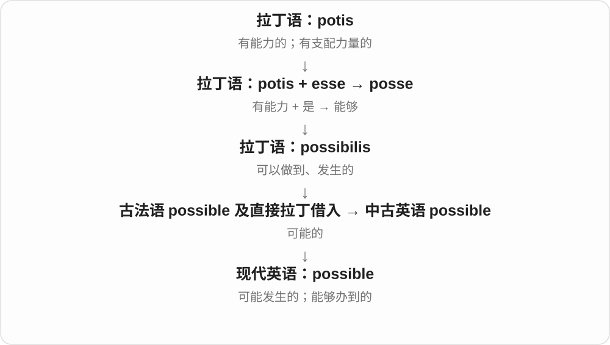
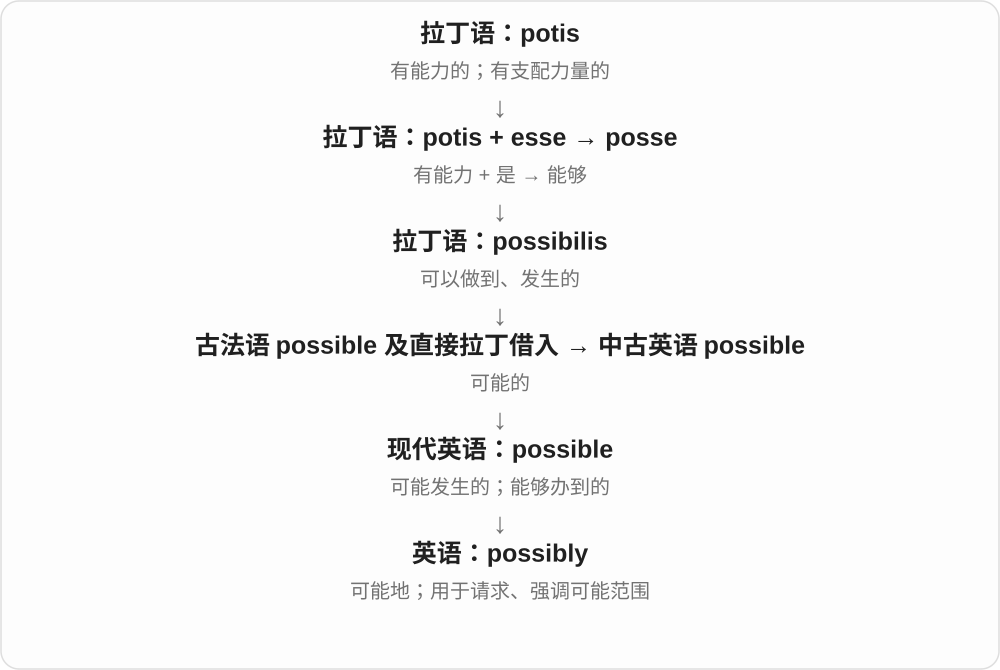
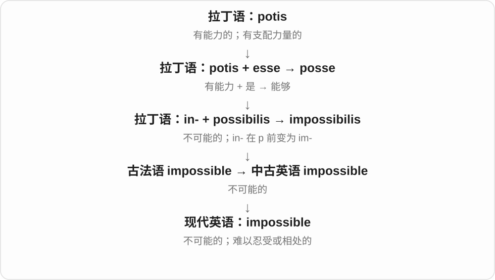

# 0459 · possible — 可能；能够实现

[逐词精讲目录](../00_逐词精讲目录.md) · [总目录](../00_总目录_按常用程度.md)

## 核心词根与来源

possible 经法语来自拉丁 possibilis，联系 posse 能够。impossible 否定这种可行或可能，possibly 把可能作为判断的语气。

**POSSIBLE：事情能够发生或做成**

先问能不能发生，再问可能性有多大。

- **能否实现**：possible · impossible
- **判断语气**：possibly

## 词形与演化规律

im- 是 in- 在 p 前同化的否定形式；possible + -ly → possibly。possible 不是“概率一定很高”的保证。

## 单词速览（按词族由简到繁）

同一基础词的相关扩展放在一起，先读基础形式，再读扩展；各组之间优先读常用的。具体词源关系见各词讲解。

| 单词 | 音标 | 核心意思 |
|---|---|---|
| [possible](#w-1) | 英 /ˈpɒsəbəl/；美 /ˈpɑːsəbəl/ | 可能的；办得到的；可考虑的 |
| [possibly](#w-3) | 英 /ˈpɒsəbli/；美 /ˈpɑːsəbli/ | 也许；可能；究竟、到底；尽可能 |
| [impossible](#w-2) | 英 /ɪmˈpɒsəbəl/；美 /ɪmˈpɑːsəbəl/ | 不可能的；难以忍受或应付的 |

## 逐词讲解

### 1. possible — 可能的；办得到的；可考虑的

**音标**：英 /ˈpɒsəbəl/；美 /ˈpɑːsəbəl/

**先抓住这个画面**

possible 的门还开着：这件事能发生，或有办法做到，但不保证一定发生。

**怎么拆**

经古法语或直接来自拉丁 possibilis，源于 posse“能够”；poss- 是这条拉丁词形留下的痕迹，不能拆成英语 possess。

**怎么变成今天的意思**

It is possible to do... 说事情做得到；a possible explanation 是一种可以考虑的解释。as soon as possible 是在条件允许的范围内尽快。

**常见搭配与例句**

if possible；as soon as possible；a possible explanation；make it possible to。

> It is possible to reach the island by boat.

可以乘船到达那座岛。

> A loose cable is one possible explanation for the problem.

电缆松动是这个问题的一种可能原因。

**别混淆**

possible 只要求存在可能；probable 表示更有理由预期它会发生。possible 不是“概率很高”。

### 2. possibly — 也许；可能；究竟、到底；尽可能

**音标**：英 /ˈpɒsəbli/；美 /ˈpɑːsəbli/

**先抓住这个画面**

possibly 像在判断旁边放一个小问号：“有这个可能，但我还不确定。”

**怎么拆**

possible + -ly；词尾 -ble 变成 -bly。

**怎么变成今天的意思**

It could possibly work 留有不确定性。Could you possibly...? 让请求更委婉；I can’t possibly... 则往往强烈表示实在做不到。

**常见搭配与例句**

possibly because；could possibly；could you possibly；can’t possibly。

> We may possibly finish before lunch.

我们也许能在午饭前完成。

> Could you possibly move your bag from this seat?

能麻烦你把包从这个座位上挪开吗？

**别混淆**

possibly 往往比 probably 更不确定；can’t possibly 中的它不是把否定减弱，而是在强调不可能。

### 3. impossible — 不可能的；难以忍受或应付的

**音标**：英 /ɪmˈpɒsəbəl/；美 /ɪmˈpɑːsəbəl/

**先抓住这个画面**

impossible 像一扇完全关上的门；口语中也会夸张地说“这人真让人没办法”。

**怎么拆**

经古法语来自拉丁 impossibilis：否定 in- 在 p 前同化成 im-，加 possibilis；现代清楚对应 im- + possible。

**怎么变成今天的意思**

impossible to finish 是没法完成。You’re impossible! 通常是抱怨对方难相处、不讲道理，并不是说这个人不存在。

**常见搭配与例句**

be impossible to do；make it impossible for；an impossible task；next to impossible。

> Without the key, it was impossible to open the cabinet.

没有钥匙，根本打不开柜子。

> You keep changing your mind—you’re impossible!

你总是改主意，真拿你没办法！

**别混淆**

difficult 表示很难，仍可能做到；impossible 在严格用法中排除可能，口语则可夸张地说难得受不了。

## 这一组要分清什么

possible 是有可能，probable 是较有可能；possibly 的语气通常比 probably 更不确定。

## 串起来练习

It is possible, but I cannot possibly finish it today.

这件事可以做到，但我今天实在不可能完成。
