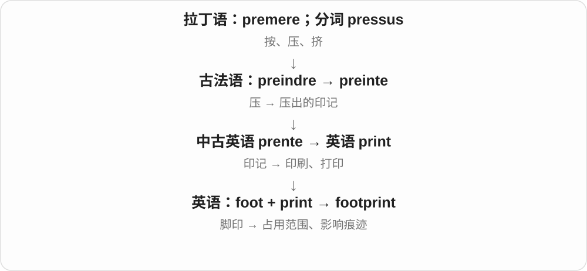

# 0460 · foot — 脚；底部；支撑、步行与英尺

[逐词精讲目录](../00_逐词精讲目录.md) · [总目录](../00_总目录_按常用程度.md)

## 核心词根与来源

foot 接古英语 fōt；feet 是不规则复数。footage 通过胶片的英尺长度保留了旧材料时代的名字。

**FOOT：脚支撑、移动，也给底部与测量命名**

先分身体的脚、东西的底部、英尺单位三条用途，再看复合词的另一半决定具体意思。

- **脚、穿戴与站立移动**：foot · barefoot · footwear · footing · foothold · footstep · footfall · footprint · footwork
- **路径、位置与自由行动**：footpath · footbridge · foothill · underfoot · afoot · footloose
- **底部、测量及固定名称**：football · footnote · footer · footage · footstool · footlocker · footman
- **foot 与 feet：脚和英尺**：foot · feet
- **footnote 的脚注名与加注动作**：footnote · footnotes · footnoted · footnoting
- **foot 的下部、底部义进入舞台脚灯**：footlights
- **foot + step → footsteps**：footsteps

## 词形与演化规律

foot → barefoot、footwear；footing、foothold、footstep、footfall、footprint、footwork；footpath、footbridge、foothill、underfoot；afoot、footloose；football、footnote、footer、footage、footstool、footlocker、footman。

foot → feet 保留旧 i 变音。数值后说 several feet；数词加单位在名词前作复合修饰时常用单数 foot。

foot 取页面底部位置，note 取注释；组合名词再发展动词。

foot + light + -s，说舞台前沿下方的一排灯；脚的位置帮助认形，实际是剧场照明名称。

footstep 由脚与步构成，现代 -s，/p/ 后读 /s/。脚步、脚步声与跟随前人道路的比喻。

## 单词速览（按词族由简到繁）

同一基础词的相关扩展放在一起，先读基础形式，再读扩展；各组之间优先读常用的。具体词源关系见各词讲解。

| 单词 | 音标 | 核心意思 |
|---|---|---|
| [foot](#w-2) | /fʊt/；复数 feet /fiːt/ | 脚；底部；英尺；诗律中的音步 |
| [football](#w-1) | 英 /ˈfʊtbɔːl/；美 /ˈfʊtbɔːl/ | 足球；某些地区所称的橄榄球类；相应的球 |
| [feet](#w-24) | /fiːt/ | 脚〔复数〕；英尺〔复数〕；foot 的复数 |
| [footage](#w-3) | 英 /ˈfʊtɪdʒ/；美 /ˈfʊtɪdʒ/ | 拍摄画面；影像素材；以英尺计算的量 |
| [footprint](#w-4) | 英 /ˈfʊtprɪnt/；美 /ˈfʊtprɪnt/ | 脚印；占地；留下的影响 |
| [footing](#w-5) | /ˈfʊtɪŋ/ | 立足、脚下稳固程度；基础；地位、关系 |
| [footwear](#w-6) | 英 /ˈfʊtweə/；美 /ˈfʊtwer/ | 鞋类；足部穿戴物 |
| [footnote](#w-9) | 英 /ˈfʊtnəʊt/；美 /ˈfʊtnoʊt/ | 脚注；不显眼的次要补充；加脚注 |
| [footnotes](#w-25) | 英 /ˈfʊtnəʊts/；美 /ˈfʊtnoʊts/ | 脚注〔复数〕；加脚注〔第三人称单数〕 |
| [footnoted](#w-26) | 英 /ˈfʊtnəʊtɪd/；美 /ˈfʊtnoʊtɪd/ | 加了脚注；带脚注说明的 |
| [footnoting](#w-27) | 英 /ˈfʊtnəʊtɪŋ/；美 /ˈfʊtnoʊtɪŋ/ | 添加脚注的过程；正在加脚注 |
| [footwork](#w-10) | 英 /ˈfʊtwɜːk/；美 /ˈfʊtwɜːrk/ | 步法；脚步动作；灵活应对 |
| [footer](#w-11) | 英 /ˈfʊtə/；美 /ˈfʊtər/ | 页脚；底部信息区；某种英尺尺寸的人或物的构词形式 |
| [foothold](#w-12) | 英 /ˈfʊthəʊld/；美 /ˈfʊthoʊld/ | 立足点；稳固起步地位 |
| [footpath](#w-13) | 英 /ˈfʊtpɑːθ/；美 /ˈfʊtpæθ/ | 步行小径；人行道 |
| [footbridge](#w-16) | /ˈfʊtbrɪdʒ/ | 人行桥；步行天桥 |
| [foothill](#w-17) | /ˈfʊthɪl/ | 山麓丘陵；大山脚下的低山 |
| [footloose](#w-18) | /ˈfʊtluːs/ | 自由自在的；不受拘束的 |
| [footman](#w-19) | /ˈfʊtmən/ | 男仆〔历史、传统大宅语境〕 |
| [footfall](#w-20) | 英 /ˈfʊtfɔːl/；美 /ˈfʊtfɔːl/ | 脚步、脚步声；客流量 |
| [footstool](#w-21) | /ˈfʊtstuːl/ | 脚凳 |
| [footstep](#w-22) | /ˈfʊtstep/ | 脚步；脚步声；前人的道路、榜样 |
| [footsteps](#w-29) | 英 /ˈfʊtsteps/；美 /ˈfʊtsteps/ | 脚步；脚步声；前人走过的道路〔复数〕 |
| [footlocker](#w-23) | 英 /ˈfʊtlɒkə/；美 /ˈfʊtlɑːkər/ | 床尾储物箱；军用储物箱 |
| [barefoot](#w-7) | 英 /ˈbeəfʊt/；美 /ˈberfʊt/ | 赤脚的；赤脚地 |
| [afoot](#w-14) | /əˈfʊt/ | 在进行、酝酿中；步行，较旧用法 |
| [underfoot](#w-15) | 英 /ˌʌndəˈfʊt/；美 /ˌʌndərˈfʊt/ | 在脚下；碍手碍脚地 |
| [footlights](#w-28) | /ˈfʊtlaɪts/ | 舞台脚灯、舞台前沿的一排灯 |

## 逐词讲解

### 1. foot — 脚；底部；英尺；诗律中的音步

**音标**：/fʊt/；复数 feet /fiːt/

**先抓住这个画面**

脚在身体下方，支撑着人、带人移动；语言也拿它说山脚、床尾和测量长度。

**怎么拆**

继承古英语 fōt，经中古英语发展。feet 是保留的旧复数元音变化，不按 foots 说双脚。英尺名称有身体测量背景，现代单位已标准化，不随谁的脚大小变化。

**怎么变成今天的意思**

**古英语 fōt → 中古英语 fot / foot**  
脚；也有长度单位的旧用法

↓

**英语 foot，复数 feet**  
脚；底部；支撑、步行和测量相关用法

on foot 步行，the foot of a hill 山脚；foot the bill 是付账。国际英尺等于0.3048米；诗歌中 foot 另指构成节奏的音步。

**常见搭配与例句**

on foot；at the foot of；put one’s feet up；foot the bill；three feet long。

> We reached the village on foot.

我们步行到达村庄。

> A small café stands at the foot of the hill.

山脚下有一家小咖啡馆。

> The company agreed to foot the bill for the repairs.

公司同意支付修理费。

**别混淆**

脚和长度数量常用 feet；作前置复合定语时常说 a six-foot wall。square feet 是面积，不能与 feet 长度直接混为一谈。

### 2. football — 足球；某些地区所称的橄榄球类；相应的球

**音标**：英 /ˈfʊtbɔːl/；美 /ˈfʊtbɔːl/

**先抓住这个画面**

字面是脚与球，但现代到底是哪种运动，必须看说话地区和背景。

**怎么拆**

foot + ball，中古英语已有相应复合名称；早期球类与今天各套规则不能简单画等号。后来不同地区把 football 固定用于不同运动。

**怎么变成今天的意思**

**foot 脚；ball 球**  
并列构词部分

↓

**football**  
若干历史相关球类的名称；现代依地区分义

英式常指足球，美式常指美式橄榄球；其他地区也有自己的 football 用法。watch football、a football match 都先确认项目。

**常见搭配与例句**

play football；a football match；a football team；American football。

> In London, they spent the afternoon watching football.

在伦敦，他们整个下午都在看足球。

> The American family gathered to watch a football game.

这个美国家庭聚在一起看美式橄榄球比赛。

**别混淆**

football 名字含 foot，不保证现代各项目只能用脚；英国足球在美国通常叫 soccer。不要只凭字面把所有项目当成一种。

### 3. feet — 脚〔复数〕；英尺〔复数〕；foot 的复数

**音标**：/fiːt/

**先抓住这个画面**

两只脚站在地上，是 feet；量一堵墙有多高，也可以用英尺。单位名称借了脚这一旧尺度。

**怎么拆**

foot 接古英语 fot，复数元音差别承接旧 i 变音：更早的词尾曾改变前面的元音，后来词尾消失。长度单位 foot 在古英语中已有，历史长度并非始终相同。

**怎么变成今天的意思**

**古英语 foot 词族的旧单复数元音区别**  
脚；也用作长度单位

↓

**现代 foot → feet**  
脚的复数；英尺的复数

my feet hurt 我的脚疼；six feet tall 六英尺高；on your feet 站着；get back on your feet 恢复站稳，也可比喻恢复生活、经济状态。

**常见搭配与例句**

two feet away；stand on both feet。

> My feet were tired after the long walk.

走了那么远，我的脚都累了。

> The wall is about six feet high.

那堵墙大约六英尺高。

**别混淆**

The wall is six feet high 用复数 feet；a six-foot wall 作名词前的复合修饰，用单数 foot。on foot 徒步是固定单数搭配。

### 4. footage — 拍摄画面；影像素材；以英尺计算的量

**音标**：英 /ˈfʊtɪdʒ/；美 /ˈfʊtɪdʒ/

**先抓住这个画面**

旧电影胶片是一条条实物，能量出多少英尺；后来这条长度名留给了拍下来的影像。

**怎么拆**

foot 英尺 + -age。电影用法与胶片按英尺计长有关；后来数字视频不再靠一条实体胶片存储，仍沿用 footage。

**怎么变成今天的意思**

**古英语 fōt → 中古英语 fot / foot**  
脚；也有长度单位的旧用法

↓

**英语 foot，复数 feet**  
脚；底部；支撑、步行和测量相关用法

↓

**foot 英尺 + -age → footage**  
以英尺计量 → 胶片、拍摄的影像素材

archive footage 档案影像，security camera footage 监控画面，raw footage 原始拍摄素材。square footage 另外说以平方英尺计的面积。

**常见搭配与例句**

video footage；archive footage；raw footage；square footage。

> The documentary uses archive footage from the 1960s.

纪录片使用了20世纪60年代的档案影像。

> The editor reviewed hours of raw footage.

剪辑师看了数小时原始拍摄素材。

**别混淆**

footage 通常不可数，不说 three footages 表示三段视频；可说 three clips。footage 也不是拍脚的视频。

### 5. footprint — 脚印；占地；留下的影响

**音标**：英 /ˈfʊtprɪnt/；美 /ˈfʊtprɪnt/

**先抓住这个画面**

脚离开后，地上的印子还在。于是一个物体占多少地方、一种活动留下多大影响，也借这个画面来讲。

**怎么拆**

foot 脚 + print 印痕，英语复合词；由实在脚印扩展出空间和影响义。

**怎么变成今天的意思**

a building’s footprint 是建筑占地轮廓；carbon footprint 是碳足迹；digital footprint 是数字活动留下的记录与痕迹。

**常见搭配与例句**

leave footprints；a small footprint；a digital footprint。

> We followed the footprints across the snow.

我们沿着雪地上的脚印走。

> The new machine has a smaller footprint than the old one.

新机器比旧机器占地更小。

**别混淆**

footprint 不一定有脚：软件的 memory footprint 是内存占用。

### 6. footing — 立足、脚下稳固程度；基础；地位、关系

**音标**：/ˈfʊtɪŋ/

**先抓住这个画面**

脚站得稳，才有稳定支撑；把这个画面借给机构运转和人与人的地位。

**怎么拆**

foot + -ing，中古英语已有相关名词。由站脚、支撑发展出立足基础、地位关系；建筑中的 footings 另指基础构件。

**怎么变成今天的意思**

**古英语 fōt → 中古英语 fot / foot**  
脚；也有长度单位的旧用法

↓

**英语 foot，复数 feet**  
脚；底部；支撑、步行和测量相关用法

↓

**foot → footing**  
脚、站脚 → 立足；基础、地位

lose one’s footing 脚下失稳；on a firm footing 基础稳固；on an equal footing 处于平等地位。不是每次都指脚的动作。

**常见搭配与例句**

find one’s footing；lose one’s footing；on a firm footing；on an equal footing。

> She lost her footing on the loose stones.

她踩在松动石头上，脚下一滑。

> The two teams should negotiate on an equal footing.

两队应在平等地位上协商。

**别混淆**

footing 是立足的稳固程度、基础或地位，footstep 是一步、脚步声；不把 on an equal footing 只译成脚站得一样高。

### 7. footwear — 鞋类；足部穿戴物

**音标**：英 /ˈfʊtweə/；美 /ˈfʊtwer/

**先抓住这个画面**

不是只说一只鞋，而是把脚上穿的鞋靴等归成一个类别。

**怎么拆**

foot 脚 + wear 穿戴、穿戴物，形成集合类别名词；通常不可数。

**怎么变成今天的意思**

**foot 脚；wear 穿戴物**  
并列构词部分

↓

**footwear**  
脚上穿戴的鞋靴等类别

comfortable footwear 舒适鞋类，suitable footwear 合适鞋子；户外活动说明可能写 sturdy footwear 结实的鞋。

**常见搭配与例句**

sports footwear；suitable footwear；a footwear retailer。

> Please wear suitable footwear for the walk.

请为这次步行穿合适的鞋。

> The shop sells clothing and sports footwear.

这家店销售服装和运动鞋类。

**别混淆**

footwear 通常不用 foot wears 或 two footwear 来数两双鞋；具体数量说 two pairs of shoes。

### 8. footnote — 脚注；不显眼的次要补充；加脚注

**音标**：英 /ˈfʊtnəʊt/；美 /ˈfʊtnoʊt/

**先抓住这个画面**

先是页面脚下的一条说明；再借说大故事里只占小位置的补充。

**怎么拆**

foot 页面下部 + note 注释，按位置形成名称；现代可作名词、动词。

**怎么变成今天的意思**

**foot 页面下方；note 注释**  
并列构词部分

↓

**footnote**  
页下的说明 → 次要补充

a footnote explains a term 脚注解释术语；a footnote to history 历史中的小插曲。脚注位置不等于内容一定无关紧要，它也可提供关键来源。

**常见搭配与例句**

add a footnote；read the footnotes；a footnote to history。

> A footnote identifies the source of the quotation.

脚注标明了引文来源。

> The failed project became little more than a footnote to the company’s history.

那个失败项目后来只是公司历史里一个不太起眼的小插曲。

**别混淆**

footnote 脚注通常放在页下，endnote 尾注常集中放在章节或书末；footer 页脚是版面区域，不是每次都有注释。

### 9. footnotes — 脚注〔复数〕；加脚注〔第三人称单数〕

**音标**：英 /ˈfʊtnəʊts/；美 /ˈfʊtnoʊts/

**先抓住这个画面**

正文下面、页面底部放补充说明，那些小注就是 footnotes。foot 给页面底部的位置。

**怎么拆**

foot 页面下部 + note 注释 → footnote，加 -s，/t/ 后读 /s/；名词也转成加脚注的动词。

**怎么变成今天的意思**

**foot + note → footnote**  
放在页面底部的说明

↓

**footnote + -s → footnotes**  
多条脚注；它加脚注

read the footnotes 阅读脚注；footnotes to the article 文章脚注。

**常见搭配与例句**

add footnotes 加脚注；footnotes at the bottom 页面底部脚注。

> The footnotes explain the unfamiliar names.

脚注解释了那些不熟悉的名字。

> She checked the sources listed in the footnotes.

她核对了脚注列出的来源。

**别混淆**

footnotes 通常放页面底部，endnotes 集中放章末、文末，位置不同。

### 10. footnoted — 加了脚注；带脚注说明的

**音标**：英 /ˈfʊtnəʊtɪd/；美 /ˈfʊtnoʊtɪd/

**先抓住这个画面**

某个出处、说法已经在页面下部配了说明，是 footnoted。读正文时还能回到对应的小注。

**怎么拆**

footnote 去 e 加完整 -ed，/t/ 后读 /ɪd/；从脚注名发展加注动词。

**怎么变成今天的意思**

**foot + note → footnote；名词转动词**  
脚注；为文字加脚注

↓

**footnote + -ed → footnoted〔去 e〕**  
加了脚注；带脚注的状态

a footnoted passage 带脚注的一段；footnoted the quotation 为引文加了脚注。

**常见搭配与例句**

carefully footnoted 认真加注的；a heavily footnoted book 脚注很多的书。

> The author footnoted the quotation.

作者给引文加了脚注。

> The carefully footnoted chapter was easy to check.

这一章注释做得认真，很容易核查。

**别混淆**

well-footnoted 强调脚注做得充分；脚注可以给出处，也可以补充正文中没展开的解释。

### 11. footnoting — 添加脚注的过程；正在加脚注

**音标**：英 /ˈfʊtnəʊtɪŋ/；美 /ˈfʊtnoʊtɪŋ/

**先抓住这个画面**

正文写好了，正在把出处、补充解释配到页面底部，是 footnoting。

**怎么拆**

footnote 去 e 加 -ing。foot 与 note 先形成位置名词，再用作加脚注的动作。

**怎么变成今天的意思**

**foot + note → footnote 名词、动词**  
页底小注；为内容加小注

↓

**footnote + -ing → footnoting〔去 e〕**  
加脚注的过程

footnoting quotations 给引文加脚注；finish footnoting 加注完成。

**常见搭配与例句**

footnoting the chapter 给章节加脚注；a system of footnoting 脚注标注方法。

> She was footnoting the quotations in her essay.

她正在给文章中的引文加脚注。

> Footnoting the chapter took the whole afternoon.

给这一章加脚注花了一整个下午。

**别混淆**

footnoting 是添加注释，quoting 是引用内容；引文可以配注，但两种动作不是同一件事。

### 12. footwork — 步法；脚步动作；灵活应对

**音标**：英 /ˈfʊtwɜːk/；美 /ˈfʊtwɜːrk/

**先抓住这个画面**

球还没打出去，脚先移动到合适位置，身体才能接上下一步。

**怎么拆**

foot（脚）+ work（动作、运用），先关注脚的配合，也能比喻应变手法。

**怎么变成今天的意思**

**英语 foot；work**  
并列的两个构词材料

↓

**foot + work → footwork**  
脚步的运用；比喻灵活应变

在拳击、网球、舞蹈等语境说步法。fancy footwork 有时赞灵活，有时调侃用技巧回避问题，需看语气。

**常见搭配与例句**

quick footwork；improve your footwork；fancy footwork。

> The coach focused on footwork rather than power.

教练重点训练步法，而不是力量。

> Some quick footwork helped her avoid an awkward question.

她灵活应对，避开了一个尴尬问题。

**别混淆**

footwork 是脚步技巧，legwork 通常指跑腿调查的繁琐工作。不能因为都涉及腿脚就统一译成跑步。

### 13. footer — 页脚；底部信息区；某种英尺尺寸的人或物的构词形式

**音标**：英 /ˈfʊtə/；美 /ˈfʊtər/

**先抓住这个画面**

把页面下方当作脚的位置，放页码、版权或重复说明等信息。

**怎么拆**

foot 下部 + -er，形成与底部位置相关的名词。六英尺高的人等口语构形中的 footer 则走英尺计量义；不是所有 -er 都只指职业。

**怎么变成今天的意思**

**古英语 fōt → 中古英语 fot / foot**  
脚；也有长度单位的旧用法

↓

**英语 foot，复数 feet**  
脚；底部；支撑、步行和测量相关用法

↓

**foot + -er → footer**  
下部 → 页脚；另有按英尺尺寸命名的构形

a page footer 页脚，a website footer 网页页脚信息区。a six-footer 常指六英尺高的人、物，具体对象由上下文决定。

**常见搭配与例句**

a page footer；a website footer；add page numbers to the footer。

> The page number appears in the footer.

页码显示在页脚。

> The website footer contains contact details and a copyright notice.

网页页脚中有联系方式和版权说明。

**别混淆**

footer 是页脚区域、信息块；footnote 是注释，两者可以同处页面下方却功能不同；header 是页眉。

### 14. foothold — 立足点；稳固起步地位

**音标**：英 /ˈfʊthəʊld/；美 /ˈfʊthoʊld/

**先抓住这个画面**

脚先找到能踩住的位置，人才能继续往上、往前；进入新领域也先要这样一小块位置。

**怎么拆**

foot + hold，hold 为抓握、支撑点等名词；不是把脚长成一只手。

**怎么变成今天的意思**

**foot；hold〔支撑、稳住的位置〕**  
并列构词部分

↓

**foothold**  
能踩稳之处 → 初步稳固地位

find a foothold 找落脚点，gain a foothold in a market 在市场取得初步立足地位。不必已经占据主要份额。

**常见搭配与例句**

find a foothold；gain a foothold；a foothold in。

> She searched for a firm foothold on the rock.

她在岩石上寻找稳固落脚点。

> The publisher gained a foothold in the children’s book market.

出版社在童书市场取得了初步立足地位。

**别混淆**

foothold 初步立足点，stronghold 稳固据点；刚进入市场与已经成为某方大本营不是同一阶段。

### 15. footpath — 步行小径；人行道

**音标**：英 /ˈfʊtpɑːθ/；美 /ˈfʊtpæθ/

**先抓住这个画面**

留给人用脚走的路径，不以车辆通行为核心。

**怎么拆**

foot 步行 + path 小路，构成步行路线名；具体是否有铺装、位于城市还是郊外，看当地用法。

**怎么变成今天的意思**

**foot 步行；path 小路**  
并列构词部分

↓

**footpath**  
供人步行的路径

a public footpath 公共步行小径；a footpath through the woods 林间小径。某些地区也用它说街道旁的人行道。

**常见搭配与例句**

follow a footpath；a woodland footpath；a public footpath。

> A narrow footpath leads through the woods.

一条窄小步道通进树林。

> We followed the footpath beside the river.

我们沿河边步道走。

**别混淆**

footpath 不必泥土路，sidewalk 在美式常说街旁人行道；名称不是跨地区完全统一的地图符号。

### 16. footbridge — 人行桥；步行天桥

**音标**：/ˈfʊtbrɪdʒ/

**先抓住这个画面**

桥的主要用途是让行人过去，而不是让汽车从上面开。

**怎么拆**

foot 步行 + bridge 桥，按用途命名。它可以跨河，也可以跨公路、铁路线等。

**怎么变成今天的意思**

**foot 步行；bridge 桥**  
并列构词部分

↓

**footbridge**  
主要供行人通行的桥

cross a footbridge 过人行桥；a footbridge over the railway 跨铁路的人行桥。具体材料不由 foot 决定。

**常见搭配与例句**

a pedestrian footbridge；cross the footbridge；a footbridge over the river。

> A footbridge connects the park with the station.

一座人行桥连接公园与车站。

> We crossed the stream on a wooden footbridge.

我们从一座木制人行桥过了小溪。

**别混淆**

footbridge 说用途是步行，不保证就是木桥、小桥；boardwalk 则主要从路面的木板材料命名。

### 17. foothill — 山麓丘陵；大山脚下的低山

**音标**：/ˈfʊthɪl/

**先抓住这个画面**

大山下方像脚边围着一圈较低的小山。

**怎么拆**

foot 底部、山脚 + hill 小山，形成地形名称；常用复数 foothills 表示山前一带丘陵。

**怎么变成今天的意思**

**foot 山脚、下方；hill 丘陵、小山**  
并列构词部分

↓

**foothill**  
大山山麓的低矮丘陵

in the foothills 在山麓丘陵地带；the foothills of the mountains 群山脚下的丘陵。不是任意一个小山包都叫 foothill。

**常见搭配与例句**

in the foothills；the wooded foothills；at the edge of the foothills。

> The village lies in the wooded foothills.

村庄坐落在林木覆盖的山麓丘陵中。

> We could see snow on the peaks beyond the foothills.

越过山麓丘陵，我们能看见山峰上的积雪。

**别混淆**

the foot of a mountain 是山脚这个位置，foothills 是那一带的低山地形；一个指位置，一个指丘陵。

### 18. footloose — 自由自在的；不受拘束的

**音标**：/ˈfʊtluːs/

**先抓住这个画面**

脚没有被拴在一处，想走就能走，借说没有太多牵绊。

**怎么拆**

foot 脚 + loose 松开的、不受束缚的，形成自由行动的比喻。

**怎么变成今天的意思**

**foot 脚；loose 不受束缚**  
并列构词部分

↓

**footloose**  
可自由行动、不受牵绊的

footloose and fancy-free 无牵无挂、自由自在；也可单说 a footloose traveller 四处走动、不固定居所的旅行者。

**常见搭配与例句**

footloose and fancy-free；a footloose life；a footloose traveller。

> After graduation, she felt footloose and ready to travel.

毕业后，她觉得没有牵绊，准备去旅行。

> The novel follows a footloose musician moving from city to city.

小说讲述一位自由漂泊的音乐人辗转各城的经历。

**别混淆**

footloose 不表示脚松动或扭伤；loose 松开与 lose 丢失拼写不同。电影标题只是这个词的一种专名使用。

### 19. footman — 男仆〔历史、传统大宅语境〕

**音标**：/ˈfʊtmən/

**先抓住这个画面**

旧式大宅中，有人负责开门、端菜、随侍等服务，常穿制服。

**怎么拆**

foot（步行、徒步）+ man；历史有徒步士兵、随行仆从等相关用法，后来家仆义突出。不是专门给人照顾双脚的职业。

**怎么变成今天的意思**

**英语 foot；man**  
并列组合的两部分

↓

**foot + man → footman**  
徒步随从等旧义 → 大宅男仆

读历史小说、宫廷大宅叙述常见。现代普通家庭请的家政人员一般不这样叫，词中带着特定社会背景。

**常见搭配与例句**

a liveried footman；the household’s footman；a footman at the door。

> A footman opened the carriage door.

一名男仆打开了马车门。

> The painting shows two footmen in uniform.

画中有两名穿制服的男仆。

**别混淆**

footman 偏服务、随侍，butler 传统上常是管理酒窖、餐饮及家仆事务的男管家；不能把全部大宅仆役都当同一职位。

### 20. footfall — 脚步、脚步声；客流量

**音标**：英 /ˈfʊtfɔːl/；美 /ˈfʊtfɔːl/

**先抓住这个画面**

脚落下一步是一声脚步；商店则把走进来的人流也用这个词来谈。

**怎么拆**

foot 脚 + fall 落下，先说脚落地的动作、声音；商业语境再借行人到访表示客流。

**怎么变成今天的意思**

**foot 脚；fall 落下**  
并列构词部分

↓

**footfall**  
脚步落地 → 脚步声；到访客流

the sound of footfalls 脚步声；increase footfall 增加客流。商业数据的具体统计口径另看报告，不等于每次都在数不同身份的人。

**常见搭配与例句**

a heavy footfall；retail footfall；increase footfall；a drop in footfall。

> A soft footfall sounded behind the curtain.

帘子后响起轻轻的脚步声。

> The new café helped increase footfall on the high street.

新咖啡馆帮助商业街增加了客流。

**别混淆**

footfall 客流不等于 sales 销售额；人进店并不保证买东西。

### 21. footstool — 脚凳

**音标**：/ˈfʊtstuːl/

**先抓住这个画面**

人坐在椅子上，把脚搁在一张较低的小凳上。

**怎么拆**

foot 脚 + stool 凳子，按用途组成名称；并不是普通坐凳长度为一英尺。

**怎么变成今天的意思**

**foot 脚；stool 凳子**  
并列构词部分

↓

**footstool**  
供搁脚用的小凳

rest one’s feet on a footstool 把脚搁在脚凳上；a padded footstool 带软垫的脚凳。

**常见搭配与例句**

a low footstool；a padded footstool；put one’s feet on a footstool。

> She rested her feet on a small footstool.

她把脚放在一张小脚凳上。

> The armchair came with a matching footstool.

扶手椅配有一张同款脚凳。

**别混淆**

footstool 主要看搁脚用途，stool 是更宽泛的凳子；step stool 则常是帮助登高的小踏凳，不必是同一种家具。

### 22. footstep — 脚步；脚步声；前人的道路、榜样

**音标**：/ˈfʊtstep/

**先抓住这个画面**

脚迈出的一步，也可以是那一步落地的声音。

**怎么拆**

foot 脚 + step 步，形成名词；复数 footsteps 又可比喻一个人走过的事业、生活道路。

**怎么变成今天的意思**

**foot 脚；step 步**  
并列构词部分

↓

**footstep**  
一步、脚步声；借说前人道路

hear footsteps 听到脚步声；follow in someone’s footsteps 走某人的道路、效法某人，常说选择相同职业或成就方向。

**常见搭配与例句**

hear footsteps；heavy footsteps；follow in her footsteps。

> We heard footsteps in the corridor.

我们听见走廊里有脚步声。

> He followed in his mother’s footsteps and became a teacher.

他走上母亲的道路，也当了老师。

**别混淆**

footstep 是步或声音；footprint 是地上留下的脚印。听到 footsteps，不等于已经看见 footprints。

### 23. footsteps — 脚步；脚步声；前人走过的道路〔复数〕

**音标**：英 /ˈfʊtsteps/；美 /ˈfʊtsteps/

**先抓住这个画面**

脚落下一步，再落下一步，就是 footsteps。你可以听见脚步声，也可以比喻沿着前人走过的路，做和他们相似的事情。

**怎么拆**

foot 脚 + step 步 → footstep，再加 -s → footsteps，/p/ 后读 /s/。复合词早有足迹义，后来脚落地的步子、声音等也常见。

**怎么变成今天的意思**

**foot + step → footstep**  
脚与步合起来，早期可说脚留下的印迹

↓

**脚步、行走踪迹 → footsteps；follow in someone’s footsteps**  
现代既有实际行走，也有仿效前人道路的比喻

hear footsteps 是听见脚步声；heavy footsteps 是沉重的脚步；follow in her footsteps 是走她走过的路、效仿她。

**常见搭配与例句**

hear footsteps；heavy footsteps；follow in someone’s footsteps。

> I heard footsteps outside the room.

我听见房间外有脚步声。

> She followed in her mother’s footsteps and became a teacher.

她走上母亲的道路，也成了一名教师。

**别混淆**

footprints 更明确说留下的脚印；footsteps 常说脚步及其声音。follow in someone’s footsteps 常指职业、行为上的沿袭，不要求真在地上跟着脚印走。

### 24. footlocker — 床尾储物箱；军用储物箱

**音标**：英 /ˈfʊtlɒkə/；美 /ˈfʊtlɑːkər/

**先抓住这个画面**

一只放在床脚、床尾的箱子，用来收放个人物品。

**怎么拆**

foot 床尾 + locker 储物箱，按位置命名；常见于军营等集体住宿场景。不是把脚锁起来的装置。

**怎么变成今天的意思**

**foot 床尾；locker 储物箱**  
并列构词部分

↓

**footlocker**  
放在床尾的个人储物箱

a military footlocker 军用储物箱；pack a footlocker 收拾床尾箱。首字母大写的 Foot Locker 也可作零售品牌名，品牌并不替代这个普通名词的历史含义。

**常见搭配与例句**

an old footlocker；a military footlocker；store something in a footlocker。

> He kept old letters in a metal footlocker.

他把旧信保存在一个金属床尾箱里。

> The museum displayed a soldier’s footlocker from the period.

博物馆展出了一位当时士兵使用的储物箱。

**别混淆**

footlocker 是箱子，不是专门存鞋的所有柜子的统称；shoe cabinet 才直接说鞋柜。

### 25. barefoot — 赤脚的；赤脚地

**音标**：英 /ˈbeəfʊt/；美 /ˈberfʊt/

**先抓住这个画面**

脚上是裸着的，没有穿鞋。

**怎么拆**

bare 裸露的 + foot 脚，形成形容词、副词；旧英语已有同类组合，现代词义依然直观。

**怎么变成今天的意思**

**bare 裸露；foot 脚**  
并列构词部分

↓

**barefoot**  
脚未穿鞋的、地

walk barefoot 赤脚走路，barefoot children 赤脚的孩子。可直接跟在动作后，不必再加一个 -ly。

**常见搭配与例句**

go barefoot；walk barefoot；a barefoot dancer。

> The children ran barefoot across the grass.

孩子们赤脚跑过草地。

> She painted a barefoot dancer standing by the window.

她画了一位站在窗边的赤脚舞者。

**别混淆**

barefoot 说没穿鞋；bare feet 是名词短语裸露的双脚。bear 熊或承受与 bare 裸露同音，不是这个复合词的部分。

### 26. afoot — 在进行、酝酿中；步行，较旧用法

**音标**：/əˈfʊt/

**先抓住这个画面**

旧义是脚在路上；现代更常见某件事已经动起来、正在酝酿。

**怎么拆**

a- 在……上、处于……状态 + foot 脚，旧表达为步行、在路上；再有事情在进行、酝酿中的比喻。

**怎么变成今天的意思**

**古英语 fōt → 中古英语 fot / foot**  
脚；也有长度单位的旧用法

↓

**英语 foot，复数 feet**  
脚；底部；支撑、步行和测量相关用法

↓

**a- + foot → afoot**  
步行、在路上 → 事情在进行或酝酿

Changes are afoot 变化正在酝酿，plans afoot 正在推进的计划。现代日常说步行多用 on foot，不必为显得有词源感都改成 afoot。

**常见搭配与例句**

changes are afoot；plans are afoot；something is afoot。

> Big changes are afoot at the local library.

当地图书馆正酝酿重大变化。

> There were plans afoot to turn the old school into a community centre.

当时正在推进把旧学校改为社区中心的计划。

**别混淆**

afoot 常讲事情已动起来；underfoot 是在脚下、碍事。两词都含 foot，位置和语义已不同。

### 27. underfoot — 在脚下；碍手碍脚地

**音标**：英 /ˌʌndəˈfʊt/；美 /ˌʌndərˈfʊt/

**先抓住这个画面**

东西就在脚底下；人总挤在行动范围里，也会让人觉得碍事。

**怎么拆**

under 在……下面 + foot 脚，组成副词、形容性表达。由脚下位置扩展到妨碍活动的比喻。

**怎么变成今天的意思**

**under 在下面；foot 脚**  
并列构词部分

↓

**underfoot**  
脚下；因占据行动空间而碍事

soft grass underfoot 脚下柔软草地；get underfoot 在别人忙碌时碍事。说人时带说话人烦扰感，不是客观说此人毫无价值。

**常见搭配与例句**

crunch underfoot；soft underfoot；get underfoot。

> Dry leaves crunched underfoot.

干树叶在脚下沙沙作响。

> The puppy kept getting underfoot while we packed.

我们收拾行李时，小狗总在脚边转，弄得人碍手碍脚。

**别混淆**

underfoot 不等于 underground 在地下；一片脚下的落叶可以 underfoot，却没有埋进地里。

### 28. footlights — 舞台脚灯、舞台前沿的一排灯

**音标**：/ˈfʊtlaɪts/

**先抓住这个画面**

演员脚前、舞台前缘有一排向上照的灯，这是 footlights。foot 给下部位置，lights 给那一排光源。

**怎么拆**

foot 脚、下部 + light 灯，再加 -s。常以复数名称谈舞台前沿的这一排灯。

**怎么变成今天的意思**

**foot 的下部位置义 + light → footlight**  
舞台前沿下部的灯

↓

**footlight + -s → footlights**  
作为一排谈的舞台脚灯

behind the footlights 在舞台上、脚灯后；the glare of the footlights 是脚灯的耀眼光。

**常见搭配与例句**

stage footlights 舞台脚灯；under the footlights 在脚灯光照下。

> The dancer stood just behind the footlights.

舞者站在脚灯后面。

> The footlights cast a warm glow across the stage.

脚灯在舞台上投出温暖的光。

**别混淆**

spotlights 按聚光用途命名，footlights 按舞台位置命名；不是同一分类标准。

## 这一组要分清什么

footstep 脚步，footprint 脚印，footfall 还能说客流；footer 页脚与 footnote 脚注不同；footage 与英尺计胶片有关。

## 串起来练习

We crossed the footbridge on foot and heard dry leaves crunching underfoot.

我们步行过了人行桥，听见干树叶在脚下沙沙作响。
