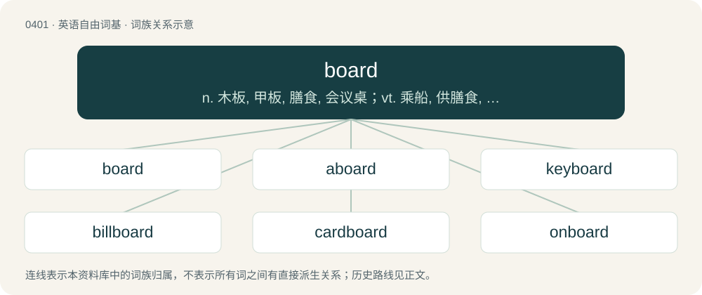

# 0461 · board — n. 木板, 甲板, 膳食, 会议桌；vt. 乘船, 供膳食, 用板覆盖；vi. 搭伙

[总目录](../00_总目录_按常用程度.md)

**类型**：英语自由词基　｜　**来源语言**：见词源记录

## 核心含义与来源

- 核心含义：n. 木板, 甲板, 膳食, 会议桌；vt. 乘船, 供膳食, 用板覆盖；vi. 搭伙
- 英文含义：A relatively long, wide and thin piece of any material, usually wood or similar, often for use in construction or furniture-making.
- 词形：board

**多个词源／构词路径**：同一拼写可能有不同来源；以下按词性和含义分别列出。

**来源记录 1**（名词；A relatively long, wide and thin piece of any material, usually wood or similar, often for use in construction or furniture-making.）

Board (duplicate bridge) From Middle English boord, boorde, bord, bourd, burd, from Old English bord, from Proto-West Germanic \*bord, from Proto-Germanic \*burdą (“board, plank; edge; table”), from Proto-Indo-European \*bʰers- (“tip, top”) + \*-dʰeti or \*bʰerH- (“to pierce; to strike”) + \*-dʰeti. The senses "food" and "council" are by metonymy from the sense "table". Cognates Cognate with Scots buird (“board; table”), Yola borde (“table”), West Frisian boerd (“board”), Dutch bord (“dish, plate; board, plank; sign”), boord (“border, boundary; bank, shore”), German Bord (“shelf”), Danish, Norwegian Bokmål, Norwegian Nynorsk, and Swedish bord (“plank; table”), Elfdalian buord (“table”), Faroese and Icelandic borð (“board, plank; table”), Gothic \*𐌱𐌰𐌿𐍂𐌳 (\*baurd, “board, plank”) (whence 𐍆𐍉𐍄𐌿𐌱𐌰𐌿𐍂𐌳 (fōtubaurd, “footstool”).

**来源记录 2**（名词；A rebound.）

From backboard.

## 词族图

## 单词速览（常用到不常用）

| 单词 | 音标 | 释义 |
|---|---|---|
| [board](#w-1) | 英 /bɔːd/；美 /bɔɹd/ | n. 木板, 甲板, 膳食, 会议桌；vt. 乘船, 供膳食, 用板覆盖；vi. 搭伙 |
| [aboard](#w-2) | 英 /əˈbɔːd/；美 /əˈbɔɹd/ | adv. 在船上, 在火车上, 在飞机上；prep. 在...之上 |
| [keyboard](#w-3) | 英 /ˈkiːbɔːd/；美 /ˈki.bɔɹd/ | n. 键盘；\[计\] 键盘 |
| [billboard](#w-4) | 美 /ˈbɪlˌboɹd/ | n. 广告牌, 布告板；vt. 宣传 |
| [cardboard](#w-5) | 英 /ˈkɑːdbɔːd/；美 /ˈkɑɹdˌbɔɹd/ | n. 薄纸板；\[化\] 咭纸; 特等纸板; 卡纸板; 卡片纸板 |
| [onboard](#w-6) | 英 /ɒnˈbɔːd/；/ɑnˈbɔɹd/ | adv. 在板上, 在船上, 在车上, 在飞机上 |
| [overboard](#w-7) | /ˈəʊvə(ɹ)ˌbɔː(ɹ)d/ | adv. 自船上落下, 在船外 |
| [dashboard](#w-8) | 英 /ˈdæʃˌbɔːd/；美 /ˈdæʃˌboɹd/ | n. 仪表板, 挡泥板 |
| [boardwalk](#w-9) | 英 /ˈbɔːd.wɔːk/；美 /ˈbɔɹdˌwɔk/ | n. 木板路, 木板铺成的散步道 |
| [scoreboard](#w-10) | /ˈskɒːbɒːd/ | n. 记分板 |
| [skateboard](#w-11) | 英 /ˈskeɪt.bɔːd/；美 /ˈskeɪt.bɔɹd/ | n. 溜冰板 |
| [starboard](#w-12) | 英 /ˈstɑː.bəd/；美 /ˈstɑɹ.bɚd/ | n. 右舷, 右侧；adv. 向右舷；vt. 转向右方, 向右转舵 |
| [leaderboard](#w-13) | /ˈliːdərbɔːd/ | n. （尤指高尔夫锦标赛的）选手积分榜 |
| [seaboard](#w-14) | /ˈsiːbɒːd/ | n. 海岸, 沿海地带；a. 海边的 |
| [blackboard](#w-15) | 英 /ˈblækbɔːd/；美 /ˈblækbɔɹd/ | n. 黑板 |
| [snowboard](#w-16) | 英 /ˈsnəʊˌbɔːd/；美 /ˈsnoʊˌbɔɹd/ | n. 滑雪板 |
| [springboard](#w-17) | /ˈspriŋbɒːd/ | n. 跳板, 出发点 |
| [boardroom](#w-18) | 英 /ˈbɔːdˌɹuːm/ | n. 会议室, 证券交换场所 |
| [clipboard](#w-19) | /ˈklipbɒːd/ | n. 有纸夹的写字板, 剪贴板；\[计\] 剪贴板 |
| [whiteboard](#w-20) | 英 /ˈwaɪtbɔːd/；美 /ˈwaɪtbɔɹd/ | n. 白色书写板 |
| [surfboard](#w-21) | 英 /ˈsɜːfˌbɔːd/；美 /ˈsɝfˌbɔɹd/ | n. 冲浪板, 用冲浪板滑水 |
| [switchboard](#w-22) | 美 /ˈswɪt͡ʃˌbɔɹd/ | n. 配电盘, 接线总机；\[电\] 交换台 |
| [sideboard](#w-23) | /ˈsaidbɒːd/ | n. 餐具柜 |
| [chalkboard](#w-24) | 英 /ˈt͡ʃɔːk.bɔː(ɹ)d/；/ˈt͡ʃɔk.bɔː(ɹ)d/ | n. 黑板 |
| [boarder](#w-25) | 英 /ˈbɔːdə/；美 /ˈbɔɹdɚ/ | n. 寄膳者, 寄膳宿者 |
| [storyboard](#w-26) | /ˈstɔːribɔːd/ | n. （电影、电视节目或商业广告等的）情节串连图板 |
| [backboard](#w-27) | /ˈbækbɒːd/ | n. 后挡板, 背板, 脊骨矫正板, 篮板 |
| [headboard](#w-28) | /ˈhedbɒːd/ | n. 床头板 |
| [chessboard](#w-29) | /ˈtʃesbɒːd/ | n. 西洋象棋盘 |
| [shipboard](#w-30) | /ˈʃipbɒːd/ | n. 舷侧, 船；a. 船用的 |
| [checkerboard](#w-31) | 英 /ˈt͡ʃɛkəˌbɔːd/；美 /ˈt͡ʃɛkɚˌbɔɹd/ | n. 棋盘, 方格图案；vt. 在...上面纵横交错地排列/分布；\[计\] 检测板, 西洋棋盘 |
| [hoverboard](#w-32) | 英 /ˈhɒvəbɔɹd/；美 /ˈhʌvɚbɔɹd/ | n. 悬滑板 |
| [longboard](#w-33) |  | 冲浪板 |
| [washboard](#w-34) | /ˈwɒːʃbɒːd/ | n. 洗衣板 |
| [soundboard](#w-35) | /ˈsaʊndbɔːd/ | n. 共鸣板, 响板; 音板 |
| [fretboard](#w-36) |  | 指板 |
| [fingerboard](#w-37) | /ˈfiŋ^əbɔːd/ | n. 指板, 键盘 |
| [paperboard](#w-38) | /ˈpeipbɒːd/ | n. 纸板 |
| [baseboard](#w-39) | 美 /ˈbeɪsˌbɔɹd/ | n. 护壁板, 脚底板 |
| [clapboard](#w-40) | /ˈklæpˌbɔː(ɹ)d/ | 【英文】A clapperboard; a device used in film production, having hinged boards that are brought together with a clap, used to synchronize picture and sound at the start of each take of a motion picture or other video product |
| [shuffleboard](#w-41) | /ˈʃʌflbɒːd/ | n. 推圆盘游戏 |
| [floorboard](#w-42) | /ˈflɔːbɔːd/ | n. 一块地板, 汽车底部板 |
| [flipboard](#w-43) |  | 【英文】A set of cards hinged together on an easel, used in making presentations. |
| [plasterboard](#w-44) | /ˈplæstəbɒːd/ | n. 石膏灰泥板 |
| [breadboard](#w-45) | /ˈbredbɔːd/ | \[计\] 实验电路板 |
| [signboard](#w-46) | 美 /ˈsaɪnˌbɔɹd/ | n. 招牌, 布告板 |
| [pegboard](#w-47) | /ˈpeɡbɔːd/ | n. （玩游戏用的）小钉板；木栓板 |
| [fiberboard](#w-48) | /bɒrd/ | n. 纤维板 |

## 逐词详解

### 1. board

**词性**：名词　｜　**音标**：英 /bɔːd/；美 /bɔɹd/

**中文释义**：n. 木板, 甲板, 膳食, 会议桌；vt. 乘船, 供膳食, 用板覆盖；vi. 搭伙

**英文义项**：A relatively long, wide and thin piece of any material, usually wood or similar, often for use in construction or furniture-making. / A device (e.g., switchboard) containing electrical switches and other controls and designed to control lights, sound, telephone connections, etc.

**词源与演化**：

Board (duplicate bridge) From Middle English boord, boorde, bord, bourd, burd, from Old English bord, from Proto-West Germanic \*bord, from Proto-Germanic \*burdą (“board, plank; edge; table”), from Proto-Indo-European \*bʰers- (“tip, top”) + \*-dʰeti or \*bʰerH- (“to pierce; to strike”) + \*-dʰeti. The senses "food" and "council" are by metonymy from the sense "table". Cognates Cognate with Scots buird (“board; table”), Yola borde (“table”), West Frisian boerd (“board”), Dutch bord (“dish, plate; board, plank; sign”), boord (“border, boundary; bank, shore”), German Bord (“shelf”), Danish, Norwegian Bokmål, Norwegian Nynorsk, and Swedish bord (“plank; table”), Elfdalian buord (“table”), Faroese and Icelandic borð (“board, plank; table”), Gothic \*𐌱𐌰𐌿𐍂𐌳 (\*baurd, “board, plank”) (whence 𐍆𐍉𐍄𐌿𐌱𐌰𐌿𐍂𐌳 (fōtubaurd, “footstool”).

**例句**：

> Each player starts the game with four counters on the board.

该用例对应义项：A flat surface with markings for playing a board game.

### 2. aboard

**词性**：副词　｜　**音标**：英 /əˈbɔːd/；美 /əˈbɔɹd/

**中文释义**：adv. 在船上, 在火车上, 在飞机上；prep. 在...之上

**英文义项**：On board; into or within a ship or boat; hence, into or within a railway car. / On or onto a horse, a camel, etc.

**构词拆分**：a- + board

**词源与演化**：

From Middle English abord, from a- (“on”) + bord (“board, side of a ship”); equivalent to a- + board.

**例句**：

> He doubled with two men aboard, scoring them both.

该用例对应义项：On base.

### 3. keyboard

**词性**：动词　｜　**音标**：英 /ˈkiːbɔːd/；美 /ˈki.bɔɹd/

**中文释义**：n. 键盘；\[计\] 键盘

**英文义项**：To type on a computer keyboard.

**构词拆分**：key + board

**词源与演化**：

From key + board.

**例句**：

> Keyboarding is the part of this job I hate the most.

该用例对应义项：To type on a computer keyboard.

### 4. billboard

**词性**：动词　｜　**音标**：美 /ˈbɪlˌboɹd/

**中文释义**：n. 广告牌, 布告板；vt. 宣传

**英文义项**：To advertise on a billboard.

**构词拆分**：bill + board

**词源与演化**：

From bill + board.

**例句**：

> The upcoming concert was billboarded all over the city.

该用例对应义项：To advertise on a billboard.

### 5. cardboard

**词性**：名词　｜　**音标**：英 /ˈkɑːdbɔːd/；美 /ˈkɑɹdˌbɔɹd/

**中文释义**：n. 薄纸板；\[化\] 咭纸; 特等纸板; 卡纸板; 卡片纸板

**英文义项**：A wood-based material resembling heavy paper, used in the manufacture of boxes, cartons and signs. / Something flat or insubstantial.

**构词拆分**：From card + board.

**词源与演化**：

From card + board.

**例句**：

> Tom reached into the cardboard box and pulled out a photo album.

### 6. onboard

**词性**：形容词　｜　**音标**：英 /ɒnˈbɔːd/；/ɑnˈbɔɹd/

**中文释义**：adv. 在板上, 在船上, 在车上, 在飞机上

**英文义项**：Carried or used on or in a vehicle or vessel. / Being a part of, being included in, participating in.

**构词拆分**：on + board；on- + board

**词源与演化**：

on + board, from on board (“phrase”), equivalent to on- + board.

**例句**：

> When it comes to security, everybody seems to be as onboard as I am.

该用例对应义项：Being a part of, being included in, participating in.

### 7. overboard

**词性**：形容词　｜　**音标**：/ˈəʊvə(ɹ)ˌbɔː(ɹ)d/

**中文释义**：adv. 自船上落下, 在船外

**英文义项**：Outside of a boat; in the water.

**构词拆分**：over- + board

**词源与演化**：

From Middle English overbord, overborde, equivalent to over- + board.

**例句**：

> He's given to going overboard every time he gets a new idea.

### 8. dashboard

**词性**：名词　｜　**音标**：英 /ˈdæʃˌbɔːd/；美 /ˈdæʃˌboɹd/

**中文释义**：n. 仪表板, 挡泥板

**英文义项**：A panel beneath the windshield of a vehicle or aircraft containing indicator gauges, compartments, and sometimes controls and indicator lights. / The float of a paddle wheel.

**构词拆分**：dash (“to sprinkle; to splatter”) + board

**词源与演化**：

From dash (“to sprinkle; to splatter”) + board for meaning 1. Possibly expanded meaning later.

**例句**：

> Log in to the dashboard to change your account settings.

该用例对应义项：A graphical user interface for changing settings.

### 9. boardwalk

**词性**：名词　｜　**音标**：英 /ˈbɔːd.wɔːk/；美 /ˈbɔɹdˌwɔk/

**中文释义**：n. 木板路, 木板铺成的散步道

**英文义项**：A slightly elevated path (walkway) for pedestrians over sandy or swampy ground, typically made out of wood; specifically (Canada, US) one running alongside a body of water or beach.

**构词拆分**：board + walk

**词源与演化**：

From board + walk.

**例句**：

> Get your skates on so we can roller skate on the boardwalk!

### 10. scoreboard

**词性**：名词　｜　**音标**：/ˈskɒːbɒːd/

**中文释义**：n. 记分板

**英文义项**：A large board that displays the score in a game or contest. / A similar board that also displays each batsman's score, and many statistics and pieces of information.

**构词拆分**：score + board

**词源与演化**：

From score + board.

**例句**：

> The player made a bad move, and now the scoreboard is once more against him.

### 11. skateboard

**词性**：名词　｜　**音标**：英 /ˈskeɪt.bɔːd/；美 /ˈskeɪt.bɔɹd/

**中文释义**：n. 溜冰板

**英文义项**：A narrow, wooden or plastic platform mounted on pairs of wheels, on which one stands and propels oneself by pushing along the ground with one foot. / A skateboard vehicle chassis: a chassis format, used for electric vehicles, which holds the drive motors and power energy store (i.e. batteries), forming the vehicular base; an instance of this format.

**构词拆分**：skate + board

**词源与演化**：

From skate + board. The foot-treadable skateboard sense (noun sense 1) came first (mid-20th century). The vehicle chassis sense (noun sense 2) was named for its resemblance thereto (late 20th or early 21st century).

**例句**：

> A new crossover model will arrive next year and will be based on an existing skateboard.

该用例对应义项：A skateboard vehicle chassis: a chassis format, used for electric vehicles, which holds the drive motors and power energy store (i.e. batteries), forming the vehicular base; an instance of this format.

### 12. starboard

**词性**：名词　｜　**音标**：英 /ˈstɑː.bəd/；美 /ˈstɑɹ.bɚd/

**中文释义**：n. 右舷, 右侧；adv. 向右舷；vt. 转向右方, 向右转舵

**英文义项**：The righthand side of a ship, boat or aircraft when facing the front, or fore or bow. Used to unambiguously refer to directions according to the sides of the vessel, rather than those of a crew member or object. / One of the two traditional watches aboard a ship standing a watch in two.

**构词拆分**：steer + board (“side (of a ship)”)

**词源与演化**：

From Middle English sterbord, stere-bourd, stere-burd, from Old English stēorbord, from Proto-West Germanic \*steurubord, equivalent to steer + board (“side (of a ship)”), referring to ancient ships with the steering oar set to the right (to accommodate right-handed crew). Ships had to dock on their left (port) side because the steering oar on the right would get in the way, which is how the left became known as the port side.

**例句**：

> We're on starboard tack, so the other boat has to give way.

该用例对应义项：The righthand side of a ship, boat or aircraft when facing the front, or fore or bow. Used to unambiguously refer to directions according to the sides of the vessel, rather than those of a crew member or object.

### 13. leaderboard

**词性**：名词　｜　**音标**：/ˈliːdərbɔːd/

**中文释义**：n. （尤指高尔夫锦标赛的）选手积分榜

**英文义项**：A board showing the ranking of leaders in a competition. / An advertisement on a web page spanning the width of the page and shallow in height.

**构词拆分**：leader + board

**词源与演化**：

From leader + board.

### 14. seaboard

**词性**：名词　｜　**音标**：/ˈsiːbɒːd/

**中文释义**：n. 海岸, 沿海地带；a. 海边的

**英文义项**：The area bordering the sea; a coastline; a sealine.

**构词拆分**：sea + board

**词源与演化**：

From earlier sea-bord, perhaps continuing (with change in meaning) Middle English see bord (“porthole cover, seaward side”), equivalent to sea + board.

**例句**：

> This place has the best vegan food on the eastern seaboard.

### 15. blackboard

**词性**：名词　｜　**音标**：英 /ˈblækbɔːd/；美 /ˈblækbɔɹd/

**中文释义**：n. 黑板

**英文义项**：A large flat surface, finished with black slate or a similar material, that can be written upon with chalk and subsequently erased; a chalkboard.

**构词拆分**：black + board

**词源与演化**：

From black + board, because such surfaces were once typically made of black slate.

**例句**：

> Hey, sir, the function on the blackboard is not exponential, but trigonometric.

### 16. snowboard

**词性**：动词　｜　**音标**：英 /ˈsnəʊˌbɔːd/；美 /ˈsnoʊˌbɔɹd/

**中文释义**：n. 滑雪板

**英文义项**：To ride a snowboard. / To travel over (a slope etc.) on a snowboard.

**构词拆分**：snow + board

**词源与演化**：

From snow + board.

**例句**：

> I have snowboarded this slope a dozen times.

该用例对应义项：To travel over (a slope etc.) on a snowboard.

### 17. springboard

**词性**：名词　｜　**音标**：/ˈspriŋbɒːd/

**中文释义**：n. 跳板, 出发点

**英文义项**：A board consisting of a flexible, springy, cantilevered platform that propels one into the air, used for diving or gymnastics. / Something that acts as a catalyst to begin or accelerate an action or growth.

**构词拆分**：spring + board

**词源与演化**：

From spring + board.

**例句**：

> The opportunity acted as a springboard for their success.

该用例对应义项：Something that acts as a catalyst to begin or accelerate an action or growth.

### 18. boardroom

**词性**：名词　｜　**音标**：英 /ˈbɔːdˌɹuːm/

**中文释义**：n. 会议室, 证券交换场所

**英文义项**：The room where a group of people (especially the board of a company or organization) conducts its meetings / Corporations or corporate management considered as a section of society

**构词拆分**：board + room

**词源与演化**：

From board + room.

**例句**：

> Though the new law is popular among the general public, it is hated in the boardroom.

该用例对应义项：Corporations or corporate management considered as a section of society

### 19. clipboard

**词性**：名词　｜　**音标**：/ˈklipbɒːd/

**中文释义**：n. 有纸夹的写字板, 剪贴板；\[计\] 剪贴板

**英文义项**：A flat piece of rigid material, such as card or plastic, with a clip at one end under which papers can be held. / A buffer in memory where the user can store data temporarily while transferring it from one place within an application to another or between applications.

**构词拆分**：clip + board

**词源与演化**：

From clip + board.

**例句**：

> Tom entered the conference room, carrying a clipboard.

### 20. whiteboard

**词性**：名词　｜　**音标**：英 /ˈwaɪtbɔːd/；美 /ˈwaɪtbɔɹd/

**中文释义**：n. 白色书写板

**英文义项**：A writing board finished with a hard white material, which can be written upon using special non-permanent markers and subsequently wiped clean. / A collaborative tool allowing several users to write and draw on the same shared display.

**构词拆分**：white + board

**词源与演化**：

From white + board, modelled on blackboard.

**例句**：

> The teacher wrote a good number of sentences on the whiteboard.

### 21. surfboard

**词性**：名词　｜　**音标**：英 /ˈsɜːfˌbɔːd/；美 /ˈsɝfˌbɔɹd/

**中文释义**：n. 冲浪板, 用冲浪板滑水

**英文义项**：A shaped waterproof plank, usually made of wood or foam and reinforced plastic, used to surf on waves.

**构词拆分**：surf + board

**词源与演化**：

From surf + board.

**例句**：

> One shark attacked the surfboard.

该用例对应义项：A shaped waterproof plank, usually made of wood or foam and reinforced plastic, used to surf on waves.

### 22. switchboard

**词性**：名词　｜　**音标**：美 /ˈswɪt͡ʃˌbɔɹd/

**中文释义**：n. 配电盘, 接线总机；\[电\] 交换台

**英文义项**：The electronic panel that is used to direct telephone calls to the desired recipient. / A large piece of power-distribution equipment that directs electricity to multiple loads.

**构词拆分**：switch + board

**词源与演化**：

From switch + board.

**例句**：

> Mary was a switchboard operator when she was younger.

### 23. sideboard

**词性**：名词　｜　**音标**：/ˈsaidbɒːd/

**中文释义**：n. 餐具柜

**英文义项**：A piece of dining room furniture having drawers and shelves for linen and tableware; originally for serving food. / A board or similar barrier that forms part of the side of something.

**构词拆分**：side + board

**词源与演化**：

From side + board.

**例句**：

> At Thanksgiving, the turkey took pride of place while the other dishes were relegated to the sideboard.

### 24. chalkboard

**词性**：名词　｜　**音标**：英 /ˈt͡ʃɔːk.bɔː(ɹ)d/；/ˈt͡ʃɔk.bɔː(ɹ)d/

**中文释义**：n. 黑板

**英文义项**：A slate or enamel board for writing on with chalk; a predecessor to a whiteboard.

**构词拆分**：chalk + board

**词源与演化**：

From chalk + board.

**例句**：

> What I can't bear is the sound of chalk squeaking on a chalkboard.

### 25. boarder

**词性**：名词　｜　**音标**：英 /ˈbɔːdə/；美 /ˈbɔɹdɚ/

**中文释义**：n. 寄膳者, 寄膳宿者

**英文义项**：A pupil who lives at school during term time. / Someone who pays for meals and lodging in a house rather than a hotel.

**构词拆分**：board + -er

**词源与演化**：

From board + -er.

**例句**：

> When I left for college, my parents took on a boarder in my old room to help defray expenses.

该用例对应义项：Someone who pays for meals and lodging in a house rather than a hotel.

### 26. storyboard

**词性**：名词　｜　**音标**：/ˈstɔːribɔːd/

**中文释义**：n. （电影、电视节目或商业广告等的）情节串连图板

**英文义项**：A series of drawings that lay out the sequence of scenes in a film or series, especially an animated one. / Any sequence of drawings or diagrams which illustrate a sequence of events, e.g. in an accident or as a flowsheet for computer programming.

**构词拆分**：story + board

**词源与演化**：

From story + board.

### 27. backboard

**词性**：名词　｜　**音标**：/ˈbækbɒːd/

**中文释义**：n. 后挡板, 背板, 脊骨矫正板, 篮板

**英文义项**：The flat vertical surface to which the basket is attached. / A flat vertical wall with the image of a tennis net drawn or painted on it, designed to practice hitting against such that the ball rebounds.

**构词拆分**：back + board

**词源与演化**：

From back + board.

**例句**：

> He banked the shot off the backboard.

该用例对应义项：a raised vertical board with basket attached; used to play basketball

### 28. headboard

**词性**：名词　｜　**音标**：/ˈhedbɒːd/

**中文释义**：n. 床头板

**英文义项**：A vertical panel, either plain or upholstered, attached to the head of a bed. / A panel, usually of metal, attached to the head of a fore-and-aft sail for additional strength.

**构词拆分**：head + board

**词源与演化**：

From head + board.

**例句**：

> One bug was found in the bathroom, another in the headboard of a bed.

### 29. chessboard

**词性**：名词　｜　**音标**：/ˈtʃesbɒːd/

**中文释义**：n. 西洋象棋盘

**英文义项**：A square playing surface divided into eight rows and eight columns, forming sixty-four equal squares arranged in an alternating pattern of colors across both rows and columns. / A mathematical construction based on this pattern of squares.

**构词拆分**：chess + board

**词源与演化**：

From chess + board.

**例句**：

> The chessboard was in the wrong position, as squares h1 and a8 were black.

### 30. shipboard

**词性**：形容词　｜　**音标**：/ˈʃipbɒːd/

**中文释义**：n. 舷侧, 船；a. 船用的

**英文义项**：Occurring or existing on board a ship. / casual or ephemeral (e.g. a shipboard romance)

**构词拆分**：ship + board

**词源与演化**：

Inherited from Middle English schip bord; equivalent to ship + board.

### 31. checkerboard

**词性**：名词　｜　**音标**：英 /ˈt͡ʃɛkəˌbɔːd/；美 /ˈt͡ʃɛkɚˌbɔɹd/

**中文释义**：n. 棋盘, 方格图案；vt. 在...上面纵横交错地排列/分布；\[计\] 检测板, 西洋棋盘

**英文义项**：A square board divided into sixty-four equal squares arranged in eight rows and eight columns, with adjacent squares alternating in color, typically black and white, used to play chess, checkers or draughts. / A pattern of squares of alternating colors.

**构词拆分**：checker + board

**词源与演化**：

From checker + board.

**例句**：

> We play chess on a checkerboard.

### 32. hoverboard

**词性**：名词　｜　**音标**：英 /ˈhɒvəbɔɹd/；美 /ˈhʌvɚbɔɹd/

**中文释义**：n. 悬滑板

**英文义项**：A levitating board that can be ridden in the manner of a surfboard or skateboard. / A small self-balancing two-wheeled motorised vehicle, related to a scooter.

**构词拆分**：hover + board

**词源与演化**：

From hover + board, patterned off of skateboard. First mentioned in the 1989 film Back to the Future Part II.

**例句**：

> Tom had an accident when he tried to ride a hoverboard for the first time.

### 33. longboard

**词性**：名词

**中文释义**：冲浪板

**英文义项**：A large surfboard, around 9 or 10 feet long with a wide nose. / A large skateboard, measuring about 90 to 150 centimeters (3' to 5').

**构词拆分**：long + board

**词源与演化**：

From long + board.

**例句**：

> Benedito likes to ride his longboard downhill.

### 34. washboard

**词性**：名词　｜　**音标**：/ˈwɒːʃbɒːd/

**中文释义**：n. 洗衣板

**英文义项**：A board with a corrugated surface against which laundry may be rubbed. / Such a board used as a simple percussion instrument.

**构词拆分**：wash + board

**词源与演化**：

From wash + board.

**用法示例／搭配（非完整句）**：

> washboard road

该用例对应义项：A stretch of ripples or bumps on a dirt or gravel road caused by interaction between traffic and road surface.

### 35. soundboard

**词性**：名词　｜　**音标**：/ˈsaʊndbɔːd/

**中文释义**：n. 共鸣板, 响板; 音板

**英文义项**：A wide, flat board placed within, or forming part of the body of, a musical instrument in order to improve vibrations and increase volume. / A mixing console used to combine and blend different audio sources to a single output.

**构词拆分**：sound + board

**词源与演化**：

From sound + board.

### 36. fretboard

**词性**：名词

**中文释义**：指板

**英文义项**：A fret or plate put over the neck of musical instruments or its fingerboard, to create a different sound of notes.

**构词拆分**：fret + board

**词源与演化**：

From fret + board.

### 37. fingerboard

**词性**：名词　｜　**音标**：/ˈfiŋ^əbɔːd/

**中文释义**：n. 指板, 键盘

**英文义项**：A flat or roughly flat strip on the neck of a stringed instrument, against which the strings are pressed to shorten the vibrating length and produce notes of higher pitches. / A miniature skateboard or snowboard that is propelled by the fingers.

**构词拆分**：finger + board

**词源与演化**：

From finger + board.

### 38. paperboard

**词性**：名词　｜　**音标**：/ˈpeipbɒːd/

**中文释义**：n. 纸板

**英文义项**：A thick paper, or thin cardboard.

**构词拆分**：paper + board

**词源与演化**：

From paper + board.

**例句**：

> The cereal box is made of recycled paperboard.

### 39. baseboard

**词性**：名词　｜　**音标**：美 /ˈbeɪsˌbɔɹd/

**中文释义**：n. 护壁板, 脚底板

**英文义项**：A panel or molding between the floor and the interior wall of a structure. / A similar panel at the base of a piece of furniture or equipment.

**构词拆分**：base + board

**词源与演化**：

From base + board.

### 40. clapboard

**词性**：名词　｜　**音标**：/ˈklæpˌbɔː(ɹ)d/

**英文义项**：A clapperboard; a device used in film production, having hinged boards that are brought together with a clap, used to synchronize picture and sound at the start of each take of a motion picture or other video production.

**构词拆分**：clap + board

**词源与演化**：

From clap + board.

### 41. shuffleboard

**词性**：名词　｜　**音标**：/ˈʃʌflbɒːd/

**中文释义**：n. 推圆盘游戏

**英文义项**：A game that involves sliding a puck or coin towards a target. / The long, narrow board on which this game is played.

**构词拆分**：shove + board

**词源与演化**：

From earlier shovillaborde (“shovel board”), an alteration of shove-board, from shove + board.

### 42. floorboard

**词性**：名词　｜　**音标**：/ˈflɔːbɔːd/

**中文释义**：n. 一块地板, 汽车底部板

**英文义项**：Any of the long boards laid over joists to make a floor. / The floor of a vehicle.

**构词拆分**：floor + board

**词源与演化**：

From floor + board.

**例句**：

> Tom turned around when he heard the floorboard creak.

### 43. flipboard

**词性**：名词

**英文义项**：A set of cards hinged together on an easel, used in making presentations.

**构词拆分**：flip + board

**词源与演化**：

From flip + board.

### 44. plasterboard

**词性**：名词　｜　**音标**：/ˈplæstəbɒːd/

**中文释义**：n. 石膏灰泥板

**英文义项**：A construction material consisting of a rigid panel of several layers of fibreboard or paper bonded to a gypsum core.

**构词拆分**：plaster + board

**词源与演化**：

From plaster + board.

### 45. breadboard

**词性**：名词　｜　**音标**：/ˈbredbɔːd/

**中文释义**：\[计\] 实验电路板

**英文义项**：A cutting board, especially for cutting bread. / A pull-out cutting board underneath a counter, found in many kitchens.

**构词拆分**：bread + board

**词源与演化**：

From bread + board. Regarding definition 3: the etymology is either that electric circuits used to be prototyped on actual bread boards (definition 1) populated with nails, or that solder breadboards have lots of holes and are usually brown (they visually resemble a slice of bread), or a merging of the two. The etymology is less obvious today given the popularity of solderless breadboards.

### 46. signboard

**词性**：名词　｜　**音标**：美 /ˈsaɪnˌbɔɹd/

**中文释义**：n. 招牌, 布告板

**英文义项**：A board carrying a sign, or on which signs may be posted.

**构词拆分**：sign + board

**词源与演化**：

From sign + board.

**例句**：

> I'm near-sighted, so I can't make out what is written on that signboard.

### 47. pegboard

**词性**：名词　｜　**音标**：/ˈpeɡbɔːd/

**中文释义**：n. （玩游戏用的）小钉板；木栓板

**英文义项**：A board that has a pattern of holes into which pegs are fitted; used especially to record the score in some card games. / A metal board attached to the base of a metal display unit (FSDU) from which shelves, hooks or bars are attached (when bars are attached, they subsequently have pegs clipped onto them)

**构词拆分**：peg + board

**词源与演化**：

From peg + board.

### 48. fiberboard

**词性**：名词　｜　**音标**：/bɒrd/

**中文释义**：n. 纤维板

**英文义项**：A material made from wood chips or shavings, which are compressed and bonded with resin and formed into stiff sheets, and used in building or making furniture.

**构词拆分**：From fiber + board.

**词源与演化**：

From fiber + board.
