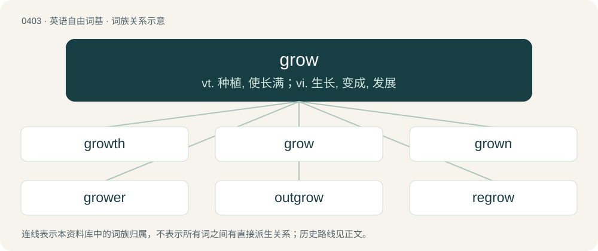

# 0464 · grow — vt. 种植, 使长满；vi. 生长, 变成, 发展

[总目录](../00_总目录_按常用程度.md)

**类型**：英语自由词基　｜　**来源语言**：见词源记录

## 核心含义与来源

- 核心含义：vt. 种植, 使长满；vi. 生长, 变成, 发展
- 英文含义：To become larger, to increase in magnitude.
- 词形：grow

**来源记录 1**（动词；To become larger, to increase in magnitude.）

From Middle English growen, from Old English grōwan (“to grow, increase, flourish, germinate”), from Proto-West Germanic \*grōan, from Proto-Germanic \*grōaną (“to grow, grow green”), from Proto-Indo-European \*gʰreh₁- (“to grow, become green”). Cognates Cognate with Dutch groeien (“to grow”), German Low German grojen (“to green; thrive; take hold; flourish”), Danish, Norwegian Bokmål, Norwegian Nynorsk, and Swedish gro (“to grow”), Faroese grógva (“to grow”), Icelandic gróa (“to grow”); also Latin grāmen (“grass, turf; herb, plant”), herba (“grass, herbage; weeds; plant”), Ukrainian гря́ний (hrjányj, “green”). Related to growth, grass, green.

## 词族图

## 单词速览（常用到不常用）

| 单词 | 音标 | 释义 |
|---|---|---|
| [growth](#w-1) | 英 /ɡɹəʊθ/；美 /ɡɹoʊθ/ | n. 生长, 栽培, 增长；\[计\] 等比级数 |
| [grow](#w-2) | 英 /ˈɡɹəʊ/；美 /ˈɡɹoʊ/ | vt. 种植, 使长满；vi. 生长, 变成, 发展 |
| [grown](#w-3) | 英 /ɡɹəʊn/；美 /ɡɹoʊn/ | a. 长大的, 成年的, 长满某物的；grow的过去分词 |
| [grower](#w-4) | 美 /ˈɡɹoʊɚ/ | n. 栽培者, 生长物 |
| [outgrow](#w-5) | 英 /ˌaʊtˈɡɹəʊ/；美 /ˌɑʊtˈɡɹoʊ/ | vt. 过大而不适于, 长得比...高(或大、快), 成长得不再具有... |
| [regrow](#w-6) | /riːˈɡrəu/ | vt. 再生；重新长出 |

## 逐词详解

### 1. growth

**词性**：名词　｜　**音标**：英 /ɡɹəʊθ/；美 /ɡɹoʊθ/

**中文释义**：n. 生长, 栽培, 增长；\[计\] 等比级数

**英文义项**：An increase in size, number, value, or strength. / An increase in psychological strength or resilience; an increased ability to overcome adversity.

**构词拆分**：grow + -th (abstract nominal suffix)

**词源与演化**：

From grow + -th (abstract nominal suffix). Compare Old Frisian grēd ("meadow, pasture"; &gt; North Frisian greyde (“growth, pasture”)), Middle High German gruote, gruot (“greens, fresh growth, shoot”), Old Norse gróðr ("growth, crop"; &gt; Faroese grøði, Danish grøde (“fruits”), Swedish gröda (“crop, harvest”)). More at grow.

**例句**：

> Struggle, disappointment, and criticism all contribute to a person's growth.

该用例对应义项：An increase in psychological strength or resilience; an increased ability to overcome adversity.

### 2. grow

**词性**：动词　｜　**音标**：英 /ˈɡɹəʊ/；美 /ˈɡɹoʊ/

**中文释义**：vt. 种植, 使长满；vi. 生长, 变成, 发展

**英文义项**：To become larger, to increase in magnitude. / To undergo growth; to be present (somewhere).

**词源与演化**：

From Middle English growen, from Old English grōwan (“to grow, increase, flourish, germinate”), from Proto-West Germanic \*grōan, from Proto-Germanic \*grōaną (“to grow, grow green”), from Proto-Indo-European \*gʰreh₁- (“to grow, become green”). Cognates Cognate with Dutch groeien (“to grow”), German Low German grojen (“to green; thrive; take hold; flourish”), Danish, Norwegian Bokmål, Norwegian Nynorsk, and Swedish gro (“to grow”), Faroese grógva (“to grow”), Icelandic gróa (“to grow”); also Latin grāmen (“grass, turf; herb, plant”), herba (“grass, herbage; weeds; plant”), Ukrainian гря́ний (hrjányj, “green”). Related to growth, grass, green.

**例句**：

> He grows peppers and squash each summer in his garden.

该用例对应义项：To cause or allow something to become bigger, especially to cultivate plants.

### 3. grown

**词性**：形容词　｜　**音标**：英 /ɡɹəʊn/；美 /ɡɹoʊn/

**中文释义**：a. 长大的, 成年的, 长满某物的；grow的过去分词

**英文义项**：Covered by growth; overgrown. / Of a person: adult.

**构词拆分**：grow + -n

**词源与演化**：

From Middle English growen. Morphologically grow + -n.

**例句**：

> Listen, I'm a grown woman, and I don't have time to deal with your petty teenage drama.

该用例对应义项：Of a person: adult.

### 4. grower

**词性**：名词　｜　**音标**：美 /ˈɡɹoʊɚ/

**中文释义**：n. 栽培者, 生长物

**英文义项**：A farmer; one who grows things. / Something that grows.

**构词拆分**：grow + -er

**词源与演化**：

From grow + -er.

**例句**：

> I didn't like the song at first, but it is a real grower.

该用例对应义项：Someone or something, especially music, that becomes more likeable over time.

### 5. outgrow

**词性**：动词　｜　**音标**：英 /ˌaʊtˈɡɹəʊ/；美 /ˌɑʊtˈɡɹoʊ/

**中文释义**：vt. 过大而不适于, 长得比...高(或大、快), 成长得不再具有...

**英文义项**：To become too big in size or too mature in age or outlook to continue to want, need, use, experience, or accept some object, practice, condition, belief, etc. / To grow faster or larger than.

**构词拆分**：out- + grow

**词源与演化**：

From out- + grow.

**例句**：

> Some people blame God for their troubles, but one must outgrow such notions.

该用例对应义项：To become too big in size or too mature in age or outlook to continue to want, need, use, experience, or accept some object, practice, condition, belief, etc.

### 6. regrow

**词性**：动词　｜　**音标**：/riːˈɡrəu/

**中文释义**：vt. 再生；重新长出

**英文义项**：To grow again a part that has been lost, shed or destroyed.

**构词拆分**：re- + grow

**词源与演化**：

From re- + grow.

**例句**：

> Humans cannot regrow lost limbs but some amphibians can.

该用例对应义项：To grow again a part that has been lost, shed or destroyed.
